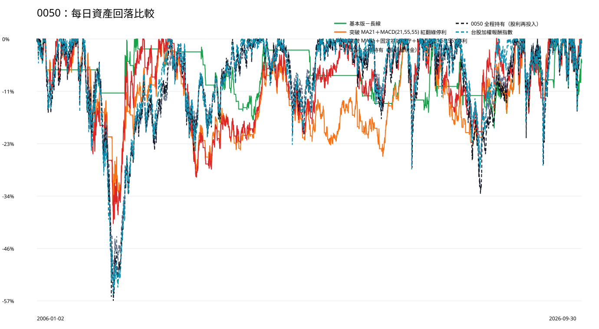

# 0050｜大盤與風險比較

台股加權報酬指數由等值 500,000 元成長為 7,814,382.23 元；總報酬 1462.88%，年化報酬 14.17%，最大資產回落 -56.02%。

## 2022 空頭與 2025～2026 多頭

|方法|年度|年初資產|年底／截止資產|年度報酬|年度最大回落|大盤報酬|大盤最大回落|進場|賣出|年底仍持有|
|---|---|---|---|---|---|---|---|---|---|---|
|基本版－長線|2022|735,842.08|677,766.31|-7.89%|-11.83%|-18.68%|-28.47%|2|3|0|
|基本版－長線|2025|947,904.16|1,086,919.89|14.67%|-10.74%|29.47%|-26.54%|4|4|1|
|基本版－長線|2026（至9/30）|1,086,919.89|1,771,480.74|62.98%|-14.85%|68.20%|-15.72%|1|1|1|
|突破 MA21＋MACD(21,55,55) 紅翻綠停利|2022|988,982.34|1,018,705.81|3.01%|-13.53%|-18.68%|-28.47%|5|6|0|
|突破 MA21＋MACD(21,55,55) 紅翻綠停利|2025|1,361,857.37|1,910,140.46|40.26%|-11.81%|29.47%|-26.54%|6|6|1|
|突破 MA21＋MACD(21,55,55) 紅翻綠停利|2026（至9/30）|1,910,140.46|3,237,709.82|69.50%|-9.19%|68.20%|-15.72%|2|2|1|
|突破 MA21＋固定初始防守＋MACD(21,55,55) 停利|2022|1,328,689.56|1,284,606.24|-3.32%|-15.82%|-18.68%|-28.47%|4|4|1|
|突破 MA21＋固定初始防守＋MACD(21,55,55) 停利|2025|1,848,656.37|2,675,487.80|44.73%|-11.81%|29.47%|-26.54%|4|4|1|
|突破 MA21＋固定初始防守＋MACD(21,55,55) 停利|2026（至9/30）|2,675,487.80|4,534,978.52|69.50%|-9.19%|68.20%|-15.72%|2|2|1|

判斷策略不能只看期末資產；需同時查看 2022 是否降低回落、2025～2026 獲利依賴、報酬相對風險與平均資金閒置。2026 為截至 9 月 30 日的非完整年度。

## 2005～2009 資料來源限制

2005～2009 每日未還原 OHLCV 來自 FinMind 公開端點；TWSE STOCK_DAY 不提供該期間日線，因此第一方驗證限於 FMSRFK 的 60 個月最高、最低、成交量與成交額。這不等於逐日第一方交叉驗證。本研究未使用付費 token，未用還原價成交，也未用未驗證資料補值。
