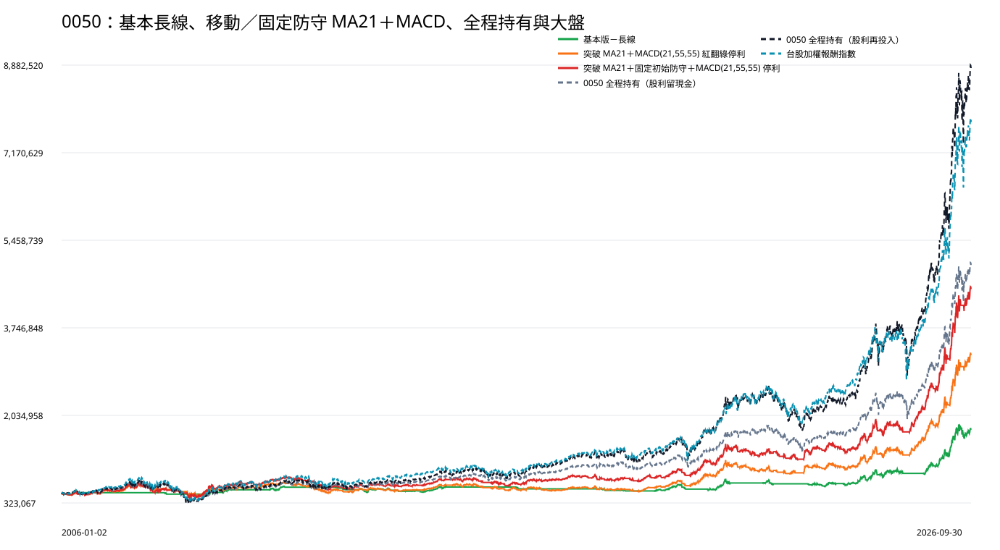

# 0050｜MA21 突破與 MACD 停利｜2006～2026 比較

## 先講結論

本研究使用同一筆 500,000 元本金，從 2006-01-02 連續重播到 2026-09-30，不中途追加、不逐年重設。三個會進出的策略中，期末資產較高的是「突破 MA21＋固定初始防守＋MACD(21,55,55) 停利」：4,534,978.52 元。這是固定規則回測結果，不據此修改參數。

## 五組方法總覽

|方法|獲利年度|期末資產|總報酬|年化報酬|最大資產回落|報酬相對風險|平均資金閒置|最大投入|進出次數|尚未賣出部位|
|---|---|---|---|---|---|---|---|---|---|---|
|基本版－長線|11／21（2006、2009、2010、2014、2019、2020、2021、2023、2024、2025、2026）|1,771,480.74|254.30%|6.28%|-19.48%|0.32|67.49%|1,626,249.61|50 買賣完成／51 次進場|1|
|突破 MA21＋MACD(21,55,55) 紅翻綠停利|14／21（2006、2007、2009、2010、2012、2014、2017、2019、2020、2022、2023、2024、2025、2026）|3,237,709.82|547.54%|9.42%|-36.31%|0.26|30.05%|2,989,085.91|132 買賣完成／133 次進場|1|
|突破 MA21＋固定初始防守＋MACD(21,55,55) 停利|15／21（2006、2007、2009、2010、2012、2014、2016、2017、2019、2020、2021、2023、2024、2025、2026）|4,534,978.52|807.00%|11.21%|-40.47%|0.28|23.86%|4,186,761.98|98 買賣完成／99 次進場|1|
|0050 全程持有（股利留現金）|16／21（2006、2007、2009、2010、2012、2013、2014、2016、2017、2019、2020、2021、2023、2024、2025、2026）|5,005,237.75|901.05%|11.74%|-52.55%|0.22|19.30%|499,973.40|0 買賣完成／1 次進場|1|
|0050 全程持有（股利再投入）|16／21（2006、2007、2009、2010、2012、2013、2014、2016、2017、2019、2020、2021、2023、2024、2025、2026）|8,850,923.98|1670.18%|14.85%|-57.32%|0.26|0.00%|1,442,213.92|0 買賣完成／1 次進場|1|

0050 全程持有是同一組基準的兩種股利處理列，不參與擇時策略排名。

## 逐年結果

|方法|年度|年初資產|年底／截止資產|年度報酬|年度最大回落|大盤報酬|大盤最大回落|進場|賣出|年底仍持有|
|---|---|---|---|---|---|---|---|---|---|---|
|基本版－長線|2006|500,000.00|524,172.33|4.83%|-6.76%|26.10%|-15.27%|1|1|0|
|基本版－長線|2007|524,172.33|524,172.33|0.00%|0.00%|12.50%|-20.41%|0|0|0|
|基本版－長線|2008|524,172.33|495,625.15|-5.45%|-5.45%|-43.07%|-53.59%|2|2|0|
|基本版－長線|2009|495,625.15|580,522.13|17.13%|-8.01%|83.34%|-11.59%|3|3|0|
|基本版－長線|2010|580,522.13|649,781.13|11.93%|-6.01%|13.57%|-15.36%|2|1|1|
|基本版－長線|2011|649,781.13|631,905.51|-2.75%|-2.83%|-17.98%|-24.52%|0|1|0|
|基本版－長線|2012|631,905.51|582,969.96|-7.74%|-16.92%|12.94%|-15.32%|6|5|1|
|基本版－長線|2013|582,969.96|568,763.33|-2.44%|-10.36%|15.14%|-8.73%|7|7|1|
|基本版－長線|2014|568,763.33|634,468.19|11.55%|-6.14%|11.39%|-10.44%|1|2|0|
|基本版－長線|2015|634,468.19|634,468.19|0.00%|0.00%|-6.87%|-23.18%|0|0|0|
|基本版－長線|2016|634,468.19|598,300.04|-5.70%|-5.70%|15.59%|-8.61%|1|1|0|
|基本版－長線|2017|598,300.04|598,300.04|0.00%|0.00%|19.52%|-4.60%|0|0|0|
|基本版－長線|2018|598,300.04|558,522.94|-6.65%|-8.54%|-4.83%|-14.47%|3|3|0|
|基本版－長線|2019|558,522.94|675,447.76|20.93%|-3.90%|28.92%|-7.16%|2|1|1|
|基本版－長線|2020|675,447.76|680,819.82|0.80%|-15.68%|27.12%|-28.55%|4|4|1|
|基本版－長線|2021|680,819.82|735,842.08|8.08%|-12.53%|27.06%|-12.74%|2|2|1|
|基本版－長線|2022|735,842.08|677,766.31|-7.89%|-11.83%|-18.68%|-28.47%|2|3|0|
|基本版－長線|2023|677,766.31|724,475.81|6.89%|-9.41%|31.48%|-6.86%|6|5|1|
|基本版－長線|2024|724,475.81|947,904.16|30.84%|-15.58%|31.73%|-18.31%|4|4|1|
|基本版－長線|2025|947,904.16|1,086,919.89|14.67%|-10.74%|29.47%|-26.54%|4|4|1|
|基本版－長線|2026（至9/30）|1,086,919.89|1,771,480.74|62.98%|-14.85%|68.20%|-15.72%|1|1|1|
|突破 MA21＋MACD(21,55,55) 紅翻綠停利|2006|500,000.00|576,130.66|15.23%|-10.31%|26.10%|-15.27%|6|5|1|
|突破 MA21＋MACD(21,55,55) 紅翻綠停利|2007|576,130.66|656,393.99|13.93%|-8.02%|12.50%|-20.41%|6|6|1|
|突破 MA21＋MACD(21,55,55) 紅翻綠停利|2008|656,393.99|492,851.96|-24.92%|-32.27%|-43.07%|-53.59%|4|4|1|
|突破 MA21＋MACD(21,55,55) 紅翻綠停利|2009|492,851.96|637,729.18|29.40%|-11.83%|83.34%|-11.59%|8|8|1|
|突破 MA21＋MACD(21,55,55) 紅翻綠停利|2010|637,729.18|728,742.17|14.27%|-7.99%|13.57%|-15.36%|6|6|1|
|突破 MA21＋MACD(21,55,55) 紅翻綠停利|2011|728,742.17|526,845.22|-27.70%|-28.71%|-17.98%|-24.52%|10|10|1|
|突破 MA21＋MACD(21,55,55) 紅翻綠停利|2012|526,845.22|599,317.55|13.76%|-10.20%|12.94%|-15.32%|4|4|1|
|突破 MA21＋MACD(21,55,55) 紅翻綠停利|2013|599,317.55|585,636.55|-2.28%|-9.75%|15.14%|-8.73%|9|9|1|
|突破 MA21＋MACD(21,55,55) 紅翻綠停利|2014|585,636.55|674,094.67|15.10%|-5.21%|11.39%|-10.44%|4|4|1|
|突破 MA21＋MACD(21,55,55) 紅翻綠停利|2015|674,094.67|593,957.43|-11.89%|-15.50%|-6.87%|-23.18%|8|8|1|
|突破 MA21＋MACD(21,55,55) 紅翻綠停利|2016|593,957.43|568,781.56|-4.24%|-10.18%|15.59%|-8.61%|9|10|0|
|突破 MA21＋MACD(21,55,55) 紅翻綠停利|2017|568,781.56|607,521.80|6.81%|-5.08%|19.52%|-4.60%|8|7|1|
|突破 MA21＋MACD(21,55,55) 紅翻綠停利|2018|607,521.80|554,128.34|-8.79%|-15.14%|-4.83%|-14.47%|7|8|0|
|突破 MA21＋MACD(21,55,55) 紅翻綠停利|2019|554,128.34|752,936.76|35.88%|-3.90%|28.92%|-7.16%|3|2|1|
|突破 MA21＋MACD(21,55,55) 紅翻綠停利|2020|752,936.76|993,445.04|31.94%|-13.37%|27.12%|-28.55%|5|5|1|
|突破 MA21＋MACD(21,55,55) 紅翻綠停利|2021|993,445.04|988,982.34|-0.45%|-18.86%|27.06%|-12.74%|9|9|1|
|突破 MA21＋MACD(21,55,55) 紅翻綠停利|2022|988,982.34|1,018,705.81|3.01%|-13.53%|-18.68%|-28.47%|5|6|0|
|突破 MA21＋MACD(21,55,55) 紅翻綠停利|2023|1,018,705.81|1,058,040.20|3.86%|-11.73%|31.48%|-6.86%|9|8|1|
|突破 MA21＋MACD(21,55,55) 紅翻綠停利|2024|1,058,040.20|1,361,857.37|28.72%|-15.58%|31.73%|-18.31%|5|5|1|
|突破 MA21＋MACD(21,55,55) 紅翻綠停利|2025|1,361,857.37|1,910,140.46|40.26%|-11.81%|29.47%|-26.54%|6|6|1|
|突破 MA21＋MACD(21,55,55) 紅翻綠停利|2026（至9/30）|1,910,140.46|3,237,709.82|69.50%|-9.19%|68.20%|-15.72%|2|2|1|
|突破 MA21＋固定初始防守＋MACD(21,55,55) 停利|2006|500,000.00|585,462.64|17.09%|-13.27%|26.10%|-15.27%|4|3|1|
|突破 MA21＋固定初始防守＋MACD(21,55,55) 停利|2007|585,462.64|617,948.61|5.55%|-13.38%|12.50%|-20.41%|5|5|1|
|突破 MA21＋固定初始防守＋MACD(21,55,55) 停利|2008|617,948.61|466,647.90|-24.48%|-31.89%|-43.07%|-53.59%|3|3|1|
|突破 MA21＋固定初始防守＋MACD(21,55,55) 停利|2009|466,647.90|727,708.18|55.94%|-11.43%|83.34%|-11.59%|4|4|1|
|突破 MA21＋固定初始防守＋MACD(21,55,55) 停利|2010|727,708.18|824,827.46|13.35%|-10.95%|13.57%|-15.36%|4|4|1|
|突破 MA21＋固定初始防守＋MACD(21,55,55) 停利|2011|824,827.46|589,766.17|-28.50%|-30.17%|-17.98%|-24.52%|8|8|1|
|突破 MA21＋固定初始防守＋MACD(21,55,55) 停利|2012|589,766.17|681,789.18|15.60%|-10.20%|12.94%|-15.32%|3|3|1|
|突破 MA21＋固定初始防守＋MACD(21,55,55) 停利|2013|681,789.18|680,063.01|-0.25%|-7.49%|15.14%|-8.73%|7|7|1|
|突破 MA21＋固定初始防守＋MACD(21,55,55) 停利|2014|680,063.01|782,776.21|15.10%|-5.21%|11.39%|-10.44%|4|4|1|
|突破 MA21＋固定初始防守＋MACD(21,55,55) 停利|2015|782,776.21|690,334.50|-11.81%|-15.71%|-6.87%|-23.18%|7|7|1|
|突破 MA21＋固定初始防守＋MACD(21,55,55) 停利|2016|690,334.50|763,739.00|10.63%|-6.33%|15.59%|-8.61%|4|4|1|
|突破 MA21＋固定初始防守＋MACD(21,55,55) 停利|2017|763,739.00|813,557.14|6.52%|-6.12%|19.52%|-4.60%|7|7|1|
|突破 MA21＋固定初始防守＋MACD(21,55,55) 停利|2018|813,557.14|757,368.95|-6.91%|-13.51%|-4.83%|-14.47%|5|6|0|
|突破 MA21＋固定初始防守＋MACD(21,55,55) 停利|2019|757,368.95|972,710.80|28.43%|-6.42%|28.92%|-7.16%|3|2|1|
|突破 MA21＋固定初始防守＋MACD(21,55,55) 停利|2020|972,710.80|1,263,930.66|29.94%|-12.56%|27.12%|-28.55%|5|5|1|
|突破 MA21＋固定初始防守＋MACD(21,55,55) 停利|2021|1,263,930.66|1,328,689.56|5.12%|-16.12%|27.06%|-12.74%|5|5|1|
|突破 MA21＋固定初始防守＋MACD(21,55,55) 停利|2022|1,328,689.56|1,284,606.24|-3.32%|-15.82%|-18.68%|-28.47%|4|4|1|
|突破 MA21＋固定初始防守＋MACD(21,55,55) 停利|2023|1,284,606.24|1,415,730.36|10.21%|-13.15%|31.48%|-6.86%|7|7|1|
|突破 MA21＋固定初始防守＋MACD(21,55,55) 停利|2024|1,415,730.36|1,848,656.37|30.58%|-16.37%|31.73%|-18.31%|4|4|1|
|突破 MA21＋固定初始防守＋MACD(21,55,55) 停利|2025|1,848,656.37|2,675,487.80|44.73%|-11.81%|29.47%|-26.54%|4|4|1|
|突破 MA21＋固定初始防守＋MACD(21,55,55) 停利|2026（至9/30）|2,675,487.80|4,534,978.52|69.50%|-9.19%|68.20%|-15.72%|2|2|1|
|0050 全程持有（股利留現金）|2006|500,000.00|607,378.21|21.48%|-16.22%|26.10%|-15.27%|1|0|1|
|0050 全程持有（股利留現金）|2007|607,378.21|668,430.59|10.05%|-16.72%|12.50%|-20.41%|0|0|1|
|0050 全程持有（股利留現金）|2008|668,430.59|407,122.73|-39.09%|-50.09%|-43.07%|-53.59%|0|0|1|
|0050 全程持有（股利留現金）|2009|407,122.73|648,863.26|59.38%|-9.57%|83.34%|-11.59%|0|0|1|
|0050 全程持有（股利留現金）|2010|648,863.26|719,246.63|10.85%|-14.41%|13.57%|-15.36%|0|0|1|
|0050 全程持有（股利留現金）|2011|719,246.63|624,517.47|-13.17%|-20.82%|-17.98%|-24.52%|0|0|1|
|0050 全程持有（股利留現金）|2012|624,517.47|682,007.01|9.21%|-11.94%|12.94%|-15.32%|0|0|1|
|0050 全程持有（股利留現金）|2013|682,007.01|743,511.06|9.02%|-7.68%|15.14%|-8.73%|0|0|1|
|0050 全程持有（股利留現金）|2014|743,511.06|838,948.13|12.84%|-7.78%|11.39%|-10.44%|0|0|1|
|0050 全程持有（股利留現金）|2015|838,948.13|798,697.81|-4.80%|-16.72%|-6.87%|-23.18%|0|0|1|
|0050 全程持有（股利留現金）|2016|798,697.81|915,745.05|14.65%|-6.52%|15.59%|-8.61%|0|0|1|
|0050 全程持有（股利留現金）|2017|915,745.05|1,041,202.05|13.70%|-4.26%|19.52%|-4.60%|0|0|1|
|0050 全程持有（股利留現金）|2018|1,041,202.05|1,004,424.03|-3.53%|-12.26%|-4.83%|-14.47%|0|0|1|
|0050 全程持有（股利留現金）|2019|1,004,424.03|1,244,952.88|23.95%|-6.21%|28.92%|-7.16%|0|0|1|
|0050 全程持有（股利留現金）|2020|1,244,952.88|1,529,261.91|22.84%|-21.16%|27.12%|-28.55%|0|0|1|
|0050 全程持有（股利留現金）|2021|1,529,261.91|1,791,437.65|17.14%|-8.40%|27.06%|-12.74%|0|0|1|
|0050 全程持有（股利留現金）|2022|1,791,437.65|1,493,651.16|-16.62%|-26.65%|-18.68%|-28.47%|0|0|1|
|0050 全程持有（股利留現金）|2023|1,493,651.16|1,786,348.13|19.60%|-5.21%|31.48%|-6.86%|0|0|1|
|0050 全程持有（股利留現金）|2024|1,786,348.13|2,418,775.27|35.40%|-17.46%|31.73%|-18.31%|0|0|1|
|0050 全程持有（股利留現金）|2025|2,418,775.27|3,115,026.92|28.79%|-21.79%|29.47%|-26.54%|0|0|1|
|0050 全程持有（股利留現金）|2026（至9/30）|3,115,026.92|5,005,237.75|60.68%|-14.04%|68.20%|-15.72%|0|0|1|
|0050 全程持有（股利再投入）|2006|500,000.00|607,947.43|21.59%|-16.22%|26.10%|-15.27%|1|0|1|
|0050 全程持有（股利再投入）|2007|607,947.43|672,940.48|10.69%|-17.97%|12.50%|-20.41%|0|0|1|
|0050 全程持有（股利再投入）|2008|672,940.48|383,517.41|-43.01%|-55.06%|-43.07%|-53.59%|0|0|1|
|0050 全程持有（股利再投入）|2009|383,517.41|670,831.70|74.92%|-11.93%|83.34%|-11.59%|0|0|1|
|0050 全程持有（股利再投入）|2010|670,831.70|757,845.51|12.97%|-16.79%|13.57%|-15.36%|0|0|1|
|0050 全程持有（股利再投入）|2011|757,845.51|639,349.82|-15.64%|-24.70%|-17.98%|-24.52%|0|0|1|
|0050 全程持有（股利再投入）|2012|639,349.82|714,882.57|11.81%|-14.86%|12.94%|-15.32%|0|0|1|
|0050 全程持有（股利再投入）|2013|714,882.57|798,421.77|11.69%|-9.71%|15.14%|-8.73%|0|0|1|
|0050 全程持有（股利再投入）|2014|798,421.77|930,106.27|16.49%|-9.67%|11.39%|-10.44%|0|0|1|
|0050 全程持有（股利再投入）|2015|930,106.27|872,091.67|-6.24%|-20.96%|-6.87%|-23.18%|0|0|1|
|0050 全程持有（股利再投入）|2016|872,091.67|1,043,198.80|19.62%|-8.58%|15.59%|-8.61%|0|0|1|
|0050 全程持有（股利再投入）|2017|1,043,198.80|1,231,582.22|18.06%|-5.45%|19.52%|-4.60%|0|0|1|
|0050 全程持有（股利再投入）|2018|1,231,582.22|1,170,607.31|-4.95%|-15.99%|-4.83%|-14.47%|0|0|1|
|0050 全程持有（股利再投入）|2019|1,170,607.31|1,561,921.30|33.43%|-8.36%|28.92%|-7.16%|0|0|1|
|0050 全程持有（股利再投入）|2020|1,561,921.30|2,047,760.46|31.11%|-28.20%|27.12%|-28.55%|0|0|1|
|0050 全程持有（股利再投入）|2021|2,047,760.46|2,500,113.12|22.09%|-10.44%|27.06%|-12.74%|0|0|1|
|0050 全程持有（股利再投入）|2022|2,500,113.12|1,965,845.50|-21.37%|-33.95%|-18.68%|-28.47%|0|0|1|
|0050 全程持有（股利再投入）|2023|1,965,845.50|2,504,962.99|27.42%|-7.02%|31.48%|-6.86%|0|0|1|
|0050 全程持有（股利再投入）|2024|2,504,962.99|3,717,782.18|48.42%|-21.70%|31.73%|-18.31%|0|0|1|
|0050 全程持有（股利再投入）|2025|3,717,782.18|5,086,504.40|36.82%|-27.49%|29.47%|-26.54%|0|0|1|
|0050 全程持有（股利再投入）|2026（至9/30）|5,086,504.40|8,850,923.98|74.01%|-15.88%|68.20%|-15.72%|0|0|1|

## 資金、交易與損益

|方法|買入周轉總額|最大投入|完成交易|截止仍持有|已實現損益|截止估算損益|股息|實際費稅與價差|
|---|---|---|---|---|---|---|---|---|
|基本版－長線|33,985,724.02|1,626,249.61|50|1|1,136,256.61|135,224.13|150,742.95|194,992.96|
|突破 MA21＋MACD(21,55,55) 紅翻綠停利|101,938,656.23|2,989,085.91|132|1|2,489,163.41|248,546.41|330,098.37|588,599.60|
|突破 MA21＋固定初始防守＋MACD(21,55,55) 停利|95,397,153.46|4,186,761.98|98|1|3,686,843.69|348,134.82|443,383.45|550,265.00|
|0050 全程持有（股利留現金）|499,973.40|499,973.40|0|1|0.00|4,505,237.75|597,841.53|1,196.55|
|0050 全程持有（股利再投入）|1,442,213.92|1,442,213.92|0|1|0.00|8,350,923.98|942,216.07|3,453.52|

## 固定初始防守策略規則

- 收盤由前一交易日位於 21 日均線下方或相等，轉為當日收盤高於 21 日均線，才是一次新突破；連續站上不重複買進。
- 不要求 21 日均線高於 144 日均線，也不因之後跌破均線而賣出。
- 初始防守價只在進場當下依該次 MA21 拉回區間低點計算；不繼承進場前防線，也不啟動或上移道氏防線。
- 持有期間固定初始防守價只因分割或價格座標重整等比例換算，經濟意義不變；收盤跌破時固定初始防守優先賣出。
- 現行 MA21＋MACD 對照使用會隨新結構上移的移動道氏防線；兩種停損不可混稱。
- MACD 使用 21、55、55；買進後須先處於或走到柱狀值大於或等於零，再等下一次由非負轉負才停利。
- 同日同時符合固定初始防守與 MACD 停利時，固定初始防守優先；賣出當日不得重新進場。
- 截至 2026-09-30 仍持有時不強制賣出，只按當日收盤扣除假設賣出成本估算。

## MA21 突破機會稽核

|日期|收盤|21日均線|MACD柱狀值|是否成交|未成交原因|防守價|
|---|---|---|---|---|---|---|
|2006-02-06|52.35|51.84|0.1726106948840680278193371988|成交|—|50.40|
|2006-02-14|52.25|52.04|0.0929794353057602026310197766|未成交|已有持股，不重複進場|51.60|
|2006-02-24|52.05|52.05|-0.054502472975090128298563172|成交|—|51.60|
|2006-03-06|52.45|52.38|-0.1204217188308266907043124240|未成交|已有持股，不重複進場|52.05|
|2006-03-30|52.30|51.67|-0.5191077464243832852875577112|成交|—|50.40|
|2006-06-26|51.80|51.77|-1.308469052650134539958921843|成交|—|49.40|
|2006-06-29|52.20|51.55|-1.076535091323799826478612914|未成交|已有持股，不重複進場|51.05|
|2006-08-02|51.80|51.48|-0.2965294335501957125408695613|成交|—|49.30|
|2006-08-30|53.70|53.04|0.4680649253008390145187324799|未成交|已有持股，不重複進場|52.45|
|2006-10-20|57.00|56.96|0.5248039336842498857346075854|未成交|已有持股，不重複進場|56.50|
|2006-10-31|53.40|53.24|0.2773701448482307663618268820|未成交|已有持股，不重複進場|52.90|
|2006-11-02|53.50|53.31|0.2094898121778229122450846186|未成交|已有持股，不重複進場|52.90|
|2006-11-14|54.05|53.61|0.1182068508737880649971675648|未成交|已有持股，不重複進場|53.50|
|2006-12-15|55.95|55.85|0.152792630701124109270610893|成交|—|54.65|
|2007-01-12|57.50|57.03|-0.030991521280172782799575341|成交|—|56.15|
|2007-02-06|57.80|57.54|-0.344154952232445800594875478|未成交|已有持股，不重複進場|56.20|
|2007-02-26|57.95|57.60|-0.422480883949922910547871947|未成交|已有持股，不重複進場|56.55|
|2007-03-19|56.00|55.93|-0.8959551370370640599227432320|成交|—|53.05|
|2007-04-23|57.85|57.35|0.0656923406208289617791804430|成交|—|56.60|
|2007-05-03|58.20|57.67|0.0535892138581644204116713915|未成交|已有持股，不重複進場|56.75|
|2007-08-23|64.00|63.89|-1.710415512766236238592787237|成交|—|58.20|
|2007-08-27|63.80|63.58|-1.584388422741689510205974539|未成交|已有持股，不重複進場|63.20|
|2007-08-30|63.80|63.40|-1.424964193830308190818736741|未成交|已有持股，不重複進場|62.45|
|2007-10-23|70.60|70.28|0.728508228787682799631440825|未成交|已有持股，不重複進場|68.50|
|2007-10-25|68.40|68.08|0.588102012237071876129555004|未成交|已有持股，不重複進場|67.70|
|2007-12-06|62.80|62.57|-1.695888689373065617599429752|成交|—|59.65|
|2007-12-11|62.35|62.28|-1.464739766258995818655135815|未成交|已有持股，不重複進場|61.85|
|2007-12-27|60.90|60.33|-1.491316585613743299787784230|成交|—|56.05|
|2008-01-14|58.80|58.69|-0.9933374175966154569814575396|未成交|已有持股，不重複進場|55.90|
|2008-02-14|57.80|56.59|-0.706016217010334139725344369|成交|—|53.40|
|2008-03-20|59.95|59.62|0.8640590493442100143283644182|成交|—|56.65|
|2008-04-02|61.75|60.61|1.196596191387530130576351292|未成交|已有持股，不重複進場|60.05|
|2008-05-07|63.60|63.52|0.8057824058310458282315136829|未成交|已有持股，不重複進場|62.40|
|2008-05-13|63.90|63.63|0.4928524481680216515945779544|未成交|已有持股，不重複進場|61.90|
|2008-07-21|53.75|53.57|-2.094204113623320010449296101|成交|—|49.41|
|2008-07-23|54.30|53.23|-1.724981279681887433993833207|未成交|已有持股，不重複進場|52.35|
|2008-08-04|52.50|52.38|-0.953720404289233812240094816|未成交|已有持股，不重複進場|51.55|
|2008-08-06|53.30|52.31|-0.788959813775704207655803760|未成交|已有持股，不重複進場|51.20|
|2008-08-25|53.70|53.49|0.324410995742688733055749510|未成交|已有持股，不重複進場|51.85|
|2008-08-27|54.10|53.56|0.404302795685209963370972071|未成交|已有持股，不重複進場|52.90|
|2008-10-31|36.54|36.48|-1.881765752785212551514833267|成交|—|29.10|
|2008-12-08|32.29|31.50|0.111464307485670610464303679|未成交|已有持股，不重複進場|28.53|
|2008-12-30|33.16|32.33|1.341230030576342980395117896|未成交|已有持股，不重複進場|31.05|
|2009-02-06|32.20|32.09|0.993775925725116753383905109|成交|—|30.01|
|2009-03-04|32.75|32.49|1.049525401914908553171910040|成交|—|31.30|
|2009-04-30|42.15|39.83|1.223660209980534062726727557|成交|—|38.90|
|2009-07-01|45.45|44.50|-0.855710121645636519766754832|成交|—|42.40|
|2009-08-13|49.36|48.51|-0.084381255531235547148298620|成交|—|48.00|
|2009-08-24|48.70|48.58|-0.414344058261833809797690918|成交|—|47.01|
|2009-08-28|48.40|48.40|-0.526741556204701294721916148|未成交|已有持股，不重複進場|47.50|
|2009-09-29|52.85|52.16|0.219458531381713516824907921|未成交|已有持股，不重複進場|51.45|
|2009-10-06|53.60|52.74|0.137521974200162116895703961|未成交|已有持股，不重複進場|52.25|
|2009-11-09|52.75|52.71|-0.629012086578326951061401921|成交|—|50.60|
|2009-12-01|53.25|53.21|-0.482569598418497346829049727|成交|—|52.20|
|2009-12-07|53.95|53.54|-0.485593010853371104515234007|未成交|已有持股，不重複進場|53.10|
|2009-12-11|53.85|53.58|-0.478904385076128114311019756|未成交|已有持股，不重複進場|52.70|
|2009-12-21|53.70|53.45|-0.500622762045396433286706795|未成交|已有持股，不重複進場|53.00|
|2010-03-01|52.80|52.43|-1.247674195330213241484828763|成交|—|50.30|
|2010-03-05|52.95|52.24|-1.005742700009270347715582778|未成交|已有持股，不重複進場|51.80|
|2010-04-23|54.75|54.70|0.1601360380998691355022368985|未成交|已有持股，不重複進場|53.65|
|2010-06-14|50.35|49.90|-0.9587829425017018401103712261|成交|—|47.95|
|2010-07-05|50.50|50.18|-0.1195138141003514786674538433|未成交|已有持股，不重複進場|49.01|
|2010-09-06|54.95|54.55|0.2161652055646620634752647392|成交|—|53.15|
|2010-10-14|57.45|57.33|0.2567130001217786783195937897|成交|—|56.05|
|2010-10-25|56.10|55.04|0.0029382704047470958667485692|成交|—|53.55|
|2010-11-16|56.75|56.36|0.202939716948303038609244739|未成交|已有持股，不重複進場|56.05|
|2010-11-22|57.35|56.80|0.086261240601443114654973233|未成交|已有持股，不重複進場|56.30|
|2010-11-25|57.10|56.91|0.021678980764379694071325526|未成交|已有持股，不重複進場|56.65|
|2010-11-30|57.10|56.98|-0.045137978661755447111835199|成交|—|56.80|
|2011-01-11|60.85|60.31|0.096301056413211178990935630|成交|—|59.40|
|2011-03-04|60.65|60.45|-0.760704319670359131563259317|成交|—|58.45|
|2011-03-09|60.20|60.12|-0.7095829356641450773614226709|未成交|已有持股，不重複進場|60.00|
|2011-03-25|59.35|59.02|-0.9577845752057772246417027720|成交|—|55.60|
|2011-04-20|60.30|59.75|-0.1660916034654540444109994010|未成交|已有持股，不重複進場|58.80|
|2011-05-31|62.00|61.45|-0.1514111407602283746160083049|成交|—|59.80|
|2011-07-04|60.05|59.76|-0.7367682961374399885051110418|成交|—|57.20|
|2011-07-15|59.20|59.13|-0.4591471321454381058654725726|未成交|已有持股，不重複進場|58.45|
|2011-07-20|60.45|59.20|-0.3567712313178419930108154210|未成交|已有持股，不重複進場|58.40|
|2011-08-01|60.35|60.01|0.08997309076027189037246263913|成交|—|59.90|
|2011-08-30|54.20|54.12|-1.367996582824809685431751590|成交|—|50.40|
|2011-09-07|53.55|53.53|-0.810836536843483128399111939|未成交|已有持股，不重複進場|52.30|
|2011-09-16|54.10|53.26|-0.529429927922170269351031741|未成交|已有持股，不重複進場|51.30|
|2011-09-20|53.40|53.38|-0.412042170913114331254762549|未成交|已有持股，不重複進場|52.50|
|2011-10-11|53.00|51.90|-0.243933970016823393492572931|成交|—|49.30|
|2011-11-14|52.15|51.60|0.864829920084953251541178509|未成交|已有持股，不重複進場|50.20|
|2011-12-01|50.30|50.27|-0.1014576677088853116566611612|成交|—|47.05|
|2011-12-21|49.28|48.44|-0.2096313811100132645422362653|成交|—|46.61|
|2012-03-09|54.95|54.77|0.8459077173821967463152667474|未成交|已有持股，不重複進場|54.00|
|2012-03-13|55.10|54.83|0.7153405284212308632657006542|未成交|已有持股，不重複進場|54.35|
|2012-03-22|55.60|55.12|0.4481857111410520910667066179|未成交|已有持股，不重複進場|54.70|
|2012-03-27|55.25|55.17|0.2981627705192054513269852124|未成交|已有持股，不重複進場|54.45|
|2012-05-02|53.35|53.12|-0.8123281241895245054377803544|成交|—|51.65|
|2012-06-15|49.40|49.21|-0.8119362218164235853687721210|成交|—|47.45|
|2012-06-27|49.45|49.20|-0.2666555230585945185094321862|未成交|已有持股，不重複進場|48.85|
|2012-07-19|50.20|50.11|0.2306970742080336102672016685|未成交|已有持股，不重複進場|49.18|
|2012-07-30|50.25|50.09|0.1561301534414175423497999696|未成交|已有持股，不重複進場|48.51|
|2012-08-31|52.75|52.69|0.7794041886134654427949136036|未成交|已有持股，不重複進場|52.40|
|2012-09-07|52.95|52.93|0.5690106515013167991154768629|未成交|已有持股，不重複進場|51.90|
|2012-11-07|51.15|51.00|-0.6272907870710500727118604846|成交|—|49.60|
|2012-11-09|51.10|50.90|-0.5841145966694457341078340014|未成交|已有持股，不重複進場|50.25|
|2012-11-23|51.70|50.46|-0.4974482906774725820976305951|未成交|已有持股，不重複進場|49.50|
|2012-12-25|53.60|53.50|0.3025735081192197424191096624|成交|—|52.40|
|2012-12-28|53.80|53.58|0.2673675501389581746595612923|未成交|已有持股，不重複進場|53.20|
|2013-01-18|53.95|53.82|0.1218112578085740572013710812|未成交|已有持股，不重複進場|53.20|
|2013-01-29|54.50|54.08|-0.0234017689521987977849607762|成交|—|53.20|
|2013-03-05|55.20|55.10|0.0881238497180848310149742739|成交|—|54.70|
|2013-03-29|55.10|55.01|-0.3458886643372133614546963320|成交|—|54.15|
|2013-04-03|55.00|54.98|-0.3254888934635943422856085368|未成交|已有持股，不重複進場|54.70|
|2013-04-19|55.45|54.39|-0.4365853266430931503136469627|成交|—|53.45|
|2013-05-29|57.65|57.58|0.3351817419929232241014855521|成交|—|56.60|
|2013-07-01|55.60|55.25|-0.8303504912458785269579299808|成交|—|52.95|
|2013-07-05|56.05|54.99|-0.6209077889013532229622637766|未成交|已有持股，不重複進場|54.80|
|2013-08-05|56.70|56.68|0.0949619248466747897746330053|未成交|已有持股，不重複進場|56.05|
|2013-08-29|55.50|55.32|-0.3977127485360241555786670958|成交|—|53.85|
|2013-10-02|57.35|57.34|0.3380384544937292270127238238|未成交|已有持股，不重複進場|56.75|
|2013-11-26|56.70|56.64|-0.3445193655680557851280977500|成交|—|55.40|
|2013-12-17|57.20|57.04|-0.0311858345660580040674470649|成交|—|56.70|
|2013-12-19|57.35|57.09|-0.0493236793116078660118802887|未成交|已有持股，不重複進場|56.85|
|2014-01-08|57.80|57.76|0.0748820429525162656096603795|未成交|已有持股，不重複進場|57.55|
|2014-01-13|57.90|57.76|0.0083656924589427314607096724|未成交|已有持股，不重複進場|57.40|
|2014-02-14|57.95|57.71|-0.2933882385580018691784554906|成交|—|55.60|
|2014-02-21|58.20|57.76|-0.1648522834595089213825922257|未成交|已有持股，不重複進場|57.60|
|2014-03-25|59.15|58.75|0.1213332294741071812931254943|未成交|已有持股，不重複進場|58.25|
|2014-04-28|61.25|61.04|0.3754869569048560657424776054|未成交|已有持股，不重複進場|60.30|
|2014-05-02|61.30|61.18|0.2740044089269810208890506022|未成交|已有持股，不重複進場|60.80|
|2014-05-06|61.55|61.24|0.2270426502570972506430267007|未成交|已有持股，不重複進場|61.00|
|2014-05-13|61.45|61.37|0.1148422731242664584459768583|未成交|已有持股，不重複進場|61.10|
|2014-07-30|67.85|67.83|0.273347082835844170182784774|未成交|已有持股，不重複進場|67.20|
|2014-08-14|67.10|66.94|-0.559061615942119645062451103|成交|—|65.05|
|2014-10-28|64.35|63.56|-0.9581382641954879871328241609|成交|—|61.74|
|2014-12-03|66.85|66.11|0.4274463311934952231152580928|未成交|已有持股，不重複進場|65.65|
|2014-12-22|66.00|65.97|-0.2311837101685274109249700317|成交|—|63.40|
|2014-12-24|66.30|65.90|-0.1597778859967280787717605422|未成交|已有持股，不重複進場|65.75|
|2015-01-08|66.50|65.68|-0.0128272519818110260941590687|成交|—|64.70|
|2015-01-19|66.25|66.07|-0.0873026245827369154452091735|未成交|已有持股，不重複進場|65.35|
|2015-03-12|69.65|69.41|0.3328127356885269042184780291|未成交|已有持股，不重複進場|68.30|
|2015-03-18|69.90|69.48|0.1789082019319019286247389478|未成交|已有持股，不重複進場|68.85|
|2015-04-07|69.60|69.54|-0.1575587900789705495175023682|成交|—|68.50|
|2015-04-10|69.65|69.54|-0.2300815990428172697485331719|未成交|已有持股，不重複進場|68.85|
|2015-04-16|69.70|69.57|-0.2747130670661131564238545788|未成交|已有持股，不重複進場|68.40|
|2015-04-22|69.65|69.40|-0.3374001793439159749194328640|未成交|已有持股，不重複進場|68.55|
|2015-05-19|71.30|70.91|-0.1077413724023886314367883357|成交|—|69.70|
|2015-05-27|71.15|70.94|-0.1669743131708021458103912408|未成交|已有持股，不重複進場|69.75|
|2015-06-23|69.55|69.50|-0.7227493905795471503543528032|成交|—|68.00|
|2015-06-30|69.40|69.18|-0.4898131104975430827705132179|未成交|已有持股，不重複進場|68.75|
|2015-09-09|64.15|61.66|-0.703620668683478469202621760|成交|—|55.40|
|2015-10-01|63.60|62.93|0.374057725276881754740108121|未成交|已有持股，不重複進場|61.45|
|2015-11-02|63.30|63.30|1.036341597554875872543179940|成交|—|62.60|
|2015-12-07|62.50|62.18|0.0149534473395548641661170602|成交|—|60.45|
|2015-12-24|61.20|61.17|-0.3146884099880342320784441042|成交|—|59.00|
|2016-01-29|59.00|57.48|-0.5810172089215118945946197765|成交|—|55.60|
|2016-04-13|64.05|63.80|0.5459571071238259355946128312|成交|—|61.60|
|2016-05-23|62.00|60.85|-0.8634105915755234219612718899|成交|—|59.00|
|2016-06-29|64.70|64.13|0.4565842984054212597455085462|成交|—|62.05|
|2016-08-25|70.00|69.59|0.283544800667337010235811707|成交|—|68.45|
|2016-09-05|70.30|69.81|-0.061029743555338458618997287|成交|—|68.60|
|2016-09-19|71.00|69.80|-0.341151682887824001176964774|成交|—|68.20|
|2016-11-08|72.35|72.17|-0.372699664627042483341046053|成交|—|70.85|
|2016-11-22|71.45|71.41|-0.865539799675924456395216271|成交|—|69.45|
|2017-01-05|72.50|71.97|-0.3766896255068688214118527851|成交|—|70.35|
|2017-03-08|72.85|72.80|0.1307796418581638111325472021|未成交|已有持股，不重複進場|72.00|
|2017-03-14|73.00|72.87|0.0031856563301568449763039518|成交|—|71.55|
|2017-03-16|73.80|72.89|0.0419464127830605079231879727|成交|—|72.60|
|2017-04-25|74.35|73.90|-0.2130865689995570864387960924|成交|—|72.50|
|2017-06-16|77.70|77.07|0.162273102620684110313884097|未成交|已有持股，不重複進場|76.50|
|2017-08-22|81.85|81.75|-0.367271413621183154700298456|成交|—|80.60|
|2017-09-18|83.15|82.49|-0.385242787361974703803020470|未成交|已有持股，不重複進場|82.10|
|2017-09-21|82.70|82.63|-0.429716987697561482036792965|未成交|已有持股，不重複進場|81.95|
|2017-10-05|81.85|81.85|-0.827557214837164723567433250|成交|—|80.30|
|2017-11-21|84.75|84.50|-0.203885750196016513093686273|成交|—|83.15|
|2017-12-28|81.70|81.38|-0.9691069078908357337607223412|成交|—|80.45|
|2018-03-08|82.75|82.01|-0.3502872025250420988289133644|成交|—|78.00|
|2018-03-27|83.40|82.96|0.0368754710419311754770573865|未成交|已有持股，不重複進場|81.60|
|2018-04-19|82.65|82.54|-0.3340341898945142423717685746|成交|—|81.20|
|2018-05-10|80.65|80.53|-0.8115146387088169562526378297|成交|—|78.35|
|2018-06-01|81.35|81.16|0.0173348636899750401608120285|未成交|已有持股，不重複進場|80.30|
|2018-07-09|82.25|81.43|-0.05738026664257871003347484556|成交|—|79.80|
|2018-08-23|85.05|85.02|0.3445121624374090810269936435|成交|—|83.05|
|2018-08-27|85.55|85.00|0.3239956989634287697946876470|未成交|已有持股，不重複進場|84.45|
|2018-09-14|86.50|85.82|0.1880217439728846295869265289|成交|—|84.90|
|2018-09-19|86.15|86.07|0.0581906079997607554713894085|未成交|已有持股，不重複進場|85.20|
|2018-09-21|86.85|86.21|0.0440811445477279355851661304|未成交|已有持股，不重複進場|85.80|
|2018-11-07|78.40|78.25|-1.889300190222576583128107936|成交|—|74.50|
|2018-11-12|78.00|77.96|-1.569089304893042951414353405|未成交|已有持股，不重複進場|77.55|
|2018-12-03|78.80|77.13|-0.617912573404825708183846561|未成交|已有持股，不重複進場|74.85|
|2019-01-09|75.00|74.76|-0.147105097964947102756439542|成交|—|72.00|
|2019-03-12|77.25|76.29|1.234838969394154455790567475|未成交|已有持股，不重複進場|75.70|
|2019-06-10|79.05|78.39|-1.177759580812516639209336446|成交|—|76.30|
|2019-08-30|81.85|80.54|-0.5087920380054070650493438223|成交|—|78.50|
|2019-12-05|92.90|92.40|0.173991579313606428468940899|未成交|已有持股，不重複進場|91.40|
|2020-01-10|97.30|97.15|-0.038089397102472666402939600|成交|—|95.05|
|2020-01-17|97.30|97.28|-0.182826327242825478617224201|未成交|已有持股，不重複進場|97.00|
|2020-02-12|92.65|92.56|-1.316403670230588614839975177|成交|—|87.60|
|2020-04-07|78.50|77.89|-3.511467731179652792587079081|成交|—|67.25|
|2020-05-26|84.45|83.77|1.420464824675287362801277701|未成交|已有持股，不重複進場|82.15|
|2020-05-29|84.45|83.95|1.383042784172865389526412458|未成交|已有持股，不重複進場|83.00|
|2020-08-25|103.90|103.87|1.047253008333655548207147512|未成交|已有持股，不重複進場|98.70|
|2020-09-14|104.55|103.35|-0.704331588554644477834905358|成交|—|101.15|
|2020-10-06|104.25|103.34|-1.431474781253450083474654667|成交|—|100.05|
|2020-11-04|106.15|105.50|-1.130465334869353013518085273|未成交|已有持股，不重複進場|102.30|
|2021-02-01|130.75|130.74|2.073026082077680651878153823|成交|—|127.55|
|2021-03-03|135.40|135.18|0.424929859519244105342975752|未成交|已有持股，不重複進場|132.70|
|2021-03-12|135.25|135.25|-1.282175020542920843860244372|成交|—|129.50|
|2021-03-16|135.35|135.32|-1.385595289586730316798285223|未成交|已有持股，不重複進場|134.45|
|2021-03-26|134.35|133.64|-2.240900600780840441316617523|未成交|已有持股，不重複進場|130.60|
|2021-05-07|139.40|138.64|-1.348967999612711294704084421|成交|—|135.00|
|2021-05-26|134.50|134.35|-3.008382144058023761765359206|成交|—|121.20|
|2021-05-28|135.80|133.76|-2.672188747347017077224321563|未成交|已有持股，不重複進場|132.35|
|2021-06-23|137.05|136.70|-0.778949376077341043203303918|未成交|已有持股，不重複進場|134.50|
|2021-06-25|136.95|136.93|-0.748928739890067730918882537|未成交|已有持股，不重複進場|136.45|
|2021-07-12|139.00|137.93|-0.194662110791429082415947563|成交|—|136.95|
|2021-08-03|138.45|137.92|-0.733074311857655179193137038|成交|—|133.75|
|2021-08-26|137.00|136.24|-1.247299179902405509413920402|成交|—|130.20|
|2021-10-19|136.95|136.05|-1.291583538247435570064493692|成交|—|130.90|
|2021-12-01|140.30|139.92|0.5623286001250879940325036608|成交|—|137.50|
|2021-12-16|142.05|141.01|0.5556869871990207810444616118|未成交|已有持股，不重複進場|139.70|
|2021-12-21|141.85|140.86|0.4677732062279983797247681033|未成交|已有持股，不重複進場|140.30|
|2022-02-10|145.05|144.82|0.245345637432056695869694380|成交|—|141.05|
|2022-03-23|138.10|136.71|-2.282245410903161299967351523|成交|—|131.00|
|2022-05-27|125.50|125.05|-1.565936410769146164846946261|成交|—|121.20|
|2022-07-18|114.20|113.48|-1.472882290981146842570079683|成交|—|106.76|
|2022-08-26|119.60|119.25|2.353030633059628045880884457|未成交|已有持股，不重複進場|117.65|
|2022-11-07|100.55|99.68|-1.264833442259112798832495013|成交|—|96.50|
|2022-12-09|115.00|114.86|4.015525527509895849429552330|未成交|已有持股，不重複進場|112.45|
|2023-01-09|115.80|112.11|0.6530297148387699406704597649|成交|—|108.40|
|2023-02-23|119.40|119.40|1.538097155362673753676931201|成交|—|117.10|
|2023-03-06|120.50|119.79|1.009370041762300246658184606|未成交|已有持股，不重複進場|116.85|
|2023-03-22|120.90|119.04|-0.212141053862933303834451626|成交|—|116.50|
|2023-04-14|120.65|120.12|-0.351153117658076586379491698|成交|—|119.50|
|2023-05-09|118.90|118.63|-1.367147933982530882175769742|成交|—|115.50|
|2023-05-16|118.60|117.96|-1.302968526473166157192919726|未成交|已有持股，不重複進場|116.65|
|2023-07-13|130.90|129.99|0.279905328270983306626919796|未成交|已有持股，不重複進場|127.00|
|2023-07-25|128.85|128.04|-0.066018635640239630268455361|成交|—|126.50|
|2023-08-07|128.50|128.40|-0.491950305428431082391351345|未成交|已有持股，不重複進場|126.90|
|2023-08-24|127.00|126.51|-1.752874593863230036279365152|成交|—|122.90|
|2023-08-29|126.05|125.96|-1.660934483142246125592778818|未成交|已有持股，不重複進場|124.50|
|2023-09-13|125.20|125.14|-1.312744724926124290773586073|未成交|已有持股，不重複進場|123.40|
|2023-10-11|126.25|124.21|-1.056079203124676529839199756|成交|—|121.35|
|2023-11-02|124.50|124.14|-0.7994284360746847676379838444|成交|—|121.10|
|2023-12-08|131.05|130.64|1.141052377410898926848196970|未成交|已有持股，不重複進場|130.00|
|2024-01-19|132.90|130.21|-0.187111976055772571152299744|成交|—|127.30|
|2024-04-18|158.95|158.44|1.203236380692896898297078816|成交|—|154.75|
|2024-04-29|158.80|157.65|-1.061241845653870006505889711|成交|—|149.50|
|2024-05-06|159.20|157.59|-1.257963330176539999996636424|未成交|已有持股，不重複進場|156.00|
|2024-06-05|168.45|167.32|0.266558956157169814865129109|未成交|已有持股，不重複進場|166.15|
|2024-08-14|180.75|180.68|-5.481215133602031066485926309|成交|—|158.40|
|2024-08-16|183.40|179.26|-4.941398801348190685997899246|未成交|已有持股，不重複進場|179.05|
|2024-09-16|178.75|178.50|-3.806295862355963430203487033|未成交|已有持股，不重複進場|170.00|
|2024-09-19|180.15|178.05|-3.336917440591128648829635534|未成交|已有持股，不重複進場|176.55|
|2024-11-04|192.95|192.49|1.398352600513859580813721084|未成交|已有持股，不重複進場|185.95|
|2024-12-03|194.30|192.36|-1.649167833701155215854240260|成交|—|184.50|
|2024-12-23|197.25|193.60|-0.564673319414253681023504990|未成交|已有持股，不重複進場|192.00|
|2025-01-06|202.15|196.35|-0.172387632076517148355344869|未成交|已有持股，不重複進場|193.25|
|2025-01-16|198.05|197.45|-0.530843878227808843722968999|成交|—|193.75|
|2025-02-05|196.80|195.75|-0.400657053960348484892902124|成交|—|190.65|
|2025-02-17|196.95|196.03|-0.586366443342468213585919799|未成交|已有持股，不重複進場|193.50|
|2025-04-25|165.75|165.28|-5.603122157990820218680370396|成交|—|145.00|
|2025-06-04|181.30|178.72|3.775162419219515301274304104|成交|—|175.25|
|2025-08-21|52.00|51.94|0.670207453529809721203814208|未成交|已有持股，不重複進場|51.50|
|2025-08-25|52.70|52.06|0.523109837058040618885033573|未成交|已有持股，不重複進場|51.65|
|2025-09-05|52.85|52.59|0.022328234701784509077886744|未成交|已有持股，不重複進場|51.75|
|2025-11-10|63.35|62.98|0.562120144298038952493039961|未成交|已有持股，不重複進場|62.40|
|2025-11-12|63.20|63.15|0.347031496652233862133580426|未成交|已有持股，不重複進場|62.75|
|2025-11-28|62.35|62.17|-1.020228951358745374682695435|成交|—|59.45|
|2025-12-03|62.30|61.82|-1.038587876011864697446273708|未成交|已有持股，不重複進場|61.40|
|2025-12-19|62.50|62.16|-0.879572020848215454463705918|成交|—|61.55|
|2026-03-11|78.20|75.98|0.655175834935743082379863607|未成交|已有持股，不重複進場|71.65|
|2026-03-18|77.80|76.96|0.078314210649029930195660327|未成交|已有持股，不重複進場|75.00|
|2026-04-08|79.20|75.59|-1.146976099819052240820505465|成交|—|72.15|
|2026-05-21|95.85|93.60|1.851255246659372250909816377|未成交|已有持股，不重複進場|92.45|
|2026-06-12|101.95|100.66|1.067660988152109550686808167|未成交|已有持股，不重複進場|97.60|
|2026-06-30|107.80|105.28|0.309385928526897933299337806|未成交|已有持股，不重複進場|102.80|
|2026-07-31|102.85|102.80|-3.725950793976988306198037706|成交|—|91.80|
|2026-08-05|103.80|101.99|-3.382482041101531429646113102|未成交|已有持股，不重複進場|99.75|
|2026-09-16|106.90|106.68|-0.729358728722899017242455356|未成交|已有持股，不重複進場|106.15|
|2006-02-06|52.35|51.84|0.1726106948840680278193371988|成交|—|50.40|
|2006-02-14|52.25|52.04|0.0929794353057602026310197766|未成交|已有持股，不重複進場|51.60|
|2006-02-24|52.05|52.05|-0.054502472975090128298563172|成交|—|51.60|
|2006-03-06|52.45|52.38|-0.1204217188308266907043124240|未成交|已有持股，不重複進場|52.05|
|2006-03-30|52.30|51.67|-0.5191077464243832852875577112|成交|—|50.40|
|2006-06-26|51.80|51.77|-1.308469052650134539958921843|成交|—|49.40|
|2006-06-29|52.20|51.55|-1.076535091323799826478612914|未成交|已有持股，不重複進場|51.05|
|2006-08-02|51.80|51.48|-0.2965294335501957125408695613|未成交|已有持股，不重複進場|49.30|
|2006-08-30|53.70|53.04|0.4680649253008390145187324799|未成交|已有持股，不重複進場|52.45|
|2006-10-20|57.00|56.96|0.5248039336842498857346075854|未成交|已有持股，不重複進場|56.50|
|2006-10-31|53.40|53.24|0.2773701448482307663618268820|未成交|已有持股，不重複進場|52.90|
|2006-11-02|53.50|53.31|0.2094898121778229122450846186|未成交|已有持股，不重複進場|52.90|
|2006-11-14|54.05|53.61|0.1182068508737880649971675648|未成交|已有持股，不重複進場|53.50|
|2006-12-15|55.95|55.85|0.152792630701124109270610893|未成交|已有持股，不重複進場|54.65|
|2007-01-12|57.50|57.03|-0.030991521280172782799575341|成交|—|56.15|
|2007-02-06|57.80|57.54|-0.344154952232445800594875478|未成交|已有持股，不重複進場|56.20|
|2007-02-26|57.95|57.60|-0.422480883949922910547871947|未成交|已有持股，不重複進場|56.55|
|2007-03-19|56.00|55.93|-0.8959551370370640599227432320|成交|—|53.05|
|2007-04-23|57.85|57.35|0.0656923406208289617791804430|未成交|已有持股，不重複進場|56.60|
|2007-05-03|58.20|57.67|0.0535892138581644204116713915|未成交|已有持股，不重複進場|56.75|
|2007-08-23|64.00|63.89|-1.710415512766236238592787237|成交|—|58.20|
|2007-08-27|63.80|63.58|-1.584388422741689510205974539|未成交|已有持股，不重複進場|63.20|
|2007-08-30|63.80|63.40|-1.424964193830308190818736741|未成交|已有持股，不重複進場|62.45|
|2007-10-23|70.60|70.28|0.728508228787682799631440825|未成交|已有持股，不重複進場|68.50|
|2007-10-25|68.40|68.08|0.588102012237071876129555004|未成交|已有持股，不重複進場|67.70|
|2007-12-06|62.80|62.57|-1.695888689373065617599429752|成交|—|59.65|
|2007-12-11|62.35|62.28|-1.464739766258995818655135815|未成交|已有持股，不重複進場|61.85|
|2007-12-27|60.90|60.33|-1.491316585613743299787784230|成交|—|56.05|
|2008-01-14|58.80|58.69|-0.9933374175966154569814575396|未成交|已有持股，不重複進場|55.90|
|2008-02-14|57.80|56.59|-0.706016217010334139725344369|成交|—|53.40|
|2008-03-20|59.95|59.62|0.8640590493442100143283644182|未成交|已有持股，不重複進場|56.65|
|2008-04-02|61.75|60.61|1.196596191387530130576351292|未成交|已有持股，不重複進場|60.05|
|2008-05-07|63.60|63.52|0.8057824058310458282315136829|未成交|已有持股，不重複進場|62.40|
|2008-05-13|63.90|63.63|0.4928524481680216515945779544|未成交|已有持股，不重複進場|61.90|
|2008-07-21|53.75|53.57|-2.094204113623320010449296101|成交|—|49.41|
|2008-07-23|54.30|53.23|-1.724981279681887433993833207|未成交|已有持股，不重複進場|52.35|
|2008-08-04|52.50|52.38|-0.953720404289233812240094816|未成交|已有持股，不重複進場|51.55|
|2008-08-06|53.30|52.31|-0.788959813775704207655803760|未成交|已有持股，不重複進場|51.20|
|2008-08-25|53.70|53.49|0.324410995742688733055749510|未成交|已有持股，不重複進場|51.85|
|2008-08-27|54.10|53.56|0.404302795685209963370972071|未成交|已有持股，不重複進場|52.90|
|2008-10-31|36.54|36.48|-1.881765752785212551514833267|成交|—|29.10|
|2008-12-08|32.29|31.50|0.111464307485670610464303679|未成交|已有持股，不重複進場|28.53|
|2008-12-30|33.16|32.33|1.341230030576342980395117896|未成交|已有持股，不重複進場|31.05|
|2009-02-06|32.20|32.09|0.993775925725116753383905109|未成交|已有持股，不重複進場|30.01|
|2009-03-04|32.75|32.49|1.049525401914908553171910040|未成交|已有持股，不重複進場|31.30|
|2009-04-30|42.15|39.83|1.223660209980534062726727557|未成交|已有持股，不重複進場|38.90|
|2009-07-01|45.45|44.50|-0.855710121645636519766754832|成交|—|42.40|
|2009-08-13|49.36|48.51|-0.084381255531235547148298620|成交|—|48.00|
|2009-08-24|48.70|48.58|-0.414344058261833809797690918|成交|—|47.01|
|2009-08-28|48.40|48.40|-0.526741556204701294721916148|未成交|已有持股，不重複進場|47.50|
|2009-09-29|52.85|52.16|0.219458531381713516824907921|未成交|已有持股，不重複進場|51.45|
|2009-10-06|53.60|52.74|0.137521974200162116895703961|未成交|已有持股，不重複進場|52.25|
|2009-11-09|52.75|52.71|-0.629012086578326951061401921|成交|—|50.60|
|2009-12-01|53.25|53.21|-0.482569598418497346829049727|未成交|已有持股，不重複進場|52.20|
|2009-12-07|53.95|53.54|-0.485593010853371104515234007|未成交|已有持股，不重複進場|53.10|
|2009-12-11|53.85|53.58|-0.478904385076128114311019756|未成交|已有持股，不重複進場|52.70|
|2009-12-21|53.70|53.45|-0.500622762045396433286706795|未成交|已有持股，不重複進場|53.00|
|2010-03-01|52.80|52.43|-1.247674195330213241484828763|成交|—|50.30|
|2010-03-05|52.95|52.24|-1.005742700009270347715582778|未成交|已有持股，不重複進場|51.80|
|2010-04-23|54.75|54.70|0.1601360380998691355022368985|未成交|已有持股，不重複進場|53.65|
|2010-06-14|50.35|49.90|-0.9587829425017018401103712261|成交|—|47.95|
|2010-07-05|50.50|50.18|-0.1195138141003514786674538433|未成交|已有持股，不重複進場|49.01|
|2010-09-06|54.95|54.55|0.2161652055646620634752647392|未成交|已有持股，不重複進場|53.15|
|2010-10-14|57.45|57.33|0.2567130001217786783195937897|未成交|已有持股，不重複進場|56.05|
|2010-10-25|56.10|55.04|0.0029382704047470958667485692|成交|—|53.55|
|2010-11-16|56.75|56.36|0.202939716948303038609244739|未成交|已有持股，不重複進場|56.05|
|2010-11-22|57.35|56.80|0.086261240601443114654973233|未成交|已有持股，不重複進場|56.30|
|2010-11-25|57.10|56.91|0.021678980764379694071325526|未成交|已有持股，不重複進場|56.65|
|2010-11-30|57.10|56.98|-0.045137978661755447111835199|成交|—|56.80|
|2011-01-11|60.85|60.31|0.096301056413211178990935630|未成交|已有持股，不重複進場|59.40|
|2011-03-04|60.65|60.45|-0.760704319670359131563259317|成交|—|58.45|
|2011-03-09|60.20|60.12|-0.7095829356641450773614226709|未成交|已有持股，不重複進場|60.00|
|2011-03-25|59.35|59.02|-0.9577845752057772246417027720|成交|—|55.60|
|2011-04-20|60.30|59.75|-0.1660916034654540444109994010|未成交|已有持股，不重複進場|58.80|
|2011-05-31|62.00|61.45|-0.1514111407602283746160083049|成交|—|59.80|
|2011-07-04|60.05|59.76|-0.7367682961374399885051110418|成交|—|57.20|
|2011-07-15|59.20|59.13|-0.4591471321454381058654725726|未成交|已有持股，不重複進場|58.45|
|2011-07-20|60.45|59.20|-0.3567712313178419930108154210|未成交|已有持股，不重複進場|58.40|
|2011-08-01|60.35|60.01|0.08997309076027189037246263913|未成交|已有持股，不重複進場|59.90|
|2011-08-30|54.20|54.12|-1.367996582824809685431751590|成交|—|50.40|
|2011-09-07|53.55|53.53|-0.810836536843483128399111939|未成交|已有持股，不重複進場|52.30|
|2011-09-16|54.10|53.26|-0.529429927922170269351031741|未成交|已有持股，不重複進場|51.30|
|2011-09-20|53.40|53.38|-0.412042170913114331254762549|未成交|已有持股，不重複進場|52.50|
|2011-10-11|53.00|51.90|-0.243933970016823393492572931|成交|—|49.30|
|2011-11-14|52.15|51.60|0.864829920084953251541178509|未成交|已有持股，不重複進場|50.20|
|2011-12-01|50.30|50.27|-0.1014576677088853116566611612|成交|—|47.05|
|2011-12-21|49.28|48.44|-0.2096313811100132645422362653|成交|—|46.61|
|2012-03-09|54.95|54.77|0.8459077173821967463152667474|未成交|已有持股，不重複進場|54.00|
|2012-03-13|55.10|54.83|0.7153405284212308632657006542|未成交|已有持股，不重複進場|54.35|
|2012-03-22|55.60|55.12|0.4481857111410520910667066179|未成交|已有持股，不重複進場|54.70|
|2012-03-27|55.25|55.17|0.2981627705192054513269852124|未成交|已有持股，不重複進場|54.45|
|2012-05-02|53.35|53.12|-0.8123281241895245054377803544|成交|—|51.65|
|2012-06-15|49.40|49.21|-0.8119362218164235853687721210|成交|—|47.45|
|2012-06-27|49.45|49.20|-0.2666555230585945185094321862|未成交|已有持股，不重複進場|48.85|
|2012-07-19|50.20|50.11|0.2306970742080336102672016685|未成交|已有持股，不重複進場|49.18|
|2012-07-30|50.25|50.09|0.1561301534414175423497999696|未成交|已有持股，不重複進場|48.51|
|2012-08-31|52.75|52.69|0.7794041886134654427949136036|未成交|已有持股，不重複進場|52.40|
|2012-09-07|52.95|52.93|0.5690106515013167991154768629|未成交|已有持股，不重複進場|51.90|
|2012-11-07|51.15|51.00|-0.6272907870710500727118604846|成交|—|49.60|
|2012-11-09|51.10|50.90|-0.5841145966694457341078340014|未成交|已有持股，不重複進場|50.25|
|2012-11-23|51.70|50.46|-0.4974482906774725820976305951|未成交|已有持股，不重複進場|49.50|
|2012-12-25|53.60|53.50|0.3025735081192197424191096624|未成交|已有持股，不重複進場|52.40|
|2012-12-28|53.80|53.58|0.2673675501389581746595612923|未成交|已有持股，不重複進場|53.20|
|2013-01-18|53.95|53.82|0.1218112578085740572013710812|未成交|已有持股，不重複進場|53.20|
|2013-01-29|54.50|54.08|-0.0234017689521987977849607762|成交|—|53.20|
|2013-03-05|55.20|55.10|0.0881238497180848310149742739|未成交|已有持股，不重複進場|54.70|
|2013-03-29|55.10|55.01|-0.3458886643372133614546963320|成交|—|54.15|
|2013-04-03|55.00|54.98|-0.3254888934635943422856085368|未成交|已有持股，不重複進場|54.70|
|2013-04-19|55.45|54.39|-0.4365853266430931503136469627|成交|—|53.45|
|2013-05-29|57.65|57.58|0.3351817419929232241014855521|未成交|已有持股，不重複進場|56.60|
|2013-07-01|55.60|55.25|-0.8303504912458785269579299808|成交|—|52.95|
|2013-07-05|56.05|54.99|-0.6209077889013532229622637766|未成交|已有持股，不重複進場|54.80|
|2013-08-05|56.70|56.68|0.0949619248466747897746330053|未成交|已有持股，不重複進場|56.05|
|2013-08-29|55.50|55.32|-0.3977127485360241555786670958|成交|—|53.85|
|2013-10-02|57.35|57.34|0.3380384544937292270127238238|未成交|已有持股，不重複進場|56.75|
|2013-11-26|56.70|56.64|-0.3445193655680557851280977500|成交|—|55.40|
|2013-12-17|57.20|57.04|-0.0311858345660580040674470649|成交|—|56.70|
|2013-12-19|57.35|57.09|-0.0493236793116078660118802887|未成交|已有持股，不重複進場|56.85|
|2014-01-08|57.80|57.76|0.0748820429525162656096603795|未成交|已有持股，不重複進場|57.55|
|2014-01-13|57.90|57.76|0.0083656924589427314607096724|未成交|已有持股，不重複進場|57.40|
|2014-02-14|57.95|57.71|-0.2933882385580018691784554906|成交|—|55.60|
|2014-02-21|58.20|57.76|-0.1648522834595089213825922257|未成交|已有持股，不重複進場|57.60|
|2014-03-25|59.15|58.75|0.1213332294741071812931254943|未成交|已有持股，不重複進場|58.25|
|2014-04-28|61.25|61.04|0.3754869569048560657424776054|未成交|已有持股，不重複進場|60.30|
|2014-05-02|61.30|61.18|0.2740044089269810208890506022|未成交|已有持股，不重複進場|60.80|
|2014-05-06|61.55|61.24|0.2270426502570972506430267007|未成交|已有持股，不重複進場|61.00|
|2014-05-13|61.45|61.37|0.1148422731242664584459768583|未成交|已有持股，不重複進場|61.10|
|2014-07-30|67.85|67.83|0.273347082835844170182784774|未成交|已有持股，不重複進場|67.20|
|2014-08-14|67.10|66.94|-0.559061615942119645062451103|成交|—|65.05|
|2014-10-28|64.35|63.56|-0.9581382641954879871328241609|成交|—|61.74|
|2014-12-03|66.85|66.11|0.4274463311934952231152580928|未成交|已有持股，不重複進場|65.65|
|2014-12-22|66.00|65.97|-0.2311837101685274109249700317|成交|—|63.40|
|2014-12-24|66.30|65.90|-0.1597778859967280787717605422|未成交|已有持股，不重複進場|65.75|
|2015-01-08|66.50|65.68|-0.0128272519818110260941590687|成交|—|64.70|
|2015-01-19|66.25|66.07|-0.0873026245827369154452091735|未成交|已有持股，不重複進場|65.35|
|2015-03-12|69.65|69.41|0.3328127356885269042184780291|未成交|已有持股，不重複進場|68.30|
|2015-03-18|69.90|69.48|0.1789082019319019286247389478|未成交|已有持股，不重複進場|68.85|
|2015-04-07|69.60|69.54|-0.1575587900789705495175023682|成交|—|68.50|
|2015-04-10|69.65|69.54|-0.2300815990428172697485331719|未成交|已有持股，不重複進場|68.85|
|2015-04-16|69.70|69.57|-0.2747130670661131564238545788|未成交|已有持股，不重複進場|68.40|
|2015-04-22|69.65|69.40|-0.3374001793439159749194328640|未成交|已有持股，不重複進場|68.55|
|2015-05-19|71.30|70.91|-0.1077413724023886314367883357|成交|—|69.70|
|2015-05-27|71.15|70.94|-0.1669743131708021458103912408|未成交|已有持股，不重複進場|69.75|
|2015-06-23|69.55|69.50|-0.7227493905795471503543528032|成交|—|68.00|
|2015-06-30|69.40|69.18|-0.4898131104975430827705132179|未成交|已有持股，不重複進場|68.75|
|2015-09-09|64.15|61.66|-0.703620668683478469202621760|成交|—|55.40|
|2015-10-01|63.60|62.93|0.374057725276881754740108121|未成交|已有持股，不重複進場|61.45|
|2015-11-02|63.30|63.30|1.036341597554875872543179940|未成交|已有持股，不重複進場|62.60|
|2015-12-07|62.50|62.18|0.0149534473395548641661170602|成交|—|60.45|
|2015-12-24|61.20|61.17|-0.3146884099880342320784441042|成交|—|59.00|
|2016-01-29|59.00|57.48|-0.5810172089215118945946197765|成交|—|55.60|
|2016-04-13|64.05|63.80|0.5459571071238259355946128312|未成交|已有持股，不重複進場|61.60|
|2016-05-23|62.00|60.85|-0.8634105915755234219612718899|成交|—|59.00|
|2016-06-29|64.70|64.13|0.4565842984054212597455085462|未成交|已有持股，不重複進場|62.05|
|2016-08-25|70.00|69.59|0.283544800667337010235811707|未成交|已有持股，不重複進場|68.45|
|2016-09-05|70.30|69.81|-0.061029743555338458618997287|成交|—|68.60|
|2016-09-19|71.00|69.80|-0.341151682887824001176964774|成交|—|68.20|
|2016-11-08|72.35|72.17|-0.372699664627042483341046053|未成交|已有持股，不重複進場|70.85|
|2016-11-22|71.45|71.41|-0.865539799675924456395216271|未成交|已有持股，不重複進場|69.45|
|2017-01-05|72.50|71.97|-0.3766896255068688214118527851|未成交|已有持股，不重複進場|70.35|
|2017-03-08|72.85|72.80|0.1307796418581638111325472021|未成交|已有持股，不重複進場|72.00|
|2017-03-14|73.00|72.87|0.0031856563301568449763039518|成交|—|71.55|
|2017-03-16|73.80|72.89|0.0419464127830605079231879727|成交|—|72.60|
|2017-04-25|74.35|73.90|-0.2130865689995570864387960924|成交|—|72.50|
|2017-06-16|77.70|77.07|0.162273102620684110313884097|未成交|已有持股，不重複進場|76.50|
|2017-08-22|81.85|81.75|-0.367271413621183154700298456|成交|—|80.60|
|2017-09-18|83.15|82.49|-0.385242787361974703803020470|未成交|已有持股，不重複進場|82.10|
|2017-09-21|82.70|82.63|-0.429716987697561482036792965|未成交|已有持股，不重複進場|81.95|
|2017-10-05|81.85|81.85|-0.827557214837164723567433250|成交|—|80.30|
|2017-11-21|84.75|84.50|-0.203885750196016513093686273|成交|—|83.15|
|2017-12-28|81.70|81.38|-0.9691069078908357337607223412|成交|—|80.45|
|2018-03-08|82.75|82.01|-0.3502872025250420988289133644|成交|—|78.00|
|2018-03-27|83.40|82.96|0.0368754710419311754770573865|未成交|已有持股，不重複進場|81.60|
|2018-04-19|82.65|82.54|-0.3340341898945142423717685746|成交|—|81.20|
|2018-05-10|80.65|80.53|-0.8115146387088169562526378297|成交|—|78.35|
|2018-06-01|81.35|81.16|0.0173348636899750401608120285|未成交|已有持股，不重複進場|80.30|
|2018-07-09|82.25|81.43|-0.05738026664257871003347484556|成交|—|79.80|
|2018-08-23|85.05|85.02|0.3445121624374090810269936435|未成交|已有持股，不重複進場|83.05|
|2018-08-27|85.55|85.00|0.3239956989634287697946876470|未成交|已有持股，不重複進場|84.45|
|2018-09-14|86.50|85.82|0.1880217439728846295869265289|未成交|已有持股，不重複進場|84.90|
|2018-09-19|86.15|86.07|0.0581906079997607554713894085|未成交|已有持股，不重複進場|85.20|
|2018-09-21|86.85|86.21|0.0440811445477279355851661304|未成交|已有持股，不重複進場|85.80|
|2018-11-07|78.40|78.25|-1.889300190222576583128107936|成交|—|74.50|
|2018-11-12|78.00|77.96|-1.569089304893042951414353405|未成交|已有持股，不重複進場|77.55|
|2018-12-03|78.80|77.13|-0.617912573404825708183846561|未成交|已有持股，不重複進場|74.85|
|2019-01-09|75.00|74.76|-0.147105097964947102756439542|成交|—|72.00|
|2019-03-12|77.25|76.29|1.234838969394154455790567475|未成交|已有持股，不重複進場|75.70|
|2019-06-10|79.05|78.39|-1.177759580812516639209336446|成交|—|76.30|
|2019-08-30|81.85|80.54|-0.5087920380054070650493438223|成交|—|78.50|
|2019-12-05|92.90|92.40|0.173991579313606428468940899|未成交|已有持股，不重複進場|91.40|
|2020-01-10|97.30|97.15|-0.038089397102472666402939600|未成交|同日已賣出，不得重新進場|95.05|
|2020-01-17|97.30|97.28|-0.182826327242825478617224201|成交|—|97.00|
|2020-02-12|92.65|92.56|-1.316403670230588614839975177|成交|—|87.60|
|2020-04-07|78.50|77.89|-3.511467731179652792587079081|成交|—|67.25|
|2020-05-26|84.45|83.77|1.420464824675287362801277701|未成交|已有持股，不重複進場|82.15|
|2020-05-29|84.45|83.95|1.383042784172865389526412458|未成交|已有持股，不重複進場|83.00|
|2020-08-25|103.90|103.87|1.047253008333655548207147512|未成交|已有持股，不重複進場|98.70|
|2020-09-14|104.55|103.35|-0.704331588554644477834905358|成交|—|101.15|
|2020-10-06|104.25|103.34|-1.431474781253450083474654667|成交|—|100.05|
|2020-11-04|106.15|105.50|-1.130465334869353013518085273|未成交|已有持股，不重複進場|102.30|
|2021-02-01|130.75|130.74|2.073026082077680651878153823|未成交|已有持股，不重複進場|127.55|
|2021-03-03|135.40|135.18|0.424929859519244105342975752|未成交|已有持股，不重複進場|132.70|
|2021-03-12|135.25|135.25|-1.282175020542920843860244372|成交|—|129.50|
|2021-03-16|135.35|135.32|-1.385595289586730316798285223|未成交|已有持股，不重複進場|134.45|
|2021-03-26|134.35|133.64|-2.240900600780840441316617523|未成交|已有持股，不重複進場|130.60|
|2021-05-07|139.40|138.64|-1.348967999612711294704084421|未成交|已有持股，不重複進場|135.00|
|2021-05-26|134.50|134.35|-3.008382144058023761765359206|成交|—|121.20|
|2021-05-28|135.80|133.76|-2.672188747347017077224321563|未成交|已有持股，不重複進場|132.35|
|2021-06-23|137.05|136.70|-0.778949376077341043203303918|未成交|已有持股，不重複進場|134.50|
|2021-06-25|136.95|136.93|-0.748928739890067730918882537|未成交|已有持股，不重複進場|136.45|
|2021-07-12|139.00|137.93|-0.194662110791429082415947563|未成交|已有持股，不重複進場|136.95|
|2021-08-03|138.45|137.92|-0.733074311857655179193137038|成交|—|133.75|
|2021-08-26|137.00|136.24|-1.247299179902405509413920402|成交|—|130.20|
|2021-10-19|136.95|136.05|-1.291583538247435570064493692|成交|—|130.90|
|2021-12-01|140.30|139.92|0.5623286001250879940325036608|未成交|已有持股，不重複進場|137.50|
|2021-12-16|142.05|141.01|0.5556869871990207810444616118|未成交|已有持股，不重複進場|139.70|
|2021-12-21|141.85|140.86|0.4677732062279983797247681033|未成交|已有持股，不重複進場|140.30|
|2022-02-10|145.05|144.82|0.245345637432056695869694380|未成交|已有持股，不重複進場|141.05|
|2022-03-23|138.10|136.71|-2.282245410903161299967351523|成交|—|131.00|
|2022-05-27|125.50|125.05|-1.565936410769146164846946261|成交|—|121.20|
|2022-07-18|114.20|113.48|-1.472882290981146842570079683|成交|—|106.76|
|2022-08-26|119.60|119.25|2.353030633059628045880884457|未成交|已有持股，不重複進場|117.65|
|2022-11-07|100.55|99.68|-1.264833442259112798832495013|成交|—|96.50|
|2022-12-09|115.00|114.86|4.015525527509895849429552330|未成交|已有持股，不重複進場|112.45|
|2023-01-09|115.80|112.11|0.6530297148387699406704597649|未成交|已有持股，不重複進場|108.40|
|2023-02-23|119.40|119.40|1.538097155362673753676931201|未成交|已有持股，不重複進場|117.10|
|2023-03-06|120.50|119.79|1.009370041762300246658184606|未成交|已有持股，不重複進場|116.85|
|2023-03-22|120.90|119.04|-0.212141053862933303834451626|成交|—|116.50|
|2023-04-14|120.65|120.12|-0.351153117658076586379491698|成交|—|119.50|
|2023-05-09|118.90|118.63|-1.367147933982530882175769742|成交|—|115.50|
|2023-05-16|118.60|117.96|-1.302968526473166157192919726|未成交|已有持股，不重複進場|116.65|
|2023-07-13|130.90|129.99|0.279905328270983306626919796|未成交|已有持股，不重複進場|127.00|
|2023-07-25|128.85|128.04|-0.066018635640239630268455361|成交|—|126.50|
|2023-08-07|128.50|128.40|-0.491950305428431082391351345|未成交|已有持股，不重複進場|126.90|
|2023-08-24|127.00|126.51|-1.752874593863230036279365152|成交|—|122.90|
|2023-08-29|126.05|125.96|-1.660934483142246125592778818|未成交|已有持股，不重複進場|124.50|
|2023-09-13|125.20|125.14|-1.312744724926124290773586073|未成交|已有持股，不重複進場|123.40|
|2023-10-11|126.25|124.21|-1.056079203124676529839199756|成交|—|121.35|
|2023-11-02|124.50|124.14|-0.7994284360746847676379838444|成交|—|121.10|
|2023-12-08|131.05|130.64|1.141052377410898926848196970|未成交|已有持股，不重複進場|130.00|
|2024-01-19|132.90|130.21|-0.187111976055772571152299744|成交|—|127.30|
|2024-04-18|158.95|158.44|1.203236380692896898297078816|未成交|已有持股，不重複進場|154.75|
|2024-04-29|158.80|157.65|-1.061241845653870006505889711|成交|—|149.50|
|2024-05-06|159.20|157.59|-1.257963330176539999996636424|未成交|已有持股，不重複進場|156.00|
|2024-06-05|168.45|167.32|0.266558956157169814865129109|未成交|已有持股，不重複進場|166.15|
|2024-08-14|180.75|180.68|-5.481215133602031066485926309|成交|—|158.40|
|2024-08-16|183.40|179.26|-4.941398801348190685997899246|未成交|已有持股，不重複進場|179.05|
|2024-09-16|178.75|178.50|-3.806295862355963430203487033|未成交|已有持股，不重複進場|170.00|
|2024-09-19|180.15|178.05|-3.336917440591128648829635534|未成交|已有持股，不重複進場|176.55|
|2024-11-04|192.95|192.49|1.398352600513859580813721084|未成交|已有持股，不重複進場|185.95|
|2024-12-03|194.30|192.36|-1.649167833701155215854240260|成交|—|184.50|
|2024-12-23|197.25|193.60|-0.564673319414253681023504990|未成交|已有持股，不重複進場|192.00|
|2025-01-06|202.15|196.35|-0.172387632076517148355344869|未成交|已有持股，不重複進場|193.25|
|2025-01-16|198.05|197.45|-0.530843878227808843722968999|成交|—|193.75|
|2025-02-05|196.80|195.75|-0.400657053960348484892902124|成交|—|190.65|
|2025-02-17|196.95|196.03|-0.586366443342468213585919799|未成交|已有持股，不重複進場|193.50|
|2025-04-25|165.75|165.28|-5.603122157990820218680370396|成交|—|145.00|
|2025-06-04|181.30|178.72|3.775162419219515301274304104|未成交|已有持股，不重複進場|175.25|
|2025-08-21|52.00|51.94|0.670207453529809721203814208|未成交|已有持股，不重複進場|51.50|
|2025-08-25|52.70|52.06|0.523109837058040618885033573|未成交|已有持股，不重複進場|51.65|
|2025-09-05|52.85|52.59|0.022328234701784509077886744|未成交|已有持股，不重複進場|51.75|
|2025-11-10|63.35|62.98|0.562120144298038952493039961|未成交|已有持股，不重複進場|62.40|
|2025-11-12|63.20|63.15|0.347031496652233862133580426|未成交|已有持股，不重複進場|62.75|
|2025-11-28|62.35|62.17|-1.020228951358745374682695435|成交|—|59.45|
|2025-12-03|62.30|61.82|-1.038587876011864697446273708|未成交|已有持股，不重複進場|61.40|
|2025-12-19|62.50|62.16|-0.879572020848215454463705918|未成交|已有持股，不重複進場|61.55|
|2026-03-11|78.20|75.98|0.655175834935743082379863607|未成交|已有持股，不重複進場|71.65|
|2026-03-18|77.80|76.96|0.078314210649029930195660327|未成交|已有持股，不重複進場|75.00|
|2026-04-08|79.20|75.59|-1.146976099819052240820505465|成交|—|72.15|
|2026-05-21|95.85|93.60|1.851255246659372250909816377|未成交|已有持股，不重複進場|92.45|
|2026-06-12|101.95|100.66|1.067660988152109550686808167|未成交|已有持股，不重複進場|97.60|
|2026-06-30|107.80|105.28|0.309385928526897933299337806|未成交|已有持股，不重複進場|102.80|
|2026-07-31|102.85|102.80|-3.725950793976988306198037706|成交|—|91.80|
|2026-08-05|103.80|101.99|-3.382482041101531429646113102|未成交|已有持股，不重複進場|99.75|
|2026-09-16|106.90|106.68|-0.729358728722899017242455356|未成交|已有持股，不重複進場|106.15|

固定初始防守與 MACD 事件稽核共 1388 列：買進 232、買進後完成待命 131、有效紅翻綠出場 99、固定初始防守優先 2、固定初始防守出場 28、截止仍持有 2。完整逐日事件請見 [固定初始防守與 MACD 事件稽核](macd-event-audit.csv)。

## 方法與限制

- 技術指標使用逐日因果、公司行動連續的技術座標；實際成交與損益使用同日原始價格。
- 0050 一拆四會同步調整歷史技術座標、既有防守價與股數，不當成暴跌、停損或額外交易。
- 策略持有期間股息、除息、股份變動及現金流與既有已驗收基本版完全同口徑。
- 2026 只統計到 9 月 30 日。

## 2005～2009 資料來源限制

2005～2009 每日未還原 OHLCV 來自 FinMind 公開端點；TWSE STOCK_DAY 不提供該期間日線，因此第一方驗證限於 FMSRFK 的 60 個月最高、最低、成交量與成交額。這不等於逐日第一方交叉驗證。本研究未使用付費 token，未用還原價成交，也未用未驗證資料補值。
