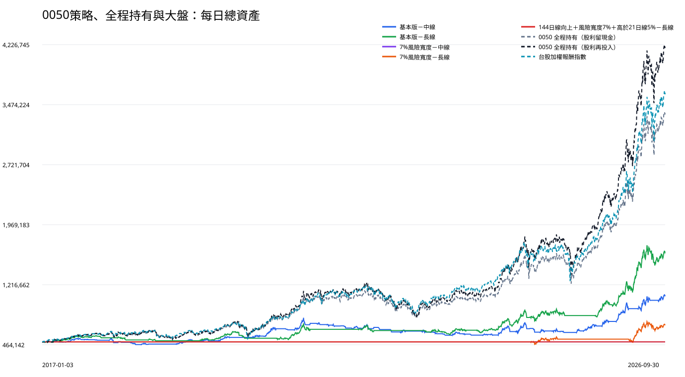

# 0050｜50萬元連續帳戶正式報告

## 先看結論

五個擇時策略都只在 2017-01-03 投入一次 50 萬元，之後連續操作到 2026-09-30，不在每年一月重設。五個擇時策略中，最後總資產最高的是「基本版－長線」：1,631,769.34 元；獲利年度 8 個（2017、2019、2020、2021、2023、2024、2025、2026）。

## 五個會進出的擇時策略

|方法|獲利年度|最後總資產|累積報酬|換算年報酬|最大資產回落|年報酬／回落|平均現金閒置|單一時點最高持倉成本|總進場|完成買賣|截止仍持有|
|---|---|---|---|---|---|---|---|---|---|---|---|
|基本版－中線|6／10（2017、2019、2020、2024、2025、2026）|1,087,022.38|117.40%|8.29%|-27.69%|0.30|57.75%|1,021,107.43|51|50|1|
|基本版－長線|8／10（2017、2019、2020、2021、2023、2024、2025、2026）|1,631,769.34|226.35%|12.90%|-19.47%|0.66|47.65%|1,497,996.32|33|32|1|
|7%風險寬度－中線|0／10（無）|500,000.00|0.00%|0.00%|0.00%|—|100.00%|0.00|0|0|0|
|7%風險寬度－長線|2／10（2024、2026）|719,351.63|43.87%|3.80%|-14.96%|0.25|89.96%|660,334.76|3|2|1|
|144日線向上＋風險寬度7%＋高於21日線5%－長線|0／10（無）|500,000.00|0.00%|0.00%|0.00%|—|100.00%|0.00|0|0|0|

## 兩個從頭持有到截止日的對照基準

這兩組不參與擇時策略排名；用途是檢查判斷買賣點是否勝過直接持有。

|方法|獲利年度|最後總資產|累積報酬|換算年報酬|最大資產回落|年報酬／回落|平均現金閒置|單一時點最高持倉成本|總進場|完成買賣|截止仍持有|
|---|---|---|---|---|---|---|---|---|---|---|---|
|0050 全程持有（股利留現金）|8／10（2017、2019、2020、2021、2023、2024、2025、2026）|3,371,538.81|574.31%|21.63%|-30.05%|0.72|10.15%|499,966.84|1|0|1|
|0050 全程持有（股利再投入）|8／10（2017、2019、2020、2021、2023、2024、2025、2026）|4,211,710.27|742.34%|24.43%|-33.95%|0.72|0.01%|827,823.98|1|0|1|

## 大盤基準

|方法|最後總資產|累積報酬|換算年報酬|最大資產回落|獲利年度|
|---|---|---|---|---|---|
|台股加權報酬指數|3,625,504.88|625.10%|22.56%|-28.55%|8／10（2017、2019、2020、2021、2023、2024、2025、2026）|

## 五個擇時策略的每年表現

|方法|年度|年初資產|年底／截止資產|帳戶報酬|帳戶最大回落|大盤報酬|大盤最大回落|進場|賣出|年底仍持有|平均現金閒置|
|---|---|---|---|---|---|---|---|---|---|---|---|
|基本版－中線|2017|500,000.00|520,564.28|4.11%|-4.20%|19.27%|-4.60%|5|5|0|50.06%|
|基本版－中線|2018|520,564.28|473,095.86|-9.12%|-14.59%|-4.83%|-14.47%|5|5|0|78.54%|
|基本版－中線|2019|473,095.86|556,365.16|17.60%|-4.46%|28.92%|-7.16%|4|4|0|43.81%|
|基本版－中線|2020|556,365.16|686,031.35|23.31%|-4.73%|27.12%|-28.55%|4|3|1|56.33%|
|基本版－中線|2021|686,031.35|685,031.12|-0.15%|-17.60%|27.06%|-12.74%|7|7|1|63.94%|
|基本版－中線|2022|685,031.12|622,286.88|-9.16%|-14.24%|-18.68%|-28.47%|4|5|0|76.83%|
|基本版－中線|2023|622,286.88|597,792.72|-3.94%|-6.83%|31.48%|-6.86%|8|7|1|64.86%|
|基本版－中線|2024|597,792.72|635,085.22|6.24%|-17.50%|31.73%|-18.31%|6|6|1|47.94%|
|基本版－中線|2025|635,085.22|789,084.42|24.25%|-7.28%|29.47%|-26.54%|6|6|1|52.57%|
|基本版－中線|2026（至9/30）|789,084.42|1,087,022.38|37.76%|-9.83%|68.20%|-15.72%|2|2|1|36.39%|
|基本版－長線|2017|500,000.00|551,092.25|10.22%|-4.53%|19.27%|-4.60%|5|5|0|22.20%|
|基本版－長線|2018|551,092.25|514,450.90|-6.65%|-8.54%|-4.83%|-14.47%|3|3|0|76.12%|
|基本版－長線|2019|514,450.90|622,157.98|20.94%|-3.90%|28.92%|-7.16%|2|1|1|49.18%|
|基本版－長線|2020|622,157.98|627,105.70|0.80%|-15.68%|27.12%|-28.55%|4|4|1|57.55%|
|基本版－長線|2021|627,105.70|677,788.56|8.08%|-12.52%|27.06%|-12.74%|2|2|1|77.05%|
|基本版－長線|2022|677,788.56|624,291.03|-7.89%|-11.83%|-18.68%|-28.47%|2|3|0|86.99%|
|基本版－長線|2023|624,291.03|667,329.94|6.89%|-9.41%|31.48%|-6.86%|6|5|1|25.59%|
|基本版－長線|2024|667,329.94|873,138.37|30.84%|-15.58%|31.73%|-18.31%|4|4|1|10.75%|
|基本版－長線|2025|873,138.37|1,001,189.55|14.67%|-10.74%|29.47%|-26.54%|4|4|1|55.50%|
|基本版－長線|2026（至9/30）|1,001,189.55|1,631,769.34|62.98%|-14.85%|68.20%|-15.72%|1|1|1|2.44%|
|7%風險寬度－中線|2017|500,000.00|500,000.00|0.00%|0.00%|19.27%|-4.60%|0|0|0|100.00%|
|7%風險寬度－中線|2018|500,000.00|500,000.00|0.00%|0.00%|-4.83%|-14.47%|0|0|0|100.00%|
|7%風險寬度－中線|2019|500,000.00|500,000.00|0.00%|0.00%|28.92%|-7.16%|0|0|0|100.00%|
|7%風險寬度－中線|2020|500,000.00|500,000.00|0.00%|0.00%|27.12%|-28.55%|0|0|0|100.00%|
|7%風險寬度－中線|2021|500,000.00|500,000.00|0.00%|0.00%|27.06%|-12.74%|0|0|0|100.00%|
|7%風險寬度－中線|2022|500,000.00|500,000.00|0.00%|0.00%|-18.68%|-28.47%|0|0|0|100.00%|
|7%風險寬度－中線|2023|500,000.00|500,000.00|0.00%|0.00%|31.48%|-6.86%|0|0|0|100.00%|
|7%風險寬度－中線|2024|500,000.00|500,000.00|0.00%|0.00%|31.73%|-18.31%|0|0|0|100.00%|
|7%風險寬度－中線|2025|500,000.00|500,000.00|0.00%|0.00%|29.47%|-26.54%|0|0|0|100.00%|
|7%風險寬度－中線|2026（至9/30）|500,000.00|500,000.00|0.00%|0.00%|68.20%|-15.72%|0|0|0|100.00%|
|7%風險寬度－長線|2017|500,000.00|500,000.00|0.00%|0.00%|19.27%|-4.60%|0|0|0|100.00%|
|7%風險寬度－長線|2018|500,000.00|500,000.00|0.00%|0.00%|-4.83%|-14.47%|0|0|0|100.00%|
|7%風險寬度－長線|2019|500,000.00|500,000.00|0.00%|0.00%|28.92%|-7.16%|0|0|0|100.00%|
|7%風險寬度－長線|2020|500,000.00|500,000.00|0.00%|0.00%|27.12%|-28.55%|0|0|0|100.00%|
|7%風險寬度－長線|2021|500,000.00|500,000.00|0.00%|0.00%|27.06%|-12.74%|0|0|0|100.00%|
|7%風險寬度－長線|2022|500,000.00|500,000.00|0.00%|0.00%|-18.68%|-28.47%|0|0|0|100.00%|
|7%風險寬度－長線|2023|500,000.00|500,000.00|0.00%|0.00%|31.48%|-6.86%|0|0|0|100.00%|
|7%風險寬度－長線|2024|500,000.00|538,354.47|7.67%|-6.80%|31.73%|-18.31%|1|0|1|60.75%|
|7%風險寬度－長線|2025|538,354.47|534,642.27|-0.69%|-4.89%|29.47%|-26.54%|0|1|0|97.06%|
|7%風險寬度－長線|2026（至9/30）|534,642.27|719,351.63|34.55%|-14.96%|68.20%|-15.72%|2|1|1|24.15%|
|144日線向上＋風險寬度7%＋高於21日線5%－長線|2017|500,000.00|500,000.00|0.00%|0.00%|19.27%|-4.60%|0|0|0|100.00%|
|144日線向上＋風險寬度7%＋高於21日線5%－長線|2018|500,000.00|500,000.00|0.00%|0.00%|-4.83%|-14.47%|0|0|0|100.00%|
|144日線向上＋風險寬度7%＋高於21日線5%－長線|2019|500,000.00|500,000.00|0.00%|0.00%|28.92%|-7.16%|0|0|0|100.00%|
|144日線向上＋風險寬度7%＋高於21日線5%－長線|2020|500,000.00|500,000.00|0.00%|0.00%|27.12%|-28.55%|0|0|0|100.00%|
|144日線向上＋風險寬度7%＋高於21日線5%－長線|2021|500,000.00|500,000.00|0.00%|0.00%|27.06%|-12.74%|0|0|0|100.00%|
|144日線向上＋風險寬度7%＋高於21日線5%－長線|2022|500,000.00|500,000.00|0.00%|0.00%|-18.68%|-28.47%|0|0|0|100.00%|
|144日線向上＋風險寬度7%＋高於21日線5%－長線|2023|500,000.00|500,000.00|0.00%|0.00%|31.48%|-6.86%|0|0|0|100.00%|
|144日線向上＋風險寬度7%＋高於21日線5%－長線|2024|500,000.00|500,000.00|0.00%|0.00%|31.73%|-18.31%|0|0|0|100.00%|
|144日線向上＋風險寬度7%＋高於21日線5%－長線|2025|500,000.00|500,000.00|0.00%|0.00%|29.47%|-26.54%|0|0|0|100.00%|
|144日線向上＋風險寬度7%＋高於21日線5%－長線|2026（至9/30）|500,000.00|500,000.00|0.00%|0.00%|68.20%|-15.72%|0|0|0|100.00%|

## 全程持有基準的每年表現

|方法|年度|年初資產|年底／截止資產|帳戶報酬|帳戶最大回落|大盤報酬|大盤最大回落|進場|賣出|年底仍持有|平均現金閒置|
|---|---|---|---|---|---|---|---|---|---|---|---|
|0050 全程持有（股利留現金）|2017|500,000.00|584,620.76|16.92%|-5.30%|19.27%|-4.60%|1|0|1|2.01%|
|0050 全程持有（股利留現金）|2018|584,620.76|558,763.27|-4.42%|-15.07%|-4.83%|-14.47%|0|0|1|5.21%|
|0050 全程持有（股利留現金）|2019|558,763.27|727,868.33|30.26%|-7.66%|28.92%|-7.16%|0|0|1|8.30%|
|0050 全程持有（股利留現金）|2020|727,868.33|927,751.61|27.46%|-25.38%|27.12%|-28.55%|0|0|1|10.33%|
|0050 全程持有（股利留現金）|2021|927,751.61|1,112,075.09|19.87%|-9.55%|27.06%|-12.74%|0|0|1|9.66%|
|0050 全程持有（股利留現金）|2022|1,112,075.09|902,715.74|-18.83%|-30.05%|-18.68%|-28.47%|0|0|1|13.52%|
|0050 全程持有（股利留現金）|2023|902,715.74|1,108,496.18|22.80%|-5.92%|31.48%|-6.86%|0|0|1|15.80%|
|0050 全程持有（股利留現金）|2024|1,108,496.18|1,553,124.67|40.11%|-19.08%|31.73%|-18.31%|0|0|1|14.07%|
|0050 全程持有（股利留現金）|2025|1,553,124.67|2,042,624.20|31.52%|-23.78%|29.47%|-26.54%|0|0|1|13.46%|
|0050 全程持有（股利留現金）|2026（至9/30）|2,042,624.20|3,371,538.81|65.06%|-14.66%|68.20%|-15.72%|0|0|1|9.22%|
|0050 全程持有（股利再投入）|2017|500,000.00|586,056.84|17.21%|-5.45%|19.27%|-4.60%|1|0|1|0.01%|
|0050 全程持有（股利再投入）|2018|586,056.84|557,041.10|-4.95%|-15.99%|-4.83%|-14.47%|0|0|1|0.00%|
|0050 全程持有（股利再投入）|2019|557,041.10|743,244.50|33.43%|-8.36%|28.92%|-7.16%|0|0|1|0.01%|
|0050 全程持有（股利再投入）|2020|743,244.50|974,441.90|31.11%|-28.20%|27.12%|-28.55%|0|0|1|0.00%|
|0050 全程持有（股利再投入）|2021|974,441.90|1,189,698.74|22.09%|-10.44%|27.06%|-12.74%|0|0|1|0.00%|
|0050 全程持有（股利再投入）|2022|1,189,698.74|935,477.83|-21.37%|-33.95%|-18.68%|-28.47%|0|0|1|0.01%|
|0050 全程持有（股利再投入）|2023|935,477.83|1,192,011.19|27.42%|-7.02%|31.48%|-6.86%|0|0|1|0.01%|
|0050 全程持有（股利再投入）|2024|1,192,011.19|1,769,130.12|48.42%|-21.70%|31.73%|-18.31%|0|0|1|0.01%|
|0050 全程持有（股利再投入）|2025|1,769,130.12|2,420,428.34|36.81%|-27.49%|29.47%|-26.54%|0|0|1|0.01%|
|0050 全程持有（股利再投入）|2026（至9/30）|2,420,428.34|4,211,710.27|74.01%|-15.88%|68.20%|-15.72%|0|0|1|0.00%|

## 空頭防守與後段多頭依賴

|方法|截至2024累積獲利|2025～2026增加獲利|後兩年占總獲利|2022比大盤多賺／少賠|2022最大回落少於大盤|
|---|---|---|---|---|---|
|基本版－中線|135,085.22|451,937.16|76.99%|9.52%|14.23%|
|基本版－長線|373,138.37|758,630.97|67.03%|10.78%|16.64%|
|7%風險寬度－中線|0.00|0.00|—|18.68%|28.47%|
|7%風險寬度－長線|38,354.47|180,997.16|82.51%|18.68%|28.47%|
|144日線向上＋風險寬度7%＋高於21日線5%－長線|0.00|0.00|—|18.68%|28.47%|

後兩年占比高不代表策略無效，但表示最終獲利較依賴 2025～2026 行情。2026 只統計到 9 月 30 日。

## 資金與交易過程

|方法|買入周轉總額|單一時點最高持倉成本|已賣出損益|截止日持股估算損益|股利收入|費稅與價差預留|
|---|---|---|---|---|---|---|
|基本版－中線|31,515,609.99|1,021,107.43|521,139.49|65,882.88|97,441.43|180,812.44|
|基本版－長線|22,046,913.32|1,497,996.32|1,007,208.33|124,561.01|116,104.05|125,842.44|
|7%風險寬度－中線|0.00|0.00|0.00|0.00|0.00|0.00|
|7%風險寬度－長線|1,694,824.04|660,334.76|164,443.50|54,908.13|4,092.00|8,128.36|
|144日線向上＋風險寬度7%＋高於21日線5%－長線|0.00|0.00|0.00|0.00|0.00|0.00|

## 進場機會稽核

表中的『完整訊號候選』是均線與型態已走到可判斷買進的那一天；實際買進前，仍須逐項通過該方法要求的條件。已有持股時不會再重複買進。

|方法|完整訊號候選|實際買進|已有持股，不重複買|144日線沒有向上|風險寬度不足7%|高於21日線不足5%|資料不足|其他未進場|
|---|---|---|---|---|---|---|---|---|
|基本版－中線|120|51|69|0|0|0|0|0|
|基本版－長線|76|33|43|0|0|0|0|0|
|7%風險寬度－中線|120|0|0|22|98|0|0|0|
|7%風險寬度－長線|76|3|14|2|57|0|0|0|
|144日線向上＋風險寬度7%＋高於21日線5%－長線|76|0|0|2|70|4|0|0|

- 7%風險寬度－中線：有 120 次完整訊號候選，但沒有一次同時通過全部條件（144日線沒有向上 22 次、風險寬度不足7% 98 次），因此沒有交易機會。
- 144日線向上＋風險寬度7%＋高於21日線5%－長線：有 76 次完整訊號候選，但沒有一次同時通過全部條件（144日線沒有向上 2 次、風險寬度不足7% 70 次、高於21日線不足5% 4 次），因此沒有交易機會。

嚴格長線版會依序檢查三項條件：144日線向上、風險寬度至少7%、收盤價至少高於21日線5%；它不是只檢查最後一項。

## 這份重播怎麼做

- 每個方法都是獨立的 50 萬元帳戶；不是把五個方法同時塞入同一帳戶。
- 擇時策略每次進場使用當時帳戶內幾乎全部可用現金，並將已實現獲利繼續投入；不是每筆固定 1 萬元。
- 持倉、現金與策略狀態可以跨年；年度表只是從同一條連續資產曲線切片。
- 0050 是長期持續監控標的；一段均線多頭區間結束後，下一個新的多頭區間可重新開始監控並等待完整進場訊號。
- 買進與賣出各預留 0.2% 價差，另扣手續費與賣出交易稅。
- 0050 一拆四只調整股數與技術座標，不當成買賣或損益。
- 截止日仍持有的部位，以 2026-09-30 原始收盤價扣除假設賣出成本估算。

## 附件

- [風險與大盤比較](benchmark-risk-report.md)
- [完整逐筆交易](trade-details.md)
- [每日總資產與回落](daily-equity.csv)
- [逐年總表](calendar-year-summary.csv)
- [全期間總表](scenario-summary.csv)
- [全部買賣動作](transactions.csv)
- [每年及五年的進場機會稽核](signal-opportunity-audit.csv)
- [股利與分割](corporate-actions.csv)
- [大盤報酬指數](benchmark.csv)
