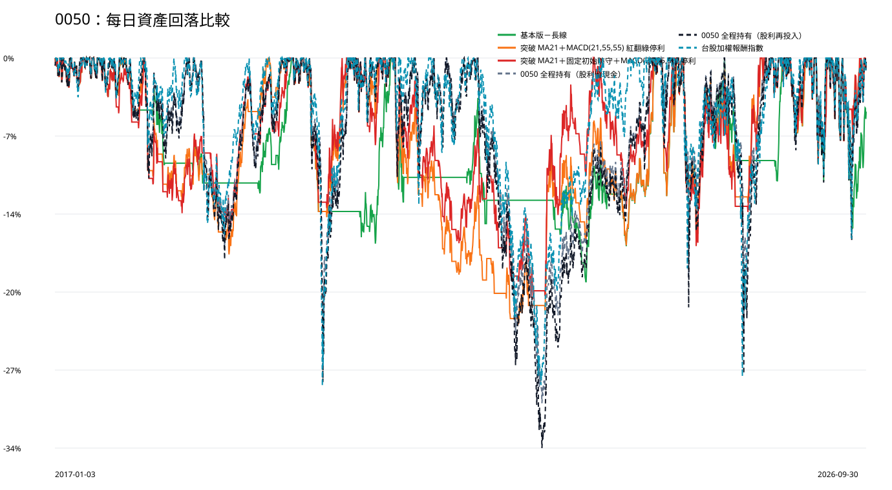

# 0050｜大盤與風險比較

台股加權報酬指數由等值 500,000 元成長為 3,625,504.88 元；總報酬 625.10%，年化報酬 22.56%，最大資產回落 -28.55%。

## 2022 空頭與 2025～2026 多頭

|方法|年度|年初資產|年底／截止資產|年度報酬|年度最大回落|大盤報酬|大盤最大回落|進場|賣出|年底仍持有|
|---|---|---|---|---|---|---|---|---|---|---|
|基本版－長線|2022|677,788.56|624,291.03|-7.89%|-11.83%|-18.68%|-28.47%|2|3|0|
|基本版－長線|2025|873,138.37|1,001,189.55|14.67%|-10.74%|29.47%|-26.54%|4|4|1|
|基本版－長線|2026（至9/30）|1,001,189.55|1,631,769.34|62.98%|-14.85%|68.20%|-15.72%|1|1|1|
|突破 MA21＋MACD(21,55,55) 紅翻綠停利|2022|869,360.38|895,492.68|3.01%|-13.53%|-18.68%|-28.47%|5|6|0|
|突破 MA21＋MACD(21,55,55) 紅翻綠停利|2025|1,197,114.61|1,679,120.15|40.26%|-11.81%|29.47%|-26.54%|6|6|1|
|突破 MA21＋MACD(21,55,55) 紅翻綠停利|2026（至9/30）|1,679,120.15|2,846,119.75|69.50%|-9.19%|68.20%|-15.72%|2|2|1|
|突破 MA21＋固定初始防守＋MACD(21,55,55) 停利|2022|856,480.72|828,066.67|-3.32%|-15.82%|-18.68%|-28.47%|4|4|1|
|突破 MA21＋固定初始防守＋MACD(21,55,55) 停利|2025|1,191,663.65|1,724,580.96|44.72%|-11.81%|29.47%|-26.54%|4|4|1|
|突破 MA21＋固定初始防守＋MACD(21,55,55) 停利|2026（至9/30）|1,724,580.96|2,923,160.59|69.50%|-9.19%|68.20%|-15.72%|2|2|1|

判斷策略不能只看期末資產；需同時查看 2022 是否降低回落、2025～2026 獲利依賴、報酬相對風險與平均資金閒置。2026 為截至 9 月 30 日的非完整年度。
