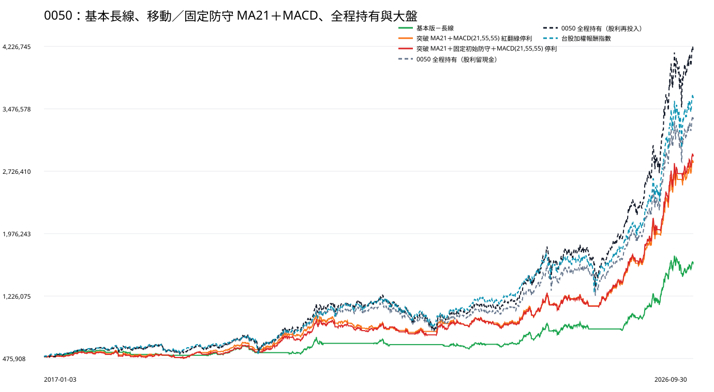

# 0050｜MA21 突破與 MACD 停利十年比較

## 先講結論

本研究使用同一筆 500,000 元本金，從 2017-01-03 連續重播到 2026-09-30，不中途追加、不逐年重設。三個會進出的策略中，期末資產較高的是「突破 MA21＋固定初始防守＋MACD(21,55,55) 停利」：2,923,160.59 元。這是固定規則回測結果，不據此修改參數。

## 四組方法總覽

|方法|獲利年度|期末資產|總報酬|年化報酬|最大資產回落|報酬相對風險|平均資金閒置|最大投入|進出次數|尚未賣出部位|
|---|---|---|---|---|---|---|---|---|---|---|
|基本版－長線|8／10（2017、2019、2020、2021、2023、2024、2025、2026）|1,631,769.34|226.35%|12.90%|-19.47%|0.66|47.65%|1,497,996.32|32 買賣完成／33 次進場|1|
|突破 MA21＋MACD(21,55,55) 紅翻綠停利|8／10（2017、2019、2020、2022、2023、2024、2025、2026）|2,846,119.75|469.22%|19.53%|-23.12%|0.84|27.43%|2,627,628.63|58 買賣完成／59 次進場|1|
|突破 MA21＋固定初始防守＋MACD(21,55,55) 停利|8／10（2017、2019、2020、2021、2023、2024、2025、2026）|2,923,160.59|484.63%|19.86%|-20.96%|0.95|22.55%|2,698,662.00|46 買賣完成／47 次進場|1|
|0050 全程持有（股利留現金）|8／10（2017、2019、2020、2021、2023、2024、2025、2026）|3,371,538.81|574.31%|21.63%|-30.05%|0.72|10.15%|499,966.84|0 買賣完成／1 次進場|1|
|0050 全程持有（股利再投入）|8／10（2017、2019、2020、2021、2023、2024、2025、2026）|4,211,710.27|742.34%|24.43%|-33.95%|0.72|0.01%|827,823.98|0 買賣完成／1 次進場|1|

0050 全程持有是同一組基準的兩種股利處理列，不參與擇時策略排名。

## 逐年結果

|方法|年度|年初資產|年底／截止資產|年度報酬|年度最大回落|大盤報酬|大盤最大回落|進場|賣出|年底仍持有|
|---|---|---|---|---|---|---|---|---|---|---|
|基本版－長線|2017|500,000.00|551,092.25|10.22%|-4.53%|19.27%|-4.60%|5|5|0|
|基本版－長線|2018|551,092.25|514,450.90|-6.65%|-8.54%|-4.83%|-14.47%|3|3|0|
|基本版－長線|2019|514,450.90|622,157.98|20.94%|-3.90%|28.92%|-7.16%|2|1|1|
|基本版－長線|2020|622,157.98|627,105.70|0.80%|-15.68%|27.12%|-28.55%|4|4|1|
|基本版－長線|2021|627,105.70|677,788.56|8.08%|-12.52%|27.06%|-12.74%|2|2|1|
|基本版－長線|2022|677,788.56|624,291.03|-7.89%|-11.83%|-18.68%|-28.47%|2|3|0|
|基本版－長線|2023|624,291.03|667,329.94|6.89%|-9.41%|31.48%|-6.86%|6|5|1|
|基本版－長線|2024|667,329.94|873,138.37|30.84%|-15.58%|31.73%|-18.31%|4|4|1|
|基本版－長線|2025|873,138.37|1,001,189.55|14.67%|-10.74%|29.47%|-26.54%|4|4|1|
|基本版－長線|2026（至9/30）|1,001,189.55|1,631,769.34|62.98%|-14.85%|68.20%|-15.72%|1|1|1|
|突破 MA21＋MACD(21,55,55) 紅翻綠停利|2017|500,000.00|534,055.41|6.81%|-5.08%|19.27%|-4.60%|8|7|1|
|突破 MA21＋MACD(21,55,55) 紅翻綠停利|2018|534,055.41|487,118.28|-8.79%|-15.14%|-4.83%|-14.47%|7|8|0|
|突破 MA21＋MACD(21,55,55) 紅翻綠停利|2019|487,118.28|661,889.41|35.88%|-3.90%|28.92%|-7.16%|3|2|1|
|突破 MA21＋MACD(21,55,55) 紅翻綠停利|2020|661,889.41|873,285.06|31.94%|-13.37%|27.12%|-28.55%|5|5|1|
|突破 MA21＋MACD(21,55,55) 紅翻綠停利|2021|873,285.06|869,360.38|-0.45%|-18.86%|27.06%|-12.74%|9|9|1|
|突破 MA21＋MACD(21,55,55) 紅翻綠停利|2022|869,360.38|895,492.68|3.01%|-13.53%|-18.68%|-28.47%|5|6|0|
|突破 MA21＋MACD(21,55,55) 紅翻綠停利|2023|895,492.68|930,064.90|3.86%|-11.73%|31.48%|-6.86%|9|8|1|
|突破 MA21＋MACD(21,55,55) 紅翻綠停利|2024|930,064.90|1,197,114.61|28.71%|-15.58%|31.73%|-18.31%|5|5|1|
|突破 MA21＋MACD(21,55,55) 紅翻綠停利|2025|1,197,114.61|1,679,120.15|40.26%|-11.81%|29.47%|-26.54%|6|6|1|
|突破 MA21＋MACD(21,55,55) 紅翻綠停利|2026（至9/30）|1,679,120.15|2,846,119.75|69.50%|-9.19%|68.20%|-15.72%|2|2|1|
|突破 MA21＋固定初始防守＋MACD(21,55,55) 停利|2017|500,000.00|524,422.57|4.88%|-6.12%|19.27%|-4.60%|8|7|1|
|突破 MA21＋固定初始防守＋MACD(21,55,55) 停利|2018|524,422.57|488,203.04|-6.91%|-13.51%|-4.83%|-14.47%|5|6|0|
|突破 MA21＋固定初始防守＋MACD(21,55,55) 停利|2019|488,203.04|627,005.46|28.43%|-6.42%|28.92%|-7.16%|3|2|1|
|突破 MA21＋固定初始防守＋MACD(21,55,55) 停利|2020|627,005.46|814,740.69|29.94%|-12.56%|27.12%|-28.55%|5|5|1|
|突破 MA21＋固定初始防守＋MACD(21,55,55) 停利|2021|814,740.69|856,480.72|5.12%|-16.12%|27.06%|-12.74%|5|5|1|
|突破 MA21＋固定初始防守＋MACD(21,55,55) 停利|2022|856,480.72|828,066.67|-3.32%|-15.82%|-18.68%|-28.47%|4|4|1|
|突破 MA21＋固定初始防守＋MACD(21,55,55) 停利|2023|828,066.67|912,592.62|10.21%|-13.15%|31.48%|-6.86%|7|7|1|
|突破 MA21＋固定初始防守＋MACD(21,55,55) 停利|2024|912,592.62|1,191,663.65|30.58%|-16.37%|31.73%|-18.31%|4|4|1|
|突破 MA21＋固定初始防守＋MACD(21,55,55) 停利|2025|1,191,663.65|1,724,580.96|44.72%|-11.81%|29.47%|-26.54%|4|4|1|
|突破 MA21＋固定初始防守＋MACD(21,55,55) 停利|2026（至9/30）|1,724,580.96|2,923,160.59|69.50%|-9.19%|68.20%|-15.72%|2|2|1|
|0050 全程持有（股利留現金）|2017|500,000.00|584,620.76|16.92%|-5.30%|19.27%|-4.60%|1|0|1|
|0050 全程持有（股利留現金）|2018|584,620.76|558,763.27|-4.42%|-15.07%|-4.83%|-14.47%|0|0|1|
|0050 全程持有（股利留現金）|2019|558,763.27|727,868.33|30.26%|-7.66%|28.92%|-7.16%|0|0|1|
|0050 全程持有（股利留現金）|2020|727,868.33|927,751.61|27.46%|-25.38%|27.12%|-28.55%|0|0|1|
|0050 全程持有（股利留現金）|2021|927,751.61|1,112,075.09|19.87%|-9.55%|27.06%|-12.74%|0|0|1|
|0050 全程持有（股利留現金）|2022|1,112,075.09|902,715.74|-18.83%|-30.05%|-18.68%|-28.47%|0|0|1|
|0050 全程持有（股利留現金）|2023|902,715.74|1,108,496.18|22.80%|-5.92%|31.48%|-6.86%|0|0|1|
|0050 全程持有（股利留現金）|2024|1,108,496.18|1,553,124.67|40.11%|-19.08%|31.73%|-18.31%|0|0|1|
|0050 全程持有（股利留現金）|2025|1,553,124.67|2,042,624.20|31.52%|-23.78%|29.47%|-26.54%|0|0|1|
|0050 全程持有（股利留現金）|2026（至9/30）|2,042,624.20|3,371,538.81|65.06%|-14.66%|68.20%|-15.72%|0|0|1|
|0050 全程持有（股利再投入）|2017|500,000.00|586,056.84|17.21%|-5.45%|19.27%|-4.60%|1|0|1|
|0050 全程持有（股利再投入）|2018|586,056.84|557,041.10|-4.95%|-15.99%|-4.83%|-14.47%|0|0|1|
|0050 全程持有（股利再投入）|2019|557,041.10|743,244.50|33.43%|-8.36%|28.92%|-7.16%|0|0|1|
|0050 全程持有（股利再投入）|2020|743,244.50|974,441.90|31.11%|-28.20%|27.12%|-28.55%|0|0|1|
|0050 全程持有（股利再投入）|2021|974,441.90|1,189,698.74|22.09%|-10.44%|27.06%|-12.74%|0|0|1|
|0050 全程持有（股利再投入）|2022|1,189,698.74|935,477.83|-21.37%|-33.95%|-18.68%|-28.47%|0|0|1|
|0050 全程持有（股利再投入）|2023|935,477.83|1,192,011.19|27.42%|-7.02%|31.48%|-6.86%|0|0|1|
|0050 全程持有（股利再投入）|2024|1,192,011.19|1,769,130.12|48.42%|-21.70%|31.73%|-18.31%|0|0|1|
|0050 全程持有（股利再投入）|2025|1,769,130.12|2,420,428.34|36.81%|-27.49%|29.47%|-26.54%|0|0|1|
|0050 全程持有（股利再投入）|2026（至9/30）|2,420,428.34|4,211,710.27|74.01%|-15.88%|68.20%|-15.72%|0|0|1|

## 資金、交易與損益

|方法|買入周轉總額|最大投入|完成交易|截止仍持有|已實現損益|截止估算損益|股息|實際費稅與價差|
|---|---|---|---|---|---|---|---|---|
|基本版－長線|22,046,913.32|1,497,996.32|32|1|1,007,208.33|124,561.01|116,104.05|125,842.44|
|突破 MA21＋MACD(21,55,55) 紅翻綠停利|50,743,529.60|2,627,628.63|58|1|2,127,628.66|218,491.09|192,544.93|292,047.19|
|突破 MA21＋固定初始防守＋MACD(21,55,55) 停利|39,116,089.79|2,698,662.00|46|1|2,198,762.84|224,397.76|190,329.83|224,590.49|
|0050 全程持有（股利留現金）|499,966.84|499,966.84|0|1|0.00|2,871,538.81|272,901.58|1,196.54|
|0050 全程持有（股利再投入）|827,823.98|827,823.98|0|1|0.00|3,711,710.27|327,921.43|1,982.68|

## 固定初始防守策略規則

- 收盤由前一交易日位於 21 日均線下方或相等，轉為當日收盤高於 21 日均線，才是一次新突破；連續站上不重複買進。
- 不要求 21 日均線高於 144 日均線，也不因之後跌破均線而賣出。
- 初始防守價只在進場當下依該次 MA21 拉回區間低點計算；不繼承進場前防線，也不啟動或上移道氏防線。
- 持有期間固定初始防守價只因分割或價格座標重整等比例換算，經濟意義不變；收盤跌破時固定初始防守優先賣出。
- 現行 MA21＋MACD 對照使用會隨新結構上移的移動道氏防線；兩種停損不可混稱。
- MACD 使用 21、55、55；買進後須先處於或走到柱狀值大於或等於零，再等下一次由非負轉負才停利。
- 同日同時符合固定初始防守與 MACD 停利時，固定初始防守優先；賣出當日不得重新進場。
- 截至 2026-09-30 仍持有時不強制賣出，只按當日收盤扣除假設賣出成本估算。

## MA21 突破機會稽核

|日期|收盤|21日均線|MACD柱狀值|是否成交|未成交原因|防守價|
|---|---|---|---|---|---|---|
|2017-01-05|72.50|71.97|-0.3787136225955189845109541394|成交|—|70.35|
|2017-03-08|72.85|72.80|0.1301753205014449613224255052|未成交|已有持股，不重複進場|72.00|
|2017-03-14|73.00|72.87|0.0026547822549172478995018115|成交|—|71.55|
|2017-03-16|73.80|72.89|0.0414488904064137541025616654|成交|—|72.60|
|2017-04-25|74.35|73.90|-0.2132994860635712922575948360|成交|—|72.50|
|2017-06-16|77.70|77.07|0.162208263209823857163860480|未成交|已有持股，不重複進場|76.50|
|2017-08-22|81.85|81.75|-0.367284770348880805354717048|成交|—|80.60|
|2017-09-18|83.15|82.49|-0.385249828814862595678823599|未成交|已有持股，不重複進場|82.10|
|2017-09-21|82.70|82.63|-0.429723350690469401484408234|未成交|已有持股，不重複進場|81.95|
|2017-10-05|81.85|81.85|-0.827561752220521388420445578|成交|—|80.30|
|2017-11-21|84.75|84.50|-0.203887334565742364837778404|成交|—|83.15|
|2017-12-28|81.70|81.38|-0.9691075388397677797727623310|成交|—|80.45|
|2018-03-08|82.75|82.01|-0.3502873483867855446304992017|成交|—|78.00|
|2018-03-27|83.40|82.96|0.0368753777518740430544992007|未成交|已有持股，不重複進場|81.60|
|2018-04-19|82.65|82.54|-0.3340342455511106720317999969|成交|—|81.20|
|2018-05-10|80.65|80.53|-0.8115146730513093414808155988|成交|—|78.35|
|2018-06-01|81.35|81.16|0.0173348439278501272214431918|未成交|已有持股，不重複進場|80.30|
|2018-07-09|82.25|81.43|-0.05738027496252491367738740063|成交|—|79.80|
|2018-08-23|85.05|85.02|0.3445121598110981893496937050|未成交|已有持股，不重複進場|83.05|
|2018-08-27|85.55|85.00|0.3239956965133907406278638857|未成交|已有持股，不重複進場|84.45|
|2018-09-14|86.50|85.82|0.1880217424668581862715724036|未成交|已有持股，不重複進場|84.90|
|2018-09-19|86.15|86.07|0.0581906066429569305811670312|未成交|已有持股，不重複進場|85.20|
|2018-09-21|86.85|86.21|0.0440811432821139837432964872|未成交|已有持股，不重複進場|85.80|
|2018-11-07|78.40|78.25|-1.889300190652528064941667482|成交|—|74.50|
|2018-11-12|78.00|77.96|-1.569089305280293649109967798|未成交|已有持股，不重複進場|77.55|
|2018-12-03|78.80|77.13|-0.617912573634295784647112249|未成交|已有持股，不重複進場|74.85|
|2019-01-09|75.00|74.76|-0.147105098057482214469291543|成交|—|72.00|
|2019-03-12|77.25|76.29|1.234838969367779989857036663|未成交|已有持股，不重複進場|75.70|
|2019-06-10|79.05|78.39|-1.177759580815731941382840064|成交|—|76.30|
|2019-08-30|81.85|80.54|-0.5087920380058217545753372389|成交|—|78.50|
|2019-12-05|92.90|92.40|0.173991579313564483766429533|未成交|已有持股，不重複進場|91.40|
|2020-01-10|97.30|97.15|-0.038089397102490019650815188|未成交|同日已賣出，不得重新進場|95.05|
|2020-01-17|97.30|97.28|-0.182826327242840022656131886|成交|—|97.00|
|2020-02-12|92.65|92.56|-1.316403670230598165330982790|成交|—|87.60|
|2020-04-07|78.50|77.89|-3.511467731179655467406776909|成交|—|67.25|
|2020-05-26|84.45|83.77|1.420464824675286559725255773|未成交|已有持股，不重複進場|82.15|
|2020-05-29|84.45|83.95|1.383042784172864667376207307|未成交|已有持股，不重複進場|83.00|
|2020-08-25|103.90|103.87|1.047253008333655462666991733|未成交|已有持股，不重複進場|98.70|
|2020-09-14|104.55|103.35|-0.704331588554644529899093379|成交|—|101.15|
|2020-10-06|104.25|103.34|-1.431474781253450115158629426|成交|—|100.05|
|2020-11-04|106.15|105.50|-1.130465334869353029098610520|未成交|已有持股，不重複進場|102.30|
|2021-02-01|130.75|130.74|2.073026082077680650192364111|未成交|已有持股，不重複進場|127.55|
|2021-03-03|135.40|135.18|0.424929859519244104318086964|未成交|已有持股，不重複進場|132.70|
|2021-03-12|135.25|135.25|-1.282175020542920844659327622|成交|—|129.50|
|2021-03-16|135.35|135.32|-1.385595289586730317542516785|未成交|已有持股，不重複進場|134.45|
|2021-03-26|134.35|133.64|-2.240900600780840441876582528|未成交|已有持股，不重複進場|130.60|
|2021-05-07|139.40|138.64|-1.348967999612711294918401746|未成交|已有持股，不重複進場|135.00|
|2021-05-26|134.50|134.35|-3.008382144058023761900304950|成交|—|121.20|
|2021-05-28|135.80|133.76|-2.672188747347017077349996238|未成交|已有持股，不重複進場|132.35|
|2021-06-23|137.05|136.70|-0.778949376077341043271925257|未成交|已有持股，不重複進場|134.50|
|2021-06-25|136.95|136.93|-0.748928739890067730982787867|未成交|已有持股，不重複進場|136.45|
|2021-07-12|139.00|137.93|-0.194662110791429082459144418|未成交|已有持股，不重複進場|136.95|
|2021-08-03|138.45|137.92|-0.733074311857655179217509042|成交|—|133.75|
|2021-08-26|137.00|136.24|-1.247299179902405509427222265|成交|—|130.20|
|2021-10-19|136.95|136.05|-1.291583538247435570068315223|成交|—|130.90|
|2021-12-01|140.30|139.92|0.5623286001250879940312381646|未成交|已有持股，不重複進場|137.50|
|2021-12-16|142.05|141.01|0.5556869871990207810436066488|未成交|已有持股，不重複進場|139.70|
|2021-12-21|141.85|140.86|0.4677732062279983797239998364|未成交|已有持股，不重複進場|140.30|
|2022-02-10|145.05|144.82|0.245345637432056695869427321|未成交|已有持股，不重複進場|141.05|
|2022-03-23|138.10|136.71|-2.282245410903161299967449820|成交|—|131.00|
|2022-05-27|125.50|125.05|-1.565936410769146164846966737|成交|—|121.20|
|2022-07-18|114.20|113.48|-1.472882290981146842570085417|成交|—|106.76|
|2022-08-26|119.60|119.25|2.353030633059628045880882410|未成交|已有持股，不重複進場|117.65|
|2022-11-07|100.55|99.68|-1.264833442259112798832495357|成交|—|96.50|
|2022-12-09|115.00|114.86|4.015525527509895849429552185|未成交|已有持股，不重複進場|112.45|
|2023-01-09|115.80|112.11|0.6530297148387699406704596947|未成交|已有持股，不重複進場|108.40|
|2023-02-23|119.40|119.40|1.538097155362673753676931174|未成交|已有持股，不重複進場|117.10|
|2023-03-06|120.50|119.79|1.009370041762300246658184582|未成交|已有持股，不重複進場|116.85|
|2023-03-22|120.90|119.04|-0.212141053862933303834451641|成交|—|116.50|
|2023-04-14|120.65|120.12|-0.351153117658076586379491707|成交|—|119.50|
|2023-05-09|118.90|118.63|-1.367147933982530882175769748|成交|—|115.50|
|2023-05-16|118.60|117.96|-1.302968526473166157192919732|未成交|已有持股，不重複進場|116.65|
|2023-07-13|130.90|129.99|0.279905328270983306626919795|未成交|已有持股，不重複進場|127.00|
|2023-07-25|128.85|128.04|-0.066018635640239630268455362|成交|—|126.50|
|2023-08-07|128.50|128.40|-0.491950305428431082391351346|未成交|已有持股，不重複進場|126.90|
|2023-08-24|127.00|126.51|-1.752874593863230036279365153|成交|—|122.90|
|2023-08-29|126.05|125.96|-1.660934483142246125592778819|未成交|已有持股，不重複進場|124.50|
|2023-09-13|125.20|125.14|-1.312744724926124290773586073|未成交|已有持股，不重複進場|123.40|
|2023-10-11|126.25|124.21|-1.056079203124676529839199756|成交|—|121.35|
|2023-11-02|124.50|124.14|-0.7994284360746847676379838444|成交|—|121.10|
|2023-12-08|131.05|130.64|1.141052377410898926848196970|未成交|已有持股，不重複進場|130.00|
|2024-01-19|132.90|130.21|-0.187111976055772571152299744|成交|—|127.30|
|2024-04-18|158.95|158.44|1.203236380692896898297078816|未成交|已有持股，不重複進場|154.75|
|2024-04-29|158.80|157.65|-1.061241845653870006505889711|成交|—|149.50|
|2024-05-06|159.20|157.59|-1.257963330176539999996636424|未成交|已有持股，不重複進場|156.00|
|2024-06-05|168.45|167.32|0.266558956157169814865129109|未成交|已有持股，不重複進場|166.15|
|2024-08-14|180.75|180.68|-5.481215133602031066485926309|成交|—|158.40|
|2024-08-16|183.40|179.26|-4.941398801348190685997899246|未成交|已有持股，不重複進場|179.05|
|2024-09-16|178.75|178.50|-3.806295862355963430203487033|未成交|已有持股，不重複進場|170.00|
|2024-09-19|180.15|178.05|-3.336917440591128648829635534|未成交|已有持股，不重複進場|176.55|
|2024-11-04|192.95|192.49|1.398352600513859580813721084|未成交|已有持股，不重複進場|185.95|
|2024-12-03|194.30|192.36|-1.649167833701155215854240260|成交|—|184.50|
|2024-12-23|197.25|193.60|-0.564673319414253681023504990|未成交|已有持股，不重複進場|192.00|
|2025-01-06|202.15|196.35|-0.172387632076517148355344869|未成交|已有持股，不重複進場|193.25|
|2025-01-16|198.05|197.45|-0.530843878227808843722968999|成交|—|193.75|
|2025-02-05|196.80|195.75|-0.400657053960348484892902124|成交|—|190.65|
|2025-02-17|196.95|196.03|-0.586366443342468213585919799|未成交|已有持股，不重複進場|193.50|
|2025-04-25|165.75|165.28|-5.603122157990820218680370396|成交|—|145.00|
|2025-06-04|181.30|178.72|3.775162419219515301274304104|未成交|已有持股，不重複進場|175.25|
|2025-08-21|52.00|51.94|0.670207453529809721203814208|未成交|已有持股，不重複進場|51.50|
|2025-08-25|52.70|52.06|0.523109837058040618885033573|未成交|已有持股，不重複進場|51.65|
|2025-09-05|52.85|52.59|0.022328234701784509077886744|未成交|已有持股，不重複進場|51.75|
|2025-11-10|63.35|62.98|0.562120144298038952493039961|未成交|已有持股，不重複進場|62.40|
|2025-11-12|63.20|63.15|0.347031496652233862133580426|未成交|已有持股，不重複進場|62.75|
|2025-11-28|62.35|62.17|-1.020228951358745374682695435|成交|—|59.45|
|2025-12-03|62.30|61.82|-1.038587876011864697446273708|未成交|已有持股，不重複進場|61.40|
|2025-12-19|62.50|62.16|-0.879572020848215454463705918|未成交|已有持股，不重複進場|61.55|
|2026-03-11|78.20|75.98|0.655175834935743082379863607|未成交|已有持股，不重複進場|71.65|
|2026-03-18|77.80|76.96|0.078314210649029930195660327|未成交|已有持股，不重複進場|75.00|
|2026-04-08|79.20|75.59|-1.146976099819052240820505465|成交|—|72.15|
|2026-05-21|95.85|93.60|1.851255246659372250909816377|未成交|已有持股，不重複進場|92.45|
|2026-06-12|101.95|100.66|1.067660988152109550686808167|未成交|已有持股，不重複進場|97.60|
|2026-06-30|107.80|105.28|0.309385928526897933299337806|未成交|已有持股，不重複進場|102.80|
|2026-07-31|102.85|102.80|-3.725950793976988306198037706|成交|—|91.80|
|2026-08-05|103.80|101.99|-3.382482041101531429646113102|未成交|已有持股，不重複進場|99.75|
|2026-09-16|106.90|106.68|-0.729358728722899017242455356|未成交|已有持股，不重複進場|106.15|

固定初始防守與 MACD 事件稽核共 124 列：買進 47、買進後完成待命 30、有效紅翻綠出場 31、固定初始防守優先 0、固定初始防守出場 15、截止仍持有 1。完整逐日事件請見 [固定初始防守與 MACD 事件稽核](macd-event-audit.csv)。

## 方法與限制

- 技術指標使用逐日因果、公司行動連續的技術座標；實際成交與損益使用同日原始價格。
- 0050 一拆四會同步調整歷史技術座標、既有防守價與股數，不當成暴跌、停損或額外交易。
- 策略持有期間股息、除息、股份變動及現金流與既有已驗收基本版完全同口徑。
- 2026 只統計到 9 月 30 日。
