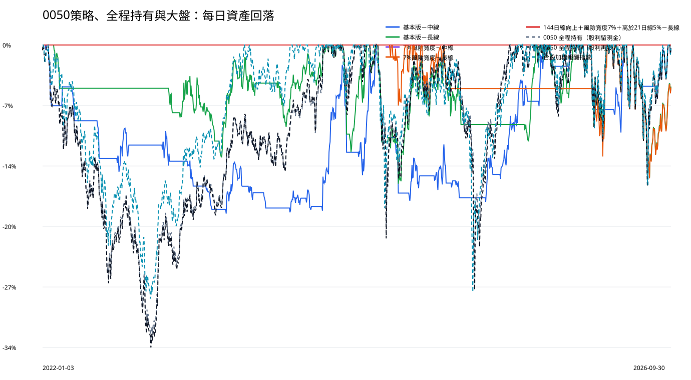

# 0050｜風險與大盤比較

## 大盤基準

大盤使用臺灣證券交易所發行量加權股價報酬指數，包含股利。50萬元從 2022-01-03 到 2026-09-30 等值成長為 1,529,411.33 元；累積報酬 205.88%，換算年報酬 26.61%，最大資產回落 -28.47%。

## 判讀方式

- 最大資產回落：資產曾經從高點跌到低點多少，絕對值越小越好。
- 年報酬／回落：每承受一單位最大回落換到多少年報酬，越高越好。
- 平均現金閒置：每天現金占總資產的平均比例，太高代表資金利用不足。

## 2022防守與2025～2026多頭依賴

|方法|年度|帳戶報酬|帳戶最大回落|大盤報酬|大盤最大回落|平均現金閒置|
|---|---|---|---|---|---|---|
|基本版－中線|2022|-11.39%|-14.24%|-18.91%|-28.47%|79.27%|
|基本版－中線|2025|24.25%|-7.28%|29.47%|-26.54%|52.57%|
|基本版－中線|2026（至9/30）|37.76%|-9.82%|68.20%|-15.72%|36.40%|
|基本版－長線|2022|-7.59%|-7.59%|-18.91%|-28.47%|93.50%|
|基本版－長線|2025|14.67%|-10.74%|29.47%|-26.54%|55.50%|
|基本版－長線|2026（至9/30）|62.98%|-14.85%|68.20%|-15.72%|2.44%|
|7%風險寬度－中線|2022|0.00%|0.00%|-18.91%|-28.47%|100.00%|
|7%風險寬度－中線|2025|0.00%|0.00%|29.47%|-26.54%|100.00%|
|7%風險寬度－中線|2026（至9/30）|0.00%|0.00%|68.20%|-15.72%|100.00%|
|7%風險寬度－長線|2022|0.00%|0.00%|-18.91%|-28.47%|100.00%|
|7%風險寬度－長線|2025|-0.69%|-4.89%|29.47%|-26.54%|97.06%|
|7%風險寬度－長線|2026（至9/30）|34.55%|-14.96%|68.20%|-15.72%|24.15%|
|144日線向上＋風險寬度7%＋高於21日線5%－長線|2022|0.00%|0.00%|-18.91%|-28.47%|100.00%|
|144日線向上＋風險寬度7%＋高於21日線5%－長線|2025|0.00%|0.00%|29.47%|-26.54%|100.00%|
|144日線向上＋風險寬度7%＋高於21日線5%－長線|2026（至9/30）|0.00%|0.00%|68.20%|-15.72%|100.00%|

2026不是完整年度；判斷策略是否只受惠於多頭，應同時查看2022是否少跌、2023～2024是否仍有累積，以及後兩年獲利占比。
