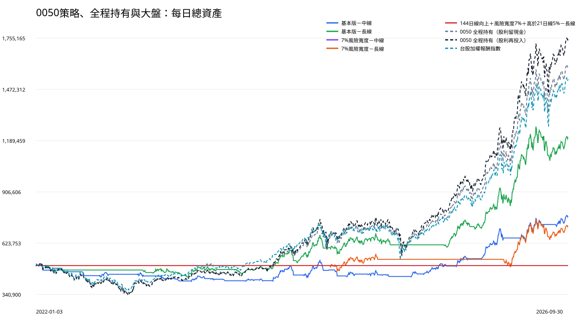

# 0050｜50萬元連續帳戶正式報告

## 先看結論

五個擇時策略都只在 2022-01-03 投入一次 50 萬元，之後連續操作到 2026-09-30，不在每年一月重設。五個擇時策略中，最後總資產最高的是「基本版－長線」：1,207,677.09 元；獲利年度 4 個（2023、2024、2025、2026）。

## 五個會進出的擇時策略

|方法|獲利年度|最後總資產|累積報酬|換算年報酬|最大資產回落|年報酬／回落|平均現金閒置|單一時點最高持倉成本|總進場|完成買賣|截止仍持有|
|---|---|---|---|---|---|---|---|---|---|---|---|
|基本版－中線|3／5（2024、2025、2026）|773,884.74|54.78%|9.64%|-18.92%|0.51|57.37%|726,964.95|27|26|1|
|基本版－長線|4／5（2023、2024、2025、2026）|1,207,677.09|141.54%|20.42%|-15.58%|1.31|39.66%|1,108,599.94|17|16|1|
|7%風險寬度－中線|0／5（無）|500,000.00|0.00%|0.00%|0.00%|—|100.00%|0.00|0|0|0|
|7%風險寬度－長線|2／5（2024、2026）|719,351.63|43.87%|7.97%|-14.96%|0.53|79.22%|660,334.76|3|2|1|
|144日線向上＋風險寬度7%＋高於21日線5%－長線|0／5（無）|500,000.00|0.00%|0.00%|0.00%|—|100.00%|0.00|0|0|0|

## 兩個從頭持有到截止日的對照基準

這兩組不參與擇時策略排名；用途是檢查判斷買賣點是否勝過直接持有。

|方法|獲利年度|最後總資產|累積報酬|換算年報酬|最大資產回落|年報酬／回落|平均現金閒置|單一時點最高持倉成本|總進場|完成買賣|截止仍持有|
|---|---|---|---|---|---|---|---|---|---|---|---|
|0050 全程持有（股利留現金）|4／5（2023、2024、2025、2026）|1,603,754.28|220.75%|27.84%|-33.08%|0.84|5.75%|499,981.37|1|0|1|
|0050 全程持有（股利再投入）|4／5（2023、2024、2025、2026）|1,748,922.58|249.78%|30.20%|-33.95%|0.89|0.01%|588,290.42|1|0|1|

## 大盤基準

|方法|最後總資產|累積報酬|換算年報酬|最大資產回落|獲利年度|
|---|---|---|---|---|---|
|台股加權報酬指數|1,529,411.33|205.88%|26.61%|-28.47%|4／5（2023、2024、2025、2026）|

## 五個擇時策略的每年表現

|方法|年度|年初資產|年底／截止資產|帳戶報酬|帳戶最大回落|大盤報酬|大盤最大回落|進場|賣出|年底仍持有|平均現金閒置|
|---|---|---|---|---|---|---|---|---|---|---|---|
|基本版－中線|2022|500,000.00|443,047.61|-11.39%|-14.24%|-18.91%|-28.47%|5|5|0|79.27%|
|基本版－中線|2023|443,047.61|425,606.56|-3.94%|-6.83%|31.48%|-6.86%|8|7|1|64.86%|
|基本版－中線|2024|425,606.56|452,144.18|6.24%|-17.50%|31.73%|-18.31%|6|6|1|47.95%|
|基本版－中線|2025|452,144.18|561,780.23|24.25%|-7.28%|29.47%|-26.54%|6|6|1|52.57%|
|基本版－中線|2026（至9/30）|561,780.23|773,884.74|37.76%|-9.82%|68.20%|-15.72%|2|2|1|36.40%|
|基本版－長線|2022|500,000.00|462,047.76|-7.59%|-7.59%|-18.91%|-28.47%|2|2|0|93.50%|
|基本版－長線|2023|462,047.76|493,893.90|6.89%|-9.41%|31.48%|-6.86%|6|5|1|25.60%|
|基本版－長線|2024|493,893.90|646,215.41|30.84%|-15.58%|31.73%|-18.31%|4|4|1|10.75%|
|基本版－長線|2025|646,215.41|740,987.20|14.67%|-10.74%|29.47%|-26.54%|4|4|1|55.50%|
|基本版－長線|2026（至9/30）|740,987.20|1,207,677.09|62.98%|-14.85%|68.20%|-15.72%|1|1|1|2.44%|
|7%風險寬度－中線|2022|500,000.00|500,000.00|0.00%|0.00%|-18.91%|-28.47%|0|0|0|100.00%|
|7%風險寬度－中線|2023|500,000.00|500,000.00|0.00%|0.00%|31.48%|-6.86%|0|0|0|100.00%|
|7%風險寬度－中線|2024|500,000.00|500,000.00|0.00%|0.00%|31.73%|-18.31%|0|0|0|100.00%|
|7%風險寬度－中線|2025|500,000.00|500,000.00|0.00%|0.00%|29.47%|-26.54%|0|0|0|100.00%|
|7%風險寬度－中線|2026（至9/30）|500,000.00|500,000.00|0.00%|0.00%|68.20%|-15.72%|0|0|0|100.00%|
|7%風險寬度－長線|2022|500,000.00|500,000.00|0.00%|0.00%|-18.91%|-28.47%|0|0|0|100.00%|
|7%風險寬度－長線|2023|500,000.00|500,000.00|0.00%|0.00%|31.48%|-6.86%|0|0|0|100.00%|
|7%風險寬度－長線|2024|500,000.00|538,354.47|7.67%|-6.80%|31.73%|-18.31%|1|0|1|60.75%|
|7%風險寬度－長線|2025|538,354.47|534,642.27|-0.69%|-4.89%|29.47%|-26.54%|0|1|0|97.06%|
|7%風險寬度－長線|2026（至9/30）|534,642.27|719,351.63|34.55%|-14.96%|68.20%|-15.72%|2|1|1|24.15%|
|144日線向上＋風險寬度7%＋高於21日線5%－長線|2022|500,000.00|500,000.00|0.00%|0.00%|-18.91%|-28.47%|0|0|0|100.00%|
|144日線向上＋風險寬度7%＋高於21日線5%－長線|2023|500,000.00|500,000.00|0.00%|0.00%|31.48%|-6.86%|0|0|0|100.00%|
|144日線向上＋風險寬度7%＋高於21日線5%－長線|2024|500,000.00|500,000.00|0.00%|0.00%|31.73%|-18.31%|0|0|0|100.00%|
|144日線向上＋風險寬度7%＋高於21日線5%－長線|2025|500,000.00|500,000.00|0.00%|0.00%|29.47%|-26.54%|0|0|0|100.00%|
|144日線向上＋風險寬度7%＋高於21日線5%－長線|2026（至9/30）|500,000.00|500,000.00|0.00%|0.00%|68.20%|-15.72%|0|0|0|100.00%|

## 全程持有基準的每年表現

|方法|年度|年初資產|年底／截止資產|帳戶報酬|帳戶最大回落|大盤報酬|大盤最大回落|進場|賣出|年底仍持有|平均現金閒置|
|---|---|---|---|---|---|---|---|---|---|---|---|
|0050 全程持有（股利留現金）|2022|500,000.00|391,229.13|-21.75%|-33.08%|-18.91%|-28.47%|1|0|1|2.86%|
|0050 全程持有（股利留現金）|2023|391,229.13|492,295.32|25.83%|-6.57%|31.48%|-6.86%|0|0|1|6.03%|
|0050 全程持有（股利留現金）|2024|492,295.32|710,667.54|44.36%|-20.44%|31.73%|-18.31%|0|0|1|6.84%|
|0050 全程持有（股利留現金）|2025|710,667.54|951,078.92|33.83%|-25.46%|29.47%|-26.54%|0|0|1|7.45%|
|0050 全程持有（股利留現金）|2026（至9/30）|951,078.92|1,603,754.28|68.62%|-15.14%|68.20%|-15.72%|0|0|1|5.58%|
|0050 全程持有（股利再投入）|2022|500,000.00|388,486.94|-22.30%|-33.95%|-18.91%|-28.47%|1|0|1|0.01%|
|0050 全程持有（股利再投入）|2023|388,486.94|495,016.76|27.42%|-7.02%|31.48%|-6.86%|0|0|1|0.01%|
|0050 全程持有（股利再投入）|2024|495,016.76|734,650.38|48.41%|-21.70%|31.73%|-18.31%|0|0|1|0.02%|
|0050 全程持有（股利再投入）|2025|734,650.38|1,005,095.16|36.81%|-27.49%|29.47%|-26.54%|0|0|1|0.01%|
|0050 全程持有（股利再投入）|2026（至9/30）|1,005,095.16|1,748,922.58|74.01%|-15.88%|68.20%|-15.72%|0|0|1|0.00%|

## 空頭防守與後段多頭依賴

|方法|截至2024累積獲利|2025～2026增加獲利|後兩年占總獲利|2022比大盤多賺／少賠|2022最大回落少於大盤|
|---|---|---|---|---|---|
|基本版－中線|-47,855.82|321,740.56|117.47%|7.52%|14.23%|
|基本版－長線|146,215.41|561,461.68|79.34%|11.32%|20.88%|
|7%風險寬度－中線|0.00|0.00|—|18.91%|28.47%|
|7%風險寬度－長線|38,354.47|180,997.16|82.51%|18.91%|28.47%|
|144日線向上＋風險寬度7%＋高於21日線5%－長線|0.00|0.00|—|18.91%|28.47%|

後兩年占比高不代表策略無效，但表示最終獲利較依賴 2025～2026 行情。2026 只統計到 9 月 30 日。

## 資金與交易過程

|方法|買入周轉總額|單一時點最高持倉成本|已賣出損益|截止日持股估算損益|股利收入|費稅與價差預留|
|---|---|---|---|---|---|---|
|基本版－中線|12,668,855.46|726,964.95|226,980.21|46,904.54|25,416.64|71,715.72|
|基本版－長線|9,706,960.20|1,108,599.94|615,495.13|92,181.96|47,632.60|54,473.36|
|7%風險寬度－中線|0.00|0.00|0.00|0.00|0.00|0.00|
|7%風險寬度－長線|1,694,824.04|660,334.76|164,443.50|54,908.13|4,092.00|8,128.36|
|144日線向上＋風險寬度7%＋高於21日線5%－長線|0.00|0.00|0.00|0.00|0.00|0.00|

## 進場機會稽核

表中的『完整訊號候選』是均線與型態已走到可判斷買進的那一天；實際買進前，仍須逐項通過該方法要求的條件。已有持股時不會再重複買進。

|方法|完整訊號候選|實際買進|已有持股，不重複買|144日線沒有向上|風險寬度不足7%|高於21日線不足5%|資料不足|其他未進場|
|---|---|---|---|---|---|---|---|---|
|基本版－中線|66|27|39|0|0|0|0|0|
|基本版－長線|46|17|29|0|0|0|0|0|
|7%風險寬度－中線|66|0|0|9|57|0|0|0|
|7%風險寬度－長線|46|3|14|2|27|0|0|0|
|144日線向上＋風險寬度7%＋高於21日線5%－長線|46|0|0|2|40|4|0|0|

- 7%風險寬度－中線：有 66 次完整訊號候選，但沒有一次同時通過全部條件（144日線沒有向上 9 次、風險寬度不足7% 57 次），因此沒有交易機會。
- 144日線向上＋風險寬度7%＋高於21日線5%－長線：有 46 次完整訊號候選，但沒有一次同時通過全部條件（144日線沒有向上 2 次、風險寬度不足7% 40 次、高於21日線不足5% 4 次），因此沒有交易機會。

嚴格長線版會依序檢查三項條件：144日線向上、風險寬度至少7%、收盤價至少高於21日線5%；它不是只檢查最後一項。

## 這份重播怎麼做

- 每個方法都是獨立的 50 萬元帳戶；不是把五個方法同時塞入同一帳戶。
- 擇時策略每次進場使用當時帳戶內幾乎全部可用現金，並將已實現獲利繼續投入；不是每筆固定 1 萬元。
- 持倉、現金與策略狀態可以跨年；年度表只是從同一條連續資產曲線切片。
- 0050 是長期持續監控標的；一段均線多頭區間結束後，下一個新的多頭區間可重新開始監控並等待完整進場訊號。
- 買進與賣出各預留 0.2% 價差，另扣手續費與賣出交易稅。
- 0050 一拆四只調整股數與技術座標，不當成買賣或損益。
- 截止日仍持有的部位，以 2026-09-30 原始收盤價扣除假設賣出成本估算。

## 附件

- [風險與大盤比較](benchmark-risk-report.md)
- [完整逐筆交易](trade-details.md)
- [每日總資產與回落](daily-equity.csv)
- [逐年總表](calendar-year-summary.csv)
- [五年總表](scenario-summary.csv)
- [全部買賣動作](transactions.csv)
- [每年及五年的進場機會稽核](signal-opportunity-audit.csv)
- [股利與分割](corporate-actions.csv)
- [大盤報酬指數](benchmark.csv)
