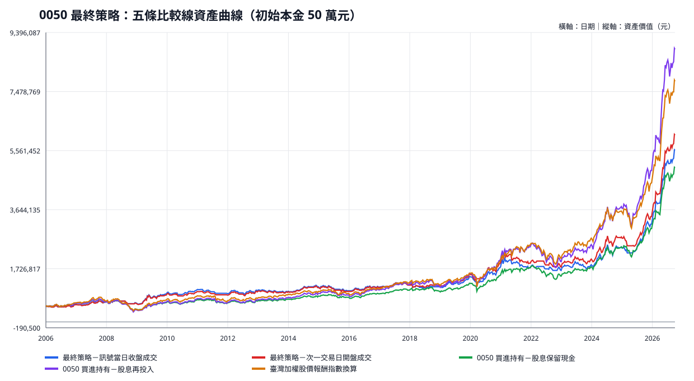
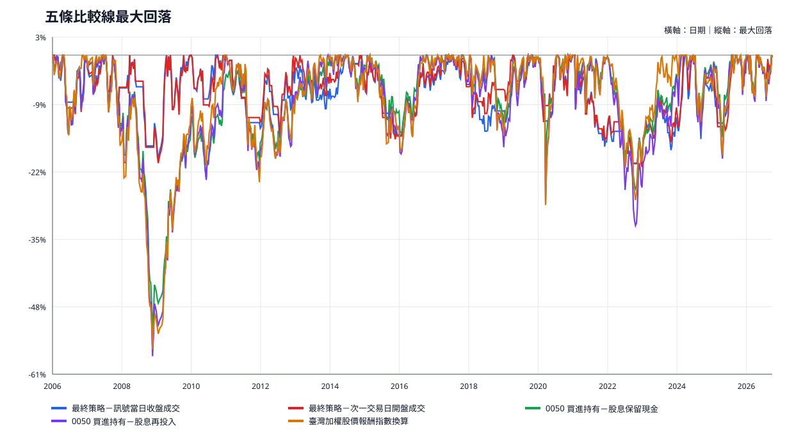
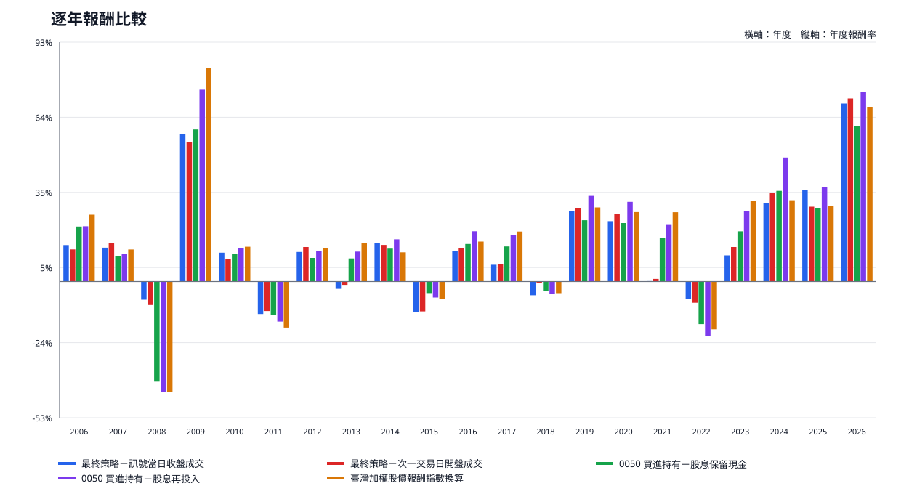
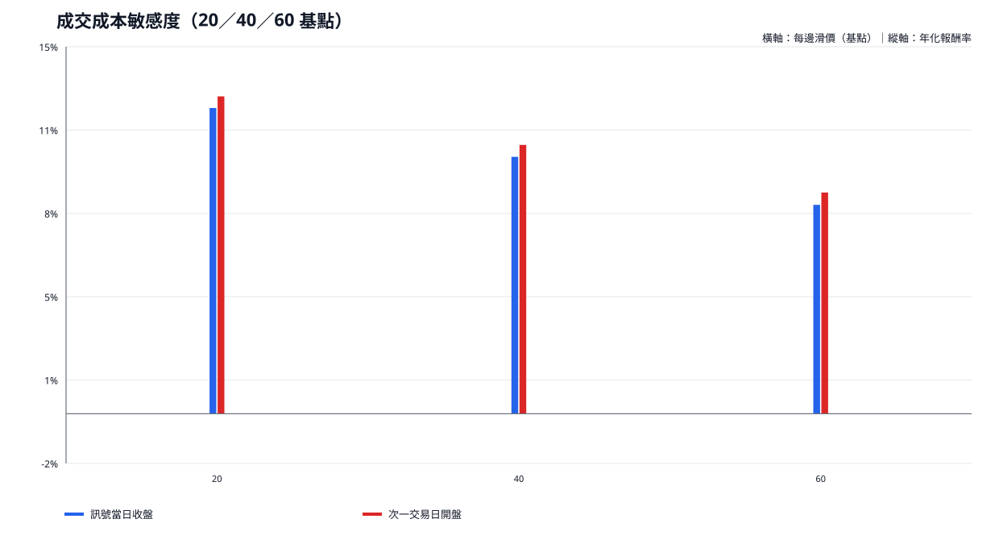
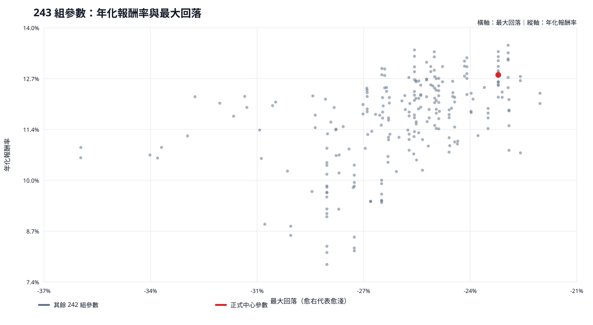

# 0050 最終策略定版報告｜正式 v1.7

產出時間：2026-10-10 23:24:39（台北）

狀態：`ACCEPT`。本版補齊主報告與繁體中文逐筆交易明細的雙向連結；策略、交易、帳務、圖表及績效數值完全沿用已驗收 v1.6。

## 閱讀順序

- [01｜一頁白話結論](#01)
- [02｜完整績效總表](#02)
- [03｜策略相對大盤與0050持有的差異](#03)
- [04｜策略規則與兩種成交版本](#04)
- [05｜完整逐年績效](#05)
- [06｜交易紀錄與資金投入](#06)
- [07｜成交時間與交易成本測試](#07)
- [08｜不同時期與市場狀態測試](#08)
- [09｜交易集中度與單筆穩定性](#09)
- [10｜243組參數穩健性](#10)
- [11｜核心持有比例研究](#11)
- [12｜最終實務建議與監控項目](#12)
- [13｜技術驗收與重現附件](#13)
- [14｜完整附件目錄](#14)

## 01

### 一頁白話結論

### 測試目的

判斷固定規則在完整歷史樣本及既定成本後是否仍為正報酬。

### 測試方法

以次一交易日開盤成交作實務主口徑，同時保留訊號當日收盤成交作理想化研究對照。

### 觀察結果

實務主口徑期末資產為 6,067,613.25 元，年化報酬率 12.78%，最大回落 -23.17%。




### 白話結論

本歷史樣本扣除既定成本後為正報酬，但不證明未來一定具有正期望。

### 對最終決策的影響

策略規則維持不變，後續應以實務主口徑執行並持續監控。

## 02

### 完整績效總表

### 測試目的

用同一本金、期間與估值方式比較五條正式比較線。

### 測試方法

統計 2006-01-02 至 2026-09-30 的連續帳戶，年度不重設。

### 觀察結果

|策略／比較基準|成交方式|期末資產|總報酬|年化報酬率|最大回落|獲利年度|虧損年度|平盤年度|進場／出場／未平倉|最大投入|
|---|---|---|---|---|---|---|---|---|---|---|
|最終策略－訊號當日收盤成交|訊號當日收盤成交|5,566,293.63|1013.26%|12.31%|-22.33%|15|6|0|92/91/1|5,138,964.42|
|最終策略－次一交易日開盤成交|次一交易日開盤成交|6,067,613.25|1113.52%|12.78%|-23.17%|15|6|0|91/90/1|5,555,470.34|
|0050 買進持有－股息保留現金|首日開盤買進後全程持有|5,005,237.75|901.05%|11.74%|-52.55%|16|5|0|1/0/1|499,973.40|
|0050 買進持有－股息再投入|首日開盤買進；股息於付款日收盤再投入|8,850,923.98|1670.18%|14.85%|-57.32%|16|5|0|1/0/1|1,442,213.92|
|臺灣加權股價報酬指數換算|指數收盤換算（不可直接交易）|7,814,382.23|1462.88%|14.16%|-56.02%|16|5|0|—|—|




### 白話結論

股息再投入持有線的期末資產較高，但兩個策略版本的最大回落明顯較淺。

### 對最終決策的影響

最終決策不能只看期末資產，必須同時衡量回落、交易成本與執行可行性。

## 03

### 策略相對大盤與0050持有的差異

### 測試目的

直接量化策略相對兩個重要比較基準的得失。

### 測試方法

期末資產差異＝策略減比較基準；年化報酬率差異以百分點表示；最大回落改善＝策略最大回落減比較基準最大回落，正值代表回落較淺。

### 觀察結果

註：差異以未四捨五入原值計算，表格顯示可能有 0.01 元或 0.01 個百分點的四捨五入差。

|策略|相較大盤期末資產差異|相較大盤年化報酬率差異|相較大盤最大回落改善|相較0050股息再投入期末資產差異|相較0050股息再投入年化報酬率差異|相較0050股息再投入最大回落改善|
|---|---|---|---|---|---|---|
|最終策略－訊號當日收盤成交|-2,248,088.59|-1.85 個百分點|+33.69 個百分點|-3,284,630.35|-2.54 個百分點|+34.98 個百分點|
|最終策略－次一交易日開盤成交|-1,746,768.98|-1.38 個百分點|+32.85 個百分點|-2,783,310.73|-2.07 個百分點|+34.15 個百分點|

### 白話結論

兩個策略版本都以較低回落交換部分長期報酬。

### 對最終決策的影響

若優先考慮風險控制，策略仍具決策價值；若只追求樣本期末值，股息再投入持有較高。

## 04

### 策略規則與兩種成交版本

### 測試目的

消除規則與成交時點的歧義。

### 測試方法

以下規格集中列示，可單獨閱讀：

- 本報告嚴格區分兩種價格座標：『技術分析用收盤價／最低價』會在分割時等比例重訂，只用於均線、訊號與防守判斷；『未還原開盤價／收盤價』是市場實際價格，只用於成交、股息再投入與未平倉清算帳務。
- MA21 大於或等於 MA144（等號歸高市場狀態）；MA21 小於 MA144 為低市場狀態。持倉期間每天重新判定並動態切換市場狀態。
- 高市場狀態進場：空手時，前一日技術分析用收盤價不高於前一日 MA21，且當日技術分析用收盤價高於當日 MA21。低市場狀態進場：MACD 柱狀值前一日小於或等於 0、當日大於 0。
- 固定初始防守價取最近一段『技術分析用收盤價不高於 MA21』期間累積的技術分析用最低價、前一日技術分析用最低價與訊號日技術分析用最低價的可用最小值；必須嚴格低於進場參考價，進場後不上移。分割時，技術分析用價格與防守價座標等比例調整。
- 高市場狀態中，當日技術分析用收盤價嚴格低於固定初始防守價時優先出場；低市場狀態只維護防守價而不執行。
- 低市場狀態由 MACD 柱狀值綠翻紅進場時，出場條件立即啟用。MA21 突破進場時，若柱狀值大於或等於 0（含 0）便立即啟用；否則等待持有後首次大於或等於 0 才啟用。啟用後，只有前一日柱狀值大於或等於 0、當日小於 0 才以 MACD 出場。
- 已持有時不加碼；賣出當日不重新進場；截止日仍持有時不強制平倉。
- 訊號當日收盤版本的進場與出場都使用訊號當日收盤；次一交易日開盤版本的進場與出場都使用訊號後下一官方交易日開盤，不存在收盤進場、隔日開盤出場的混合第三版。
- 單一連續帳戶初始本金 500,000 元，只買整股；每次以當時可用現金為預算上限，初始風險不得超過可用現金 20%；不借款、不加碼、不逐年重設。
- 使用 2005 年資料暖機，正式期間為 2006-01-02 至 2026-09-30。買進與賣出各計 20 基點滑價；手續費率 0.0399%，每筆四捨五入至整元，並假設沒有最低手續費；ETF 賣出稅 0.1%。未平倉部位以當日未還原收盤價，扣除預估賣出手續費與稅後的清算值列入資產。
- 股息資格在除息日依持股鎖定，付款日入帳；策略閒置現金於下一次合規進場投入。0050 買進持有股息再投入線採付款日收盤再投入，實務能否同日動用股息取決於券商入帳時點。2025-06-18 分割只調整股數與價格座標，不是交易，也不視為暴跌或停損。

### 觀察結果

訊號當日收盤成交只作研究對照；次一交易日開盤成交才是正式執行與歸因口徑。

### 白話結論

所有訊號都在收盤後才能完整確認，因此實務不應把同日收盤成交當成可直接複製的結果。

### 對最終決策的影響

正式監控器應在盤後建立下一官方交易日開盤待執行單。

## 05

### 完整逐年績效

### 測試目的

檢查結果是否只由少數年度造成，並把策略與大盤逐年並排。

### 測試方法

沿用單一連續帳戶，每年年初資產等於前一年年末資產；同時統計進場、出場與年底持有。

### 觀察結果

|策略|年度|年初資產|年末／截止資產|策略報酬|策略最大回落|大盤報酬|大盤最大回落|進場|出場|年底／截止仍持有|
|---|---|---|---|---|---|---|---|---|---|---|
|最終策略－訊號當日收盤成交|2006|500,000.00|571,128.81|14.23%|-10.42%|26.10%|-15.27%|4|3|1|
|最終策略－訊號當日收盤成交|2007|571,128.81|646,599.48|13.21%|-9.73%|12.50%|-20.41%|3|4|0|
|最終策略－訊號當日收盤成交|2008|646,599.48|600,771.38|-7.09%|-19.15%|-43.07%|-53.59%|3|2|1|
|最終策略－訊號當日收盤成交|2009|600,771.38|946,693.96|57.58%|-11.93%|83.34%|-11.59%|4|4|1|
|最終策略－訊號當日收盤成交|2010|946,693.96|1,053,174.30|11.25%|-8.85%|13.57%|-15.36%|4|4|1|
|最終策略－訊號當日收盤成交|2011|1,053,174.30|919,735.53|-12.67%|-14.00%|-17.98%|-24.52%|5|5|1|
|最終策略－訊號當日收盤成交|2012|919,735.53|1,025,866.99|11.54%|-13.36%|12.94%|-15.32%|3|3|1|
|最終策略－訊號當日收盤成交|2013|1,025,866.99|996,340.30|-2.88%|-9.15%|15.14%|-8.73%|7|7|1|
|最終策略－訊號當日收盤成交|2014|996,340.30|1,146,827.59|15.10%|-5.21%|11.39%|-10.44%|4|4|1|
|最終策略－訊號當日收盤成交|2015|1,146,827.59|1,011,406.94|-11.81%|-16.81%|-6.87%|-23.18%|6|7|0|
|最終策略－訊號當日收盤成交|2016|1,011,406.94|1,131,951.94|11.92%|-6.23%|15.59%|-8.61%|4|3|1|
|最終策略－訊號當日收盤成交|2017|1,131,951.94|1,206,158.04|6.56%|-5.57%|19.52%|-4.60%|6|7|0|
|最終策略－訊號當日收盤成交|2018|1,206,158.04|1,141,659.46|-5.35%|-14.51%|-4.83%|-14.47%|5|5|0|
|最終策略－訊號當日收盤成交|2019|1,141,659.46|1,456,562.25|27.58%|-6.42%|28.92%|-7.16%|3|2|1|
|最終策略－訊號當日收盤成交|2020|1,456,562.25|1,799,816.06|23.57%|-12.56%|27.12%|-28.55%|5|5|1|
|最終策略－訊號當日收盤成交|2021|1,799,816.06|1,802,882.34|0.17%|-17.54%|27.06%|-12.74%|6|6|1|
|最終策略－訊號當日收盤成交|2022|1,802,882.34|1,680,912.45|-6.77%|-12.00%|-18.68%|-28.47%|3|3|1|
|最終策略－訊號當日收盤成交|2023|1,680,912.45|1,852,504.06|10.21%|-13.15%|31.48%|-6.86%|7|7|1|
|最終策略－訊號當日收盤成交|2024|1,852,504.06|2,418,997.37|30.58%|-16.37%|31.73%|-18.31%|4|4|1|
|最終策略－訊號當日收盤成交|2025|2,418,997.37|3,283,916.85|35.76%|-12.21%|29.47%|-26.54%|4|4|1|
|最終策略－訊號當日收盤成交|2026|3,283,916.85|5,566,293.63|69.50%|-9.19%|68.20%|-15.72%|2|2|1|
|最終策略－次一交易日開盤成交|2006|500,000.00|562,714.01|12.54%|-11.83%|26.10%|-15.27%|4|3|1|
|最終策略－次一交易日開盤成交|2007|562,714.01|647,241.07|15.02%|-9.74%|12.50%|-20.41%|3|4|0|
|最終策略－次一交易日開盤成交|2008|647,241.07|587,905.72|-9.17%|-20.02%|-43.07%|-53.59%|3|2|1|
|最終策略－次一交易日開盤成交|2009|587,905.72|908,197.36|54.48%|-11.93%|83.34%|-11.59%|4|4|1|
|最終策略－次一交易日開盤成交|2010|908,197.36|987,908.89|8.78%|-9.73%|13.57%|-15.36%|4|4|1|
|最終策略－次一交易日開盤成交|2011|987,908.89|874,077.30|-11.52%|-12.87%|-17.98%|-24.52%|5|5|1|
|最終策略－次一交易日開盤成交|2012|874,077.30|991,914.95|13.48%|-13.44%|12.94%|-15.32%|3|3|1|
|最終策略－次一交易日開盤成交|2013|991,914.95|978,977.18|-1.30%|-8.20%|15.14%|-8.73%|7|7|1|
|最終策略－次一交易日開盤成交|2014|978,977.18|1,119,013.37|14.30%|-5.43%|11.39%|-10.44%|4|4|1|
|最終策略－次一交易日開盤成交|2015|1,119,013.37|988,526.46|-11.66%|-17.56%|-6.87%|-23.18%|6|7|0|
|最終策略－次一交易日開盤成交|2016|988,526.46|1,118,042.40|13.10%|-6.09%|15.59%|-8.61%|4|3|1|
|最終策略－次一交易日開盤成交|2017|1,118,042.40|1,195,795.68|6.95%|-6.00%|19.52%|-4.60%|6|7|0|
|最終策略－次一交易日開盤成交|2018|1,195,795.68|1,189,134.43|-0.56%|-9.80%|-4.83%|-14.47%|4|4|0|
|最終策略－次一交易日開盤成交|2019|1,189,134.43|1,531,199.43|28.77%|-6.08%|28.92%|-7.16%|3|2|1|
|最終策略－次一交易日開盤成交|2020|1,531,199.43|1,935,422.63|26.40%|-13.72%|27.12%|-28.55%|5|5|1|
|最終策略－次一交易日開盤成交|2021|1,935,422.63|1,954,944.45|1.01%|-16.85%|27.06%|-12.74%|6|6|1|
|最終策略－次一交易日開盤成交|2022|1,954,944.45|1,792,878.79|-8.29%|-12.77%|-18.68%|-28.47%|3|3|1|
|最終策略－次一交易日開盤成交|2023|1,792,878.79|2,034,300.90|13.47%|-11.44%|31.48%|-6.86%|7|7|1|
|最終策略－次一交易日開盤成交|2024|2,034,300.90|2,738,589.57|34.62%|-15.00%|31.73%|-18.31%|4|4|1|
|最終策略－次一交易日開盤成交|2025|2,738,589.57|3,538,703.52|29.22%|-16.37%|29.47%|-26.54%|4|4|1|
|最終策略－次一交易日開盤成交|2026|3,538,703.52|6,067,613.25|71.46%|-9.19%|68.20%|-15.72%|2|2|1|
|0050 買進持有－股息保留現金|2006|500,000.00|607,378.21|21.48%|-16.22%|26.10%|-15.27%|1|0|1|
|0050 買進持有－股息保留現金|2007|607,378.21|668,430.59|10.05%|-16.72%|12.50%|-20.41%|0|0|1|
|0050 買進持有－股息保留現金|2008|668,430.59|407,122.73|-39.09%|-50.09%|-43.07%|-53.59%|0|0|1|
|0050 買進持有－股息保留現金|2009|407,122.73|648,863.26|59.38%|-9.57%|83.34%|-11.59%|0|0|1|
|0050 買進持有－股息保留現金|2010|648,863.26|719,246.63|10.85%|-14.41%|13.57%|-15.36%|0|0|1|
|0050 買進持有－股息保留現金|2011|719,246.63|624,517.47|-13.17%|-20.82%|-17.98%|-24.52%|0|0|1|
|0050 買進持有－股息保留現金|2012|624,517.47|682,007.01|9.21%|-11.94%|12.94%|-15.32%|0|0|1|
|0050 買進持有－股息保留現金|2013|682,007.01|743,511.06|9.02%|-7.68%|15.14%|-8.73%|0|0|1|
|0050 買進持有－股息保留現金|2014|743,511.06|838,948.13|12.84%|-7.78%|11.39%|-10.44%|0|0|1|
|0050 買進持有－股息保留現金|2015|838,948.13|798,697.81|-4.80%|-16.72%|-6.87%|-23.18%|0|0|1|
|0050 買進持有－股息保留現金|2016|798,697.81|915,745.05|14.65%|-6.52%|15.59%|-8.61%|0|0|1|
|0050 買進持有－股息保留現金|2017|915,745.05|1,041,202.05|13.70%|-4.26%|19.52%|-4.60%|0|0|1|
|0050 買進持有－股息保留現金|2018|1,041,202.05|1,004,424.03|-3.53%|-12.26%|-4.83%|-14.47%|0|0|1|
|0050 買進持有－股息保留現金|2019|1,004,424.03|1,244,952.88|23.95%|-6.21%|28.92%|-7.16%|0|0|1|
|0050 買進持有－股息保留現金|2020|1,244,952.88|1,529,261.91|22.84%|-21.16%|27.12%|-28.55%|0|0|1|
|0050 買進持有－股息保留現金|2021|1,529,261.91|1,791,437.65|17.14%|-8.40%|27.06%|-12.74%|0|0|1|
|0050 買進持有－股息保留現金|2022|1,791,437.65|1,493,651.16|-16.62%|-26.65%|-18.68%|-28.47%|0|0|1|
|0050 買進持有－股息保留現金|2023|1,493,651.16|1,786,348.13|19.60%|-5.21%|31.48%|-6.86%|0|0|1|
|0050 買進持有－股息保留現金|2024|1,786,348.13|2,418,775.27|35.40%|-17.46%|31.73%|-18.31%|0|0|1|
|0050 買進持有－股息保留現金|2025|2,418,775.27|3,115,026.92|28.79%|-21.79%|29.47%|-26.54%|0|0|1|
|0050 買進持有－股息保留現金|2026|3,115,026.92|5,005,237.75|60.68%|-14.04%|68.20%|-15.72%|0|0|1|
|0050 買進持有－股息再投入|2006|500,000.00|607,947.43|21.59%|-16.22%|26.10%|-15.27%|1|0|1|
|0050 買進持有－股息再投入|2007|607,947.43|672,940.48|10.69%|-17.97%|12.50%|-20.41%|0|0|1|
|0050 買進持有－股息再投入|2008|672,940.48|383,517.41|-43.01%|-55.06%|-43.07%|-53.59%|0|0|1|
|0050 買進持有－股息再投入|2009|383,517.41|670,831.70|74.92%|-11.93%|83.34%|-11.59%|0|0|1|
|0050 買進持有－股息再投入|2010|670,831.70|757,845.51|12.97%|-16.79%|13.57%|-15.36%|0|0|1|
|0050 買進持有－股息再投入|2011|757,845.51|639,349.82|-15.64%|-24.70%|-17.98%|-24.52%|0|0|1|
|0050 買進持有－股息再投入|2012|639,349.82|714,882.57|11.81%|-14.86%|12.94%|-15.32%|0|0|1|
|0050 買進持有－股息再投入|2013|714,882.57|798,421.77|11.69%|-9.71%|15.14%|-8.73%|0|0|1|
|0050 買進持有－股息再投入|2014|798,421.77|930,106.27|16.49%|-9.67%|11.39%|-10.44%|0|0|1|
|0050 買進持有－股息再投入|2015|930,106.27|872,091.67|-6.24%|-20.96%|-6.87%|-23.18%|0|0|1|
|0050 買進持有－股息再投入|2016|872,091.67|1,043,198.80|19.62%|-8.58%|15.59%|-8.61%|0|0|1|
|0050 買進持有－股息再投入|2017|1,043,198.80|1,231,582.22|18.06%|-5.45%|19.52%|-4.60%|0|0|1|
|0050 買進持有－股息再投入|2018|1,231,582.22|1,170,607.31|-4.95%|-15.99%|-4.83%|-14.47%|0|0|1|
|0050 買進持有－股息再投入|2019|1,170,607.31|1,561,921.30|33.43%|-8.36%|28.92%|-7.16%|0|0|1|
|0050 買進持有－股息再投入|2020|1,561,921.30|2,047,760.46|31.11%|-28.20%|27.12%|-28.55%|0|0|1|
|0050 買進持有－股息再投入|2021|2,047,760.46|2,500,113.12|22.09%|-10.44%|27.06%|-12.74%|0|0|1|
|0050 買進持有－股息再投入|2022|2,500,113.12|1,965,845.50|-21.37%|-33.95%|-18.68%|-28.47%|0|0|1|
|0050 買進持有－股息再投入|2023|1,965,845.50|2,504,962.99|27.42%|-7.02%|31.48%|-6.86%|0|0|1|
|0050 買進持有－股息再投入|2024|2,504,962.99|3,717,782.18|48.42%|-21.70%|31.73%|-18.31%|0|0|1|
|0050 買進持有－股息再投入|2025|3,717,782.18|5,086,504.40|36.82%|-27.49%|29.47%|-26.54%|0|0|1|
|0050 買進持有－股息再投入|2026|5,086,504.40|8,850,923.98|74.01%|-15.88%|68.20%|-15.72%|0|0|1|
|臺灣加權股價報酬指數換算|2006|500,000.00|630,511.96|26.10%|-15.27%|26.10%|-15.27%|—|—|—|
|臺灣加權股價報酬指數換算|2007|630,511.96|709,303.13|12.50%|-20.41%|12.50%|-20.41%|—|—|—|
|臺灣加權股價報酬指數換算|2008|709,303.13|403,814.89|-43.07%|-53.59%|-43.07%|-53.59%|—|—|—|
|臺灣加權股價報酬指數換算|2009|403,814.89|740,373.95|83.34%|-11.59%|83.34%|-11.59%|—|—|—|
|臺灣加權股價報酬指數換算|2010|740,373.95|840,869.65|13.57%|-15.36%|13.57%|-15.36%|—|—|—|
|臺灣加權股價報酬指數換算|2011|840,869.65|689,690.81|-17.98%|-24.52%|-17.98%|-24.52%|—|—|—|
|臺灣加權股價報酬指數換算|2012|689,690.81|778,947.24|12.94%|-15.32%|12.94%|-15.32%|—|—|—|
|臺灣加權股價報酬指數換算|2013|778,947.24|896,889.04|15.14%|-8.73%|15.14%|-8.73%|—|—|—|
|臺灣加權股價報酬指數換算|2014|896,889.04|999,042.72|11.39%|-10.44%|11.39%|-10.44%|—|—|—|
|臺灣加權股價報酬指數換算|2015|999,042.72|930,396.77|-6.87%|-23.18%|-6.87%|-23.18%|—|—|—|
|臺灣加權股價報酬指數換算|2016|930,396.77|1,075,443.50|15.59%|-8.61%|15.59%|-8.61%|—|—|—|
|臺灣加權股價報酬指數換算|2017|1,075,443.50|1,285,406.44|19.52%|-4.60%|19.52%|-4.60%|—|—|—|
|臺灣加權股價報酬指數換算|2018|1,285,406.44|1,223,359.26|-4.83%|-14.47%|-4.83%|-14.47%|—|—|—|
|臺灣加權股價報酬指數換算|2019|1,223,359.26|1,577,145.89|28.92%|-7.16%|28.92%|-7.16%|—|—|—|
|臺灣加權股價報酬指數換算|2020|1,577,145.89|2,004,892.15|27.12%|-28.55%|27.12%|-28.55%|—|—|—|
|臺灣加權股價報酬指數換算|2021|2,004,892.15|2,547,477.86|27.06%|-12.74%|27.06%|-12.74%|—|—|—|
|臺灣加權股價報酬指數換算|2022|2,547,477.86|2,071,679.22|-18.68%|-28.47%|-18.68%|-28.47%|—|—|—|
|臺灣加權股價報酬指數換算|2023|2,071,679.22|2,723,900.64|31.48%|-6.86%|31.48%|-6.86%|—|—|—|
|臺灣加權股價報酬指數換算|2024|2,723,900.64|3,588,277.30|31.73%|-18.31%|31.73%|-18.31%|—|—|—|
|臺灣加權股價報酬指數換算|2025|3,588,277.30|4,645,853.16|29.47%|-26.54%|29.47%|-26.54%|—|—|—|
|臺灣加權股價報酬指數換算|2026|4,645,853.16|7,814,382.23|68.20%|-15.72%|68.20%|-15.72%|—|—|—|




### 白話結論

策略存在虧損年度，正報酬並不是逐年穩定發生。

### 對最終決策的影響

年度不順時不得臨時改規則，應依既定監控條件評估是否仍在歷史合理範圍。

## 06

### 交易紀錄與資金投入

### 測試目的

確認帳戶成果可由實際投入、股息與成本完整解釋。

### 測試方法

初始本金 500,000 元；每次以當時可用現金及初始風險上限決定整股數，不借款、不加碼。手續費率為 0.0399%，ETF 賣出稅為 0.1%。股息依除息資格鎖定並在付款日入帳；股息再投入比較線的 31 筆交易以付款日未還原收盤價成交，實務能否同日動用股息仍取決於券商入帳時點。分割只調整價格與股數座標，不視為交易。

### 觀察結果

|策略／比較基準|累計買進|最大投入|已實現淨損益|股息|費用與稅|滑價成本|
|---|---|---|---|---|---|---|
|最終策略－訊號當日收盤成交|123,188,113.24|5,138,964.42|4,638,982.24|548,663.67|220,245.00|490,897.78|
|最終策略－次一交易日開盤成交|126,791,420.98|5,555,470.34|5,055,523.31|630,259.89|226,605.00|505,154.64|
|0050 買進持有－股息保留現金|499,973.40|499,973.40|0.00|597,841.53|199.00|997.55|
|0050 買進持有－股息再投入|1,442,213.92|1,442,213.92|0.00|942,216.07|576.00|2,877.52|
|臺灣加權股價報酬指數換算|—|—|—|—|—|—|

### 逐筆交易明細

下列明細均來自本報告已驗收的原始交易帳。中文閱讀版將每一筆進場、出場、股數、費稅、股息、淨損益、報酬率、最大有利／不利變動與初始防守價並排呈現。

- [繁體中文逐筆交易明細](trade-details.md)
- [兩種成交版本合併逐筆 CSV](strategy-trade-details.csv)
- [訊號當日收盤版逐筆 CSV](signal-close-trade-details.csv)
- [次一交易日開盤版逐筆 CSV](next-session-open-trade-details.csv)
- [完整買賣與現金事件流水](strategy-transactions.csv)

### 白話結論

50 萬元是帳戶起始本金，不是每筆固定投入；獲利累積後單筆最大投入可高於 50 萬元。

### 對最終決策的影響

實務系統必須逐日保存現金、股數、清算值、股息權利與成本。

## 07

### 成交時間與交易成本測試

### 測試目的

評估延後成交與更差價格對績效的影響。

### 測試方法

固定原訊號，分別測兩種成交方式及買賣各 20、40、60 基點；20 基點等於 0.20%。

### 觀察結果

|成交方式|單邊滑價|期末資產|年化報酬率|最大回落|完成回合|
|---|---|---|---|---|---|
|訊號當日收盤成交|20 基點|5,566,293.63|12.31%|-22.33%|91|
|訊號當日收盤成交|40 基點|3,857,519.66|10.34%|-24.12%|91|
|訊號當日收盤成交|60 基點|2,673,146.85|8.41%|-28.80%|91|
|次一交易日開盤成交|20 基點|6,067,613.25|12.78%|-23.17%|90|
|次一交易日開盤成交|40 基點|4,222,400.81|10.82%|-24.08%|90|
|次一交易日開盤成交|60 基點|2,938,157.80|8.91%|-26.76%|90|




### 白話結論

成本愈高，期末資產與年化報酬率愈低；實務結果應以次一交易日開盤 20 基點為主。

### 對最終決策的影響

若實際滑價長期超過 40 或 60 基點壓力帶，應暫停擴大部位並檢查執行品質。

## 08

### 不同時期與市場狀態測試

### 測試目的

確認績效是否只集中在單一年代或多頭環境。

### 測試方法

比較固定歷史區間、3／5／10 年滾動期間，以及以已完成歷史資訊分類的多頭、空頭與盤整。

### 觀察結果

|期間|期初資產|期末資產|年化報酬率|最大回落|
|---|---|---|---|---|
|2006～2012|500,000.00|991,914.95|10.29%|-23.17%|
|2013～2019|1,002,976.15|1,531,199.43|6.23%|-17.56%|
|2020～2026年9月|1,542,255.15|6,067,613.25|22.51%|-21.31%|

|滾動期間|觀測數|年化報酬率中位數|最差年化報酬率|最差最大回落|
|---|---|---|---|---|
|3 年|213|7.96%|-1.99%|-23.17%|
|5 年|189|8.78%|-0.00%|-23.17%|
|10 年|129|7.60%|4.15%|-23.17%|

|市場狀態|交易日報酬數|策略複合報酬|平均每日報酬|
|---|---|---|---|
|多頭|3010|352.13%|0.05%|
|空頭|569|41.56%|0.07%|
|盤整|1261|70.41%|0.04%|

### 白話結論

長期平均為正不代表任何起點都順利；滾動最差值與市場狀態分解更接近真實持有感受。

### 對最終決策的影響

未來固定追蹤五年滾動結果、空頭表現與最長水下期間。

## 09

### 交易集中度與單筆穩定性

### 測試目的

確認成果是否過度依賴少數大贏家，並量化連虧與水下期。

### 測試方法

依完整回合計算連續虧損、最佳／最差交易與水下期；另固定原訊號移除最佳 1、3、5 回合。

### 觀察結果

最長連虧 4 回合；最佳單筆 1,390,894.08 元，最差單筆 -189,155.59 元；最長水下 1142 日。

|移除最佳回合數|期末資產|年化報酬率|最大回落|相較原始期末差異|
|---|---|---|---|---|
|0|6,067,613.25|12.78%|-23.17%|0.00|
|1|4,548,505.84|11.22%|-23.17%|-1,519,107.41|
|3|2,700,890.86|8.46%|-23.17%|-3,366,722.39|
|5|1,802,131.68|6.37%|-23.29%|-4,265,481.57|

### 白話結論

策略需要承受連虧與長期未創新高，也確實依賴部分大贏家。

### 對最終決策的影響

監控應警示連虧、水下期與單筆貢獻集中，但不能用短期結果隨意改參數。

## 10

### 243組參數穩健性

### 測試目的

檢查現行參數是否只是孤立的樣本內尖峰。

### 測試方法

完整比較 243 組均線與 MACD 參數，並檢查現行參數附近只改一格的局部結果。

### 觀察結果

中心參數 21／144 與 MACD(21,55,55)：期末資產 6,067,613.25 元、年化報酬率 12.78%、最大回落 -23.17%。局部鄰域共 11 組，年化報酬率中位數 12.62%，範圍 11.37%～13.25%。

|指標|組數|最小值|第10百分位|中位數|第90百分位|最大值|
|---|---|---|---|---|---|---|
|年化報酬率|243|7.83%|9.85%|11.86%|12.86%|13.55%|
|期末資產|243|2,393,320.78|3,515,154.52|5,121,497.21|6,165,543.59|6,992,774.64|
|最大回落|243|-36.03%|-28.45%|-25.75%|-23.17%|-21.88%|
|年化報酬率／最大回落|243|0.275|0.346|0.456|0.538|0.593|
|五年滾動期間最差年化報酬率|243|-6.95%|-4.65%|-2.70%|-1.41%|-0.00%|




### 白話結論

現行設定附近仍有相近表現，結果並非只靠一個精確參數點成立。

### 對最終決策的影響

正式參數維持 21／144 與 MACD(21,55,55)；任何變更都要另做樣本外研究與品質驗收。

## 11

### 核心持有比例研究

### 測試目的

評估把部分資金長期持有 0050 對報酬與回落的影響。

### 測試方法

比較不同核心持有／策略交易比例，並分成不再平衡與每年再平衡。每個比例使用獨立子帳戶重建。

### 觀察結果

|配置|期末資產|年化報酬率|最大回落|再平衡次數|再平衡成本|
|---|---|---|---|---|---|
|核心持有 0%／策略交易 100%（不再平衡）|6,067,613.25|12.78%|-23.17%|—|—|
|核心持有 20%／策略交易 80%（不再平衡）|6,616,896.05|13.25%|-28.68%|—|—|
|核心持有 40%／策略交易 60%（不再平衡）|7,166,751.51|13.69%|-34.42%|—|—|
|核心持有 60%／策略交易 40%（不再平衡）|7,716,450.41|14.09%|-41.31%|—|—|
|核心持有 0%／策略交易 100%（每年再平衡）|6,067,613.25|12.78%|-23.17%|0|0.00|
|核心持有 20%／策略交易 80%（每年再平衡）|6,709,426.00|13.33%|-28.64%|20|619.48|
|核心持有 40%／策略交易 60%（每年再平衡）|7,331,609.69|13.81%|-34.29%|20|955.10|
|核心持有 60%／策略交易 40%（每年再平衡）|7,910,081.90|14.23%|-41.12%|20|976.92|

### 白話結論

提高核心持有比例在本樣本可能增加期末資產，也可能加深最大回落。

### 對最終決策的影響

核心比例屬資產配置決策，不改寫本策略規則；正式策略本身仍以全策略交易規則呈現。

## 12

### 最終實務建議與監控項目

### 測試目的

把研究結論轉成可執行的日常流程與停看條件。

### 測試方法

盤後計算訊號，次一官方交易日開盤執行；逐日記錄價格、均線、MACD 柱狀值、市場狀態、出場條件是否啟用、固定防守價、現金、股數、股息與分割。

### 觀察結果

主要監控項目為資料缺日、非官方交易日成交、負現金、重複進場、實際滑價、五年滾動績效、連虧與水下期。

### 白話結論

策略可以進入後續執行與監控，但應視為可被新資料否證的工作假說。

### 對最終決策的影響

規則、參數或成交模型若要改動，必須另開研究版本，不得直接覆寫本定版。

## 13

### 技術驗收與重現附件

### 測試目的

證明 v1.3 只改呈現，沒有改變 v1.2 的任何既有數值。

### 測試方法

逐檔比對沿用附件的 SHA 檔案指紋；重新計算三張新增表；驗證全部相對連結、章節錨點與產物清單。

### 觀察結果

正式狀態為 `ACCEPT`；本版的資料與績效逐值沿用已驗收 v1.3-r3。技術名詞：CAGR＝年化報酬率；MaxDD＝最大回落；SIGNAL_CLOSE＝訊號當日收盤成交；NEXT_SESSION_OPEN＝次一交易日開盤成交；BUY_HOLD＝買進後全程持有；regime＝市場狀態／多空環境；benchmark＝比較基準；rolling＝滾動期間；histogram＝MACD柱狀值；armed＝出場條件已啟用；raw close＝未還原收盤價；bps＝基點（20基點＝0.20%）；core/tactical＝核心持有／策略交易；sleeve＝子帳戶；replay＝重新執行驗證；QA＝品質驗收；manifest＝產物清單；SHA＝檔案指紋；readback＝讀回驗證；parity＝逐值一致性。

重現命令：

```powershell
python -m backtests.dual_ma.etf_0050_final_strategy_v1_7 run
python -m backtests.dual_ma.etf_0050_final_strategy_v1_7 validate
python -m pytest tests/backtests/dual_ma/test_etf_0050_final_strategy_v1_7.py -q
```

自訂輸出路徑時，run 與 report 資料夾名稱都必須以 `v1-7` 結尾。

### 白話結論

主文只使用友善中文名稱；英文內部代碼與檔名只留在本技術章節及附件。

### 對最終決策的影響

本版已通過 00 的獨立驗收；v1.2 與 v1.3-r3 均保持唯讀。

## 14

### 完整附件目錄

- [report.md](report.md)
- [allocation-daily-equity.csv](allocation-daily-equity.csv)
- [allocation-sleeve-ledger.csv](allocation-sleeve-ledger.csv)
- [allocation-summary.csv](allocation-summary.csv)
- [benchmark.csv](benchmark.csv)
- [buy-hold-corporate-actions.csv](buy-hold-corporate-actions.csv)
- [buy-hold-reinvest-audit.csv](buy-hold-reinvest-audit.csv)
- [buy-hold-trade-details.csv](buy-hold-trade-details.csv)
- [buy-hold-transactions.csv](buy-hold-transactions.csv)
- [calendar-year-returns.svg](calendar-year-returns.svg)
- [complete-calendar-year.csv](complete-calendar-year.csv)
- [complete-performance-summary.csv](complete-performance-summary.csv)
- [concentration.csv](concentration.csv)
- [core-parity.json](core-parity.json)
- [execution-cost-sensitivity.csv](execution-cost-sensitivity.csv)
- [execution-cost-sensitivity.svg](execution-cost-sensitivity.svg)
- [fixed-periods.csv](fixed-periods.csv)
- [main-comparison-calendar-year.csv](main-comparison-calendar-year.csv)
- [main-comparison-daily.csv](main-comparison-daily.csv)
- [main-comparison-drawdown.svg](main-comparison-drawdown.svg)
- [main-comparison-equity.svg](main-comparison-equity.svg)
- [main-comparison-summary.csv](main-comparison-summary.csv)
- [market-regime-performance.csv](market-regime-performance.csv)
- [market-regime.csv](market-regime.csv)
- [next-session-open-corporate-actions.csv](next-session-open-corporate-actions.csv)
- [next-session-open-daily-equity.csv](next-session-open-daily-equity.csv)
- [next-session-open-scenario-summary.csv](next-session-open-scenario-summary.csv)
- [next-session-open-trade-details.csv](next-session-open-trade-details.csv)
- [next-session-open-transactions.csv](next-session-open-transactions.csv)
- [parameter-distribution.csv](parameter-distribution.csv)
- [parameter-heatmap.csv](parameter-heatmap.csv)
- [parameter-neighborhoods.csv](parameter-neighborhoods.csv)
- [parameter-results-243.csv](parameter-results-243.csv)
- [parameter-robustness.svg](parameter-robustness.svg)
- [parameter-rolling-5y.csv](parameter-rolling-5y.csv)
- [rolling-3-5-10.csv](rolling-3-5-10.csv)
- [signal-close-corporate-actions.csv](signal-close-corporate-actions.csv)
- [signal-close-daily-equity.csv](signal-close-daily-equity.csv)
- [signal-close-scenario-summary.csv](signal-close-scenario-summary.csv)
- [signal-close-trade-details.csv](signal-close-trade-details.csv)
- [signal-close-transactions.csv](signal-close-transactions.csv)
- [source-v1-2-input-manifest.json](source-v1-2-input-manifest.json)
- [source-v1-2-parity.json](source-v1-2-parity.json)
- [strategy-corporate-actions.csv](strategy-corporate-actions.csv)
- [strategy-relative-differences.csv](strategy-relative-differences.csv)
- [strategy-trade-details.csv](strategy-trade-details.csv)
- [strategy-transactions.csv](strategy-transactions.csv)
- [trade-details.md](trade-details.md)
- [trade-stability.csv](trade-stability.csv)
- [v1-3-input-manifest.json](v1-3-input-manifest.json)
- [artifact-manifest.json](artifact-manifest.json)
- [readback.json](readback.json)
- [checkpoint.json](checkpoint.json)
