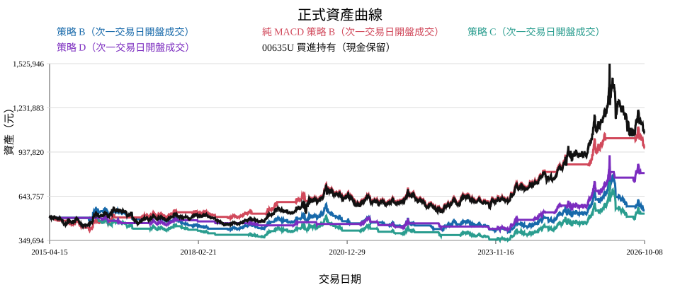
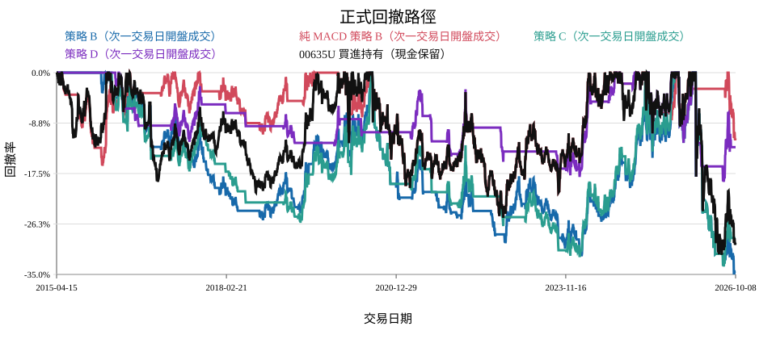
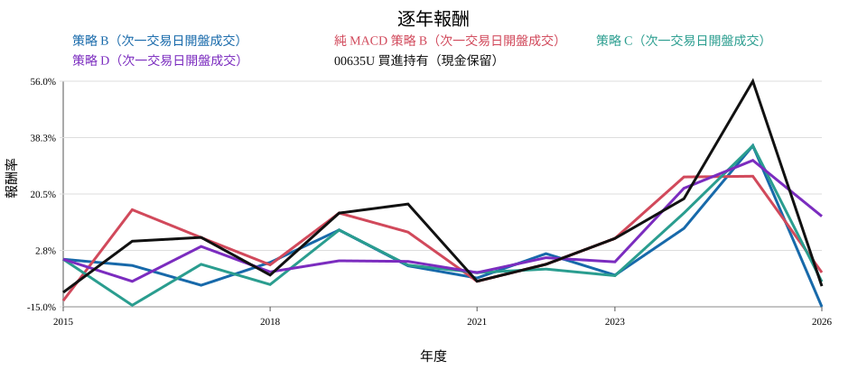
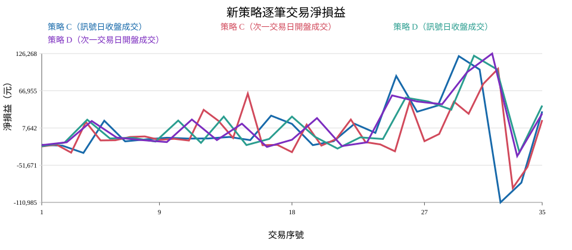
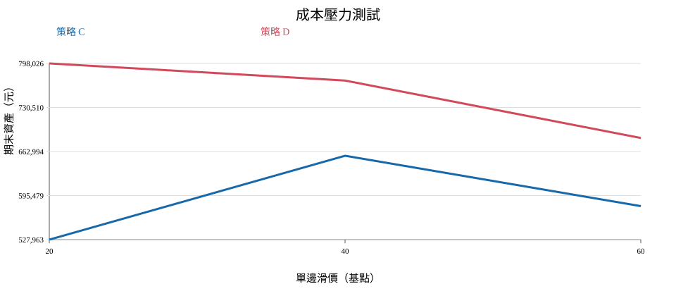
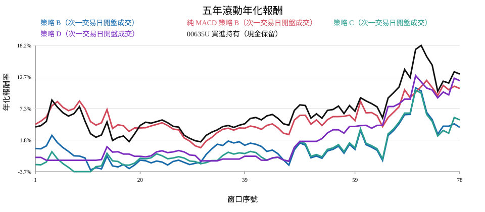
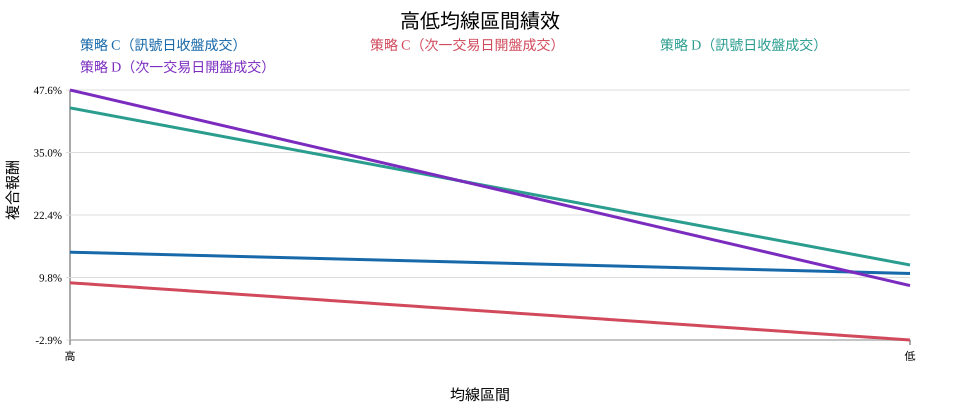
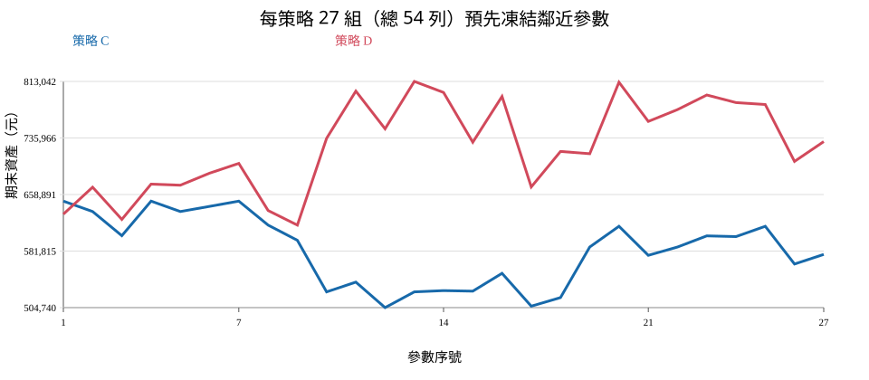
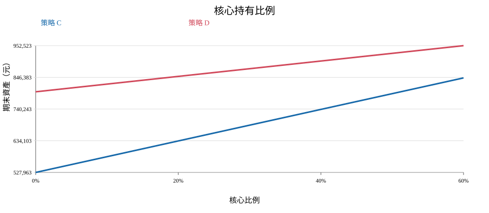

# 00635U 黃金期貨 ETF｜KD(9,9,55) 循環進場＋T-1 Pivot Stop 修正版研究

> **狀態：隔離研究候選，尚未採納。** 凍結資料與唯一契約均已通過 SHA gate；仍須 00 嚴格 QA。
> **v3 嚴格 QA 退件：** `formal-run-kd-9-9-55-v3` 標記 `QA_REJECTED_DUPLICATE_CYCLE_SIGNAL`，只保留稽核；本版已重算全部輸出。
> **v4 防守定義棄用：** `formal-run-kd-9-9-55-v4` 標記 `DEPRECATED_WRONG_INITIAL_STOP_DEFINITION`；訊號日低點不得再作 KD cycle 防守。
> **取代舊版：** `formal-run-kd-cycle-v2` 與發布別名 `2015-2026-kd-cycle-ma21-breakout-v1-0` 因進場 KD 誤用 9/55/55，標記 `DEPRECATED_WRONG_ENTRY_KD_PARAMETERS`，只保留稽核且不得用於決策。
> 資料快照：`00635U_FINMIND_PRIMARY_20150415_20261008_V3_D6735B7A5FF5`；輸入 manifest SHA-256：`4b0431d777f239241bc1dddd64dba124b61f990dcf907539815dbd685d761d9d`。
> 唯一規則契約 SHA-256：`2cffeef16decb2b2747ccdff63d2c16143a5d25c03441b8d8858e2d71dc062fc`；契約原文已原樣收入附件。

## 閱讀順序

- [01｜一頁白話結論](#01一頁白話結論)
- [02｜完整績效總表](#02完整績效總表)
- [03｜相對基準](#03相對基準)
- [04｜策略規則與成交版本](#04策略規則與成交版本)
- [05｜完整逐年績效](#05完整逐年績效)
- [06｜交易紀錄、循環稽核與資金投入](#06交易紀錄循環稽核與資金投入)
- [07｜成交時間與成本](#07成交時間與成本)
- [08｜時期、滾動與狀態](#08時期滾動與狀態)
- [09｜交易集中度與路徑風險](#09交易集中度與路徑風險)
- [10｜預先凍結參數鄰近穩健性](#10預先凍結參數鄰近穩健性)
- [11｜核心持有比例研究](#11核心持有比例研究)
- [12｜實務建議與黃金 ETF 限制](#12實務建議與黃金-etf-限制)
- [13｜技術驗收與隔離重播](#13技術驗收與隔離重播)
- [14｜完整附件目錄](#14完整附件目錄)

## 01｜一頁白話結論

### 測試目的

先回答新進場是否值得進一步研究。

### 測試方法

以次一交易日開盤為實務主口徑，同時比較原策略、純 MACD、買進持有及風險。

### 觀察結果

本版以第二段 K<D 起點至訊號 T-1 的最低 technical_low 作固定 pivot stop，取代 `formal-run-kd-9-9-55-v4` 的訊號日低點定義（`DEPRECATED_WRONG_INITIAL_STOP_DEFINITION`）。策略 C 次開期末資產 527,962.74 元；策略 D 次開期末資產 798,025.95 元。兩個實務主口徑完成交易均不少於 10 筆；仍只屬歷史隔離研究，不代表採納。

### 白話結論

單一歷史樣本不能證明未來正期望；交易筆數不足時只可稱探索性。

### 對最終決策的影響

報告只交 00 嚴格 QA，不自動採納策略。

## 02｜完整績效總表

### 測試目的

在同期間比較所有正式線。

### 測試方法

所有線以 500,000 元、相同資料與費稅重播。

### 觀察結果

共同期間保留原策略、純 MACD、新策略 C／D 與兩條買進持有，共 14 條比較線。

### 白話結論

期末資產、年化報酬率與最大回落必須一起看。

### 對最終決策的影響

主表是其餘分析的唯一母表。

| 主線 | 成交方式 | 期末資產 | 總報酬 | 年化報酬率 | 最大回落 | 獲利／虧損／平盤年度 | 進場／出場／未平倉 | 最大投入 |
|---|---|---:|---:|---:|---:|---:|---:|---:|
| 策略 A（訊號日收盤成交） | 訊號日收盤 | 675,692.74 元 | 35.14% | 2.66% | -30.61% | 6／5／1 | 47／47／0 | 799,425.02 元 |
| 策略 A（次一交易日開盤成交） | 次一交易日開盤 | 818,877.80 元 | 63.78% | 4.39% | -27.45% | 8／3／1 | 46／46／0 | 954,257.75 元 |
| 策略 B（訊號日收盤成交） | 訊號日收盤 | 675,515.37 元 | 35.10% | 2.65% | -36.50% | 4／7／1 | 28／28／0 | 893,438.00 元 |
| 策略 B（次一交易日開盤成交） | 次一交易日開盤 | 548,619.53 元 | 9.72% | 0.81% | -35.04% | 4／7／1 | 43／43／0 | 738,370.66 元 |
| 純 MACD 策略 A（訊號日收盤成交） | 訊號日收盤 | 739,803.16 元 | 47.96% | 3.47% | -22.26% | 8／4／0 | 34／34／0 | 742,883.90 元 |
| 純 MACD 策略 A（次一交易日開盤成交） | 次一交易日開盤 | 696,748.44 元 | 39.35% | 2.93% | -23.98% | 8／4／0 | 33／33／0 | 732,193.78 元 |
| 純 MACD 策略 B（訊號日收盤成交） | 訊號日收盤 | 896,742.70 元 | 79.35% | 5.22% | -25.22% | 7／5／0 | 14／14／0 | 849,423.57 元 |
| 純 MACD 策略 B（次一交易日開盤成交） | 次一交易日開盤 | 972,764.88 元 | 94.55% | 5.97% | -25.22% | 7／5／0 | 12／11／1 | 1,029,510.62 元 |
| 00635U 買進持有（現金保留） | 比較基準 | 1,071,314.06 元 | 114.26% | 6.86% | -31.64% | 7／5／0 | 1／0／1 | 499,994.90 元 |
| 00635U 買進持有（分配再投入） | 比較基準 | 1,071,314.06 元 | 114.26% | 6.86% | -31.64% | 7／5／0 | 1／0／1 | 499,994.90 元 |
| 策略 C（訊號日收盤成交） | 訊號日收盤 | 635,042.39 元 | 27.01% | 2.10% | -37.55% | 5／6／1 | 25／25／0 | 791,574.56 元 |
| 策略 C（次一交易日開盤成交） | 次一交易日開盤 | 527,962.74 元 | 5.59% | 0.48% | -33.64% | 3／8／1 | 35／35／0 | 650,132.10 元 |
| 策略 D（訊號日收盤成交） | 訊號日收盤 | 808,415.03 元 | 61.68% | 4.27% | -20.98% | 4／7／1 | 23／23／0 | 796,354.29 元 |
| 策略 D（次一交易日開盤成交） | 次一交易日開盤 | 798,025.95 元 | 59.61% | 4.16% | -18.96% | 5／6／1 | 21／21／0 | 804,589.53 元 |

## 03｜相對基準

### 測試目的

衡量相對可交易被動基準的差距。

### 測試方法

計算期末資產、年化與最大回落差；TAIEX 只作補充。

### 觀察結果

策略 C／D 均逐一比較 00635U 現金保留與分配再投入；官方 Gold ER 未取得，因此不以代理替代。

### 白話結論

缺少 Gold ER 時不能宣稱完成黃金指數超額報酬比較。

### 對最終決策的影響

主要決策只依可驗證的 00635U 基準。

| 策略 | 比較基準 | 期末資產差 | 年化報酬率差 | 最大回落差 |
|---|---|---:|---:|---:|
| 策略 C（次一交易日開盤成交） | 00635U 買進持有（現金保留） | -543,351.32 元 | -6.39 百分點 | -2.00 百分點 |
| 策略 C（次一交易日開盤成交） | 00635U 買進持有（分配再投入） | -543,351.32 元 | -6.39 百分點 | -2.00 百分點 |
| 策略 D（次一交易日開盤成交） | 00635U 買進持有（現金保留） | -273,288.11 元 | -2.71 百分點 | +12.69 百分點 |
| 策略 D（次一交易日開盤成交） | 00635U 買進持有（分配再投入） | -273,288.11 元 | -2.71 百分點 | +12.69 百分點 |

## 04｜策略規則與成交版本

### 測試目的

鎖定唯一進場契約與未改動範圍。

### 測試方法

逐字保存契約；稽核 K1／L1／H1、K2_so_far、突破、分流、防守與 2R。

### 觀察結果

契約原文 SHA-256 為 `2cffeef16decb2b2747ccdff63d2c16143a5d25c03441b8d8858e2d71dc062fc`，複製檔與來源位元組一致；KD 維持 (9,9,55)，唯一修正是 KD cycle initial_stop 改為因果 T-1 pivot。2023-09-18 與 2023-11-17 的 pivot 分別為 23.63 與 23.71。

### 白話結論

突破日不必 K<D，也不是比較突破日單一 K；只有 K2_so_far>K1。

### 對最終決策的影響

任何語意變更必須另開版本。

- **KD cycle 進場：** 進場與出場 KD 均維持 KD(9,9,55)；K2_so_far>K1、MA21 收盤突破、C／D 分流與第一次合法訊號即消耗均不變。原策略比較線仍保留 MACD(21,55,55)。
- **pivot stop 唯一修正：** 固定初始防守 initial_stop 為當前第二段 K<D 起點至訊號 T-1 的最低 technical_low；不得使用訊號日或未來資料。若沒有至少一個完成的第二段交易日，fail closed。
- **成交與出場：** SIGNAL_CLOSE 於訊號日收盤成交；NEXT_SESSION_OPEN 於次一個可成交交易日開盤成交，open<=stop 取消。持倉後只有 technical_close<stop 才觸發，等號不出場；固定防守優先於淨成本 2R 後 KD 死叉。策略 C 高均線原始 MA21 分支仍用既有 structural stop。
- **棄用版本：** `formal-run-kd-9-9-55-v4` 使用訊號日低點，標記 `DEPRECATED_WRONG_INITIAL_STOP_DEFINITION`；舊 9/55/55 版仍標記 `DEPRECATED_WRONG_ENTRY_KD_PARAMETERS`；v3 重複 cycle 退件仍標記 `QA_REJECTED_DUPLICATE_CYCLE_SIGNAL`。

#### 2023-09-18／2023-11-17 pivot stop 具名回歸

| 訊號日 | 策略 | pivot 起點 | pivot T-1 | pivot | 最低日 | 成交結果 | 後續日 | 後續收盤 | 觸發防守 | 驗證 |
|---|---|---|---|---:|---|---|---|---:|---|---|
| 2023-09-18 | 策略 C（訊號日收盤成交） | 2023-09-12 | 2023-09-15 | 23.63 | 2023-09-14 | EXCLUDED | 2023-09-22 | 23.78 | 否 | PASS |
| 2023-09-18 | 策略 C（次一交易日開盤成交） | 2023-09-12 | 2023-09-15 | 23.63 | 2023-09-14 | EXCLUDED | 2023-09-22 | 23.78 | 否 | PASS |
| 2023-09-18 | 策略 D（訊號日收盤成交） | 2023-09-12 | 2023-09-15 | 23.63 | 2023-09-14 | FILLED | 2023-09-22 | 23.78 | 否 | PASS |
| 2023-09-18 | 策略 D（次一交易日開盤成交） | 2023-09-12 | 2023-09-15 | 23.63 | 2023-09-14 | FILLED | 2023-09-22 | 23.78 | 否 | PASS |
| 2023-11-17 | 策略 C（訊號日收盤成交） | 2023-11-08 | 2023-11-16 | 23.71 | 2023-11-13 | EXCLUDED | 2023-11-20 | 24.23 | 否 | PASS |
| 2023-11-17 | 策略 C（次一交易日開盤成交） | 2023-11-08 | 2023-11-16 | 23.71 | 2023-11-13 | FILLED | 2023-11-20 | 24.23 | 否 | PASS |
| 2023-11-17 | 策略 D（訊號日收盤成交） | 2023-11-08 | 2023-11-16 | 23.71 | 2023-11-13 | FILLED | 2023-11-20 | 24.23 | 否 | PASS |
| 2023-11-17 | 策略 D（次一交易日開盤成交） | 2023-11-08 | 2023-11-16 | 23.71 | 2023-11-13 | FILLED | 2023-11-20 | 24.23 | 否 | PASS |

2023-09-18 的防守固定為 2023-09-14 低點 23.63，2023-09-22 收盤 23.78 不觸發；2023-11-17 的防守固定為 2023-11-13 低點 23.71，2023-11-20 收盤 24.23 不觸發。表內同列 SIGNAL_CLOSE 與 NEXT_SESSION_OPEN 的成交差異；全檔次開取消仍以 open<=pivot stop 驗證。

#### 2022-10-05／2022-11-07 KD 具名正式回歸

| 日期 | 成交版本 | K | D | K/D 方向 | cycle phase | K1 | K2_so_far | K2>K1 | MA21 突破 | signal window | 合法訊號 | 成交結果 |
|---|---|---:|---:|---|---|---:|---:|---|---|---|---|---|
| 2022-10-05 | 訊號日收盤 | 45.14 | 37.50 | K_GT_D | SEEK_FIRST_LOW | 12.19 | 14.95 | 是 | 否 | 否 | 否 | NO_ORDER |
| 2022-10-05 | 次一交易日開盤 | 45.14 | 37.50 | K_GT_D | SEEK_FIRST_LOW | 12.19 | 14.95 | 是 | 否 | 否 | 否 | NO_ORDER |
| 2022-11-07 | 訊號日收盤 | 48.67 | 39.08 | K_GT_D | MIDDLE_HIGH | 26.40 | — | 否 | 是 | 否 | 否 | NO_ORDER |
| 2022-11-07 | 次一交易日開盤 | 48.67 | 39.08 | K_GT_D | MIDDLE_HIGH | 26.40 | — | 否 | 是 | 否 | 否 | NO_ORDER |

2022-10-05 使用正式鎖定 FinMind raw OHLC 與遞迴公式 `K=RSV/9+前K×8/9`、`D=K/55+前D×54/55`；正式值與使用者畫面約 K=47.39、D=45.32 的差異分別為 -2.25、-7.82，方向一致為 K>D。

- [pivot stop 具名回歸 CSV](pivot-stop-regression.csv)
- [pivot stop 全檔回讀](pivot-stop-readback.json)
- [cycle 消耗全檔回讀](cycle-consumption-readback.json)
- [具名日期回歸 CSV](named-date-regression.csv)
- [舊版棄用與保留 hash](superseded-artifact-registry.json)
- [唯一規則契約原文](strategy-rule-contract.md)
- [契約 SHA 驗證](contract-verification.json)
- [策略 D MA144 隔離回讀](ma144-invariance-readback.json)
- [逐循環因果稽核](kd-cycle-audit.csv)

## 05｜完整逐年績效

### 測試目的

檢查報酬是否集中少數年度。

### 測試方法

以前一年末資產為次年起點，首年使用初始本金。

### 觀察結果

完整逐年附件含 168 列，年度帳戶連續、不重設本金。

### 白話結論

獲利年度數不能取代最差年度幅度。

### 對最終決策的影響

年度集中過高會降低採納信心。

#### 完整逐年績效表

| 策略／基準 | 年度 | 年初資產 | 年末資產 | 年度報酬 | 年度最大回落 |
|---|---:|---:|---:|---:|---:|
| 策略 A（訊號日收盤成交） | 2015 | 500,000.00 元 | 500,000.00 元 | 0.00% | 0.00% |
| 策略 A（訊號日收盤成交） | 2016 | 500,000.00 元 | 541,411.01 元 | 8.28% | -8.75% |
| 策略 A（訊號日收盤成交） | 2017 | 541,411.01 元 | 511,907.69 元 | -5.45% | -11.70% |
| 策略 A（訊號日收盤成交） | 2018 | 511,907.69 元 | 516,052.55 元 | 0.81% | -8.48% |
| 策略 A（訊號日收盤成交） | 2019 | 516,052.55 元 | 525,410.77 元 | 1.81% | -12.07% |
| 策略 A（訊號日收盤成交） | 2020 | 525,410.77 元 | 489,606.09 元 | -6.81% | -17.24% |
| 策略 A（訊號日收盤成交） | 2021 | 489,606.09 元 | 461,091.80 元 | -5.82% | -10.50% |
| 策略 A（訊號日收盤成交） | 2022 | 461,091.80 元 | 450,945.79 元 | -2.20% | -19.73% |
| 策略 A（訊號日收盤成交） | 2023 | 450,945.79 元 | 475,591.27 元 | 5.47% | -7.07% |
| 策略 A（訊號日收盤成交） | 2024 | 475,591.27 元 | 487,974.91 元 | 2.60% | -10.73% |
| 策略 A（訊號日收盤成交） | 2025 | 487,974.91 元 | 700,509.66 元 | 43.55% | -13.25% |
| 策略 A（訊號日收盤成交） | 2026 | 700,509.66 元 | 675,692.74 元 | -3.54% | -28.95% |
| 策略 A（次一交易日開盤成交） | 2015 | 500,000.00 元 | 500,000.00 元 | 0.00% | 0.00% |
| 策略 A（次一交易日開盤成交） | 2016 | 500,000.00 元 | 520,846.99 元 | 4.17% | -11.05% |
| 策略 A（次一交易日開盤成交） | 2017 | 520,846.99 元 | 490,200.22 元 | -5.88% | -12.06% |
| 策略 A（次一交易日開盤成交） | 2018 | 490,200.22 元 | 492,814.19 元 | 0.53% | -7.88% |
| 策略 A（次一交易日開盤成交） | 2019 | 492,814.19 元 | 529,785.60 元 | 7.50% | -9.54% |
| 策略 A（次一交易日開盤成交） | 2020 | 529,785.60 元 | 530,158.68 元 | 0.07% | -15.23% |
| 策略 A（次一交易日開盤成交） | 2021 | 530,158.68 元 | 498,837.99 元 | -5.91% | -11.26% |
| 策略 A（次一交易日開盤成交） | 2022 | 498,837.99 元 | 517,993.04 元 | 3.84% | -15.09% |
| 策略 A（次一交易日開盤成交） | 2023 | 517,993.04 元 | 545,327.16 元 | 5.28% | -6.82% |
| 策略 A（次一交易日開盤成交） | 2024 | 545,327.16 元 | 558,674.69 元 | 2.45% | -11.59% |
| 策略 A（次一交易日開盤成交） | 2025 | 558,674.69 元 | 836,953.63 元 | 49.81% | -10.56% |
| 策略 A（次一交易日開盤成交） | 2026 | 836,953.63 元 | 818,877.80 元 | -2.16% | -27.45% |
| 策略 B（訊號日收盤成交） | 2015 | 500,000.00 元 | 500,000.00 元 | 0.00% | 0.00% |
| 策略 B（訊號日收盤成交） | 2016 | 500,000.00 元 | 491,744.84 元 | -1.65% | -14.16% |
| 策略 B（訊號日收盤成交） | 2017 | 491,744.84 元 | 453,343.22 元 | -7.81% | -13.91% |
| 策略 B（訊號日收盤成交） | 2018 | 453,343.22 元 | 451,172.29 元 | -0.48% | -9.65% |
| 策略 B（訊號日收盤成交） | 2019 | 451,172.29 元 | 445,015.65 元 | -1.36% | -11.05% |
| 策略 B（訊號日收盤成交） | 2020 | 445,015.65 元 | 490,943.19 元 | 10.32% | -15.11% |
| 策略 B（訊號日收盤成交） | 2021 | 490,943.19 元 | 456,848.02 元 | -6.94% | -13.85% |
| 策略 B（訊號日收盤成交） | 2022 | 456,848.02 元 | 449,569.02 元 | -1.59% | -22.60% |
| 策略 B（訊號日收盤成交） | 2023 | 449,569.02 元 | 479,067.63 元 | 6.56% | -13.04% |
| 策略 B（訊號日收盤成交） | 2024 | 479,067.63 元 | 568,741.58 元 | 18.72% | -6.38% |
| 策略 B（訊號日收盤成交） | 2025 | 568,741.58 元 | 807,244.34 元 | 41.94% | -12.35% |
| 策略 B（訊號日收盤成交） | 2026 | 807,244.34 元 | 675,515.37 元 | -16.32% | -36.50% |
| 策略 B（次一交易日開盤成交） | 2015 | 500,000.00 元 | 500,000.00 元 | 0.00% | 0.00% |
| 策略 B（次一交易日開盤成交） | 2016 | 500,000.00 元 | 490,236.08 元 | -1.95% | -13.55% |
| 策略 B（次一交易日開盤成交） | 2017 | 490,236.08 元 | 450,107.63 元 | -8.19% | -14.21% |
| 策略 B（次一交易日開盤成交） | 2018 | 450,107.63 元 | 445,621.84 元 | -1.00% | -9.28% |
| 策略 B（次一交易日開盤成交） | 2019 | 445,621.84 元 | 486,566.21 元 | 9.19% | -8.36% |
| 策略 B（次一交易日開盤成交） | 2020 | 486,566.21 元 | 476,429.27 元 | -2.08% | -19.97% |
| 策略 B（次一交易日開盤成交） | 2021 | 476,429.27 元 | 448,282.56 元 | -5.91% | -11.26% |
| 策略 B（次一交易日開盤成交） | 2022 | 448,282.56 元 | 456,205.00 元 | 1.77% | -16.79% |
| 策略 B（次一交易日開盤成交） | 2023 | 456,205.00 元 | 433,404.12 元 | -5.00% | -15.31% |
| 策略 B（次一交易日開盤成交） | 2024 | 433,404.12 元 | 475,399.53 元 | 9.69% | -7.44% |
| 策略 B（次一交易日開盤成交） | 2025 | 475,399.53 元 | 645,158.39 元 | 35.71% | -12.22% |
| 策略 B（次一交易日開盤成交） | 2026 | 645,158.39 元 | 548,619.53 元 | -14.96% | -35.04% |
| 純 MACD 策略 A（訊號日收盤成交） | 2015 | 500,000.00 元 | 454,879.06 元 | -9.02% | -9.02% |
| 純 MACD 策略 A（訊號日收盤成交） | 2016 | 454,879.06 元 | 481,442.82 元 | 5.84% | -8.26% |
| 純 MACD 策略 A（訊號日收盤成交） | 2017 | 481,442.82 元 | 474,776.27 元 | -1.38% | -9.92% |
| 純 MACD 策略 A（訊號日收盤成交） | 2018 | 474,776.27 元 | 485,720.80 元 | 2.31% | -7.13% |
| 純 MACD 策略 A（訊號日收盤成交） | 2019 | 485,720.80 元 | 543,167.85 元 | 11.83% | -4.52% |
| 純 MACD 策略 A（訊號日收盤成交） | 2020 | 543,167.85 元 | 548,825.38 元 | 1.04% | -12.36% |
| 純 MACD 策略 A（訊號日收盤成交） | 2021 | 548,825.38 元 | 519,932.97 元 | -5.26% | -10.50% |
| 純 MACD 策略 A（訊號日收盤成交） | 2022 | 519,932.97 元 | 504,782.51 元 | -2.91% | -20.31% |
| 純 MACD 策略 A（訊號日收盤成交） | 2023 | 504,782.51 元 | 507,787.43 元 | 0.60% | -10.32% |
| 純 MACD 策略 A（訊號日收盤成交） | 2024 | 507,787.43 元 | 532,096.18 元 | 4.79% | -8.41% |
| 純 MACD 策略 A（訊號日收盤成交） | 2025 | 532,096.18 元 | 650,951.07 元 | 22.34% | -11.31% |
| 純 MACD 策略 A（訊號日收盤成交） | 2026 | 650,951.07 元 | 739,803.16 元 | 13.65% | -18.07% |
| 純 MACD 策略 A（次一交易日開盤成交） | 2015 | 500,000.00 元 | 453,257.81 元 | -9.35% | -9.35% |
| 純 MACD 策略 A（次一交易日開盤成交） | 2016 | 453,257.81 元 | 471,972.04 元 | 4.13% | -8.12% |
| 純 MACD 策略 A（次一交易日開盤成交） | 2017 | 471,972.04 元 | 460,084.48 元 | -2.52% | -10.10% |
| 純 MACD 策略 A（次一交易日開盤成交） | 2018 | 460,084.48 元 | 467,551.11 元 | 1.62% | -6.88% |
| 純 MACD 策略 A（次一交易日開盤成交） | 2019 | 467,551.11 元 | 523,371.35 元 | 11.94% | -4.12% |
| 純 MACD 策略 A（次一交易日開盤成交） | 2020 | 523,371.35 元 | 560,979.50 元 | 7.19% | -10.40% |
| 純 MACD 策略 A（次一交易日開盤成交） | 2021 | 560,979.50 元 | 527,615.67 元 | -5.95% | -11.26% |
| 純 MACD 策略 A（次一交易日開盤成交） | 2022 | 527,615.67 元 | 492,711.72 元 | -6.62% | -14.73% |
| 純 MACD 策略 A（次一交易日開盤成交） | 2023 | 492,711.72 元 | 500,577.91 元 | 1.60% | -9.43% |
| 純 MACD 策略 A（次一交易日開盤成交） | 2024 | 500,577.91 元 | 521,505.71 元 | 4.18% | -7.22% |
| 純 MACD 策略 A（次一交易日開盤成交） | 2025 | 521,505.71 元 | 642,209.50 元 | 23.15% | -10.56% |
| 純 MACD 策略 A（次一交易日開盤成交） | 2026 | 642,209.50 元 | 696,748.44 元 | 8.49% | -18.07% |
| 純 MACD 策略 B（訊號日收盤成交） | 2015 | 500,000.00 元 | 440,571.86 元 | -11.89% | -11.89% |
| 純 MACD 策略 B（訊號日收盤成交） | 2016 | 440,571.86 元 | 414,474.04 元 | -5.92% | -17.89% |
| 純 MACD 策略 B（訊號日收盤成交） | 2017 | 414,474.04 元 | 445,119.98 元 | 7.39% | -6.86% |
| 純 MACD 策略 B（訊號日收盤成交） | 2018 | 445,119.98 元 | 441,246.31 元 | -0.87% | -10.01% |
| 純 MACD 策略 B（訊號日收盤成交） | 2019 | 441,246.31 元 | 495,397.22 元 | 12.27% | -3.92% |
| 純 MACD 策略 B（訊號日收盤成交） | 2020 | 495,397.22 元 | 535,338.46 元 | 8.06% | -15.11% |
| 純 MACD 策略 B（訊號日收盤成交） | 2021 | 535,338.46 元 | 498,159.83 元 | -6.94% | -13.85% |
| 純 MACD 策略 B（訊號日收盤成交） | 2022 | 498,159.83 元 | 490,222.72 元 | -1.59% | -22.60% |
| 純 MACD 策略 B（訊號日收盤成交） | 2023 | 490,222.72 元 | 522,388.49 元 | 6.56% | -13.04% |
| 純 MACD 策略 B（訊號日收盤成交） | 2024 | 522,388.49 元 | 656,900.07 元 | 25.75% | -6.29% |
| 純 MACD 策略 B（訊號日收盤成交） | 2025 | 656,900.07 元 | 840,579.07 元 | 27.96% | -9.34% |
| 純 MACD 策略 B（訊號日收盤成交） | 2026 | 840,579.07 元 | 896,742.70 元 | 6.68% | -7.30% |
| 純 MACD 策略 B（次一交易日開盤成交） | 2015 | 500,000.00 元 | 434,766.67 元 | -13.05% | -13.05% |
| 純 MACD 策略 B（次一交易日開盤成交） | 2016 | 434,766.67 元 | 502,520.54 元 | 15.58% | -6.84% |
| 純 MACD 策略 B（次一交易日開盤成交） | 2017 | 502,520.54 元 | 536,777.95 元 | 6.82% | -6.86% |
| 純 MACD 策略 B（次一交易日開盤成交） | 2018 | 536,777.95 元 | 527,336.54 元 | -1.76% | -9.98% |
| 純 MACD 策略 B（次一交易日開盤成交） | 2019 | 527,336.54 元 | 603,935.44 元 | 14.53% | -4.82% |
| 純 MACD 策略 B（次一交易日開盤成交） | 2020 | 603,935.44 元 | 655,451.06 元 | 8.53% | -15.11% |
| 純 MACD 策略 B（次一交易日開盤成交） | 2021 | 655,451.06 元 | 609,930.61 元 | -6.94% | -13.85% |
| 純 MACD 策略 B（次一交易日開盤成交） | 2022 | 609,930.61 元 | 600,213.31 元 | -1.59% | -22.60% |
| 純 MACD 策略 B（次一交易日開盤成交） | 2023 | 600,213.31 元 | 639,595.68 元 | 6.56% | -13.04% |
| 純 MACD 策略 B（次一交易日開盤成交） | 2024 | 639,595.68 元 | 805,051.84 元 | 25.87% | -6.29% |
| 純 MACD 策略 B（次一交易日開盤成交） | 2025 | 805,051.84 元 | 1,015,307.01 元 | 26.12% | -9.34% |
| 純 MACD 策略 B（次一交易日開盤成交） | 2026 | 1,015,307.01 元 | 972,764.88 元 | -4.19% | -11.75% |
| 00635U 買進持有（現金保留） | 2015 | 500,000.00 元 | 447,833.21 元 | -10.43% | -12.99% |
| 00635U 買進持有（現金保留） | 2016 | 447,833.21 元 | 473,286.70 元 | 5.68% | -18.94% |
| 00635U 買進持有（現金保留） | 2017 | 473,286.70 元 | 505,796.31 元 | 6.87% | -8.58% |
| 00635U 買進持有（現金保留） | 2018 | 505,796.31 元 | 480,595.18 元 | -4.98% | -15.12% |
| 00635U 買進持有（現金保留） | 2019 | 480,595.18 元 | 550,402.25 元 | 14.53% | -6.75% |
| 00635U 買進持有（現金保留） | 2020 | 550,402.25 元 | 645,916.20 元 | 17.35% | -15.11% |
| 00635U 買進持有（現金保留） | 2021 | 645,916.20 元 | 601,056.87 元 | -6.95% | -13.85% |
| 00635U 買進持有（現金保留） | 2022 | 601,056.87 元 | 591,480.14 元 | -1.59% | -22.60% |
| 00635U 買進持有（現金保留） | 2023 | 591,480.14 元 | 630,290.79 元 | 6.56% | -13.04% |
| 00635U 買進持有（現金保留） | 2024 | 630,290.79 元 | 750,249.78 元 | 19.03% | -8.38% |
| 00635U 買進持有（現金保留） | 2025 | 750,249.78 元 | 1,170,355.05 元 | 56.00% | -10.56% |
| 00635U 買進持有（現金保留） | 2026 | 1,170,355.05 元 | 1,071,314.06 元 | -8.46% | -31.64% |
| 00635U 買進持有（分配再投入） | 2015 | 500,000.00 元 | 447,833.21 元 | -10.43% | -12.99% |
| 00635U 買進持有（分配再投入） | 2016 | 447,833.21 元 | 473,286.70 元 | 5.68% | -18.94% |
| 00635U 買進持有（分配再投入） | 2017 | 473,286.70 元 | 505,796.31 元 | 6.87% | -8.58% |
| 00635U 買進持有（分配再投入） | 2018 | 505,796.31 元 | 480,595.18 元 | -4.98% | -15.12% |
| 00635U 買進持有（分配再投入） | 2019 | 480,595.18 元 | 550,402.25 元 | 14.53% | -6.75% |
| 00635U 買進持有（分配再投入） | 2020 | 550,402.25 元 | 645,916.20 元 | 17.35% | -15.11% |
| 00635U 買進持有（分配再投入） | 2021 | 645,916.20 元 | 601,056.87 元 | -6.95% | -13.85% |
| 00635U 買進持有（分配再投入） | 2022 | 601,056.87 元 | 591,480.14 元 | -1.59% | -22.60% |
| 00635U 買進持有（分配再投入） | 2023 | 591,480.14 元 | 630,290.79 元 | 6.56% | -13.04% |
| 00635U 買進持有（分配再投入） | 2024 | 630,290.79 元 | 750,249.78 元 | 19.03% | -8.38% |
| 00635U 買進持有（分配再投入） | 2025 | 750,249.78 元 | 1,170,355.05 元 | 56.00% | -10.56% |
| 00635U 買進持有（分配再投入） | 2026 | 1,170,355.05 元 | 1,071,314.06 元 | -8.46% | -31.64% |
| 策略 C（訊號日收盤成交） | 2015 | 500,000.00 元 | 500,000.00 元 | 0.00% | 0.00% |
| 策略 C（訊號日收盤成交） | 2016 | 500,000.00 元 | 428,150.92 元 | -14.37% | -14.37% |
| 策略 C（訊號日收盤成交） | 2017 | 428,150.92 元 | 423,191.86 元 | -1.16% | -8.04% |
| 策略 C（訊號日收盤成交） | 2018 | 423,191.86 元 | 390,267.63 元 | -7.78% | -7.78% |
| 策略 C（訊號日收盤成交） | 2019 | 390,267.63 元 | 394,274.43 元 | 1.03% | -11.05% |
| 策略 C（訊號日收盤成交） | 2020 | 394,274.43 元 | 434,965.00 元 | 10.32% | -15.11% |
| 策略 C（訊號日收盤成交） | 2021 | 434,965.00 元 | 404,758.78 元 | -6.94% | -13.85% |
| 策略 C（訊號日收盤成交） | 2022 | 404,758.78 元 | 398,310.08 元 | -1.59% | -22.60% |
| 策略 C（訊號日收盤成交） | 2023 | 398,310.08 元 | 424,443.75 元 | 6.56% | -13.04% |
| 策略 C（訊號日收盤成交） | 2024 | 424,443.75 元 | 503,892.35 元 | 18.72% | -6.38% |
| 策略 C（訊號日收盤成交） | 2025 | 503,892.35 元 | 715,198.36 元 | 41.93% | -12.35% |
| 策略 C（訊號日收盤成交） | 2026 | 715,198.36 元 | 635,042.39 元 | -11.21% | -37.55% |
| 策略 C（次一交易日開盤成交） | 2015 | 500,000.00 元 | 500,000.00 元 | 0.00% | 0.00% |
| 策略 C（次一交易日開盤成交） | 2016 | 500,000.00 元 | 427,654.23 元 | -14.47% | -15.12% |
| 策略 C（次一交易日開盤成交） | 2017 | 427,654.23 元 | 420,812.66 元 | -1.60% | -8.50% |
| 策略 C（次一交易日開盤成交） | 2018 | 420,812.66 元 | 387,340.76 元 | -7.95% | -7.95% |
| 策略 C（次一交易日開盤成交） | 2019 | 387,340.76 元 | 422,954.26 元 | 9.19% | -6.75% |
| 策略 C（次一交易日開盤成交） | 2020 | 422,954.26 元 | 415,086.31 元 | -1.86% | -19.31% |
| 策略 C（次一交易日開盤成交） | 2021 | 415,086.31 元 | 397,644.12 元 | -4.20% | -11.93% |
| 策略 C（次一交易日開盤成交） | 2022 | 397,644.12 元 | 385,357.50 元 | -3.09% | -16.07% |
| 策略 C（次一交易日開盤成交） | 2023 | 385,357.50 元 | 365,476.60 元 | -5.16% | -13.95% |
| 策略 C（次一交易日開盤成交） | 2024 | 365,476.60 元 | 418,599.84 元 | 14.54% | -7.44% |
| 策略 C（次一交易日開盤成交） | 2025 | 418,599.84 元 | 568,075.62 元 | 35.71% | -12.22% |
| 策略 C（次一交易日開盤成交） | 2026 | 568,075.62 元 | 527,962.74 元 | -7.06% | -33.64% |
| 策略 D（訊號日收盤成交） | 2015 | 500,000.00 元 | 500,000.00 元 | 0.00% | 0.00% |
| 策略 D（訊號日收盤成交） | 2016 | 500,000.00 元 | 462,834.01 元 | -7.43% | -9.91% |
| 策略 D（訊號日收盤成交） | 2017 | 462,834.01 元 | 483,623.05 元 | 4.49% | -6.86% |
| 策略 D（訊號日收盤成交） | 2018 | 483,623.05 元 | 466,583.70 元 | -3.52% | -3.52% |
| 策略 D（訊號日收盤成交） | 2019 | 466,583.70 元 | 463,805.04 元 | -0.60% | -6.12% |
| 策略 D（訊號日收盤成交） | 2020 | 463,805.04 元 | 456,033.65 元 | -1.68% | -5.82% |
| 策略 D（訊號日收盤成交） | 2021 | 456,033.65 元 | 452,409.89 元 | -0.79% | -8.57% |
| 策略 D（訊號日收盤成交） | 2022 | 452,409.89 元 | 446,676.46 元 | -1.27% | -13.36% |
| 策略 D（訊號日收盤成交） | 2023 | 446,676.46 元 | 439,838.06 元 | -1.53% | -5.47% |
| 策略 D（訊號日收盤成交） | 2024 | 439,838.06 元 | 535,351.99 元 | 21.72% | -4.32% |
| 策略 D（訊號日收盤成交） | 2025 | 535,351.99 元 | 719,531.26 元 | 34.40% | -12.35% |
| 策略 D（訊號日收盤成交） | 2026 | 719,531.26 元 | 808,415.03 元 | 12.35% | -20.98% |
| 策略 D（次一交易日開盤成交） | 2015 | 500,000.00 元 | 500,000.00 元 | 0.00% | 0.00% |
| 策略 D（次一交易日開盤成交） | 2016 | 500,000.00 元 | 465,177.47 元 | -6.96% | -9.44% |
| 策略 D（次一交易日開盤成交） | 2017 | 465,177.47 元 | 483,959.34 元 | 4.04% | -6.86% |
| 策略 D（次一交易日開盤成交） | 2018 | 483,959.34 元 | 464,651.25 元 | -3.99% | -3.99% |
| 策略 D（次一交易日開盤成交） | 2019 | 464,651.25 元 | 462,440.26 元 | -0.48% | -5.96% |
| 策略 D（次一交易日開盤成交） | 2020 | 462,440.26 元 | 459,249.43 元 | -0.69% | -5.62% |
| 策略 D（次一交易日開盤成交） | 2021 | 459,249.43 元 | 439,952.47 元 | -4.20% | -11.93% |
| 策略 D（次一交易日開盤成交） | 2022 | 439,952.47 元 | 442,105.03 元 | 0.49% | -12.97% |
| 策略 D（次一交易日開盤成交） | 2023 | 442,105.03 元 | 438,415.55 元 | -0.83% | -5.47% |
| 策略 D（次一交易日開盤成交） | 2024 | 438,415.55 元 | 536,271.68 元 | 22.32% | -4.32% |
| 策略 D（次一交易日開盤成交） | 2025 | 536,271.68 元 | 703,037.64 元 | 31.10% | -12.19% |
| 策略 D（次一交易日開盤成交） | 2026 | 703,037.64 元 | 798,025.95 元 | 13.51% | -18.96% |

- [完整逐年績效 CSV](annual-performance.csv)

## 06｜交易紀錄、循環稽核與資金投入

### 測試目的

讓 00 能逐筆重建型態、訂單與帳務。

### 測試方法

保存循環所有區段、候選日、成交／排除、R／2R、armed 與出場。

### 觀察結果

逐循環稽核共 11,216 列，合法訊號 80 列，次開低於或等於防守價取消 3 列。

### 白話結論

每循環最多一次訊號，次開成交不具正風險距離即取消。

### 對最終決策的影響

任何摘要交易數都須由附件一對一重建。

| 新策略 | 進場 | 已完成 | 未平倉 | 最大投入 |
|---|---:|---:|---:|---:|
| 策略 C（訊號日收盤成交） | 25 | 25 | 0 | 791,574.56 元 |
| 策略 C（次一交易日開盤成交） | 35 | 35 | 0 | 650,132.10 元 |
| 策略 D（訊號日收盤成交） | 23 | 23 | 0 | 796,354.29 元 |
| 策略 D（次一交易日開盤成交） | 21 | 21 | 0 | 804,589.53 元 |

- [繁體中文逐筆交易明細](trade-details.md)
- [逐筆交易明細 CSV](trade-details.csv)
- [每日主帳](strategy-account-daily.csv)
- [事件帳](event-ledger.csv)
- [公司行動帳](corporate-action-ledger.csv)
- [逐循環稽核](kd-cycle-audit.csv)

## 07｜成交時間與成本

### 測試目的

量化成交時間與摩擦。

### 測試方法

兩種成交版本各自進出同口徑，並施加三種滑價。

### 觀察結果

成本附件含 12 列，涵蓋 C／D、收盤／次開及 20／40／60 基點。

### 白話結論

成本可能改變 2R 與出場路徑，不能只線性扣減。

### 對最終決策的影響

實務判讀固定使用次一交易日開盤。

#### 完整成交與成本壓力表

| 策略 | 成交方式 | 單邊滑價（基點） | 期末資產 | 年化報酬率 | 最大回落 | 完成交易 |
|---|---|---:|---:|---:|---:|---:|
| 策略 C | 訊號日收盤 | 20 | 635,042.39 元 | 2.10% | -37.55% | 25 |
| 策略 C | 次一交易日開盤 | 20 | 527,962.74 元 | 0.48% | -33.64% | 35 |
| 策略 D | 訊號日收盤 | 20 | 808,415.03 元 | 4.27% | -20.98% | 23 |
| 策略 D | 次一交易日開盤 | 20 | 798,025.95 元 | 4.16% | -18.96% | 21 |
| 策略 C | 訊號日收盤 | 40 | 642,514.71 元 | 2.21% | -38.29% | 18 |
| 策略 C | 次一交易日開盤 | 40 | 656,528.38 元 | 2.40% | -34.44% | 17 |
| 策略 D | 訊號日收盤 | 40 | 742,453.37 元 | 3.50% | -22.63% | 18 |
| 策略 D | 次一交易日開盤 | 40 | 771,795.12 元 | 3.85% | -19.60% | 16 |
| 策略 C | 訊號日收盤 | 60 | 646,574.58 元 | 2.26% | -39.03% | 15 |
| 策略 C | 次一交易日開盤 | 60 | 579,300.86 元 | 1.29% | -35.22% | 16 |
| 策略 D | 訊號日收盤 | 60 | 710,107.37 元 | 3.10% | -25.96% | 18 |
| 策略 D | 次一交易日開盤 | 60 | 683,734.73 元 | 2.76% | -21.43% | 15 |

- [完整成本壓力 CSV](cost-sensitivity.csv)

## 08｜時期、滾動與狀態

### 測試目的

檢查不同時期、滾動窗口與均線區間。

### 測試方法

輸出固定期、月末滾動 3／5／10 年及 HIGH／LOW 診斷。

### 觀察結果

固定期間 42 列、滾動窗口 2,772 列；C／D 高低均線區間另列 8 列。

### 白話結論

全期正報酬不代表每個長窗口穩健。

### 對最終決策的影響

最差窗口限制最終結論。

#### 固定期間完整表

| 策略／基準 | 期間 | 實際起訖 | 期初資產 | 期末資產 | 總報酬 | 年化報酬率 | 最大回落 |
|---|---|---|---:|---:|---:|---:|---:|
| 策略 A（訊號日收盤成交） | 2015_2019 | 2015-04-15～2019-12-31 | 500,000.00 元 | 525,410.77 元 | 5.08% | 1.06% | -18.92% |
| 策略 A（訊號日收盤成交） | 2020_2022 | 2020-01-02～2022-12-30 | 525,410.77 元 | 450,945.79 元 | -14.17% | -4.97% | -29.99% |
| 策略 A（訊號日收盤成交） | 2023_LATEST | 2023-01-03～2026-10-08 | 450,945.79 元 | 675,692.74 元 | 49.84% | 11.34% | -28.95% |
| 策略 A（次一交易日開盤成交） | 2015_2019 | 2015-04-15～2019-12-31 | 500,000.00 元 | 529,785.60 元 | 5.96% | 1.23% | -20.95% |
| 策略 A（次一交易日開盤成交） | 2020_2022 | 2020-01-02～2022-12-30 | 529,785.60 元 | 517,993.04 元 | -2.23% | -0.75% | -23.93% |
| 策略 A（次一交易日開盤成交） | 2023_LATEST | 2023-01-03～2026-10-08 | 517,993.04 元 | 818,877.80 元 | 58.09% | 12.94% | -27.45% |
| 策略 B（訊號日收盤成交） | 2015_2019 | 2015-04-15～2019-12-31 | 500,000.00 元 | 445,015.65 元 | -11.00% | -2.44% | -26.58% |
| 策略 B（訊號日收盤成交） | 2020_2022 | 2020-01-02～2022-12-30 | 445,015.65 元 | 449,569.02 元 | 1.02% | 0.34% | -25.22% |
| 策略 B（訊號日收盤成交） | 2023_LATEST | 2023-01-03～2026-10-08 | 449,569.02 元 | 675,515.37 元 | 50.26% | 11.42% | -36.50% |
| 策略 B（次一交易日開盤成交） | 2015_2019 | 2015-04-15～2019-12-31 | 500,000.00 元 | 486,566.21 元 | -2.69% | -0.58% | -25.63% |
| 策略 B（次一交易日開盤成交） | 2020_2022 | 2020-01-02～2022-12-30 | 486,566.21 元 | 456,205.00 元 | -6.24% | -2.13% | -29.61% |
| 策略 B（次一交易日開盤成交） | 2023_LATEST | 2023-01-03～2026-10-08 | 456,205.00 元 | 548,619.53 元 | 20.26% | 5.02% | -35.04% |
| 純 MACD 策略 A（訊號日收盤成交） | 2015_2019 | 2015-04-15～2019-12-31 | 500,000.00 元 | 543,167.85 元 | 8.63% | 1.77% | -12.47% |
| 純 MACD 策略 A（訊號日收盤成交） | 2020_2022 | 2020-01-02～2022-12-30 | 543,167.85 元 | 504,782.51 元 | -7.07% | -2.42% | -22.26% |
| 純 MACD 策略 A（訊號日收盤成交） | 2023_LATEST | 2023-01-03～2026-10-08 | 504,782.51 元 | 739,803.16 元 | 46.56% | 10.69% | -18.07% |
| 純 MACD 策略 A（次一交易日開盤成交） | 2015_2019 | 2015-04-15～2019-12-31 | 500,000.00 元 | 523,371.35 元 | 4.67% | 0.97% | -13.93% |
| 純 MACD 策略 A（次一交易日開盤成交） | 2020_2022 | 2020-01-02～2022-12-30 | 523,371.35 元 | 492,711.72 元 | -5.86% | -2.00% | -23.98% |
| 純 MACD 策略 A（次一交易日開盤成交） | 2023_LATEST | 2023-01-03～2026-10-08 | 492,711.72 元 | 696,748.44 元 | 41.41% | 9.64% | -18.07% |
| 純 MACD 策略 B（訊號日收盤成交） | 2015_2019 | 2015-04-15～2019-12-31 | 500,000.00 元 | 495,397.22 元 | -0.92% | -0.20% | -18.37% |
| 純 MACD 策略 B（訊號日收盤成交） | 2020_2022 | 2020-01-02～2022-12-30 | 495,397.22 元 | 490,222.72 元 | -1.04% | -0.35% | -25.22% |
| 純 MACD 策略 B（訊號日收盤成交） | 2023_LATEST | 2023-01-03～2026-10-08 | 490,222.72 元 | 896,742.70 元 | 82.93% | 17.40% | -13.04% |
| 純 MACD 策略 B（次一交易日開盤成交） | 2015_2019 | 2015-04-15～2019-12-31 | 500,000.00 元 | 603,935.44 元 | 20.79% | 4.09% | -16.18% |
| 純 MACD 策略 B（次一交易日開盤成交） | 2020_2022 | 2020-01-02～2022-12-30 | 603,935.44 元 | 600,213.31 元 | -0.62% | -0.21% | -25.22% |
| 純 MACD 策略 B（次一交易日開盤成交） | 2023_LATEST | 2023-01-03～2026-10-08 | 600,213.31 元 | 972,764.88 元 | 62.07% | 13.69% | -13.04% |
| 00635U 買進持有（現金保留） | 2015_2019 | 2015-04-15～2019-12-31 | 500,000.00 元 | 550,402.25 元 | 10.08% | 2.06% | -20.81% |
| 00635U 買進持有（現金保留） | 2020_2022 | 2020-01-02～2022-12-30 | 550,402.25 元 | 591,480.14 元 | 7.46% | 2.43% | -25.22% |
| 00635U 買進持有（現金保留） | 2023_LATEST | 2023-01-03～2026-10-08 | 591,480.14 元 | 1,071,314.06 元 | 81.12% | 17.09% | -31.64% |
| 00635U 買進持有（分配再投入） | 2015_2019 | 2015-04-15～2019-12-31 | 500,000.00 元 | 550,402.25 元 | 10.08% | 2.06% | -20.81% |
| 00635U 買進持有（分配再投入） | 2020_2022 | 2020-01-02～2022-12-30 | 550,402.25 元 | 591,480.14 元 | 7.46% | 2.43% | -25.22% |
| 00635U 買進持有（分配再投入） | 2023_LATEST | 2023-01-03～2026-10-08 | 591,480.14 元 | 1,071,314.06 元 | 81.12% | 17.09% | -31.64% |
| 策略 C（訊號日收盤成交） | 2015_2019 | 2015-04-15～2019-12-31 | 500,000.00 元 | 394,274.43 元 | -21.15% | -4.91% | -25.47% |
| 策略 C（訊號日收盤成交） | 2020_2022 | 2020-01-02～2022-12-30 | 394,274.43 元 | 398,310.08 元 | 1.02% | 0.34% | -25.22% |
| 策略 C（訊號日收盤成交） | 2023_LATEST | 2023-01-03～2026-10-08 | 398,310.08 元 | 635,042.39 元 | 59.43% | 13.19% | -37.55% |
| 策略 C（次一交易日開盤成交） | 2015_2019 | 2015-04-15～2019-12-31 | 500,000.00 元 | 422,954.26 元 | -15.41% | -3.49% | -25.88% |
| 策略 C（次一交易日開盤成交） | 2020_2022 | 2020-01-02～2022-12-30 | 422,954.26 元 | 385,357.50 元 | -8.89% | -3.06% | -26.65% |
| 策略 C（次一交易日開盤成交） | 2023_LATEST | 2023-01-03～2026-10-08 | 385,357.50 元 | 527,962.74 元 | 37.01% | 8.72% | -33.64% |
| 策略 D（訊號日收盤成交） | 2015_2019 | 2015-04-15～2019-12-31 | 500,000.00 元 | 463,805.04 元 | -7.24% | -1.58% | -12.78% |
| 策略 D（訊號日收盤成交） | 2020_2022 | 2020-01-02～2022-12-30 | 463,805.04 元 | 446,676.46 元 | -3.69% | -1.25% | -13.36% |
| 策略 D（訊號日收盤成交） | 2023_LATEST | 2023-01-03～2026-10-08 | 446,676.46 元 | 808,415.03 元 | 80.98% | 17.07% | -20.98% |
| 策略 D（次一交易日開盤成交） | 2015_2019 | 2015-04-15～2019-12-31 | 500,000.00 元 | 462,440.26 元 | -7.51% | -1.64% | -12.78% |
| 策略 D（次一交易日開盤成交） | 2020_2022 | 2020-01-02～2022-12-30 | 462,440.26 元 | 442,105.03 元 | -4.40% | -1.49% | -12.97% |
| 策略 D（次一交易日開盤成交） | 2023_LATEST | 2023-01-03～2026-10-08 | 442,105.03 元 | 798,025.95 元 | 80.51% | 16.99% | -18.96% |

#### 滾動 3／5／10 年摘要

| 策略／基準 | 窗口 | 有效數 | 最差年化 | 中位年化 | 最佳年化 | 窗口最差回落 |
|---|---:|---:|---:|---:|---:|---:|
| 策略 A（訊號日收盤成交） | 3 年 | 102 | -7.70% | -0.87% | 22.76% | -29.99% |
| 策略 A（訊號日收盤成交） | 5 年 | 78 | -4.66% | -1.11% | 12.09% | -29.99% |
| 策略 A（訊號日收盤成交） | 10 年 | 18 | 1.00% | 2.55% | 5.28% | -30.61% |
| 策略 A（次一交易日開盤成交） | 3 年 | 102 | -4.88% | 1.59% | 24.08% | -27.45% |
| 策略 A（次一交易日開盤成交） | 5 年 | 78 | -1.66% | 1.96% | 14.29% | -27.45% |
| 策略 A（次一交易日開盤成交） | 10 年 | 18 | 2.77% | 4.37% | 7.36% | -27.45% |
| 策略 B（訊號日收盤成交） | 3 年 | 102 | -8.56% | 1.14% | 27.01% | -36.50% |
| 策略 B（訊號日收盤成交） | 5 年 | 78 | -4.53% | 1.20% | 15.24% | -36.50% |
| 策略 B（訊號日收盤成交） | 10 年 | 18 | 2.16% | 2.98% | 6.78% | -36.50% |
| 策略 B（次一交易日開盤成交） | 3 年 | 102 | -8.01% | 0.08% | 18.31% | -35.04% |
| 策略 B（次一交易日開盤成交） | 5 年 | 78 | -3.35% | 0.16% | 10.84% | -35.04% |
| 策略 B（次一交易日開盤成交） | 10 年 | 18 | 0.37% | 1.01% | 4.60% | -35.04% |
| 純 MACD 策略 A（訊號日收盤成交） | 3 年 | 102 | -5.28% | 2.64% | 16.48% | -22.26% |
| 純 MACD 策略 A（訊號日收盤成交） | 5 年 | 78 | -1.34% | 1.59% | 7.96% | -22.26% |
| 純 MACD 策略 A（訊號日收盤成交） | 10 年 | 18 | 1.96% | 3.82% | 5.50% | -22.26% |
| 純 MACD 策略 A（次一交易日開盤成交） | 3 年 | 102 | -4.87% | 2.42% | 15.51% | -23.98% |
| 純 MACD 策略 A（次一交易日開盤成交） | 5 年 | 78 | -0.98% | 2.02% | 7.18% | -23.98% |
| 純 MACD 策略 A（次一交易日開盤成交） | 10 年 | 18 | 1.99% | 3.78% | 5.58% | -23.98% |
| 純 MACD 策略 B（訊號日收盤成交） | 3 年 | 102 | -4.34% | 5.22% | 22.79% | -25.22% |
| 純 MACD 策略 B（訊號日收盤成交） | 5 年 | 78 | -0.94% | 3.82% | 13.18% | -25.22% |
| 純 MACD 策略 B（訊號日收盤成交） | 10 年 | 18 | 3.49% | 5.55% | 7.14% | -25.22% |
| 純 MACD 策略 B（次一交易日開盤成交） | 3 年 | 102 | -3.83% | 6.23% | 20.34% | -25.22% |
| 純 MACD 策略 B（次一交易日開盤成交） | 5 年 | 78 | 0.49% | 4.90% | 12.13% | -25.22% |
| 純 MACD 策略 B（次一交易日開盤成交） | 10 年 | 18 | 5.52% | 7.46% | 9.12% | -25.22% |
| 00635U 買進持有（現金保留） | 3 年 | 102 | -3.83% | 6.10% | 33.13% | -31.64% |
| 00635U 買進持有（現金保留） | 5 年 | 78 | 1.50% | 5.60% | 18.19% | -31.64% |
| 00635U 買進持有（現金保留） | 10 年 | 18 | 6.19% | 8.10% | 11.61% | -31.64% |
| 00635U 買進持有（分配再投入） | 3 年 | 102 | -3.83% | 6.10% | 33.13% | -31.64% |
| 00635U 買進持有（分配再投入） | 5 年 | 78 | 1.50% | 5.60% | 18.19% | -31.64% |
| 00635U 買進持有（分配再投入） | 10 年 | 18 | 6.19% | 8.10% | 11.61% | -31.64% |
| 策略 C（訊號日收盤成交） | 3 年 | 102 | -8.03% | 0.79% | 27.01% | -37.55% |
| 策略 C（訊號日收盤成交） | 5 年 | 78 | -4.33% | 0.96% | 15.24% | -37.55% |
| 策略 C（訊號日收盤成交） | 10 年 | 18 | 1.48% | 3.05% | 5.56% | -37.55% |
| 策略 C（次一交易日開盤成交） | 3 年 | 102 | -8.16% | -0.37% | 20.03% | -33.64% |
| 策略 C（次一交易日開盤成交） | 5 年 | 78 | -3.65% | -0.96% | 10.46% | -33.64% |
| 策略 C（次一交易日開盤成交） | 10 年 | 18 | -0.85% | 0.96% | 3.16% | -33.64% |
| 策略 D（訊號日收盤成交） | 3 年 | 102 | -3.65% | -0.33% | 23.47% | -20.98% |
| 策略 D（訊號日收盤成交） | 5 年 | 78 | -1.89% | 0.18% | 13.65% | -20.98% |
| 策略 D（訊號日收盤成交） | 10 年 | 18 | 1.54% | 3.96% | 5.78% | -20.98% |
| 策略 D（次一交易日開盤成交） | 3 年 | 102 | -3.76% | -0.61% | 23.19% | -18.96% |
| 策略 D（次一交易日開盤成交） | 5 年 | 78 | -1.86% | -0.32% | 12.96% | -18.96% |
| 策略 D（次一交易日開盤成交） | 10 年 | 18 | 1.29% | 3.87% | 5.75% | -18.96% |

#### 高低均線區間

| 策略 | 區間 | 交易日數 | 區間複合報酬 |
|---|---|---:|---:|
| 策略 C（訊號日收盤成交） | 高均線區間 | 1,698 | 14.87% |
| 策略 C（訊號日收盤成交） | 低均線區間 | 963 | 10.57% |
| 策略 C（次一交易日開盤成交） | 高均線區間 | 1,698 | 8.70% |
| 策略 C（次一交易日開盤成交） | 低均線區間 | 963 | -2.86% |
| 策略 D（訊號日收盤成交） | 高均線區間 | 1,698 | 43.99% |
| 策略 D（訊號日收盤成交） | 低均線區間 | 963 | 12.29% |
| 策略 D（次一交易日開盤成交） | 高均線區間 | 1,698 | 47.61% |
| 策略 D（次一交易日開盤成交） | 低均線區間 | 963 | 8.13% |

- [固定期間 CSV](fixed-periods.csv)
- [完整滾動窗口 CSV](rolling-windows.csv)
- [高低均線區間 CSV](regime-performance.csv)

## 09｜交易集中度與路徑風險

### 測試目的

檢查少數交易與路徑依賴。

### 測試方法

列勝率、最佳／最差、前 1／3 筆獲利集中、連虧與水下期。

### 觀察結果

12 條主動線均列勝率、最佳／最差交易、獲利集中度、連虧與水下期。

### 白話結論

少數交易撐起結果時，正期望證據偏弱。

### 對最終決策的影響

集中度過高只能保留研究候選。

| 策略 | 已完成 | 勝率 | 最佳交易 | 最差交易 | 最佳 1 筆集中度 | 最佳 3 筆集中度 | 最長連虧 | 最長水下期 |
|---|---:|---:|---:|---:|---:|---:|---:|---:|
| 策略 A（訊號日收盤成交） | 47 | 40.43% | +122,183.04 元 | -123,764.95 元 | 17.40% | 42.90% | 5 | 3206 日 |
| 策略 A（次一交易日開盤成交） | 46 | 41.30% | +145,806.06 元 | -135,395.72 元 | 18.13% | 45.69% | 7 | 1536 日 |
| 策略 B（訊號日收盤成交） | 28 | 42.86% | +137,860.54 元 | -125,265.20 元 | 23.57% | 60.48% | 5 | 3118 日 |
| 策略 B（次一交易日開盤成交） | 43 | 32.56% | +115,869.72 元 | -100,038.94 元 | 18.87% | 45.00% | 7 | 1874 日 |
| 純 MACD 策略 A（訊號日收盤成交） | 34 | 41.18% | +77,511.53 元 | -31,381.04 元 | 15.43% | 41.96% | 3 | 1851 日 |
| 純 MACD 策略 A（次一交易日開盤成交） | 33 | 39.39% | +76,562.48 元 | -35,480.66 元 | 16.67% | 45.88% | 6 | 1399 日 |
| 純 MACD 策略 B（訊號日收盤成交） | 14 | 64.29% | +147,439.88 元 | -55,530.03 元 | 26.24% | 62.08% | 2 | 1396 日 |
| 純 MACD 策略 B（次一交易日開盤成交） | 11 | 72.73% | +193,374.06 元 | -46,084.58 元 | 30.92% | 71.18% | 2 | 1344 日 |
| 策略 C（訊號日收盤成交） | 25 | 40.00% | +122,141.04 元 | -110,984.54 元 | 24.45% | 62.73% | 7 | 3106 日 |
| 策略 C（次一交易日開盤成交） | 35 | 34.29% | +102,028.06 元 | -88,084.80 元 | 20.42% | 48.54% | 7 | 1873 日 |
| 策略 D（訊號日收盤成交） | 23 | 43.48% | +122,881.20 元 | -31,309.60 元 | 24.48% | 55.83% | 4 | 2136 日 |
| 策略 D（次一交易日開盤成交） | 21 | 47.62% | +126,267.87 元 | -37,258.47 元 | 25.97% | 58.10% | 3 | 3062 日 |

- [集中度、移除最佳交易與路徑診斷](path-and-concentration.csv)

## 10｜預先凍結參數鄰近穩健性

### 測試目的

檢查主參數是否只在單點有效。

### 測試方法

事前固定 MA 18／21／24、進場 K 平滑 8／9／10、D 平滑 45／55／65；每策略為 3×3×3＝27 組，兩策略合計 54 列。RSV9、出場 KD 與 2R 固定。

### 觀察結果

parameter-grid.csv 合計 54 列；策略 C、D 各 27 組，均由 MA 三值 × K 三值 × D 三值（3×3×3）構成。主規則固定 MA21 與進場 KD(9,9,55)，出場 KD(9,9,55) 與 2R 完全不搜尋。

### 白話結論

鄰近格只作敏感度，不用來事後改選漂亮參數。

### 對最終決策的影響

主設定若顯著偏離分布，結論降級。

| 策略 | 格數 | 中位期末資產 | 正報酬比例 | 主設定期末資產 | 五年最差年化 |
|---|---:|---:|---:|---:|---:|
| 策略 C | 27 | 587,419.92 元 | 100.00% | 527,962.74 元 | -4.55% |
| 策略 D | 27 | 730,161.37 元 | 100.00% | 798,025.95 元 | -6.39% |

## 11｜核心持有比例研究

### 測試目的

觀察核心持有比例的報酬與回落取捨。

### 測試方法

core 與 tactical 分帳，主方法不再平衡。

### 觀察結果

C／D 各 0／20／40／60% 共 8 組，core 與 tactical 每日分帳且重建誤差為零。

### 白話結論

混合結果不是事後線性乘權重。

### 對最終決策的影響

年度再平衡若研究必須另開版本。

| 策略 | 核心比例 | 期末資產 | 年化報酬率 | 最大回落 |
|---|---:|---:|---:|---:|
| 策略 C | 0% | 527,962.74 元 | 0.48% | -33.64% |
| 策略 C | 20% | 633,478.75 元 | 2.08% | -32.69% |
| 策略 C | 40% | 738,991.48 元 | 3.46% | -32.01% |
| 策略 C | 60% | 844,515.68 元 | 4.67% | -31.60% |
| 策略 D | 0% | 798,025.95 元 | 4.16% | -18.96% |
| 策略 D | 20% | 849,525.93 元 | 4.72% | -22.40% |
| 策略 D | 40% | 901,034.98 元 | 5.26% | -25.14% |
| 策略 D | 60% | 952,522.92 元 | 5.77% | -27.38% |

## 12｜實務建議與黃金 ETF 限制

### 測試目的

把歷史研究轉成限制條件。

### 測試方法

檢查交易筆數、成本、轉倉、匯率、時區與追蹤誤差。

### 觀察結果

兩個實務主口徑完成交易均不少於 10 筆；仍只屬歷史隔離研究，不代表採納。

### 白話結論

00635U 是期貨 ETF 載具，不等於現貨黃金。

### 對最終決策的影響

只有 00 QA 通過才可決定下一步；本報告不代表採納。

## 13｜技術驗收與隔離重播

### 測試目的

證明資料、規則、帳務與輸出可重現。

### 測試方法

驗契約 SHA、輸入 gate、帳務守恆、連結、圖表 metadata、manifest 與雙重播。

### 觀察結果

輸入 manifest `4b0431d777f239241bc1dddd64dba124b61f990dcf907539815dbd685d761d9d` 已由 00 gate 接受；v3 標記 `QA_REJECTED_DUPLICATE_CYCLE_SIGNAL`，v4 標記 `DEPRECATED_WRONG_INITIAL_STOP_DEFINITION`。本版全檔 cycle 與 pivot 因果唯一性均 PASS，輸出仍需兩次全新隔離重播 exact parity。

### 白話結論

任一 hash、因果或帳務差異都必須停止。

### 對最終決策的影響

狀態只可停在指定 QA stop code。

- [pivot stop 全檔回讀](pivot-stop-readback.json)
- [pivot stop 具名回歸](pivot-stop-regression.csv)
- [cycle 消耗全檔回讀](cycle-consumption-readback.json)
- [輸出 manifest](manifest.json)
- [回讀驗證](readback.json)

## 14｜完整附件目錄

### 測試目的

提供完整稽核材料。

### 測試方法

逐檔列出報告用資料、帳本、圖表與驗證檔。

### 觀察結果

本包提供 41 個可點入口，含原始 CSV、中文 SVG、契約、manifest 與 readback。

### 白話結論

主文不能取代原始附件。

### 對最終決策的影響

00 以 SHA 與獨立重算為最終依據。

- [formal-summary.csv](formal-summary.csv)
- [relative-benchmark.csv](relative-benchmark.csv)
- [daily-equity.csv](daily-equity.csv)
- [strategy-account-daily.csv](strategy-account-daily.csv)
- [trade-details.md](trade-details.md)
- [trade-details.csv](trade-details.csv)
- [event-ledger.csv](event-ledger.csv)
- [kd-cycle-audit.csv](kd-cycle-audit.csv)
- [corporate-action-ledger.csv](corporate-action-ledger.csv)
- [named-date-regression.csv](named-date-regression.csv)
- [pivot-stop-regression.csv](pivot-stop-regression.csv)
- [annual-performance.csv](annual-performance.csv)
- [fixed-periods.csv](fixed-periods.csv)
- [rolling-windows.csv](rolling-windows.csv)
- [regime-performance.csv](regime-performance.csv)
- [path-and-concentration.csv](path-and-concentration.csv)
- [cost-sensitivity.csv](cost-sensitivity.csv)
- [parameter-grid.csv](parameter-grid.csv)
- [parameter-grid-summary.csv](parameter-grid-summary.csv)
- [core-allocation-summary.csv](core-allocation-summary.csv)
- [core-allocation-daily.csv](core-allocation-daily.csv)
- [core-allocation-ledger.csv](core-allocation-ledger.csv)
- [index-alignment-ledger.csv](index-alignment-ledger.csv)
- [taiex-supplement.csv](taiex-supplement.csv)
- [strategy-rule-contract.md](strategy-rule-contract.md)
- [contract-verification.json](contract-verification.json)
- [superseded-artifact-registry.json](superseded-artifact-registry.json)
- [ma144-invariance-readback.json](ma144-invariance-readback.json)
- [cycle-consumption-readback.json](cycle-consumption-readback.json)
- [pivot-stop-readback.json](pivot-stop-readback.json)
- [equity-chart.svg](equity-chart.svg)
- [drawdown-chart.svg](drawdown-chart.svg)
- [annual-chart.svg](annual-chart.svg)
- [rolling-window-chart.svg](rolling-window-chart.svg)
- [regime-chart.svg](regime-chart.svg)
- [trade-pnl-chart.svg](trade-pnl-chart.svg)
- [cost-pressure-chart.svg](cost-pressure-chart.svg)
- [core-allocation-chart.svg](core-allocation-chart.svg)
- [parameter-grid-chart.svg](parameter-grid-chart.svg)
- [manifest.json](manifest.json)
- [readback.json](readback.json)

`STOP_WAIT_00_00635U_KD_PIVOT_STOP_REPORT_QA`
