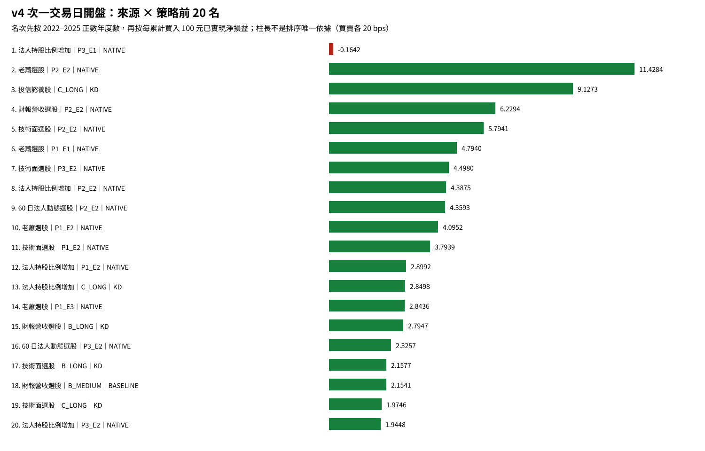

# 雙均線｜技術 QA 附錄（v23）

## 目錄

[一句話結論](#一句話結論)｜[每次投入多少](#每次投入多少)｜[策略字典](#策略字典)｜[2022 與 2023 比較](#2022-與-2023-比較)｜[候選](#候選最多五組)｜[觀察組](#四完整年度觀察組非候選)｜[去重稽核](#cohort-延續值與-canonical-dedup-稽核)｜[v1/v4 對照](#v1-舊報告延續與-v4-主口徑對照)｜[完整排名](#98-組完整排名)｜[年度表](#20222025-完整年度)｜[稽核](#因果成交與動作稽核)｜[附件](#附件與可重現證據)｜[限制](#限制)

## 一句話結論

本研究把 7 個可比較選股來源 × 14 個策略固定為 **98 組**；v4 `NEXT_SESSION_OPEN/20bps` 是主結果，v1 `SIGNAL_CLOSE/20bps` 是同組敏感度，不把兩個成交版本膨脹成 196 組。主口徑可排名 89 組；依凍結規則，必須在正式 v4 的 2022–2025 與 2026/09 YTD **五個期間已實現結果全正**才可進入最多五組候選，本次主候選為 **0 組**。

嚴格聯合判準先要求 v4 五期全正，再要求 v1 五期全正、canonical dedup 池化後 v4 與 v1 已實現淨利都為正且方向一致；本次可確認的組合為 **0 組**。因此目前結論是：**尚不能確認雙均線策略具有穩健正期望值**。

成交口徑必須分開解讀：v1 舊報告延續口徑仍有 **6 組**舊策略在 2022–2026/09 五期已實現淨利皆正；正式主口徑 v4 `NEXT_SESSION_OPEN/20bps` 則是 **0 組**五期皆正。這 6 組舊結果沒有被推翻或遺失，而是切換到可成交的次一交易日開盤後都未維持五期全正，因此不能確認跨成交口徑穩健性。

年度表是選股年度 cohort 視圖；同一筆經濟交易可能跨入多個 selection_years，因此年度列不可相加。v1 舊報告延續池化值保留 cohort 重複，不能稱為逐筆去重；跨成交版本比較應使用另列的 canonical dedup 池化欄。v4 的 canonical key 重複為 0。

這仍是短樣本的研究證據，不足以單獨宣稱未來必然為正期望值。判斷重點是：完整年度一致性、池化後每 100 元已實現淨利、樣本數、資金峰值、v1/v4 方向是否一致，以及是否依賴未平倉估值。

## 每次投入多少

每筆是獨立研究交易，買進總成本上限 TWD 10,000、最多 999 股；新九策略另有初始風險上限 TWD 2,000。不是每組固定投入 50 萬。

本版把資金峰值拆成三種：『舊報告直接沿用參考峰值』是從已驗收舊 35 組機器表直接帶入，並非本版逐筆證據重算；『本版 evidence 重算峰值』由目前 `source-trade-evidence.csv.gz` 計算；『實際已填峰值』計入所有已填進場（含 HOLD），只有實際出場才釋放。舊 detail 沒有匯出精確 cutoff market-session，因此本版不虛構 cutoff 日期；排名只使用 v4 evidence 重算峰值。

## 策略字典

|代號|中文進出場規則|方法軸|
|---|---|---|
|A_MEDIUM|基本進場；5/21 中期均線結構出場|舊五組依凍結規則選 BASELINE 或 KD|
|A_LONG|基本進場；21/144 長期均線結構出場|舊五組依凍結規則選 BASELINE 或 KD|
|B_MEDIUM|距近期低點不超過 7% 進場；5/21 中期均線結構出場|舊五組依凍結規則選 BASELINE 或 KD|
|B_LONG|距近期低點不超過 7% 進場；21/144 長期均線結構出場|舊五組依凍結規則選 BASELINE 或 KD|
|C_LONG|收盤高於 21 日線至少 5% 進場；21/144 長期均線結構出場|舊五組依凍結規則選 BASELINE 或 KD|
|P1_E1|MA21 結構突破進場；固定結構防守；MACD 轉弱備援出場|NATIVE|
|P1_E2|MA21 結構突破進場；固定結構防守；費後達 2R 後 KD 死叉出場|NATIVE|
|P1_E3|MA21 結構突破進場；只升不降的道氏防線；MACD 轉弱備援出場|NATIVE|
|P2_E1|MACD(21,55,55) 綠翻紅進場；固定結構防守；MACD 轉弱備援出場|NATIVE|
|P2_E2|MACD(21,55,55) 綠翻紅進場；固定結構防守；費後達 2R 後 KD 死叉出場|NATIVE|
|P2_E3|MACD(21,55,55) 綠翻紅進場；只升不降的道氏防線；MACD 轉弱備援出場|NATIVE|
|P3_E1|KD(9,9,55) 二次回檔後突破 MA21進場；固定結構防守；MACD 轉弱備援出場|NATIVE|
|P3_E2|KD(9,9,55) 二次回檔後突破 MA21進場；固定結構防守；費後達 2R 後 KD 死叉出場|NATIVE|
|P3_E3|KD(9,9,55) 二次回檔後突破 MA21進場；只升不降的道氏防線；MACD 轉弱備援出場|NATIVE|

## 2022 與 2023 比較

以主口徑 v4（次一交易日開盤、買賣各 20 bps）比較；每個來源各列該年『每累計買入 100 元已實現淨損益』最高的策略。這是同年、同成交口徑的相對結果，不代表跨年可直接外推。

|年度|來源|該來源最佳策略|方法|完成買賣|每100元已實現淨損益|實際動作|樣本分母|
|---:|---|---|---|---:|---:|---:|---:|
|2022|財報營收選股|P2_E2｜MACD(21,55,55) 綠翻紅進場；固定結構防守；費後達 2R 後 KD 死叉出場|NATIVE|270|7.61|1016|522|
|2022|60 日法人動態選股|C_LONG｜收盤高於 21 日線至少 5% 進場；21/144 長期均線結構出場|KD|58|7.83|122|61|
|2022|投信認養股|C_LONG｜收盤高於 21 日線至少 5% 進場；21/144 長期均線結構出場|KD|9|14.31|18|9|
|2022|法人持股比例增加|C_LONG｜收盤高於 21 日線至少 5% 進場；21/144 長期均線結構出場|KD|23|12.37|50|25|
|2022|技術面選股|P2_E2｜MACD(21,55,55) 綠翻紅進場；固定結構防守；費後達 2R 後 KD 死叉出場|NATIVE|296|8.24|1117|575|
|2022|老蕭選股|P2_E2｜MACD(21,55,55) 綠翻紅進場；固定結構防守；費後達 2R 後 KD 死叉出場|NATIVE|62|16.55|219|115|
|2022|精選股票|P2_E2｜MACD(21,55,55) 綠翻紅進場；固定結構防守；費後達 2R 後 KD 死叉出場|NATIVE|145|4.68|567|290|
|2023|財報營收選股|P2_E2｜MACD(21,55,55) 綠翻紅進場；固定結構防守；費後達 2R 後 KD 死叉出場|NATIVE|203|7.35|764|399|
|2023|60 日法人動態選股|P2_E2｜MACD(21,55,55) 綠翻紅進場；固定結構防守；費後達 2R 後 KD 死叉出場|NATIVE|287|8.95|1091|562|
|2023|投信認養股|C_LONG｜收盤高於 21 日線至少 5% 進場；21/144 長期均線結構出場|KD|5|10.93|14|7|
|2023|法人持股比例增加|P3_E2｜KD(9,9,55) 二次回檔後突破 MA21進場；固定結構防守；費後達 2R 後 KD 死叉出場|NATIVE|18|9.88|50|25|
|2023|技術面選股|P2_E2｜MACD(21,55,55) 綠翻紅進場；固定結構防守；費後達 2R 後 KD 死叉出場|NATIVE|319|9.87|1178|605|
|2023|老蕭選股|P2_E2｜MACD(21,55,55) 綠翻紅進場；固定結構防守；費後達 2R 後 KD 死叉出場|NATIVE|64|8.42|221|117|
|2023|精選股票|P3_E2｜KD(9,9,55) 二次回檔後突破 MA21進場；固定結構防守；費後達 2R 後 KD 死叉出場|NATIVE|8|21.80|28|14|

## 候選（最多五組）

只有 v4 五期已實現結果全正者才可列入主候選並進入 phase 2。

|優先|來源|策略|方法|v4 正期間數（共5期）|v4 canonical每100元|v4完成買賣|v4動作|v4 HOLD|v1 canonical每100元|
|---:|---|---|---|---:|---:|---:|---:|---:|---:|

**本次主候選為 0 組；`candidate-shortlist.csv` 為空，沒有任何組合可進入 phase 2。**

## 四完整年度觀察組（非候選）

下列組合只滿足 2022–2025 四個完整年度為正，但未滿足含 2026/09 YTD 的五期全正；只供觀察，不是候選，也不進 phase 2。

|來源|策略|方法|v4 正期間數（共5期）|v4 cohort每100元|v4 canonical每100元|未通過期間|
|---|---|---|---:|---:|---:|---|
|法人持股比例增加|P3_E1|NATIVE|4|-0.16|-0.16|2026/09|

## cohort 延續值與 canonical dedup 稽核

canonical economic-trade key 由來源、策略、正規化股票碼、進出場訊號／成交日、買入金額、已實現或估值損益、交易狀態組成；股票碼會去除 `.TW`／`.TWO` 等 suffix。完整 duplicate keys、受影響組與損益差見 [canonical dedup audit](canonical-dedup-audit.json)。

|版本|池化語義|去重前列數|去重後列數|移除重複列|受影響組|
|---|---|---:|---:|---:|---:|
|v1|舊報告 selection-year cohort 延續|108696|106355|2341|32|
|v4|正式主口徑|94442|94442|0|0|

## v1 舊報告延續與 v4 主口徑對照

下列正是舊 35 組中，依凍結代表方法折疊後的 6 個 distinct 來源×策略。每格為『v1 已實現淨利／v4 已實現淨利』；v4 翻負年度另列。v1 是訊號收盤的舊報告延續結果，v4 才是本研究的正式因果成交主口徑。

|來源|策略|方法|2022 v1／v4|2023 v1／v4|2024 v1／v4|2025 v1／v4|2026/09 v1／v4|v4 翻負年度|
|---|---|---|---:|---:|---:|---:|---:|---|
|60 日法人動態選股|C_LONG|KD|41,046.11／44,838.09|28,888.86／-2,133.26|32,404.95／-32,467.02|109,949.56／63,216.59|2,641.53／-12,137.71|2023、2024、2026/09|
|財報營收選股|A_LONG|KD|7,832.80／102,492.80|323,844.77／43,104.69|6,616.42／-81,227.68|249,222.97／288,464.57|294,236.18／4,345.03|2024|
|財報營收選股|C_LONG|KD|20,686.86／42,429.62|32,789.32／-4,623.24|34,130.40／-29,005.25|128,040.44／126,328.56|116,079.68／-21,184.53|2023、2024、2026/09|
|技術面選股|A_LONG|BASELINE|16,541.45／42,079.48|475,819.71／49,725.67|114,841.21／-79,948.21|194,327.72／192,410.98|141,495.27／-21,436.78|2024、2026/09|
|技術面選股|B_LONG|KD|18,009.52／44,755.72|117,015.45／35,923.01|49,141.68／-11,217.96|195,118.08／178,597.26|203,519.44／-22,441.38|2024、2026/09|
|技術面選股|C_LONG|KD|26,070.19／8,863.70|53,177.21／12,882.12|34,152.83／-15,578.33|96,553.49／72,618.65|150,661.67／-18,894.88|2024、2026/09|

## 98 組完整排名

|名次|來源|策略|方法|狀態|v4完整年正數|v4已實現淨利|v4累計買入|v4每100元|v4未平倉估值|v4 evidence峰值／日期|v4實際已填峰值／日期|v4動作|HOLD|樣本分母|v1 cohort每100元|估值依賴|
|---:|---|---|---|---|---:|---:|---:|---:|---:|---|---|---:|---:|---:|---:|---|
|1|法人持股比例增加|P3_E1|NATIVE|PASS|4|-1,225.79|746,408.64|-0.16|949.39|69,765.35／2023-12-08|79,576.72／2024-07-02|172|10|87|0.63|False|
|2|老蕭選股|P2_E2|NATIVE|PASS|3|194,555.35|1,702,378.65|11.43|9,466.62|242,706.85／2022-12-06|621,289.00／2024-04-12|639|142|345|10.92|False|
|3|投信認養股|C_LONG|KD|PASS|3|17,649.37|193,368.31|9.13|0.00|39,895.60／2023-03-02|39,895.60／2023-03-02|49|5|25|5.91|False|
|4|財報營收選股|P2_E2|NATIVE|PASS|3|479,696.41|7,700,465.04|6.23|27,685.10|1,121,370.16／2025-02-25|2,568,022.04／2026-01-29|3067|720|1672|5.94|False|
|5|技術面選股|P2_E2|NATIVE|PASS|3|596,012.04|10,286,495.03|5.79|30,724.89|1,387,383.52／2025-02-27|3,574,944.15／2024-07-09|3939|900|2128|4.84|False|
|6|老蕭選股|P1_E1|NATIVE|PASS|3|110,630.06|2,307,692.01|4.79|11,219.50|168,357.01／2026-05-13|233,553.89／2026-05-13|545|34|281|6.17|False|
|7|技術面選股|P3_E2|NATIVE|PASS|3|81,926.72|1,821,414.34|4.50|1,138.56|201,199.28／2026-06-05|277,971.46／2026-06-05|445|36|227|5.53|False|
|8|法人持股比例增加|P2_E2|NATIVE|PASS|3|170,656.13|3,889,617.35|4.39|5,827.09|543,880.06／2024-03-05|1,437,436.98／2024-07-09|1520|354|814|3.52|False|
|9|60 日法人動態選股|P2_E2|NATIVE|PASS|3|377,891.08|8,668,696.41|4.36|13,562.83|1,146,910.98／2024-03-06|3,101,636.60／2024-07-09|3346|780|1787|3.09|False|
|10|老蕭選股|P1_E2|NATIVE|PASS|3|84,132.81|2,054,407.81|4.10|2,225.79|169,950.64／2026-01-16|348,489.26／2026-01-16|518|50|272|6.17|False|
|11|技術面選股|P1_E2|NATIVE|PASS|3|275,705.21|7,267,011.02|3.79|38,979.21|632,150.02／2026-04-21|995,259.40／2026-05-13|1886|201|974|5.64|False|
|12|法人持股比例增加|P1_E2|NATIVE|PASS|3|81,448.99|2,809,354.24|2.90|18,630.97|265,044.42／2026-03-27|427,968.23／2024-07-11|774|96|402|4.96|False|
|13|法人持股比例增加|C_LONG|KD|PASS|3|46,288.51|1,624,247.65|2.85|14,870.15|118,707.09／2026-05-22|129,715.36／2024-07-08|381|21|194|3.65|False|
|14|老蕭選股|P1_E3|NATIVE|PASS|3|72,585.80|2,552,635.73|2.84|7,021.27|130,761.50／2026-05-06|177,544.39／2026-05-13|583|27|297|4.12|False|
|15|財報營收選股|B_LONG|KD|PASS|3|287,887.79|10,301,172.04|2.79|43,955.83|633,389.34／2026-03-19|710,893.83／2026-03-19|2385|128|1218|3.35|True|
|16|60 日法人動態選股|P3_E2|NATIVE|PASS|3|37,772.22|1,624,097.66|2.33|-545.36|137,734.91／2026-01-27|214,812.70／2024-05-21|405|37|206|3.13|False|
|17|技術面選股|B_LONG|KD|PASS|3|225,616.63|10,456,581.86|2.16|31,948.31|568,708.44／2024-08-23|775,320.18／2024-08-23|2404|130|1222|2.96|False|
|18|財報營收選股|B_MEDIUM|BASELINE|PASS|3|248,128.98|11,519,067.49|2.15|36,733.36|718,733.07／2026-05-07|798,229.88／2026-05-07|2548|102|1290|2.66|False|
|19|技術面選股|C_LONG|KD|PASS|3|59,891.25|3,033,086.83|1.97|13,183.82|196,838.93／2026-03-30|226,762.79／2026-03-31|695|36|354|5.81|False|
|20|法人持股比例增加|P3_E2|NATIVE|PASS|3|12,620.22|648,917.57|1.94|949.39|66,345.22／2026-03-27|109,491.76／2024-07-02|168|19|86|1.77|False|
|21|60 日法人動態選股|P1_E2|NATIVE|PASS|3|124,616.28|6,681,630.78|1.87|30,244.05|513,232.91／2024-10-24|874,479.77／2024-07-17|1749|184|904|3.32|False|
|22|老蕭選股|P2_E1|NATIVE|PASS|3|72,195.64|3,898,086.73|1.85|13,876.20|291,369.24／2022-12-09|316,195.67／2022-12-09|1047|80|532|2.50|True|
|23|法人持股比例增加|B_LONG|KD|PASS|3|98,070.14|5,856,191.27|1.67|25,486.28|317,671.07／2024-05-07|416,702.01／2024-05-22|1340|69|681|2.13|False|
|24|技術面選股|P3_E1|NATIVE|PASS|3|32,200.45|1,987,051.57|1.62|1,426.02|204,405.93／2026-06-05|243,710.15／2026-06-05|454|23|229|2.31|False|
|25|60 日法人動態選股|B_LONG|KD|PASS|3|192,061.48|12,562,380.54|1.53|40,044.32|723,401.83／2024-08-28|898,063.07／2024-08-28|2858|138|1451|2.18|False|
|26|老蕭選股|C_LONG|KD|PASS|3|18,309.87|1,267,395.66|1.44|651.03|114,960.12／2026-01-16|144,869.84／2026-01-16|299|18|152|1.88|False|
|27|財報營收選股|A_LONG|KD|PASS|3|357,179.42|26,665,640.43|1.34|51,110.97|1,234,345.12／2023-02-10|1,313,944.24／2023-02-10|6111|339|3104|2.33|False|
|28|老蕭選股|P2_E3|NATIVE|PASS|3|36,890.15|4,040,868.06|0.91|13,663.93|289,498.81／2022-12-07|298,441.05／2022-12-09|1054|67|534|1.18|True|
|29|老蕭選股|A_LONG|BASELINE|PASS|3|55,481.43|6,411,745.46|0.87|13,479.31|308,525.97／2023-03-08|492,031.36／2025-12-09|1477|87|754|2.20|True|
|30|財報營收選股|P2_E1|NATIVE|PASS|3|147,686.36|19,247,444.06|0.77|50,512.97|1,419,966.22／2022-12-09|1,632,114.17／2025-05-26|5207|456|2663|0.76|False|
|31|技術面選股|P2_E1|NATIVE|PASS|3|180,393.24|24,607,255.48|0.73|58,559.43|1,607,437.01／2022-12-07|2,035,487.62／2026-06-05|6571|577|3350|0.71|False|
|32|技術面選股|A_LONG|BASELINE|PASS|3|182,831.14|27,072,357.42|0.68|46,379.37|1,790,713.91／2023-04-19|2,056,518.64／2023-04-19|6311|412|3199|2.35|True|
|33|財報營收選股|P2_E3|NATIVE|PASS|3|122,500.18|20,628,382.72|0.59|32,696.09|1,400,957.49／2022-12-07|1,509,089.26／2025-05-22|5242|317|2666|0.70|False|
|34|老蕭選股|A_MEDIUM|BASELINE|PASS|3|20,287.20|4,520,169.95|0.45|17,916.40|217,365.69／2022-12-07|237,750.46／2023-03-10|1383|228|697|3.40|False|
|35|法人持股比例增加|A_LONG|BASELINE|PASS|3|58,416.98|13,209,126.70|0.44|35,836.62|787,187.65／2023-04-17|956,003.12／2023-04-17|3128|221|1583|1.84|False|
|36|技術面選股|P2_E3|NATIVE|PASS|3|82,359.63|26,275,993.96|0.31|43,514.90|1,563,142.43／2022-12-07|1,609,875.93／2022-12-07|6611|409|3354|0.43|False|
|37|60 日法人動態選股|P2_E1|NATIVE|PASS|3|4,899.75|21,210,110.59|0.02|32,740.82|1,426,672.35／2024-03-07|1,688,080.98／2025-05-26|5655|517|2871|0.09|True|
|38|60 日法人動態選股|P2_E3|NATIVE|PASS|3|-8,579.00|22,621,561.97|-0.04|21,485.39|1,377,063.88／2024-03-07|1,534,459.33／2025-05-26|5687|371|2875|0.11|False|
|39|法人持股比例增加|P3_E3|NATIVE|PASS|3|-2,865.35|786,151.58|-0.36|949.39|49,899.26／2024-05-07|49,899.26／2024-05-07|173|6|87|0.27|False|
|40|財報營收選股|P1_E2|NATIVE|PASS|2|253,406.06|6,040,665.61|4.20|54,519.63|577,399.83／2026-05-12|844,799.10／2026-06-02|1594|172|828|5.44|False|
|41|財報營收選股|P3_E2|NATIVE|PASS|2|62,029.58|1,594,232.52|3.89|3,230.32|164,638.59／2026-06-05|212,947.57／2026-06-05|386|28|198|4.55|False|
|42|財報營收選股|C_LONG|KD|PASS|2|113,945.17|3,010,733.78|3.78|20,958.96|210,624.74／2026-05-12|229,330.06／2026-05-15|704|38|360|5.90|False|
|43|老蕭選股|B_MEDIUM|KD|PASS|2|64,203.54|2,359,400.43|2.72|15,754.23|98,840.11／2024-02-20|108,822.02／2024-02-20|520|17|262|1.99|True|
|44|投信認養股|B_LONG|BASELINE|PASS|2|17,112.56|648,347.19|2.64|0.00|69,696.16／2023-03-02|79,631.98／2023-03-02|155|12|78|1.12|False|
|45|投信認養股|P2_E2|NATIVE|PASS|2|11,351.76|546,427.44|2.08|0.00|113,401.26／2022-12-06|328,504.68／2024-07-17|233|64|123|-1.82|False|
|46|60 日法人動態選股|C_LONG|KD|PASS|2|61,316.68|3,542,407.78|1.73|17,121.82|203,859.14／2026-03-27|222,578.49／2026-03-27|810|38|411|4.09|False|
|47|老蕭選股|P3_E3|NATIVE|PASS|2|8,600.05|576,667.57|1.49|0.00|44,177.04／2026-04-02|44,177.04／2026-04-02|126|3|63|2.81|False|
|48|老蕭選股|B_LONG|BASELINE|PASS|2|46,687.45|3,357,207.95|1.39|13,586.09|202,909.04／2025-02-26|306,312.56／2025-12-12|790|51|404|1.42|False|
|49|技術面選股|P1_E1|NATIVE|PASS|2|112,344.04|8,295,929.38|1.35|47,400.25|569,967.60／2026-05-13|811,202.21／2026-06-02|1975|134|1004|2.40|False|
|50|技術面選股|B_MEDIUM|KD|PASS|2|195,194.93|14,471,555.57|1.35|56,257.69|739,539.23／2026-05-04|808,874.57／2026-05-04|3148|107|1589|2.00|False|
|51|財報營收選股|P1_E1|NATIVE|PASS|2|78,466.74|6,843,126.58|1.15|64,195.08|515,967.96／2026-05-12|754,343.62／2026-06-04|1658|119|853|2.12|False|
|52|技術面選股|P1_E3|NATIVE|PASS|2|90,111.05|9,046,166.30|1.00|42,170.31|515,711.09／2026-06-01|671,321.32／2026-06-01|2072|107|1050|2.09|False|
|53|老蕭選股|P3_E1|NATIVE|PASS|2|5,538.65|566,667.87|0.98|0.00|52,966.98／2026-06-02|52,966.98／2026-06-02|126|4|63|2.37|False|
|54|投信認養股|A_LONG|BASELINE|PASS|2|16,929.62|2,137,552.76|0.79|149.76|249,248.50／2023-03-10|269,179.92／2023-03-10|501|35|252|1.19|False|
|55|財報營收選股|P1_E3|NATIVE|PASS|2|55,659.70|7,561,313.01|0.74|56,942.02|514,497.03／2026-05-12|634,008.57／2026-06-04|1749|91|894|1.88|False|
|56|法人持股比例增加|P1_E3|NATIVE|PASS|2|23,762.22|3,678,399.81|0.65|24,617.05|185,982.32／2024-05-29|228,822.80／2024-07-08|849|42|433|1.45|False|
|57|技術面選股|P3_E3|NATIVE|PASS|2|10,592.41|2,074,839.78|0.51|1,198.95|174,591.24／2026-06-05|184,583.18／2026-06-05|460|18|231|1.44|False|
|58|60 日法人動態選股|A_LONG|BASELINE|PASS|2|63,020.72|30,598,201.03|0.21|46,488.59|2,192,146.44／2023-04-18|2,560,174.43／2023-04-18|7125|459|3607|1.62|False|
|59|法人持股比例增加|P1_E1|NATIVE|PASS|2|-3,103.76|3,357,100.10|-0.09|24,048.46|207,607.47／2026-03-18|286,453.93／2024-06-27|814|58|417|1.05|False|
|60|老蕭選股|P3_E2|NATIVE|PASS|2|-606.95|483,228.89|-0.13|340.86|49,742.25／2022-12-01|79,534.49／2026-06-02|118|10|61|3.02|False|
|61|60 日法人動態選股|P3_E3|NATIVE|PASS|2|-2,852.97|1,860,019.92|-0.15|582.32|109,366.96／2023-11-22|117,036.16／2024-05-08|414|17|208|0.65|False|
|62|財報營收選股|A_MEDIUM|BASELINE|PASS|2|-80,608.43|48,822,902.29|-0.17|55,884.84|1,941,535.01／2022-12-05|2,132,208.45／2022-08-29|12276|1206|6179|0.76|False|
|63|60 日法人動態選股|P3_E1|NATIVE|PASS|2|-3,638.70|1,803,155.37|-0.20|582.32|126,352.10／2026-01-13|136,891.78／2024-05-08|413|23|208|0.62|False|
|64|法人持股比例增加|P2_E3|NATIVE|PASS|2|-26,726.51|10,474,360.76|-0.26|8,536.12|744,379.94／2024-03-01|791,989.68／2024-03-01|2649|174|1340|-0.12|True|
|65|60 日法人動態選股|P1_E3|NATIVE|PASS|2|-26,366.20|8,436,438.88|-0.31|38,895.92|368,748.08／2026-01-16|474,532.99／2026-06-04|1929|90|980|0.65|False|
|66|法人持股比例增加|P2_E1|NATIVE|PASS|2|-32,947.45|9,832,545.61|-0.34|17,795.58|777,699.42／2024-03-04|865,143.04／2024-03-04|2630|237|1338|-0.11|False|
|67|60 日法人動態選股|P1_E1|NATIVE|PASS|2|-29,988.02|7,732,090.46|-0.39|37,148.30|436,960.03／2026-01-23|543,144.38／2026-06-04|1837|117|936|0.60|False|
|68|精選股票|B_MEDIUM|BASELINE|PASS|1|103,577.69|1,748,572.81|5.92|9,043.24|268,678.17／2026-05-04|298,538.04／2026-05-04|391|17|198|3.13|False|
|69|精選股票|A_MEDIUM|BASELINE|PASS|1|52,712.04|4,926,045.14|1.07|20,641.23|767,985.59／2026-08-31|867,771.43／2026-08-31|1100|46|560|0.89|True|
|70|精選股票|A_LONG|BASELINE|PASS|1|2,437.83|1,241,059.52|0.20|21,162.96|296,639.46／2026-09-22|366,771.33／2026-07-07|329|28|181|2.05|True|
|71|60 日法人動態選股|B_MEDIUM|BASELINE|PASS|1|18,602.97|9,849,923.47|0.19|12,037.74|546,828.13／2024-03-07|576,696.53／2024-03-07|2150|82|1085|1.35|False|
|72|投信認養股|P2_E3|NATIVE|PASS|1|-4,410.29|1,632,348.92|-0.27|0.00|177,153.91／2024-03-06|185,211.73／2024-03-06|410|31|206|-0.35|False|
|73|財報營收選股|P3_E3|NATIVE|PASS|1|-6,934.17|1,772,434.87|-0.39|3,724.23|147,215.62／2026-06-05|165,595.80／2026-06-05|394|14|199|0.71|False|
|74|投信認養股|P2_E1|NATIVE|PASS|1|-6,541.61|1,564,594.54|-0.42|0.00|177,135.87／2024-03-06|195,059.38／2024-03-06|410|38|206|-0.65|False|
|75|精選股票|B_LONG|KD|PASS|1|-3,938.77|680,779.85|-0.58|17,152.09|155,844.84／2026-08-11|193,773.42／2026-08-11|176|15|95|1.92|False|
|76|投信認養股|P1_E2|NATIVE|PASS|1|-2,528.45|416,554.21|-0.61|2,107.37|69,697.76／2023-03-02|99,434.99／2023-03-02|116|16|59|1.56|False|
|77|法人持股比例增加|B_MEDIUM|KD|PASS|1|-29,217.80|4,746,321.44|-0.62|9,120.70|198,880.31／2024-03-05|208,852.20／2024-03-05|1027|35|517|0.71|False|
|78|60 日法人動態選股|A_MEDIUM|BASELINE|PASS|1|-388,029.50|52,709,126.46|-0.74|26,989.18|2,152,742.38／2023-03-01|2,252,505.02／2023-03-01|12708|1047|6383|0.16|False|
|79|投信認養股|B_MEDIUM|KD|PASS|1|-3,040.61|396,980.86|-0.77|2,107.37|39,695.00／2023-08-08|39,695.00／2023-08-08|85|2|43|-3.00|False|
|80|投信認養股|P1_E3|NATIVE|PASS|1|-4,537.23|513,497.03|-0.88|2,107.37|59,815.04／2023-03-22|59,815.04／2023-03-22|120|8|61|-0.25|True|
|81|投信認養股|P1_E1|NATIVE|PASS|1|-4,229.92|473,851.33|-0.89|2,107.37|69,756.88／2023-03-22|69,756.88／2023-03-22|116|10|59|-0.73|True|
|82|法人持股比例增加|A_MEDIUM|BASELINE|PASS|1|-199,640.32|19,868,241.98|-1.00|9,581.92|857,021.84／2023-02-22|886,979.71／2023-02-22|4736|374|2377|0.39|False|
|83|投信認養股|A_MEDIUM|KD|PASS|1|-36,630.12|3,401,181.48|-1.08|2,107.37|269,247.71／2023-02-17|269,247.71／2023-02-17|873|94|437|-0.44|False|
|84|財報營收選股|P3_E1|NATIVE|PASS|1|-19,459.94|1,724,134.30|-1.13|3,517.79|156,697.94／2026-06-05|204,704.13／2026-06-05|393|18|199|-0.36|False|
|85|投信認養股|P3_E3|NATIVE|PASS|1|-1,874.51|69,502.07|-2.70|0.00|19,851.11／2024-03-01|19,933.27／2024-11-20|16|1|8|-2.42|False|
|86|投信認養股|P3_E1|NATIVE|PASS|1|-2,909.53|59,516.65|-4.89|0.00|9,988.43／2025-03-06|19,933.27／2024-11-20|16|2|8|-4.09|False|
|87|技術面選股|A_MEDIUM|KD|PASS|0|-120,976.36|69,808,609.07|-0.17|92,660.80|2,699,467.95／2022-12-02|2,768,250.97／2022-12-02|16571|1250|8325|0.56|False|
|88|精選股票|C_LONG|KD|PASS|0|-3,271.85|187,436.42|-1.75|10,242.99|49,662.84／2026-09-22|57,620.72／2026-09-22|49|4|27|3.44|False|
|89|投信認養股|P3_E2|NATIVE|PASS|0|-4,959.00|59,728.57|-8.30|0.00|19,950.71／2025-03-06|19,950.71／2025-03-06|16|2|8|-8.90|False|
|HOLD|精選股票|P3_E2|NATIVE|HOLD_SOURCE_YEAR_COVERAGE|3|15,787.47|323,158.52|4.89|0.00|59,285.79／2024-05-07|89,178.83／2024-05-15|82|8|41|4.53|False|
|HOLD|精選股票|P1_E2|NATIVE|HOLD_SOURCE_YEAR_COVERAGE|2|-24,125.08|1,589,018.72|-1.52|0.00|167,747.99／2024-10-24|288,638.69／2024-07-18|410|44|206|-0.59|False|
|HOLD|精選股票|P2_E2|NATIVE|HOLD_SOURCE_YEAR_COVERAGE|2|-60,783.31|3,248,033.55|-1.87|0.00|599,471.42／2024-10-24|1,612,075.92／2024-07-19|1198|267|617|-2.78|False|
|HOLD|精選股票|P3_E3|NATIVE|HOLD_SOURCE_YEAR_COVERAGE|1|-4,927.26|362,818.50|-1.36|0.00|39,797.90／2022-09-21|39,797.90／2022-09-21|82|4|41|-1.53|False|
|HOLD|精選股票|P1_E3|NATIVE|HOLD_SOURCE_YEAR_COVERAGE|1|-30,767.38|1,948,371.35|-1.58|0.00|148,367.32／2024-04-15|169,394.03／2024-07-11|442|22|221|-1.27|False|
|HOLD|精選股票|P1_E1|NATIVE|HOLD_SOURCE_YEAR_COVERAGE|1|-48,758.41|1,822,801.57|-2.67|0.00|149,385.25／2024-04-19|189,366.07／2024-07-11|426|27|213|-2.27|False|
|HOLD|精選股票|P3_E1|NATIVE|HOLD_SOURCE_YEAR_COVERAGE|1|-9,407.07|342,852.36|-2.74|0.00|49,311.09／2024-04-25|59,296.51／2024-04-25|82|6|41|-3.05|False|
|HOLD|精選股票|P2_E3|NATIVE|HOLD_SOURCE_YEAR_COVERAGE|0|-82,339.20|7,567,828.67|-1.09|0.00|733,971.87／2022-12-07|751,805.70／2022-12-07|1877|126|942|-1.20|False|
|HOLD|精選股票|P2_E1|NATIVE|HOLD_SOURCE_YEAR_COVERAGE|0|-128,538.45|7,237,834.31|-1.78|0.00|736,620.26／2022-12-13|817,575.28／2024-07-09|1870|161|942|-1.88|False|

## 98 組 × 2 成交版本完整五期摘要

|來源|策略|方法|版本／成交|排名狀態|五期正數|完成買賣|cohort已實現淨利|cohort累計買入|cohort每100元|canonical每100元|正式未平倉數／估值|含估值淨利／每100元|舊報告直接沿用峰值／日期|本版 evidence 重算峰值／日期|實際已填峰值／日期|實際動作|已填 HOLD／原因|樣本分母|估值依賴|
|---|---|---|---|---|---:|---:|---:|---:|---:|---:|---|---|---|---|---|---:|---|---:|---|
|法人持股比例增加|P3_E1|NATIVE|v4／次一交易日開盤|PASS|4|76|-1,225.79|746,408.64|-0.16|-0.16|1／949.39|-276.40／-0.04|N/A／N/A|69,765.35／2023-12-08|79,576.72／2024-07-02|172|10／HOLD_APPLICABLE_ECONOMIC_EVENT:9\|HOLD_MISSING_BAR\|HOLD_TECHNICAL_FACTOR:1|87|False|
|法人持股比例增加|P3_E1|NATIVE|v1／訊號收盤|PASS|4|80|5,007.25|792,757.77|0.63|0.63|1／710.26|5,717.51／0.71|N/A／N/A|67,979.68／2023-12-07|79,649.92／2024-07-01|176|8／HOLD_APPLICABLE_ECONOMIC_EVENT:7\|HOLD_MISSING_BAR\|HOLD_TECHNICAL_FACTOR:1|89|False|
|老蕭選股|P2_E2|NATIVE|v4／次一交易日開盤|PASS|4|191|194,555.35|1,702,378.65|11.43|11.43|12／9,466.62|204,021.97／11.42|N/A／N/A|242,706.85／2022-12-06|621,289.00／2024-04-12|639|142／HOLD_APPLICABLE_ECONOMIC_EVENT:103\|HOLD_INPUT_OR_ECONOMIC_EVENT:13\|HOLD_MISSING_BAR:24\|HOLD_MISSING_BAR\|HOLD_TECHNICAL_FACTOR:2|345|False|
|老蕭選股|P2_E2|NATIVE|v1／訊號收盤|PASS|4|206|201,913.56|1,849,089.79|10.92|10.92|12／1,770.08|203,683.64／10.53|N/A／N/A|256,361.84／2022-12-05|626,510.17／2024-04-11|662|140／HOLD_APPLICABLE_ECONOMIC_EVENT:98\|HOLD_INPUT_OR_ECONOMIC_EVENT:15\|HOLD_MISSING_BAR:25\|HOLD_MISSING_BAR\|HOLD_TECHNICAL_FACTOR:2|358|False|
|投信認養股|C_LONG|KD|v4／次一交易日開盤|PASS|3|20|17,649.37|193,368.31|9.13|9.13|0／0.00|17,649.37／9.13|N/A／N/A|39,895.60／2023-03-02|39,895.60／2023-03-02|49|5／HOLD_APPLICABLE_ECONOMIC_EVENT:4\|HOLD_MISSING_BAR:1|25|False|
|投信認養股|C_LONG|KD|v1／訊號收盤|PASS|2|21|12,168.91|206,037.34|5.91|5.91|0／0.00|12,168.91／5.91|39,788.69／2024-02-16|39,788.69／2024-02-16|39,788.69／2024-02-16|47|3／資料不足暫不列入:3|24|False|
|財報營收選股|P2_E2|NATIVE|v4／次一交易日開盤|PASS|4|848|479,696.41|7,700,465.04|6.23|6.23|104／27,685.10|507,381.52／6.04|N/A／N/A|1,121,370.16／2025-02-25|2,568,022.04／2026-01-29|3067|720／HOLD_APPLICABLE_ECONOMIC_EVENT:547\|HOLD_INPUT_OR_ECONOMIC_EVENT:108\|HOLD_MISSING_BAR:39\|HOLD_MISSING_BAR\|HOLD_TECHNICAL_FACTOR:26|1672|False|
|財報營收選股|P2_E2|NATIVE|v1／訊號收盤|PASS|4|999|544,807.37|9,175,505.39|5.94|5.94|111／26,580.46|571,387.83／5.75|N/A／N/A|1,076,760.56／2025-02-24|2,680,751.46／2026-01-28|3434|750／HOLD_APPLICABLE_ECONOMIC_EVENT:575\|HOLD_INPUT_OR_ECONOMIC_EVENT:105\|HOLD_MISSING_BAR:42\|HOLD_MISSING_BAR\|HOLD_TECHNICAL_FACTOR:28|1860|False|
|技術面選股|P2_E2|NATIVE|v4／次一交易日開盤|PASS|4|1119|596,012.04|10,286,495.03|5.79|5.79|109／30,724.89|626,736.93／5.66|N/A／N/A|1,387,383.52／2025-02-27|3,574,944.15／2024-07-09|3939|900／HOLD_APPLICABLE_ECONOMIC_EVENT:692\|HOLD_INPUT_OR_ECONOMIC_EVENT:131\|HOLD_MISSING_BAR:53\|HOLD_MISSING_BAR\|HOLD_TECHNICAL_FACTOR:24|2128|False|
|技術面選股|P2_E2|NATIVE|v1／訊號收盤|PASS|4|1282|575,928.63|11,897,422.24|4.84|4.84|113／24,884.22|600,812.85／4.72|N/A／N/A|1,384,250.73／2025-02-26|3,642,712.68／2024-07-08|4299|915／HOLD_APPLICABLE_ECONOMIC_EVENT:707\|HOLD_INPUT_OR_ECONOMIC_EVENT:130\|HOLD_MISSING_BAR:55\|HOLD_MISSING_BAR\|HOLD_TECHNICAL_FACTOR:23|2310|False|
|老蕭選股|P1_E1|NATIVE|v4／次一交易日開盤|PASS|4|238|110,630.06|2,307,692.01|4.79|4.79|9／11,219.50|121,849.56／5.11|N/A／N/A|168,357.01／2026-05-13|233,553.89／2026-05-13|545|34／HOLD_APPLICABLE_ECONOMIC_EVENT:26\|HOLD_INPUT_OR_ECONOMIC_EVENT:3\|HOLD_MISSING_BAR:5|281|False|
|老蕭選股|P1_E1|NATIVE|v1／訊號收盤|PASS|4|257|154,909.30|2,511,862.53|6.17|6.17|9／12,146.15|167,055.46／6.45|N/A／N/A|189,931.05／2026-05-12|257,413.84／2026-05-12|582|33／HOLD_APPLICABLE_ECONOMIC_EVENT:26\|HOLD_INPUT_OR_ECONOMIC_EVENT:2\|HOLD_MISSING_BAR:5|299|False|
|技術面選股|P3_E2|NATIVE|v4／次一交易日開盤|PASS|4|185|81,926.72|1,821,414.34|4.50|4.50|6／1,138.56|83,065.28／4.42|N/A／N/A|201,199.28／2026-06-05|277,971.46／2026-06-05|445|36／HOLD_APPLICABLE_ECONOMIC_EVENT:33\|HOLD_INPUT_OR_ECONOMIC_EVENT:1\|HOLD_MISSING_BAR:1\|HOLD_MISSING_BAR\|HOLD_TECHNICAL_FACTOR:1|227|False|
|技術面選股|P3_E2|NATIVE|v1／訊號收盤|PASS|4|202|110,812.01|2,004,957.55|5.53|5.53|6／1,490.53|112,302.54／5.44|N/A／N/A|199,405.20／2026-01-12|255,546.47／2026-06-04|471|32／HOLD_APPLICABLE_ECONOMIC_EVENT:29\|HOLD_INPUT_OR_ECONOMIC_EVENT:1\|HOLD_MISSING_BAR:1\|HOLD_MISSING_BAR\|HOLD_TECHNICAL_FACTOR:1|240|False|
|法人持股比例增加|P2_E2|NATIVE|v4／次一交易日開盤|PASS|4|427|170,656.13|3,889,617.35|4.39|4.39|33／5,827.09|176,483.22／4.27|N/A／N/A|543,880.06／2024-03-05|1,437,436.98／2024-07-09|1520|354／HOLD_APPLICABLE_ECONOMIC_EVENT:279\|HOLD_INPUT_OR_ECONOMIC_EVENT:45\|HOLD_MISSING_BAR:16\|HOLD_MISSING_BAR\|HOLD_TECHNICAL_FACTOR:14|814|False|
|法人持股比例增加|P2_E2|NATIVE|v1／訊號收盤|PASS|4|487|158,140.50|4,491,084.66|3.52|3.52|35／5,473.51|163,614.02／3.44|N/A／N/A|532,325.65／2025-02-24|1,417,560.23／2024-07-08|1639|354／HOLD_APPLICABLE_ECONOMIC_EVENT:276\|HOLD_INPUT_OR_ECONOMIC_EVENT:46\|HOLD_MISSING_BAR:18\|HOLD_MISSING_BAR\|HOLD_TECHNICAL_FACTOR:14|876|False|
|60 日法人動態選股|P2_E2|NATIVE|v4／次一交易日開盤|PASS|4|940|377,891.08|8,668,696.41|4.36|4.36|67／13,562.83|391,453.91／4.27|N/A／N/A|1,146,910.98／2024-03-06|3,101,636.60／2024-07-09|3346|780／HOLD_APPLICABLE_ECONOMIC_EVENT:619\|HOLD_INPUT_OR_ECONOMIC_EVENT:97\|HOLD_MISSING_BAR:38\|HOLD_MISSING_BAR\|HOLD_TECHNICAL_FACTOR:26|1787|False|
|60 日法人動態選股|P2_E2|NATIVE|v1／訊號收盤|PASS|4|1079|311,075.92|10,059,264.39|3.09|3.09|72／17,138.72|328,214.64／3.09|N/A／N/A|1,153,331.96／2024-03-07|3,181,244.55／2024-07-08|3664|799／HOLD_APPLICABLE_ECONOMIC_EVENT:635\|HOLD_INPUT_OR_ECONOMIC_EVENT:98\|HOLD_MISSING_BAR:39\|HOLD_MISSING_BAR\|HOLD_TECHNICAL_FACTOR:27|1950|False|
|老蕭選股|P1_E2|NATIVE|v4／次一交易日開盤|PASS|4|212|84,132.81|2,054,407.81|4.10|4.10|10／2,225.79|86,358.60／4.04|N/A／N/A|169,950.64／2026-01-16|348,489.26／2026-01-16|518|50／HOLD_APPLICABLE_ECONOMIC_EVENT:34\|HOLD_INPUT_OR_ECONOMIC_EVENT:3\|HOLD_MISSING_BAR:13|272|False|
|老蕭選股|P1_E2|NATIVE|v1／訊號收盤|PASS|4|239|144,433.91|2,341,089.35|6.17|6.17|7／-116.52|144,317.39／6.01|N/A／N/A|201,125.38／2026-04-07|348,895.06／2026-04-07|573|51／HOLD_APPLICABLE_ECONOMIC_EVENT:37\|HOLD_INPUT_OR_ECONOMIC_EVENT:3\|HOLD_MISSING_BAR:10\|HOLD_MISSING_BAR\|HOLD_TECHNICAL_FACTOR:1|297|False|
|技術面選股|P1_E2|NATIVE|v4／次一交易日開盤|PASS|4|739|275,705.21|7,267,011.02|3.79|3.79|34／38,979.21|314,684.43／4.15|N/A／N/A|632,150.02／2026-04-21|995,259.40／2026-05-13|1886|201／HOLD_APPLICABLE_ECONOMIC_EVENT:173\|HOLD_INPUT_OR_ECONOMIC_EVENT:15\|HOLD_MISSING_BAR:8\|HOLD_MISSING_BAR\|HOLD_TECHNICAL_FACTOR:5|974|False|
|技術面選股|P1_E2|NATIVE|v1／訊號收盤|PASS|4|826|460,966.81|8,171,850.72|5.64|5.64|34／39,919.61|500,886.42／5.90|N/A／N/A|660,977.03／2026-04-15|975,444.86／2026-06-01|2039|189／HOLD_APPLICABLE_ECONOMIC_EVENT:164\|HOLD_INPUT_OR_ECONOMIC_EVENT:14\|HOLD_MISSING_BAR:6\|HOLD_MISSING_BAR\|HOLD_TECHNICAL_FACTOR:5|1049|False|
|法人持股比例增加|P1_E2|NATIVE|v4／次一交易日開盤|PASS|4|286|81,448.99|2,809,354.24|2.90|2.90|20／18,630.97|100,079.96／3.36|N/A／N/A|265,044.42／2026-03-27|427,968.23／2024-07-11|774|96／HOLD_APPLICABLE_ECONOMIC_EVENT:86\|HOLD_INPUT_OR_ECONOMIC_EVENT:5\|HOLD_MISSING_BAR:1\|HOLD_MISSING_BAR\|HOLD_TECHNICAL_FACTOR:4|402|False|
|法人持股比例增加|P1_E2|NATIVE|v1／訊號收盤|PASS|4|312|152,812.50|3,078,075.05|4.96|4.96|19／17,012.53|169,825.03／5.23|N/A／N/A|278,365.00／2026-03-26|387,979.15／2024-07-10|819|92／HOLD_APPLICABLE_ECONOMIC_EVENT:84\|HOLD_INPUT_OR_ECONOMIC_EVENT:3\|HOLD_MISSING_BAR:1\|HOLD_MISSING_BAR\|HOLD_TECHNICAL_FACTOR:4|423|False|
|法人持股比例增加|C_LONG|KD|v4／次一交易日開盤|PASS|3|166|46,288.51|1,624,247.65|2.85|2.85|7／14,870.15|61,158.66／3.62|N/A／N/A|118,707.09／2026-05-22|129,715.36／2024-07-08|381|21／HOLD_APPLICABLE_ECONOMIC_EVENT:19\|HOLD_MISSING_BAR:2|194|False|
|法人持股比例增加|C_LONG|KD|v1／訊號收盤|PASS|4|253|90,790.79|2,488,061.45|3.65|3.82|8／17,386.83|108,177.62／4.21|238,281.47／2024-05-28|238,281.47／2024-05-28|248,198.76／2024-05-28|533|10／資料不足暫不列入:10|271|True|
|老蕭選股|P1_E3|NATIVE|v4／次一交易日開盤|PASS|4|264|72,585.80|2,552,635.73|2.84|2.84|6／7,021.27|79,607.06／3.06|N/A／N/A|130,761.50／2026-05-06|177,544.39／2026-05-13|583|27／HOLD_APPLICABLE_ECONOMIC_EVENT:22\|HOLD_INPUT_OR_ECONOMIC_EVENT:2\|HOLD_MISSING_BAR:3|297|False|
|老蕭選股|P1_E3|NATIVE|v1／訊號收盤|PASS|4|281|113,155.38|2,745,467.07|4.12|4.12|6／7,416.85|120,572.23／4.31|N/A／N/A|154,152.12／2026-04-07|191,582.85／2026-05-07|618|27／HOLD_APPLICABLE_ECONOMIC_EVENT:23\|HOLD_INPUT_OR_ECONOMIC_EVENT:1\|HOLD_MISSING_BAR:3|314|False|
|財報營收選股|B_LONG|KD|v4／次一交易日開盤|PASS|3|1050|287,887.79|10,301,172.04|2.79|2.79|40／43,955.83|331,843.62／3.11|N/A／N/A|633,389.34／2026-03-19|710,893.83／2026-03-19|2385|128／HOLD_APPLICABLE_ECONOMIC_EVENT:112\|HOLD_MISSING_BAR:14\|HOLD_MISSING_BAR\|HOLD_TECHNICAL_FACTOR:2|1218|True|
|財報營收選股|B_LONG|KD|v1／訊號收盤|PASS|4|1943|640,115.36|19,107,416.06|3.35|2.99|79／94,251.77|734,367.13／3.70|1,583,255.24／2026-03-20|1,593,253.79／2026-03-20|1,942,861.68／2026-03-20|4270|168／資料不足暫不列入:168|2190|False|
|60 日法人動態選股|P3_E2|NATIVE|v4／次一交易日開盤|PASS|3|165|37,772.22|1,624,097.66|2.33|2.33|4／-545.36|37,226.86／2.24|N/A／N/A|137,734.91／2026-01-27|214,812.70／2024-05-21|405|37／HOLD_APPLICABLE_ECONOMIC_EVENT:34\|HOLD_INPUT_OR_ECONOMIC_EVENT:2\|HOLD_MISSING_BAR\|HOLD_TECHNICAL_FACTOR:1|206|False|
|60 日法人動態選股|P3_E2|NATIVE|v1／訊號收盤|PASS|3|176|54,624.47|1,746,168.88|3.13|3.13|4／-559.37|54,065.10／3.03|N/A／N/A|149,492.42／2026-01-26|208,758.72／2024-05-20|421|34／HOLD_APPLICABLE_ECONOMIC_EVENT:31\|HOLD_INPUT_OR_ECONOMIC_EVENT:2\|HOLD_MISSING_BAR\|HOLD_TECHNICAL_FACTOR:1|214|False|
|技術面選股|B_LONG|KD|v4／次一交易日開盤|PASS|3|1063|225,616.63|10,456,581.86|2.16|2.16|29／31,948.31|257,564.94／2.40|N/A／N/A|568,708.44／2024-08-23|775,320.18／2024-08-23|2404|130／HOLD_APPLICABLE_ECONOMIC_EVENT:112\|HOLD_MISSING_BAR:14\|HOLD_MISSING_BAR\|HOLD_TECHNICAL_FACTOR:4|1222|False|
|技術面選股|B_LONG|KD|v1／訊號收盤|PASS|5|1996|582,804.17|19,675,358.61|2.96|2.86|54／49,029.59|631,833.76／3.13|1,393,853.67／2026-03-20|1,393,853.67／2026-03-20|1,680,176.10／2026-03-20|4343|162／資料不足暫不列入:162|2212|False|
|財報營收選股|B_MEDIUM|BASELINE|v4／次一交易日開盤|PASS|4|1161|248,128.98|11,519,067.49|2.15|2.15|27／36,733.36|284,862.34／2.42|N/A／N/A|718,733.07／2026-05-07|798,229.88／2026-05-07|2548|102／HOLD_APPLICABLE_ECONOMIC_EVENT:97\|HOLD_MISSING_BAR:2\|HOLD_MISSING_BAR\|HOLD_TECHNICAL_FACTOR:3|1290|False|
|財報營收選股|B_MEDIUM|BASELINE|v1／訊號收盤|PASS|3|1395|368,595.97|13,859,855.39|2.66|2.51|37／68,224.51|436,820.48／3.07|851,468.95／2026-05-06|851,468.95／2026-05-06|1,020,656.07／2026-05-06|2973|78／資料不足暫不列入:78|1510|False|
|技術面選股|C_LONG|KD|v4／次一交易日開盤|PASS|3|310|59,891.25|3,033,086.83|1.97|1.97|8／13,183.82|73,075.07／2.35|N/A／N/A|196,838.93／2026-03-30|226,762.79／2026-03-31|695|36／HOLD_APPLICABLE_ECONOMIC_EVENT:32\|HOLD_MISSING_BAR:2\|HOLD_MISSING_BAR\|HOLD_TECHNICAL_FACTOR:2|354|False|
|技術面選股|C_LONG|KD|v1／訊號收盤|PASS|5|632|360,615.38|6,203,117.60|5.81|5.52|17／17,390.50|378,005.88／5.95|516,580.23／2026-03-27|516,580.23／2026-03-27|576,120.48／2026-03-30|1357|42／資料不足暫不列入:42|691|False|
|法人持股比例增加|P3_E2|NATIVE|v4／次一交易日開盤|PASS|3|66|12,620.22|648,917.57|1.94|1.94|1／949.39|13,569.61／2.06|N/A／N/A|66,345.22／2026-03-27|109,491.76／2024-07-02|168|19／HOLD_APPLICABLE_ECONOMIC_EVENT:16\|HOLD_INPUT_OR_ECONOMIC_EVENT:2\|HOLD_MISSING_BAR\|HOLD_TECHNICAL_FACTOR:1|86|False|
|法人持股比例增加|P3_E2|NATIVE|v1／訊號收盤|PASS|3|71|12,461.56|703,694.68|1.77|1.77|1／710.26|13,171.81／1.85|N/A／N/A|79,238.05／2026-03-26|109,527.63／2024-07-01|174|17／HOLD_APPLICABLE_ECONOMIC_EVENT:14\|HOLD_INPUT_OR_ECONOMIC_EVENT:2\|HOLD_MISSING_BAR\|HOLD_TECHNICAL_FACTOR:1|89|False|
|60 日法人動態選股|P1_E2|NATIVE|v4／次一交易日開盤|PASS|4|682|124,616.28|6,681,630.78|1.87|1.87|38／30,244.05|154,860.33／2.21|N/A／N/A|513,232.91／2024-10-24|874,479.77／2024-07-17|1749|184／HOLD_APPLICABLE_ECONOMIC_EVENT:163\|HOLD_INPUT_OR_ECONOMIC_EVENT:10\|HOLD_MISSING_BAR:4\|HOLD_MISSING_BAR\|HOLD_TECHNICAL_FACTOR:7|904|False|
|60 日法人動態選股|P1_E2|NATIVE|v1／訊號收盤|PASS|4|748|245,036.96|7,380,317.96|3.32|3.32|37／26,605.35|271,642.31／3.52|N/A／N/A|512,306.26／2026-03-25|806,205.25／2024-07-16|1861|173／HOLD_APPLICABLE_ECONOMIC_EVENT:155\|HOLD_INPUT_OR_ECONOMIC_EVENT:8\|HOLD_MISSING_BAR:4\|HOLD_MISSING_BAR\|HOLD_TECHNICAL_FACTOR:6|958|False|
|老蕭選股|P2_E1|NATIVE|v4／次一交易日開盤|PASS|3|443|72,195.64|3,898,086.73|1.85|1.85|9／13,876.20|86,071.84／2.18|N/A／N/A|291,369.24／2022-12-09|316,195.67／2022-12-09|1047|80／HOLD_APPLICABLE_ECONOMIC_EVENT:72\|HOLD_INPUT_OR_ECONOMIC_EVENT:2\|HOLD_MISSING_BAR:6|532|True|
|老蕭選股|P2_E1|NATIVE|v1／訊號收盤|PASS|4|469|104,098.33|4,163,106.58|2.50|2.50|8／12,788.71|116,887.04／2.77|N/A／N/A|296,105.39／2022-12-08|321,342.74／2022-12-08|1097|80／HOLD_APPLICABLE_ECONOMIC_EVENT:71\|HOLD_INPUT_OR_ECONOMIC_EVENT:2\|HOLD_MISSING_BAR:7|557|False|
|法人持股比例增加|B_LONG|KD|v4／次一交易日開盤|PASS|3|595|98,070.14|5,856,191.27|1.67|1.67|17／25,486.28|123,556.42／2.05|N/A／N/A|317,671.07／2024-05-07|416,702.01／2024-05-22|1340|69／HOLD_APPLICABLE_ECONOMIC_EVENT:57\|HOLD_MISSING_BAR:9\|HOLD_MISSING_BAR\|HOLD_TECHNICAL_FACTOR:3|681|False|
|法人持股比例增加|B_LONG|KD|v1／訊號收盤|PASS|4|924|194,053.54|9,120,234.31|2.13|2.21|21／28,272.81|222,326.35／2.38|696,469.40／2024-06-04|696,469.40／2024-06-04|716,154.17／2024-06-04|1957|49／資料不足暫不列入:49|994|False|
|技術面選股|P3_E1|NATIVE|v4／次一交易日開盤|PASS|4|202|32,200.45|1,987,051.57|1.62|1.62|4／1,426.02|33,626.47／1.66|N/A／N/A|204,405.93／2026-06-05|243,710.15／2026-06-05|454|23／HOLD_APPLICABLE_ECONOMIC_EVENT:23|229|False|
|技術面選股|P3_E1|NATIVE|v1／訊號收盤|PASS|4|213|48,799.63|2,112,374.17|2.31|2.31|4／1,960.24|50,759.86／2.36|N/A／N/A|206,940.89／2026-06-04|246,800.02／2026-06-04|474|22／HOLD_APPLICABLE_ECONOMIC_EVENT:22|239|False|
|60 日法人動態選股|B_LONG|KD|v4／次一交易日開盤|PASS|3|1278|192,061.48|12,562,380.54|1.53|1.53|35／40,044.32|232,105.80／1.80|N/A／N/A|723,401.83／2024-08-28|898,063.07／2024-08-28|2858|138／HOLD_APPLICABLE_ECONOMIC_EVENT:121\|HOLD_MISSING_BAR:11\|HOLD_MISSING_BAR\|HOLD_TECHNICAL_FACTOR:6|1451|False|
|60 日法人動態選股|B_LONG|KD|v1／訊號收盤|PASS|4|1900|408,517.27|18,739,387.82|2.18|2.15|41／43,476.15|451,993.41／2.36|1,284,111.82／2024-08-22|1,284,111.82／2024-08-22|1,523,098.34／2024-08-22|4063|122／資料不足暫不列入:122|2063|False|
|老蕭選股|C_LONG|KD|v4／次一交易日開盤|PASS|4|132|18,309.87|1,267,395.66|1.44|1.44|2／651.03|18,960.90／1.48|N/A／N/A|114,960.12／2026-01-16|144,869.84／2026-01-16|299|18／HOLD_APPLICABLE_ECONOMIC_EVENT:13\|HOLD_MISSING_BAR:4\|HOLD_MISSING_BAR\|HOLD_TECHNICAL_FACTOR:1|152|False|
|老蕭選股|C_LONG|KD|v1／訊號收盤|PASS|3|300|54,406.13|2,899,955.33|1.88|1.69|4／1,487.64|55,893.78／1.90|174,853.42／2026-05-12|174,853.42／2026-05-12|214,626.77／2026-05-12|632|16／資料不足暫不列入:16|320|False|
|財報營收選股|A_LONG|KD|v4／次一交易日開盤|PASS|4|2696|357,179.42|26,665,640.43|1.34|1.34|69／51,110.97|408,290.39／1.49|N/A／N/A|1,234,345.12／2023-02-10|1,313,944.24／2023-02-10|6111|339／HOLD_APPLICABLE_ECONOMIC_EVENT:279\|HOLD_MISSING_BAR:47\|HOLD_MISSING_BAR\|HOLD_TECHNICAL_FACTOR:13|3104|False|
|財報營收選股|A_LONG|KD|v1／訊號收盤|PASS|5|3827|881,753.13|37,842,421.17|2.33|2.04|118／101,784.37|983,537.50／2.52|2,158,356.51／2024-02-20|2,158,356.51／2024-02-20|2,437,222.33／2026-03-20|8378|330／資料不足暫不列入:330|4275|False|
|老蕭選股|P2_E3|NATIVE|v4／次一交易日開盤|PASS|3|459|36,890.15|4,040,868.06|0.91|0.91|8／13,663.93|50,554.07／1.24|N/A／N/A|289,498.81／2022-12-07|298,441.05／2022-12-09|1054|67／HOLD_APPLICABLE_ECONOMIC_EVENT:61\|HOLD_INPUT_OR_ECONOMIC_EVENT:1\|HOLD_MISSING_BAR:5|534|True|
|老蕭選股|P2_E3|NATIVE|v1／訊號收盤|PASS|3|483|50,744.23|4,286,988.65|1.18|1.18|7／12,576.44|63,320.67／1.46|N/A／N/A|294,586.66／2022-12-06|302,946.44／2022-12-08|1100|67／HOLD_APPLICABLE_ECONOMIC_EVENT:60\|HOLD_INPUT_OR_ECONOMIC_EVENT:1\|HOLD_MISSING_BAR:6|557|True|
|老蕭選股|A_LONG|BASELINE|v4／次一交易日開盤|PASS|3|656|55,481.43|6,411,745.46|0.87|0.87|11／13,479.31|68,960.74／1.06|N/A／N/A|308,525.97／2023-03-08|492,031.36／2025-12-09|1477|87／HOLD_APPLICABLE_ECONOMIC_EVENT:57\|HOLD_MISSING_BAR:29\|HOLD_MISSING_BAR\|HOLD_TECHNICAL_FACTOR:1|754|True|
|老蕭選股|A_LONG|BASELINE|v1／訊號收盤|PASS|4|1132|242,885.40|11,039,136.58|2.20|2.23|22／18,806.92|261,692.32／2.33|703,067.87／2024-02-21|703,067.87／2024-02-21|752,872.54／2024-02-21|2412|75／資料不足暫不列入:75|1229|False|
|財報營收選股|P2_E1|NATIVE|v4／次一交易日開盤|PASS|4|2119|147,686.36|19,247,444.06|0.77|0.77|88／50,512.97|198,199.33／1.00|N/A／N/A|1,419,966.22／2022-12-09|1,632,114.17／2025-05-26|5207|456／HOLD_APPLICABLE_ECONOMIC_EVENT:425\|HOLD_INPUT_OR_ECONOMIC_EVENT:10\|HOLD_MISSING_BAR:12\|HOLD_MISSING_BAR\|HOLD_TECHNICAL_FACTOR:9|2663|False|
|財報營收選股|P2_E1|NATIVE|v1／訊號收盤|PASS|3|2363|165,780.83|21,714,735.78|0.76|0.76|99／55,933.47|221,714.30／0.99|N/A／N/A|1,430,179.90／2022-12-08|1,673,094.92／2025-05-23|5717|461／HOLD_APPLICABLE_ECONOMIC_EVENT:431\|HOLD_INPUT_OR_ECONOMIC_EVENT:10\|HOLD_MISSING_BAR:12\|HOLD_MISSING_BAR\|HOLD_TECHNICAL_FACTOR:8|2923|False|
|技術面選股|P2_E1|NATIVE|v4／次一交易日開盤|PASS|4|2682|180,393.24|24,607,255.48|0.73|0.73|91／58,559.43|238,952.67／0.95|N/A／N/A|1,607,437.01／2022-12-07|2,035,487.62／2026-06-05|6571|577／HOLD_APPLICABLE_ECONOMIC_EVENT:539\|HOLD_INPUT_OR_ECONOMIC_EVENT:10\|HOLD_MISSING_BAR:16\|HOLD_MISSING_BAR\|HOLD_TECHNICAL_FACTOR:12|3350|False|
|技術面選股|P2_E1|NATIVE|v1／訊號收盤|PASS|3|2913|192,738.81|27,000,382.68|0.71|0.71|99／62,238.09|254,976.90／0.92|N/A／N/A|1,633,825.67／2022-12-06|2,101,346.53／2026-06-04|7047|580／HOLD_APPLICABLE_ECONOMIC_EVENT:542\|HOLD_INPUT_OR_ECONOMIC_EVENT:9\|HOLD_MISSING_BAR:17\|HOLD_MISSING_BAR\|HOLD_TECHNICAL_FACTOR:12|3592|False|
|技術面選股|A_LONG|BASELINE|v4／次一交易日開盤|PASS|3|2731|182,831.14|27,072,357.42|0.68|0.68|56／46,379.37|229,210.51／0.83|N/A／N/A|1,790,713.91／2023-04-19|2,056,518.64／2023-04-19|6311|412／HOLD_APPLICABLE_ECONOMIC_EVENT:335\|HOLD_MISSING_BAR:59\|HOLD_MISSING_BAR\|HOLD_TECHNICAL_FACTOR:18|3199|True|
|技術面選股|A_LONG|BASELINE|v1／訊號收盤|PASS|5|4056|943,025.35|40,213,333.07|2.35|2.17|94／75,098.96|1,018,124.31／2.48|3,116,162.54／2024-02-23|3,116,162.54／2024-02-23|3,312,999.07／2024-02-23|8792|328／資料不足暫不列入:328|4478|False|
|財報營收選股|P2_E3|NATIVE|v4／次一交易日開盤|PASS|4|2281|122,500.18|20,628,382.72|0.59|0.59|68／32,696.09|155,196.27／0.74|N/A／N/A|1,400,957.49／2022-12-07|1,509,089.26／2025-05-22|5242|317／HOLD_APPLICABLE_ECONOMIC_EVENT:295\|HOLD_INPUT_OR_ECONOMIC_EVENT:7\|HOLD_MISSING_BAR:8\|HOLD_MISSING_BAR\|HOLD_TECHNICAL_FACTOR:7|2666|False|
|財報營收選股|P2_E3|NATIVE|v1／訊號收盤|PASS|3|2530|162,512.89|23,153,947.46|0.70|0.70|79／36,424.44|198,937.33／0.84|N/A／N/A|1,412,142.92／2022-12-06|1,538,965.91／2025-05-21|5747|314／HOLD_APPLICABLE_ECONOMIC_EVENT:294\|HOLD_INPUT_OR_ECONOMIC_EVENT:6\|HOLD_MISSING_BAR:8\|HOLD_MISSING_BAR\|HOLD_TECHNICAL_FACTOR:6|2923|False|
|老蕭選股|A_MEDIUM|BASELINE|v4／次一交易日開盤|PASS|4|462|20,287.20|4,520,169.95|0.45|0.45|7／17,916.40|38,203.60／0.83|N/A／N/A|217,365.69／2022-12-07|237,750.46／2023-03-10|1383|228／HOLD_APPLICABLE_ECONOMIC_EVENT:30\|HOLD_ENTRY_REGIME_WARMUP:187\|HOLD_MISSING_BAR:11|697|False|
|老蕭選股|A_MEDIUM|BASELINE|v1／訊號收盤|PASS|4|651|217,470.40|6,404,142.16|3.40|3.40|8／35,348.63|252,819.03／3.90|256,343.21／2026-01-13|256,343.21／2026-01-13|344,366.78／2026-01-13|1355|27／資料不足暫不列入:27|686|False|
|法人持股比例增加|A_LONG|BASELINE|v4／次一交易日開盤|PASS|3|1334|58,416.98|13,209,126.70|0.44|0.44|28／35,836.62|94,253.60／0.70|N/A／N/A|787,187.65／2023-04-17|956,003.12／2023-04-17|3128|221／HOLD_APPLICABLE_ECONOMIC_EVENT:184\|HOLD_MISSING_BAR:31\|HOLD_MISSING_BAR\|HOLD_TECHNICAL_FACTOR:6|1583|False|
|法人持股比例增加|A_LONG|BASELINE|v1／訊號收盤|PASS|4|1870|341,176.45|18,541,426.06|1.84|1.89|33／36,915.05|378,091.50／2.00|1,770,366.34／2024-02-23|1,770,366.34／2024-02-23|1,829,861.75／2024-02-23|4034|144／資料不足暫不列入:144|2047|False|
|技術面選股|P2_E3|NATIVE|v4／次一交易日開盤|PASS|4|2871|82,359.63|26,275,993.96|0.31|0.31|74／43,514.90|125,874.53／0.47|N/A／N/A|1,563,142.43／2022-12-07|1,609,875.93／2022-12-07|6611|409／HOLD_APPLICABLE_ECONOMIC_EVENT:386\|HOLD_INPUT_OR_ECONOMIC_EVENT:6\|HOLD_MISSING_BAR:9\|HOLD_MISSING_BAR\|HOLD_TECHNICAL_FACTOR:8|3354|False|
|技術面選股|P2_E3|NATIVE|v1／訊號收盤|PASS|3|3103|122,157.80|28,706,573.98|0.43|0.43|82／46,668.39|168,826.19／0.58|N/A／N/A|1,589,407.24／2022-12-06|1,636,513.13／2022-12-06|7078|407／HOLD_APPLICABLE_ECONOMIC_EVENT:383\|HOLD_INPUT_OR_ECONOMIC_EVENT:6\|HOLD_MISSING_BAR:10\|HOLD_MISSING_BAR\|HOLD_TECHNICAL_FACTOR:8|3592|False|
|60 日法人動態選股|P2_E1|NATIVE|v4／次一交易日開盤|PASS|3|2302|4,899.75|21,210,110.59|0.02|0.02|52／32,740.82|37,640.57／0.17|N/A／N/A|1,426,672.35／2024-03-07|1,688,080.98／2025-05-26|5655|517／HOLD_APPLICABLE_ECONOMIC_EVENT:482\|HOLD_INPUT_OR_ECONOMIC_EVENT:6\|HOLD_MISSING_BAR:16\|HOLD_MISSING_BAR\|HOLD_TECHNICAL_FACTOR:13|2871|True|
|60 日法人動態選股|P2_E1|NATIVE|v1／訊號收盤|PASS|2|2510|20,653.88|23,395,327.74|0.09|0.09|59／39,150.11|59,804.00／0.25|N/A／N/A|1,450,244.81／2024-03-06|1,708,716.25／2025-05-23|6084|519／HOLD_APPLICABLE_ECONOMIC_EVENT:486\|HOLD_INPUT_OR_ECONOMIC_EVENT:5\|HOLD_MISSING_BAR:16\|HOLD_MISSING_BAR\|HOLD_TECHNICAL_FACTOR:12|3088|True|
|60 日法人動態選股|P2_E3|NATIVE|v4／次一交易日開盤|PASS|4|2461|-8,579.00|22,621,561.97|-0.04|-0.04|43／21,485.39|12,906.39／0.06|N/A／N/A|1,377,063.88／2024-03-07|1,534,459.33／2025-05-26|5687|371／HOLD_APPLICABLE_ECONOMIC_EVENT:351\|HOLD_INPUT_OR_ECONOMIC_EVENT:2\|HOLD_MISSING_BAR:9\|HOLD_MISSING_BAR\|HOLD_TECHNICAL_FACTOR:9|2875|False|
|60 日法人動態選股|P2_E3|NATIVE|v1／訊號收盤|PASS|3|2673|26,221.91|24,846,931.54|0.11|0.11|50／26,726.17|52,948.07／0.21|N/A／N/A|1,399,249.57／2024-03-06|1,554,408.32／2025-05-23|6107|365／HOLD_APPLICABLE_ECONOMIC_EVENT:346\|HOLD_INPUT_OR_ECONOMIC_EVENT:2\|HOLD_MISSING_BAR:9\|HOLD_MISSING_BAR\|HOLD_TECHNICAL_FACTOR:8|3088|False|
|法人持股比例增加|P3_E3|NATIVE|v4／次一交易日開盤|PASS|3|80|-2,865.35|786,151.58|-0.36|-0.36|1／949.39|-1,915.96／-0.24|N/A／N/A|49,899.26／2024-05-07|49,899.26／2024-05-07|173|6／HOLD_APPLICABLE_ECONOMIC_EVENT:6|87|False|
|法人持股比例增加|P3_E3|NATIVE|v1／訊號收盤|PASS|3|83|2,260.28|822,484.99|0.27|0.27|1／710.26|2,970.54／0.36|N/A／N/A|49,886.13／2024-05-06|49,886.13／2024-05-06|177|5／HOLD_APPLICABLE_ECONOMIC_EVENT:5|89|False|
|財報營收選股|P1_E2|NATIVE|v4／次一交易日開盤|PASS|3|616|253,406.06|6,040,665.61|4.20|4.20|40／54,519.63|307,925.69／4.81|N/A／N/A|577,399.83／2026-05-12|844,799.10／2026-06-02|1594|172／HOLD_APPLICABLE_ECONOMIC_EVENT:150\|HOLD_INPUT_OR_ECONOMIC_EVENT:17\|HOLD_MISSING_BAR:2\|HOLD_MISSING_BAR\|HOLD_TECHNICAL_FACTOR:3|828|False|
|財報營收選股|P1_E2|NATIVE|v1／訊號收盤|PASS|4|705|378,573.51|6,957,794.10|5.44|5.44|41／56,366.37|434,939.89／5.93|N/A／N/A|599,219.96／2026-05-14|854,092.04／2026-06-01|1762|166／HOLD_APPLICABLE_ECONOMIC_EVENT:145\|HOLD_INPUT_OR_ECONOMIC_EVENT:16\|HOLD_MISSING_BAR:1\|HOLD_MISSING_BAR\|HOLD_TECHNICAL_FACTOR:4|912|False|
|財報營收選股|P3_E2|NATIVE|v4／次一交易日開盤|PASS|3|163|62,029.58|1,594,232.52|3.89|3.89|7／3,230.32|65,259.90／3.93|N/A／N/A|164,638.59／2026-06-05|212,947.57／2026-06-05|386|28／HOLD_APPLICABLE_ECONOMIC_EVENT:25\|HOLD_INPUT_OR_ECONOMIC_EVENT:2\|HOLD_MISSING_BAR\|HOLD_TECHNICAL_FACTOR:1|198|False|
|財報營收選股|P3_E2|NATIVE|v1／訊號收盤|PASS|3|180|80,783.95|1,777,220.67|4.55|4.55|7／5,440.68|86,224.63／4.67|N/A／N/A|169,224.54／2026-01-26|207,768.04／2026-06-04|414|25／HOLD_APPLICABLE_ECONOMIC_EVENT:22\|HOLD_INPUT_OR_ECONOMIC_EVENT:2\|HOLD_MISSING_BAR\|HOLD_TECHNICAL_FACTOR:1|212|False|
|財報營收選股|C_LONG|KD|v4／次一交易日開盤|PASS|2|310|113,945.17|3,010,733.78|3.78|3.78|12／20,958.96|134,904.13／4.32|N/A／N/A|210,624.74／2026-05-12|229,330.06／2026-05-15|704|38／HOLD_APPLICABLE_ECONOMIC_EVENT:35\|HOLD_MISSING_BAR:2\|HOLD_MISSING_BAR\|HOLD_TECHNICAL_FACTOR:1|360|False|
|財報營收選股|C_LONG|KD|v1／訊號收盤|PASS|5|575|331,726.70|5,618,929.40|5.90|5.31|25／48,506.74|380,233.44／6.50|489,424.70／2026-05-11|489,424.70／2026-05-11|529,328.82／2026-05-14|1253|42／資料不足暫不列入:42|642|False|
|老蕭選股|B_MEDIUM|KD|v4／次一交易日開盤|PASS|2|242|64,203.54|2,359,400.43|2.72|2.72|3／15,754.23|79,957.77／3.35|N/A／N/A|98,840.11／2024-02-20|108,822.02／2024-02-20|520|17／HOLD_APPLICABLE_ECONOMIC_EVENT:12\|HOLD_MISSING_BAR:5|262|True|
|老蕭選股|B_MEDIUM|KD|v1／訊號收盤|PASS|4|410|80,391.48|4,037,878.93|1.99|1.91|4／22,667.39|103,058.86／2.53|187,087.18／2026-01-13|187,087.18／2026-01-13|216,804.47／2026-01-13|844|11／資料不足暫不列入:11|425|False|
|投信認養股|B_LONG|BASELINE|v4／次一交易日開盤|PASS|2|66|17,112.56|648,347.19|2.64|2.64|0／0.00|17,112.56／2.64|N/A／N/A|69,696.16／2023-03-02|79,631.98／2023-03-02|155|12／HOLD_APPLICABLE_ECONOMIC_EVENT:10\|HOLD_MISSING_BAR:2|78|False|
|投信認養股|B_LONG|BASELINE|v1／訊號收盤|PASS|1|88|9,745.44|868,554.44|1.12|1.14|0／0.00|9,745.44／1.12|94,498.45／2024-08-20|94,498.45／2024-08-20|104,467.34／2024-08-20|190|8／資料不足暫不列入:8|96|False|
|投信認養股|P2_E2|NATIVE|v4／次一交易日開盤|PASS|2|59|11,351.76|546,427.44|2.08|2.08|0／0.00|11,351.76／2.08|N/A／N/A|113,401.26／2022-12-06|328,504.68／2024-07-17|233|64／HOLD_APPLICABLE_ECONOMIC_EVENT:51\|HOLD_INPUT_OR_ECONOMIC_EVENT:7\|HOLD_MISSING_BAR:3\|HOLD_MISSING_BAR\|HOLD_TECHNICAL_FACTOR:3|123|False|
|投信認養股|P2_E2|NATIVE|v1／訊號收盤|PASS|2|65|-11,023.87|606,382.91|-1.82|-1.82|0／0.00|-11,023.87／-1.82|N/A／N/A|104,101.50／2023-02-09|336,464.51／2024-07-16|253|70／HOLD_APPLICABLE_ECONOMIC_EVENT:53\|HOLD_INPUT_OR_ECONOMIC_EVENT:8\|HOLD_MISSING_BAR:5\|HOLD_MISSING_BAR\|HOLD_TECHNICAL_FACTOR:4|135|False|
|60 日法人動態選股|C_LONG|KD|v4／次一交易日開盤|PASS|2|364|61,316.68|3,542,407.78|1.73|1.73|9／17,121.82|78,438.50／2.16|N/A／N/A|203,859.14／2026-03-27|222,578.49／2026-03-27|810|38／HOLD_APPLICABLE_ECONOMIC_EVENT:33\|HOLD_MISSING_BAR:3\|HOLD_MISSING_BAR\|HOLD_TECHNICAL_FACTOR:2|411|False|
|60 日法人動態選股|C_LONG|KD|v1／訊號收盤|PASS|5|536|214,931.00|5,256,577.52|4.09|4.06|10／19,119.69|234,050.70／4.37|367,726.89／2024-05-28|367,726.89／2024-05-28|387,613.97／2024-05-28|1137|30／資料不足暫不列入:30|576|False|
|老蕭選股|P3_E3|NATIVE|v4／次一交易日開盤|PASS|3|60|8,600.05|576,667.57|1.49|1.49|0／0.00|8,600.05／1.49|N/A／N/A|44,177.04／2026-04-02|44,177.04／2026-04-02|126|3／HOLD_APPLICABLE_ECONOMIC_EVENT:3|63|False|
|老蕭選股|P3_E3|NATIVE|v1／訊號收盤|PASS|4|62|16,857.36|599,975.88|2.81|2.81|0／0.00|16,857.36／2.81|N/A／N/A|45,206.40／2026-04-01|45,206.40／2026-04-01|128|2／HOLD_APPLICABLE_ECONOMIC_EVENT:2|64|False|
|老蕭選股|B_LONG|BASELINE|v4／次一交易日開盤|PASS|3|347|46,687.45|3,357,207.95|1.39|1.39|6／13,586.09|60,273.54／1.77|N/A／N/A|202,909.04／2025-02-26|306,312.56／2025-12-12|790|51／HOLD_APPLICABLE_ECONOMIC_EVENT:32\|HOLD_MISSING_BAR:18\|HOLD_MISSING_BAR\|HOLD_TECHNICAL_FACTOR:1|404|False|
|老蕭選股|B_LONG|BASELINE|v1／訊號收盤|PASS|3|820|113,066.89|7,944,867.15|1.42|1.51|17／22,184.99|135,251.88／1.67|425,735.33／2024-02-22|425,735.33／2024-02-22|595,671.31／2026-03-19|1758|59／資料不足暫不列入:59|896|False|
|技術面選股|P1_E1|NATIVE|v4／次一交易日開盤|PASS|3|844|112,344.04|8,295,929.38|1.35|1.35|26／47,400.25|159,744.29／1.87|N/A／N/A|569,967.60／2026-05-13|811,202.21／2026-06-02|1975|134／HOLD_APPLICABLE_ECONOMIC_EVENT:127\|HOLD_INPUT_OR_ECONOMIC_EVENT:5\|HOLD_MISSING_BAR\|HOLD_TECHNICAL_FACTOR:2|1004|False|
|技術面選股|P1_E1|NATIVE|v1／訊號收盤|PASS|3|902|213,868.52|8,925,965.09|2.40|2.40|27／49,266.31|263,134.84／2.87|N/A／N/A|601,820.60／2026-06-01|857,615.72／2026-06-01|2098|137／HOLD_APPLICABLE_ECONOMIC_EVENT:130\|HOLD_INPUT_OR_ECONOMIC_EVENT:5\|HOLD_MISSING_BAR\|HOLD_TECHNICAL_FACTOR:2|1066|False|
|技術面選股|B_MEDIUM|KD|v4／次一交易日開盤|PASS|3|1458|195,194.93|14,471,555.57|1.35|1.35|24／56,257.69|251,452.62／1.71|N/A／N/A|739,539.23／2026-05-04|808,874.57／2026-05-04|3148|107／HOLD_APPLICABLE_ECONOMIC_EVENT:97\|HOLD_MISSING_BAR:4\|HOLD_MISSING_BAR\|HOLD_TECHNICAL_FACTOR:6|1589|False|
|技術面選股|B_MEDIUM|KD|v1／訊號收盤|PASS|4|1740|345,907.54|17,301,823.04|2.00|2.08|31／72,088.50|417,996.04／2.37|821,260.88／2026-04-30|821,260.88／2026-04-30|970,907.21／2026-05-06|3666|84／資料不足暫不列入:84|1855|False|
|財報營收選股|P1_E1|NATIVE|v4／次一交易日開盤|PASS|3|698|78,466.74|6,843,126.58|1.15|1.15|36／64,195.08|142,661.83／1.99|N/A／N/A|515,967.96／2026-05-12|754,343.62／2026-06-04|1658|119／HOLD_APPLICABLE_ECONOMIC_EVENT:107\|HOLD_INPUT_OR_ECONOMIC_EVENT:8\|HOLD_MISSING_BAR:1\|HOLD_MISSING_BAR\|HOLD_TECHNICAL_FACTOR:3|853|False|
|財報營收選股|P1_E1|NATIVE|v1／訊號收盤|PASS|3|764|159,943.86|7,535,263.42|2.12|2.12|37／67,132.96|227,076.82／2.88|N/A／N/A|520,759.92／2026-05-11|759,962.08／2026-06-03|1801|124／HOLD_APPLICABLE_ECONOMIC_EVENT:112\|HOLD_INPUT_OR_ECONOMIC_EVENT:8\|HOLD_MISSING_BAR:1\|HOLD_MISSING_BAR\|HOLD_TECHNICAL_FACTOR:3|925|False|
|技術面選股|P1_E3|NATIVE|v4／次一交易日開盤|PASS|3|921|90,111.05|9,046,166.30|1.00|1.00|22／42,170.31|132,281.36／1.43|N/A／N/A|515,711.09／2026-06-01|671,321.32／2026-06-01|2072|107／HOLD_APPLICABLE_ECONOMIC_EVENT:101\|HOLD_INPUT_OR_ECONOMIC_EVENT:4\|HOLD_MISSING_BAR\|HOLD_TECHNICAL_FACTOR:2|1050|False|
|技術面選股|P1_E3|NATIVE|v1／訊號收盤|PASS|3|980|202,651.06|9,691,382.75|2.09|2.09|23／44,174.05|246,825.11／2.49|N/A／N/A|542,436.37／2026-06-01|698,520.74／2026-05-29|2199|111／HOLD_APPLICABLE_ECONOMIC_EVENT:105\|HOLD_INPUT_OR_ECONOMIC_EVENT:4\|HOLD_MISSING_BAR\|HOLD_TECHNICAL_FACTOR:2|1114|False|
|老蕭選股|P3_E1|NATIVE|v4／次一交易日開盤|PASS|3|59|5,538.65|566,667.87|0.98|0.98|0／0.00|5,538.65／0.98|N/A／N/A|52,966.98／2026-06-02|52,966.98／2026-06-02|126|4／HOLD_APPLICABLE_ECONOMIC_EVENT:4|63|False|
|老蕭選股|P3_E1|NATIVE|v1／訊號收盤|PASS|3|61|13,969.49|589,986.09|2.37|2.37|0／0.00|13,969.49／2.37|N/A／N/A|53,870.93／2026-06-01|53,870.93／2026-06-01|128|3／HOLD_APPLICABLE_ECONOMIC_EVENT:3|64|False|
|投信認養股|A_LONG|BASELINE|v4／次一交易日開盤|PASS|2|216|16,929.62|2,137,552.76|0.79|0.79|1／149.76|17,079.38／0.80|N/A／N/A|249,248.50／2023-03-10|269,179.92／2023-03-10|501|35／HOLD_APPLICABLE_ECONOMIC_EVENT:28\|HOLD_MISSING_BAR:7|252|False|
|投信認養股|A_LONG|BASELINE|v1／訊號收盤|PASS|2|276|32,721.76|2,740,936.70|1.19|1.18|2／358.80|33,080.56／1.20|318,831.25／2023-04-17|318,831.25／2023-04-17|338,609.72／2023-04-17|597|24／資料不足暫不列入:24|302|False|
|財報營收選股|P1_E3|NATIVE|v4／次一交易日開盤|PASS|3|773|55,659.70|7,561,313.01|0.74|0.74|30／56,942.02|112,601.72／1.44|N/A／N/A|514,497.03／2026-05-12|634,008.57／2026-06-04|1749|91／HOLD_APPLICABLE_ECONOMIC_EVENT:82\|HOLD_INPUT_OR_ECONOMIC_EVENT:6\|HOLD_MISSING_BAR:1\|HOLD_MISSING_BAR\|HOLD_TECHNICAL_FACTOR:2|894|False|
|財報營收選股|P1_E3|NATIVE|v1／訊號收盤|PASS|3|838|154,929.52|8,257,605.49|1.88|1.88|31／58,642.35|213,571.87／2.50|N/A／N/A|521,466.03／2026-05-11|640,642.91／2026-05-11|1888|95／HOLD_APPLICABLE_ECONOMIC_EVENT:86\|HOLD_INPUT_OR_ECONOMIC_EVENT:6\|HOLD_MISSING_BAR:1\|HOLD_MISSING_BAR\|HOLD_TECHNICAL_FACTOR:2|964|False|
|法人持股比例增加|P1_E3|NATIVE|v4／次一交易日開盤|PASS|3|376|23,762.22|3,678,399.81|0.65|0.65|15／24,617.05|48,379.27／1.27|N/A／N/A|185,982.32／2024-05-29|228,822.80／2024-07-08|849|42／HOLD_APPLICABLE_ECONOMIC_EVENT:40\|HOLD_MISSING_BAR:1\|HOLD_MISSING_BAR\|HOLD_TECHNICAL_FACTOR:1|433|False|
|法人持股比例增加|P1_E3|NATIVE|v1／訊號收盤|PASS|3|394|56,508.09|3,884,969.97|1.45|1.45|15／24,656.60|81,164.69／2.02|N/A／N/A|189,382.21／2024-05-28|237,866.84／2026-05-11|887|43／HOLD_APPLICABLE_ECONOMIC_EVENT:41\|HOLD_MISSING_BAR:1\|HOLD_MISSING_BAR\|HOLD_TECHNICAL_FACTOR:1|452|False|
|技術面選股|P3_E3|NATIVE|v4／次一交易日開盤|PASS|3|211|10,592.41|2,074,839.78|0.51|0.51|2／1,198.95|11,791.36／0.56|N/A／N/A|174,591.24／2026-06-05|184,583.18／2026-06-05|460|18／HOLD_APPLICABLE_ECONOMIC_EVENT:18|231|False|
|技術面選股|P3_E3|NATIVE|v1／訊號收盤|PASS|3|221|31,528.90|2,190,476.40|1.44|1.44|2／1,260.13|32,789.03／1.48|N/A／N/A|177,215.18／2026-06-04|187,212.23／2026-06-04|478|17／HOLD_APPLICABLE_ECONOMIC_EVENT:17|240|False|
|60 日法人動態選股|A_LONG|BASELINE|v4／次一交易日開盤|PASS|2|3089|63,020.72|30,598,201.03|0.21|0.21|59／46,488.59|109,509.31／0.35|N/A／N/A|2,192,146.44／2023-04-18|2,560,174.43／2023-04-18|7125|459／HOLD_APPLICABLE_ECONOMIC_EVENT:379\|HOLD_MISSING_BAR:60\|HOLD_MISSING_BAR\|HOLD_TECHNICAL_FACTOR:20|3607|False|
|60 日法人動態選股|A_LONG|BASELINE|v1／訊號收盤|PASS|4|3992|642,576.92|39,589,129.22|1.62|1.63|71／49,762.48|692,339.40／1.72|3,104,112.29／2024-02-23|3,104,112.29／2024-02-23|3,303,266.15／2024-02-23|8639|324／資料不足暫不列入:324|4387|False|
|法人持股比例增加|P1_E1|NATIVE|v4／次一交易日開盤|PASS|3|342|-3,103.76|3,357,100.10|-0.09|-0.09|17／24,048.46|20,944.70／0.60|N/A／N/A|207,607.47／2026-03-18|286,453.93／2024-06-27|814|58／HOLD_APPLICABLE_ECONOMIC_EVENT:55\|HOLD_MISSING_BAR:1\|HOLD_MISSING_BAR\|HOLD_TECHNICAL_FACTOR:2|417|False|
|法人持股比例增加|P1_E1|NATIVE|v1／訊號收盤|PASS|3|359|37,359.73|3,549,289.82|1.05|1.05|17／24,897.37|62,257.10／1.68|N/A／N/A|209,087.77／2026-03-17|297,032.39／2026-06-03|848|58／HOLD_APPLICABLE_ECONOMIC_EVENT:55\|HOLD_MISSING_BAR:1\|HOLD_MISSING_BAR\|HOLD_TECHNICAL_FACTOR:2|434|False|
|老蕭選股|P3_E2|NATIVE|v4／次一交易日開盤|PASS|3|50|-606.95|483,228.89|-0.13|-0.13|1／340.86|-266.09／-0.05|N/A／N/A|49,742.25／2022-12-01|79,534.49／2026-06-02|118|10／HOLD_APPLICABLE_ECONOMIC_EVENT:7\|HOLD_MISSING_BAR:2\|HOLD_MISSING_BAR\|HOLD_TECHNICAL_FACTOR:1|61|False|
|老蕭選股|P3_E2|NATIVE|v1／訊號收盤|PASS|4|55|16,117.11|533,362.77|3.02|3.02|0／0.00|16,117.11／3.02|N/A／N/A|49,758.28／2022-11-30|75,140.37／2026-04-01|124|8／HOLD_APPLICABLE_ECONOMIC_EVENT:6\|HOLD_MISSING_BAR:1\|HOLD_MISSING_BAR\|HOLD_TECHNICAL_FACTOR:1|63|False|
|60 日法人動態選股|P3_E3|NATIVE|v4／次一交易日開盤|PASS|2|189|-2,852.97|1,860,019.92|-0.15|-0.15|2／582.32|-2,270.65／-0.12|N/A／N/A|109,366.96／2023-11-22|117,036.16／2024-05-08|414|17／HOLD_APPLICABLE_ECONOMIC_EVENT:17|208|False|
|60 日法人動態選股|P3_E3|NATIVE|v1／訊號收盤|PASS|3|195|12,588.08|1,934,556.70|0.65|0.65|2／594.22|13,182.29／0.67|N/A／N/A|109,633.39／2026-01-12|119,420.87／2024-05-07|424|16／HOLD_APPLICABLE_ECONOMIC_EVENT:16|213|False|
|財報營收選股|A_MEDIUM|BASELINE|v4／次一交易日開盤|PASS|3|4908|-80,608.43|48,822,902.29|-0.17|-0.17|65／55,884.84|-24,723.58／-0.05|N/A／N/A|1,941,535.01／2022-12-05|2,132,208.45／2022-08-29|12276|1206／HOLD_APPLICABLE_ECONOMIC_EVENT:340\|HOLD_ENTRY_REGIME_WARMUP:814\|HOLD_MISSING_BAR:38\|HOLD_MISSING_BAR\|HOLD_TECHNICAL_FACTOR:14|6179|False|
|財報營收選股|A_MEDIUM|BASELINE|v1／訊號收盤|PASS|3|5014|381,337.46|49,874,368.29|0.76|0.74|96／107,100.39|488,437.85／0.96|1,789,101.87／2026-01-28|1,789,101.87／2026-01-28|2,206,179.13／2026-08-28|10572|239／資料不足暫不列入:239|5349|False|
|60 日法人動態選股|P3_E1|NATIVE|v4／次一交易日開盤|PASS|2|183|-3,638.70|1,803,155.37|-0.20|-0.20|2／582.32|-3,056.37／-0.17|N/A／N/A|126,352.10／2026-01-13|136,891.78／2024-05-08|413|23／HOLD_APPLICABLE_ECONOMIC_EVENT:22\|HOLD_MISSING_BAR\|HOLD_TECHNICAL_FACTOR:1|208|False|
|60 日法人動態選股|P3_E1|NATIVE|v1／訊號收盤|PASS|2|189|11,673.97|1,874,938.45|0.62|0.62|2／594.22|12,268.19／0.65|N/A／N/A|129,532.09／2026-01-12|139,389.61／2024-05-07|423|22／HOLD_APPLICABLE_ECONOMIC_EVENT:21\|HOLD_MISSING_BAR\|HOLD_TECHNICAL_FACTOR:1|213|False|
|法人持股比例增加|P2_E3|NATIVE|v4／次一交易日開盤|PASS|2|1146|-26,726.51|10,474,360.76|-0.26|-0.26|20／8,536.12|-18,190.40／-0.17|N/A／N/A|744,379.94／2024-03-01|791,989.68／2024-03-01|2649|174／HOLD_APPLICABLE_ECONOMIC_EVENT:163\|HOLD_INPUT_OR_ECONOMIC_EVENT:2\|HOLD_MISSING_BAR:4\|HOLD_MISSING_BAR\|HOLD_TECHNICAL_FACTOR:5|1340|True|
|法人持股比例增加|P2_E3|NATIVE|v1／訊號收盤|PASS|3|1234|-13,643.40|11,412,196.20|-0.12|-0.12|23／12,626.55|-1,016.85／-0.01|N/A／N/A|760,274.33／2024-02-29|807,643.84／2024-02-29|2830|175／HOLD_APPLICABLE_ECONOMIC_EVENT:164\|HOLD_INPUT_OR_ECONOMIC_EVENT:2\|HOLD_MISSING_BAR:4\|HOLD_MISSING_BAR\|HOLD_TECHNICAL_FACTOR:5|1432|False|
|60 日法人動態選股|P1_E3|NATIVE|v4／次一交易日開盤|PASS|3|864|-26,366.20|8,436,438.88|-0.31|-0.31|26／38,895.92|12,529.72／0.14|N/A／N/A|368,748.08／2026-01-16|474,532.99／2026-06-04|1929|90／HOLD_APPLICABLE_ECONOMIC_EVENT:85\|HOLD_INPUT_OR_ECONOMIC_EVENT:2\|HOLD_MISSING_BAR:1\|HOLD_MISSING_BAR\|HOLD_TECHNICAL_FACTOR:2|980|False|
|60 日法人動態選股|P1_E3|NATIVE|v1／訊號收盤|PASS|3|909|58,226.13|8,958,019.40|0.65|0.65|27／37,055.42|95,281.55／1.04|N/A／N/A|382,033.33／2026-06-03|500,724.55／2026-06-03|2022|91／HOLD_APPLICABLE_ECONOMIC_EVENT:86\|HOLD_INPUT_OR_ECONOMIC_EVENT:2\|HOLD_MISSING_BAR:1\|HOLD_MISSING_BAR\|HOLD_TECHNICAL_FACTOR:2|1027|False|
|法人持股比例增加|P2_E1|NATIVE|v4／次一交易日開盤|PASS|2|1074|-32,947.45|9,832,545.61|-0.34|-0.34|27／17,795.58|-15,151.87／-0.15|N/A／N/A|777,699.42／2024-03-04|865,143.04／2024-03-04|2630|237／HOLD_APPLICABLE_ECONOMIC_EVENT:218\|HOLD_INPUT_OR_ECONOMIC_EVENT:4\|HOLD_MISSING_BAR:7\|HOLD_MISSING_BAR\|HOLD_TECHNICAL_FACTOR:8|1338|False|
|法人持股比例增加|P2_E1|NATIVE|v1／訊號收盤|PASS|3|1164|-12,389.88|10,785,052.37|-0.11|-0.11|30／23,054.53|10,664.65／0.10|N/A／N/A|794,520.65／2024-03-01|881,704.20／2024-03-01|2815|238／HOLD_APPLICABLE_ECONOMIC_EVENT:219\|HOLD_INPUT_OR_ECONOMIC_EVENT:4\|HOLD_MISSING_BAR:7\|HOLD_MISSING_BAR\|HOLD_TECHNICAL_FACTOR:8|1432|False|
|60 日法人動態選股|P1_E1|NATIVE|v4／次一交易日開盤|PASS|3|790|-29,988.02|7,732,090.46|-0.39|-0.39|29／37,148.30|7,160.27／0.09|N/A／N/A|436,960.03／2026-01-23|543,144.38／2026-06-04|1837|117／HOLD_APPLICABLE_ECONOMIC_EVENT:111\|HOLD_INPUT_OR_ECONOMIC_EVENT:2\|HOLD_MISSING_BAR:1\|HOLD_MISSING_BAR\|HOLD_TECHNICAL_FACTOR:3|936|False|
|60 日法人動態選股|P1_E1|NATIVE|v1／訊號收盤|PASS|3|833|49,459.30|8,218,583.38|0.60|0.60|30／36,113.40|85,572.70／1.01|N/A／N/A|448,673.90／2026-01-15|579,112.60／2026-06-03|1930|120／HOLD_APPLICABLE_ECONOMIC_EVENT:114\|HOLD_INPUT_OR_ECONOMIC_EVENT:2\|HOLD_MISSING_BAR:1\|HOLD_MISSING_BAR\|HOLD_TECHNICAL_FACTOR:3|983|False|
|精選股票|B_MEDIUM|BASELINE|v4／次一交易日開盤|PASS|2|176|103,577.69|1,748,572.81|5.92|5.92|5／9,043.24|112,620.93／6.26|N/A／N/A|268,678.17／2026-05-04|298,538.04／2026-05-04|391|17／HOLD_APPLICABLE_ECONOMIC_EVENT:17|198|False|
|精選股票|B_MEDIUM|BASELINE|v1／訊號收盤|PASS|3|535|166,598.74|5,322,908.80|3.13|3.20|11／30,603.16|197,201.90／3.63|307,594.51／2024-03-06|307,594.51／2024-03-06|377,848.08／2026-05-06|1141|32／資料不足暫不列入:32|578|False|
|精選股票|A_MEDIUM|BASELINE|v4／次一交易日開盤|PASS|1|495|52,712.04|4,926,045.14|1.07|1.07|19／20,641.23|73,353.28／1.43|N/A／N/A|767,985.59／2026-08-31|867,771.43／2026-08-31|1100|46／HOLD_APPLICABLE_ECONOMIC_EVENT:41\|HOLD_ENTRY_REGIME_WARMUP:4\|HOLD_MISSING_BAR:1|560|True|
|精選股票|A_MEDIUM|BASELINE|v1／訊號收盤|PASS|4|2152|190,046.87|21,424,358.48|0.89|0.88|34／58,122.09|248,168.96／1.14|1,125,895.04／2023-02-23|1,125,895.04／2023-02-23|1,145,737.13／2023-02-23|4485|80／資料不足暫不列入:80|2266|False|
|精選股票|A_LONG|BASELINE|v4／次一交易日開盤|PASS|1|125|2,437.83|1,241,059.52|0.20|0.20|28／21,162.96|23,600.79／1.56|N/A／N/A|296,639.46／2026-09-22|366,771.33／2026-07-07|329|28／HOLD_APPLICABLE_ECONOMIC_EVENT:27\|HOLD_MISSING_BAR:1|181|True|
|精選股票|A_LONG|BASELINE|v1／訊號收盤|PASS|4|1186|241,898.64|11,773,465.34|2.05|2.07|37／25,415.49|267,314.14／2.20|1,063,965.83／2024-02-22|1,063,965.83／2024-02-22|1,123,441.60／2024-02-22|2592|102／資料不足暫不列入:102|1325|False|
|60 日法人動態選股|B_MEDIUM|BASELINE|v4／次一交易日開盤|PASS|2|992|18,602.97|9,849,923.47|0.19|0.19|11／12,037.74|30,640.71／0.31|N/A／N/A|546,828.13／2024-03-07|576,696.53／2024-03-07|2150|82／HOLD_APPLICABLE_ECONOMIC_EVENT:70\|HOLD_MISSING_BAR:5\|HOLD_MISSING_BAR\|HOLD_TECHNICAL_FACTOR:7|1085|False|
|60 日法人動態選股|B_MEDIUM|BASELINE|v1／訊號收盤|PASS|3|1151|155,169.95|11,453,052.01|1.35|1.35|17／34,188.30|189,358.25／1.63|665,612.78／2024-03-06|665,612.78／2024-03-06|685,352.32／2024-03-06|2424|58／資料不足暫不列入:58|1226|False|
|投信認養股|P2_E3|NATIVE|v4／次一交易日開盤|PASS|1|175|-4,410.29|1,632,348.92|-0.27|-0.27|0／0.00|-4,410.29／-0.27|N/A／N/A|177,153.91／2024-03-06|185,211.73／2024-03-06|410|31／HOLD_APPLICABLE_ECONOMIC_EVENT:29\|HOLD_MISSING_BAR:2|206|False|
|投信認養股|P2_E3|NATIVE|v1／訊號收盤|PASS|2|196|-6,489.88|1,836,024.40|-0.35|-0.35|0／0.00|-6,489.88／-0.35|N/A／N/A|177,317.99／2024-03-05|185,023.06／2024-03-05|450|30／HOLD_APPLICABLE_ECONOMIC_EVENT:28\|HOLD_MISSING_BAR:2|226|False|
|財報營收選股|P3_E3|NATIVE|v4／次一交易日開盤|PASS|2|181|-6,934.17|1,772,434.87|-0.39|-0.39|4／3,724.23|-3,209.95／-0.18|N/A／N/A|147,215.62／2026-06-05|165,595.80／2026-06-05|394|14／HOLD_APPLICABLE_ECONOMIC_EVENT:14|199|False|
|財報營收選股|P3_E3|NATIVE|v1／訊號收盤|PASS|2|192|13,392.66|1,895,605.32|0.71|0.71|4／5,836.27|19,228.93／0.99|N/A／N/A|148,378.44／2026-06-04|167,890.37／2026-06-04|416|14／HOLD_APPLICABLE_ECONOMIC_EVENT:14|210|False|
|投信認養股|P2_E1|NATIVE|v4／次一交易日開盤|PASS|1|168|-6,541.61|1,564,594.54|-0.42|-0.42|0／0.00|-6,541.61／-0.42|N/A／N/A|177,135.87／2024-03-06|195,059.38／2024-03-06|410|38／HOLD_APPLICABLE_ECONOMIC_EVENT:36\|HOLD_MISSING_BAR:2|206|False|
|投信認養股|P2_E1|NATIVE|v1／訊號收盤|PASS|1|188|-11,496.54|1,757,025.88|-0.65|-0.65|0／0.00|-11,496.54／-0.65|N/A／N/A|177,245.84／2024-03-05|194,774.52／2024-03-05|450|38／HOLD_APPLICABLE_ECONOMIC_EVENT:36\|HOLD_MISSING_BAR:2|226|False|
|精選股票|B_LONG|KD|v4／次一交易日開盤|PASS|1|69|-3,938.77|680,779.85|-0.58|-0.58|11／17,152.09|13,213.32／1.68|N/A／N/A|155,844.84／2026-08-11|193,773.42／2026-08-11|176|15／HOLD_APPLICABLE_ECONOMIC_EVENT:15|95|False|
|精選股票|B_LONG|KD|v1／訊號收盤|PASS|4|554|105,252.92|5,477,763.11|1.92|1.99|15／18,053.66|123,306.57／2.19|417,373.95／2024-05-07|417,373.95／2024-05-07|427,141.43／2024-05-07|1203|44／資料不足暫不列入:44|613|True|
|投信認養股|P1_E2|NATIVE|v4／次一交易日開盤|PASS|1|42|-2,528.45|416,554.21|-0.61|-0.61|1／2,107.37|-421.09／-0.10|N/A／N/A|69,697.76／2023-03-02|99,434.99／2023-03-02|116|16／HOLD_APPLICABLE_ECONOMIC_EVENT:15\|HOLD_MISSING_BAR:1|59|False|
|投信認養股|P1_E2|NATIVE|v1／訊號收盤|PASS|2|45|6,966.91|446,833.77|1.56|1.56|1／1,981.12|8,948.02／1.96|N/A／N/A|69,690.20／2023-03-01|99,561.55／2023-03-01|120|15／HOLD_APPLICABLE_ECONOMIC_EVENT:14\|HOLD_MISSING_BAR:1|61|True|
|法人持股比例增加|B_MEDIUM|KD|v4／次一交易日開盤|PASS|2|479|-29,217.80|4,746,321.44|-0.62|-0.62|3／9,120.70|-20,097.10／-0.42|N/A／N/A|198,880.31／2024-03-05|208,852.20／2024-03-05|1027|35／HOLD_APPLICABLE_ECONOMIC_EVENT:32\|HOLD_MISSING_BAR:1\|HOLD_MISSING_BAR\|HOLD_TECHNICAL_FACTOR:2|517|False|
|法人持股比例增加|B_MEDIUM|KD|v1／訊號收盤|PASS|3|552|39,227.80|5,491,562.30|0.71|0.69|4／19,534.38|58,762.18／1.06|278,086.44／2024-03-01|278,086.44／2024-03-01|288,062.49／2024-03-01|1157|27／資料不足暫不列入:27|583|False|
|60 日法人動態選股|A_MEDIUM|BASELINE|v4／次一交易日開盤|PASS|1|5295|-388,029.50|52,709,126.46|-0.74|-0.74|41／26,989.18|-361,040.33／-0.68|N/A／N/A|2,152,742.38／2023-03-01|2,252,505.02／2023-03-01|12708|1047／HOLD_APPLICABLE_ECONOMIC_EVENT:340\|HOLD_ENTRY_REGIME_WARMUP:646\|HOLD_MISSING_BAR:44\|HOLD_MISSING_BAR\|HOLD_TECHNICAL_FACTOR:17|6383|False|
|60 日法人動態選股|A_MEDIUM|BASELINE|v1／訊號收盤|PASS|2|5375|83,278.68|53,514,689.37|0.16|0.14|63／67,869.21|151,147.89／0.28|2,291,363.46／2023-02-23|2,291,363.46／2023-02-23|2,331,174.90／2023-02-23|11182|196／資料不足暫不列入:196|5634|True|
|投信認養股|B_MEDIUM|KD|v4／次一交易日開盤|PASS|1|40|-3,040.61|396,980.86|-0.77|-0.77|1／2,107.37|-933.25／-0.23|N/A／N/A|39,695.00／2023-08-08|39,695.00／2023-08-08|85|2／HOLD_APPLICABLE_ECONOMIC_EVENT:2|43|False|
|投信認養股|B_MEDIUM|KD|v1／訊號收盤|PASS|1|51|-15,216.29|507,565.40|-3.00|-3.00|1／1,981.12|-13,235.18／-2.56|49,733.03／2023-07-24|49,733.03／2023-07-24|49,733.03／2023-07-24|103|0／—|52|False|
|投信認養股|P1_E3|NATIVE|v4／次一交易日開盤|PASS|1|52|-4,537.23|513,497.03|-0.88|-0.88|1／2,107.37|-2,429.86／-0.46|N/A／N/A|59,815.04／2023-03-22|59,815.04／2023-03-22|120|8／HOLD_APPLICABLE_ECONOMIC_EVENT:7\|HOLD_MISSING_BAR:1|61|True|
|投信認養股|P1_E3|NATIVE|v1／訊號收盤|PASS|1|56|-1,398.42|554,131.46|-0.25|-0.25|1／1,981.12|582.70／0.10|N/A／N/A|59,796.46／2023-03-01|59,796.46／2023-03-01|126|7／HOLD_APPLICABLE_ECONOMIC_EVENT:6\|HOLD_MISSING_BAR:1|64|True|
|投信認養股|P1_E1|NATIVE|v4／次一交易日開盤|PASS|1|48|-4,229.92|473,851.33|-0.89|-0.89|1／2,107.37|-2,122.55／-0.44|N/A／N/A|69,756.88／2023-03-22|69,756.88／2023-03-22|116|10／HOLD_APPLICABLE_ECONOMIC_EVENT:9\|HOLD_MISSING_BAR:1|59|True|
|投信認養股|P1_E1|NATIVE|v1／訊號收盤|PASS|1|53|-3,815.19|524,284.15|-0.73|-0.73|1／1,981.12|-1,834.07／-0.34|N/A／N/A|69,756.33／2023-03-01|69,756.33／2023-03-01|124|9／HOLD_APPLICABLE_ECONOMIC_EVENT:8\|HOLD_MISSING_BAR:1|63|True|
|法人持股比例增加|A_MEDIUM|BASELINE|v4／次一交易日開盤|PASS|1|1997|-199,640.32|19,868,241.98|-1.00|-1.00|6／9,581.92|-190,058.40／-0.95|N/A／N/A|857,021.84／2023-02-22|886,979.71／2023-02-22|4736|374／HOLD_APPLICABLE_ECONOMIC_EVENT:135\|HOLD_ENTRY_REGIME_WARMUP:217\|HOLD_MISSING_BAR:16\|HOLD_MISSING_BAR\|HOLD_TECHNICAL_FACTOR:6|2377|False|
|法人持股比例增加|A_MEDIUM|BASELINE|v1／訊號收盤|PASS|2|2112|81,659.85|21,026,217.01|0.39|0.33|7／36,307.67|117,967.53／0.56|936,286.33／2023-02-23|936,286.33／2023-02-23|956,189.55／2023-02-23|4377|80／資料不足暫不列入:80|2199|True|
|投信認養股|A_MEDIUM|KD|v4／次一交易日開盤|PASS|1|342|-36,630.12|3,401,181.48|-1.08|-1.08|1／2,107.37|-34,522.75／-1.01|N/A／N/A|269,247.71／2023-02-17|269,247.71／2023-02-17|873|94／HOLD_APPLICABLE_ECONOMIC_EVENT:25\|HOLD_ENTRY_REGIME_WARMUP:65\|HOLD_MISSING_BAR:4|437|False|
|投信認養股|A_MEDIUM|KD|v1／訊號收盤|PASS|2|313|-13,813.12|3,112,248.86|-0.44|-0.44|1／1,981.12|-11,832.00／-0.38|278,776.07／2023-02-21|278,776.07／2023-02-21|278,776.07／2023-02-21|649|12／資料不足暫不列入:12|326|False|
|財報營收選股|P3_E1|NATIVE|v4／次一交易日開盤|PASS|2|176|-19,459.94|1,724,134.30|-1.13|-1.13|5／3,517.79|-15,942.16／-0.90|N/A／N/A|156,697.94／2026-06-05|204,704.13／2026-06-05|393|18／HOLD_APPLICABLE_ECONOMIC_EVENT:18|199|False|
|財報營收選股|P3_E1|NATIVE|v1／訊號收盤|PASS|2|187|-6,696.14|1,847,368.28|-0.36|-0.36|5／5,910.39|-785.75／-0.04|N/A／N/A|158,136.31／2026-06-04|207,522.85／2026-06-04|415|18／HOLD_APPLICABLE_ECONOMIC_EVENT:18|210|False|
|投信認養股|P3_E3|NATIVE|v4／次一交易日開盤|PASS|1|7|-1,874.51|69,502.07|-2.70|-2.70|0／0.00|-1,874.51／-2.70|N/A／N/A|19,851.11／2024-03-01|19,933.27／2024-11-20|16|1／HOLD_APPLICABLE_ECONOMIC_EVENT:1|8|False|
|投信認養股|P3_E3|NATIVE|v1／訊號收盤|PASS|1|10|-2,406.19|99,531.64|-2.42|-2.42|0／0.00|-2,406.19／-2.42|N/A／N/A|19,866.64／2024-02-29|19,866.64／2024-02-29|20|0／—|10|False|
|投信認養股|P3_E1|NATIVE|v4／次一交易日開盤|PASS|1|6|-2,909.53|59,516.65|-4.89|-4.89|0／0.00|-2,909.53／-4.89|N/A／N/A|9,988.43／2025-03-06|19,933.27／2024-11-20|16|2／HOLD_APPLICABLE_ECONOMIC_EVENT:2|8|False|
|投信認養股|P3_E1|NATIVE|v1／訊號收盤|PASS|1|9|-3,667.97|89,575.27|-4.09|-4.09|0／0.00|-3,667.97／-4.09|N/A／N/A|19,864.98／2024-11-19|19,866.64／2024-02-29|20|1／HOLD_APPLICABLE_ECONOMIC_EVENT:1|10|False|
|技術面選股|A_MEDIUM|KD|v4／次一交易日開盤|PASS|1|7014|-120,976.36|69,808,609.07|-0.17|-0.17|61／92,660.80|-28,315.56／-0.04|N/A／N/A|2,699,467.95／2022-12-02|2,768,250.97／2022-12-02|16571|1250／HOLD_APPLICABLE_ECONOMIC_EVENT:416\|HOLD_ENTRY_REGIME_WARMUP:757\|HOLD_MISSING_BAR:53\|HOLD_MISSING_BAR\|HOLD_TECHNICAL_FACTOR:24|8325|False|
|技術面選股|A_MEDIUM|KD|v1／訊號收盤|PASS|3|7206|403,918.37|71,717,474.38|0.56|0.57|87／126,407.48|530,325.85／0.73|2,390,874.84／2023-02-24|2,390,874.84／2023-02-24|2,607,600.21／2026-01-26|15004|268／資料不足暫不列入:268|7561|False|
|精選股票|C_LONG|KD|v4／次一交易日開盤|PASS|1|19|-3,271.85|187,436.42|-1.75|-1.75|4／10,242.99|6,971.14／3.07|N/A／N/A|49,662.84／2026-09-22|57,620.72／2026-09-22|49|4／HOLD_APPLICABLE_ECONOMIC_EVENT:4|27|False|
|精選股票|C_LONG|KD|v1／訊號收盤|PASS|3|167|56,687.30|1,646,205.77|3.44|3.62|4／10,958.08|67,645.38／4.01|168,773.24／2024-05-10|168,773.24／2024-05-10|168,773.24／2024-05-10|357|10／資料不足暫不列入:10|181|True|
|投信認養股|P3_E2|NATIVE|v4／次一交易日開盤|PASS|0|6|-4,959.00|59,728.57|-8.30|-8.30|0／0.00|-4,959.00／-8.30|N/A／N/A|19,950.71／2025-03-06|19,950.71／2025-03-06|16|2／HOLD_APPLICABLE_ECONOMIC_EVENT:2|8|False|
|投信認養股|P3_E2|NATIVE|v1／訊號收盤|PASS|0|8|-7,087.85|79,668.00|-8.90|-8.90|0／0.00|-7,087.85／-8.90|N/A／N/A|19,935.98／2025-03-05|19,935.98／2025-03-05|20|2／HOLD_APPLICABLE_ECONOMIC_EVENT:2|10|False|
|精選股票|P3_E2|NATIVE|v4／次一交易日開盤|HOLD_SOURCE_YEAR_COVERAGE|3|33|15,787.47|323,158.52|4.89|4.89|0／0.00|15,787.47／4.89|N/A／N/A|59,285.79／2024-05-07|89,178.83／2024-05-15|82|8／HOLD_APPLICABLE_ECONOMIC_EVENT:8|41|False|
|精選股票|P3_E2|NATIVE|v1／訊號收盤|HOLD_SOURCE_YEAR_COVERAGE|2|36|16,133.23|356,456.86|4.53|4.53|0／0.00|16,133.23／4.53|N/A／N/A|69,345.56／2024-05-14|89,269.41／2024-05-14|88|8／HOLD_APPLICABLE_ECONOMIC_EVENT:8|44|False|
|精選股票|P1_E2|NATIVE|v4／次一交易日開盤|HOLD_SOURCE_YEAR_COVERAGE|2|162|-24,125.08|1,589,018.72|-1.52|-1.52|0／0.00|-24,125.08／-1.52|N/A／N/A|167,747.99／2024-10-24|288,638.69／2024-07-18|410|44／HOLD_APPLICABLE_ECONOMIC_EVENT:42\|HOLD_MISSING_BAR:1\|HOLD_MISSING_BAR\|HOLD_TECHNICAL_FACTOR:1|206|False|
|精選股票|P1_E2|NATIVE|v1／訊號收盤|HOLD_SOURCE_YEAR_COVERAGE|2|179|-10,414.24|1,766,389.41|-0.59|-0.59|0／0.00|-10,414.24／-0.59|N/A／N/A|159,502.44／2024-10-23|278,276.07／2024-07-10|446|45／HOLD_APPLICABLE_ECONOMIC_EVENT:43\|HOLD_MISSING_BAR:1\|HOLD_MISSING_BAR\|HOLD_TECHNICAL_FACTOR:1|224|False|
|精選股票|P2_E2|NATIVE|v4／次一交易日開盤|HOLD_SOURCE_YEAR_COVERAGE|2|350|-60,783.31|3,248,033.55|-1.87|-1.87|0／0.00|-60,783.31／-1.87|N/A／N/A|599,471.42／2024-10-24|1,612,075.92／2024-07-19|1198|267／HOLD_APPLICABLE_ECONOMIC_EVENT:231\|HOLD_INPUT_OR_ECONOMIC_EVENT:5\|HOLD_MISSING_BAR:16\|HOLD_MISSING_BAR\|HOLD_TECHNICAL_FACTOR:15|617|False|
|精選股票|P2_E2|NATIVE|v1／訊號收盤|HOLD_SOURCE_YEAR_COVERAGE|2|421|-109,968.23|3,961,022.71|-2.78|-2.78|0／0.00|-109,968.23／-2.78|N/A／N/A|572,308.28／2024-10-23|1,580,639.51／2024-07-18|1346|270／HOLD_APPLICABLE_ECONOMIC_EVENT:234\|HOLD_INPUT_OR_ECONOMIC_EVENT:6\|HOLD_MISSING_BAR:15\|HOLD_MISSING_BAR\|HOLD_TECHNICAL_FACTOR:15|691|False|
|精選股票|P3_E3|NATIVE|v4／次一交易日開盤|HOLD_SOURCE_YEAR_COVERAGE|1|37|-4,927.26|362,818.50|-1.36|-1.36|0／0.00|-4,927.26／-1.36|N/A／N/A|39,797.90／2022-09-21|39,797.90／2022-09-21|82|4／HOLD_APPLICABLE_ECONOMIC_EVENT:4|41|False|
|精選股票|P3_E3|NATIVE|v1／訊號收盤|HOLD_SOURCE_YEAR_COVERAGE|1|41|-6,231.52|406,196.35|-1.53|-1.53|0／0.00|-6,231.52／-1.53|N/A／N/A|49,849.06／2022-09-20|49,849.06／2022-09-20|88|3／HOLD_APPLICABLE_ECONOMIC_EVENT:3|44|False|
|精選股票|P1_E3|NATIVE|v4／次一交易日開盤|HOLD_SOURCE_YEAR_COVERAGE|1|199|-30,767.38|1,948,371.35|-1.58|-1.58|0／0.00|-30,767.38／-1.58|N/A／N/A|148,367.32／2024-04-15|169,394.03／2024-07-11|442|22／HOLD_APPLICABLE_ECONOMIC_EVENT:22|221|False|
|精選股票|P1_E3|NATIVE|v1／訊號收盤|HOLD_SOURCE_YEAR_COVERAGE|1|217|-27,208.95|2,139,605.40|-1.27|-1.27|0／0.00|-27,208.95／-1.27|N/A／N/A|148,704.09／2024-04-12|169,062.76／2024-07-10|484|25／HOLD_APPLICABLE_ECONOMIC_EVENT:25|242|False|
|精選股票|P1_E1|NATIVE|v4／次一交易日開盤|HOLD_SOURCE_YEAR_COVERAGE|1|186|-48,758.41|1,822,801.57|-2.67|-2.67|0／0.00|-48,758.41／-2.67|N/A／N/A|149,385.25／2024-04-19|189,366.07／2024-07-11|426|27／HOLD_APPLICABLE_ECONOMIC_EVENT:27|213|False|
|精選股票|P1_E1|NATIVE|v1／訊號收盤|HOLD_SOURCE_YEAR_COVERAGE|1|204|-45,679.41|2,012,441.69|-2.27|-2.27|0／0.00|-45,679.41／-2.27|N/A／N/A|149,489.56／2024-04-18|199,019.89／2024-07-10|468|30／HOLD_APPLICABLE_ECONOMIC_EVENT:30|234|False|
|精選股票|P3_E1|NATIVE|v4／次一交易日開盤|HOLD_SOURCE_YEAR_COVERAGE|1|35|-9,407.07|342,852.36|-2.74|-2.74|0／0.00|-9,407.07／-2.74|N/A／N/A|49,311.09／2024-04-25|59,296.51／2024-04-25|82|6／HOLD_APPLICABLE_ECONOMIC_EVENT:6|41|False|
|精選股票|P3_E1|NATIVE|v1／訊號收盤|HOLD_SOURCE_YEAR_COVERAGE|1|39|-11,784.92|386,257.66|-3.05|-3.05|0／0.00|-11,784.92／-3.05|N/A／N/A|49,849.06／2022-09-20|59,348.21／2024-04-24|88|5／HOLD_APPLICABLE_ECONOMIC_EVENT:5|44|False|
|精選股票|P2_E3|NATIVE|v4／次一交易日開盤|HOLD_SOURCE_YEAR_COVERAGE|0|816|-82,339.20|7,567,828.67|-1.09|-1.09|0／0.00|-82,339.20／-1.09|N/A／N/A|733,971.87／2022-12-07|751,805.70／2022-12-07|1877|126／HOLD_APPLICABLE_ECONOMIC_EVENT:119\|HOLD_MISSING_BAR:1\|HOLD_MISSING_BAR\|HOLD_TECHNICAL_FACTOR:6|942|False|
|精選股票|P2_E3|NATIVE|v1／訊號收盤|HOLD_SOURCE_YEAR_COVERAGE|1|925|-103,752.62|8,681,756.90|-1.20|-1.20|0／0.00|-103,752.62／-1.20|N/A／N/A|738,858.47／2022-12-06|756,200.78／2022-12-06|2095|126／HOLD_APPLICABLE_ECONOMIC_EVENT:119\|HOLD_MISSING_BAR:1\|HOLD_MISSING_BAR\|HOLD_TECHNICAL_FACTOR:6|1051|False|
|精選股票|P2_E1|NATIVE|v4／次一交易日開盤|HOLD_SOURCE_YEAR_COVERAGE|0|781|-128,538.45|7,237,834.31|-1.78|-1.78|0／0.00|-128,538.45／-1.78|N/A／N/A|736,620.26／2022-12-13|817,575.28／2024-07-09|1870|161／HOLD_APPLICABLE_ECONOMIC_EVENT:147\|HOLD_MISSING_BAR:6\|HOLD_MISSING_BAR\|HOLD_TECHNICAL_FACTOR:8|942|False|
|精選股票|P2_E1|NATIVE|v1／訊號收盤|HOLD_SOURCE_YEAR_COVERAGE|1|884|-155,872.75|8,291,539.18|-1.88|-1.88|0／0.00|-155,872.75／-1.88|N/A／N/A|740,506.96／2022-12-12|852,089.40／2024-07-18|2088|167／HOLD_APPLICABLE_ECONOMIC_EVENT:153\|HOLD_MISSING_BAR:6\|HOLD_MISSING_BAR\|HOLD_TECHNICAL_FACTOR:8|1051|False|

## 2022–2025 完整年度

### 2022

下表完整列出 98 組 × 2 成交版本；同內容亦見 [年度機器表](source-strategy-annual.csv)。

|來源|策略|方法|版本／成交|資料狀態|完成買賣|已實現淨利|累計買入|每100元|正式未平倉數／估值|含估值淨利／每100元|舊報告直接沿用峰值／日期|本版 evidence 重算峰值／日期|實際已填峰值／日期|動作|HOLD／原因|樣本分母|
|---|---|---|---|---|---:|---:|---:|---:|---|---|---|---|---|---:|---|---:|
|60 日法人動態選股|A_LONG|BASELINE|v1／SIGNAL_CLOSE|COMPARABLE_REPLAYED|144|42,686.50|1,434,859.19|2.97|0／0.00|42,686.50／2.97|159,714.41／2022-02-21|159,714.41／2022-02-21|179,517.12／2023-02-01|306|9／資料不足暫不列入:9|153|
|60 日法人動態選股|A_LONG|BASELINE|v4／NEXT_SESSION_OPEN|COMPARABLE_REPLAYED|715|111,275.37|7,101,684.94|1.57|0／0.00|111,275.37／1.57|N/A／N/A|1,502,305.21／2023-02-03|1,691,300.24／2023-02-10|1650|110／HOLD_APPLICABLE_ECONOMIC_EVENT:88\|HOLD_MISSING_BAR:17\|HOLD_MISSING_BAR\|HOLD_TECHNICAL_FACTOR:5|825|
|60 日法人動態選股|A_MEDIUM|BASELINE|v1／SIGNAL_CLOSE|COMPARABLE_REPLAYED|203|-63,994.61|2,022,690.75|-3.16|0／0.00|-63,994.61／-3.16|279,616.64／2022-08-31|279,616.64／2022-08-31|309,576.42／2022-08-31|420|7／資料不足暫不列入:7|210|
|60 日法人動態選股|A_MEDIUM|BASELINE|v4／NEXT_SESSION_OPEN|COMPARABLE_REPLAYED|881|-150,886.07|8,773,964.59|-1.72|0／0.00|-150,886.07／-1.72|N/A／N/A|1,951,077.30／2022-12-06|1,990,897.95／2022-12-06|2985|612／HOLD_APPLICABLE_ECONOMIC_EVENT:49\|HOLD_ENTRY_REGIME_WARMUP:553\|HOLD_MISSING_BAR:7\|HOLD_MISSING_BAR\|HOLD_TECHNICAL_FACTOR:3|1493|
|60 日法人動態選股|B_LONG|KD|v1／SIGNAL_CLOSE|COMPARABLE_REPLAYED|85|27,290.59|846,013.92|3.23|0／0.00|27,290.59／3.23|139,726.03／2022-02-21|139,726.03／2022-02-21|139,726.03／2022-02-21|180|5／資料不足暫不列入:5|90|
|60 日法人動態選股|B_LONG|KD|v4／NEXT_SESSION_OPEN|COMPARABLE_REPLAYED|195|60,662.78|1,928,015.74|3.15|0／0.00|60,662.78／3.15|N/A／N/A|288,436.24／2023-04-10|298,224.77／2023-04-10|420|15／HOLD_APPLICABLE_ECONOMIC_EVENT:14\|HOLD_MISSING_BAR:1|210|
|60 日法人動態選股|B_MEDIUM|BASELINE|v1／SIGNAL_CLOSE|COMPARABLE_REPLAYED|36|-13,705.67|359,366.86|-3.81|0／0.00|-13,705.67／-3.81|79,861.04／2022-02-23|79,861.04／2022-02-23|79,861.04／2022-02-23|76|2／資料不足暫不列入:2|38|
|60 日法人動態選股|B_MEDIUM|BASELINE|v4／NEXT_SESSION_OPEN|COMPARABLE_REPLAYED|70|-13,116.60|695,439.24|-1.89|0／0.00|-13,116.60／-1.89|N/A／N/A|139,245.52／2022-12-02|139,245.52／2022-12-02|152|6／HOLD_APPLICABLE_ECONOMIC_EVENT:6|76|
|60 日法人動態選股|C_LONG|KD|v1／SIGNAL_CLOSE|COMPARABLE_REPLAYED|23|41,046.11|228,023.15|18.00|0／0.00|41,046.11／18.00|49,856.07／2022-04-13|49,856.07／2022-04-13|49,856.07／2022-04-13|48|1／資料不足暫不列入:1|24|
|60 日法人動態選股|C_LONG|KD|v4／NEXT_SESSION_OPEN|COMPARABLE_REPLAYED|58|44,838.09|572,820.80|7.83|0／0.00|44,838.09／7.83|N/A／N/A|169,143.93／2023-03-24|169,143.93／2023-03-24|122|3／HOLD_APPLICABLE_ECONOMIC_EVENT:2\|HOLD_MISSING_BAR:1|61|
|60 日法人動態選股|P1_E1|NATIVE|v1／SIGNAL_CLOSE|COMPARABLE_REPLAYED|178|14,646.34|1,764,764.07|0.83|0／0.00|14,646.34／0.83|N/A／N/A|258,871.00／2023-03-06|268,835.68／2023-03-06|406|25／HOLD_APPLICABLE_ECONOMIC_EVENT:25|203|
|60 日法人動態選股|P1_E1|NATIVE|v4／NEXT_SESSION_OPEN|COMPARABLE_REPLAYED|152|19,660.67|1,504,245.53|1.31|0／0.00|19,660.67／1.31|N/A／N/A|258,881.47／2023-03-07|268,856.27／2023-03-07|350|23／HOLD_APPLICABLE_ECONOMIC_EVENT:23|175|
|60 日法人動態選股|P1_E2|NATIVE|v1／SIGNAL_CLOSE|COMPARABLE_REPLAYED|160|33,765.45|1,586,580.61|2.13|0／0.00|33,765.45／2.13|N/A／N/A|308,717.40／2023-03-06|378,501.74／2023-03-06|398|39／HOLD_APPLICABLE_ECONOMIC_EVENT:39|199|
|60 日法人動態選股|P1_E2|NATIVE|v4／NEXT_SESSION_OPEN|COMPARABLE_REPLAYED|131|35,145.79|1,295,492.32|2.71|0／0.00|35,145.79／2.71|N/A／N/A|288,822.71／2023-02-14|368,521.33／2023-03-07|341|40／HOLD_APPLICABLE_ECONOMIC_EVENT:39\|HOLD_MISSING_BAR\|HOLD_TECHNICAL_FACTOR:1|171|
|60 日法人動態選股|P1_E3|NATIVE|v1／SIGNAL_CLOSE|COMPARABLE_REPLAYED|189|17,708.94|1,873,978.12|0.94|0／0.00|17,708.94／0.94|N/A／N/A|209,353.25／2022-12-14|209,453.60／2022-08-26|422|22／HOLD_APPLICABLE_ECONOMIC_EVENT:22|211|
|60 日法人動態選股|P1_E3|NATIVE|v4／NEXT_SESSION_OPEN|COMPARABLE_REPLAYED|162|17,049.28|1,599,660.95|1.07|0／0.00|17,049.28／1.07|N/A／N/A|209,310.97／2022-12-15|209,310.97／2022-12-15|364|20／HOLD_APPLICABLE_ECONOMIC_EVENT:20|182|
|60 日法人動態選股|P2_E1|NATIVE|v1／SIGNAL_CLOSE|COMPARABLE_REPLAYED|767|-41,578.70|7,286,472.16|-0.57|0／0.00|-41,578.70／-0.57|N/A／N/A|1,155,677.72／2022-12-06|1,301,835.83／2022-12-06|1827|149／HOLD_APPLICABLE_ECONOMIC_EVENT:144\|HOLD_MISSING_BAR:5|916|
|60 日法人動態選股|P2_E1|NATIVE|v4／NEXT_SESSION_OPEN|COMPARABLE_REPLAYED|616|29,770.39|5,793,993.70|0.51|0／0.00|29,770.39／0.51|N/A／N/A|1,150,297.48／2022-12-07|1,295,601.94／2022-12-07|1503|138／HOLD_APPLICABLE_ECONOMIC_EVENT:133\|HOLD_MISSING_BAR:5|754|
|60 日法人動態選股|P2_E2|NATIVE|v1／SIGNAL_CLOSE|COMPARABLE_REPLAYED|366|60,183.63|3,507,239.06|1.72|0／0.00|60,183.63／1.72|N/A／N/A|798,973.62／2022-12-05|1,639,765.23／2023-06-21|1231|261／HOLD_APPLICABLE_ECONOMIC_EVENT:238\|HOLD_INPUT_OR_ECONOMIC_EVENT:4\|HOLD_MISSING_BAR:13\|HOLD_MISSING_BAR\|HOLD_TECHNICAL_FACTOR:6|627|
|60 日法人動態選股|P2_E2|NATIVE|v4／NEXT_SESSION_OPEN|COMPARABLE_REPLAYED|263|162,500.54|2,502,642.49|6.49|0／0.00|162,500.54／6.49|N/A／N/A|776,634.75／2022-12-06|1,667,738.73／2023-06-26|999|248／HOLD_APPLICABLE_ECONOMIC_EVENT:225\|HOLD_INPUT_OR_ECONOMIC_EVENT:4\|HOLD_MISSING_BAR:13\|HOLD_MISSING_BAR\|HOLD_TECHNICAL_FACTOR:6|511|
|60 日法人動態選股|P2_E3|NATIVE|v1／SIGNAL_CLOSE|COMPARABLE_REPLAYED|808|-31,660.49|7,673,330.27|-0.41|0／0.00|-31,660.49／-0.41|N/A／N/A|1,162,237.10／2022-12-06|1,199,547.24／2022-12-06|1831|108／HOLD_APPLICABLE_ECONOMIC_EVENT:107\|HOLD_MISSING_BAR:1|916|
|60 日法人動態選股|P2_E3|NATIVE|v4／NEXT_SESSION_OPEN|COMPARABLE_REPLAYED|651|23,709.97|6,128,640.89|0.39|0／0.00|23,709.97／0.39|N/A／N/A|1,156,967.89／2022-12-07|1,194,138.50／2022-12-07|1507|103／HOLD_APPLICABLE_ECONOMIC_EVENT:102\|HOLD_MISSING_BAR:1|754|
|60 日法人動態選股|P3_E1|NATIVE|v1／SIGNAL_CLOSE|COMPARABLE_REPLAYED|40|-176.43|394,985.88|-0.04|0／0.00|-176.43／-0.04|N/A／N/A|69,818.45／2022-09-20|69,818.45／2022-09-20|84|2／HOLD_APPLICABLE_ECONOMIC_EVENT:2|42|
|60 日法人動態選股|P3_E1|NATIVE|v4／NEXT_SESSION_OPEN|COMPARABLE_REPLAYED|35|-1,831.44|345,205.96|-0.53|0／0.00|-1,831.44／-0.53|N/A／N/A|59,761.04／2022-09-21|59,761.04／2022-09-21|74|2／HOLD_APPLICABLE_ECONOMIC_EVENT:2|37|
|60 日法人動態選股|P3_E2|NATIVE|v1／SIGNAL_CLOSE|COMPARABLE_REPLAYED|34|18,256.31|335,149.44|5.45|0／0.00|18,256.31／5.45|N/A／N/A|89,816.90／2022-12-14|99,794.06／2022-12-14|84|8／HOLD_APPLICABLE_ECONOMIC_EVENT:8|42|
|60 日法人動態選股|P3_E2|NATIVE|v4／NEXT_SESSION_OPEN|COMPARABLE_REPLAYED|30|14,703.75|295,448.78|4.98|0／0.00|14,703.75／4.98|N/A／N/A|88,328.23／2022-12-12|88,328.23／2022-12-12|74|7／HOLD_APPLICABLE_ECONOMIC_EVENT:7|37|
|60 日法人動態選股|P3_E3|NATIVE|v1／SIGNAL_CLOSE|COMPARABLE_REPLAYED|40|1,989.75|394,985.88|0.50|0／0.00|1,989.75／0.50|N/A／N/A|69,818.45／2022-09-20|69,818.45／2022-09-20|84|2／HOLD_APPLICABLE_ECONOMIC_EVENT:2|42|
|60 日法人動態選股|P3_E3|NATIVE|v4／NEXT_SESSION_OPEN|COMPARABLE_REPLAYED|35|-829.20|345,205.96|-0.24|0／0.00|-829.20／-0.24|N/A／N/A|59,761.04／2022-09-21|59,761.04／2022-09-21|74|2／HOLD_APPLICABLE_ECONOMIC_EVENT:2|37|
|投信認養股|A_LONG|BASELINE|v1／SIGNAL_CLOSE|COMPARABLE_REPLAYED|5|-680.35|49,708.83|-1.37|0／0.00|-680.35／-1.37|19,787.48／2022-12-26|19,787.48／2022-12-26|19,787.48／2022-12-26|10|0／—|5|
|投信認養股|A_LONG|BASELINE|v4／NEXT_SESSION_OPEN|COMPARABLE_REPLAYED|78|18,060.46|776,194.02|2.33|0／0.00|18,060.46／2.33|N/A／N/A|229,136.12／2023-02-02|239,071.95／2023-02-02|178|11／HOLD_APPLICABLE_ECONOMIC_EVENT:9\|HOLD_MISSING_BAR:2|89|
|投信認養股|A_MEDIUM|KD|v1／SIGNAL_CLOSE|COMPARABLE_REPLAYED|16|3,784.57|159,502.59|2.37|0／0.00|3,784.57／2.37|69,780.13／2022-08-01|69,780.13／2022-08-01|69,780.13／2022-08-01|32|0／—|16|
|投信認養股|A_MEDIUM|KD|v4／NEXT_SESSION_OPEN|COMPARABLE_REPLAYED|107|-811.70|1,065,129.35|-0.08|0／0.00|-811.70／-0.08|N/A／N/A|238,961.13／2022-09-01|258,897.80／2022-09-01|324|55／HOLD_APPLICABLE_ECONOMIC_EVENT:4\|HOLD_ENTRY_REGIME_WARMUP:50\|HOLD_MISSING_BAR:1|162|
|投信認養股|B_LONG|BASELINE|v1／SIGNAL_CLOSE|COMPARABLE_REPLAYED|2|-1,353.38|19,745.40|-6.85|0／0.00|-1,353.38／-6.85|9,956.87／2022-01-17|9,956.87／2022-01-17|9,956.87／2022-01-17|4|0／—|2|
|投信認養股|B_LONG|BASELINE|v4／NEXT_SESSION_OPEN|COMPARABLE_REPLAYED|23|5,685.98|228,662.58|2.49|0／0.00|5,685.98／2.49|N/A／N/A|69,696.16／2023-03-02|79,631.98／2023-03-02|50|2／HOLD_APPLICABLE_ECONOMIC_EVENT:2|25|
|投信認養股|B_MEDIUM|KD|v1／SIGNAL_CLOSE|COMPARABLE_REPLAYED|2|2,041.54|19,972.10|10.22|0／0.00|2,041.54／10.22|9,986.93／2022-07-08|9,986.93／2022-07-08|9,986.93／2022-07-08|4|0／—|2|
|投信認養股|B_MEDIUM|KD|v4／NEXT_SESSION_OPEN|COMPARABLE_REPLAYED|8|8,415.32|79,494.41|10.59|0／0.00|8,415.32／10.59|N/A／N/A|19,955.82／2023-02-08|19,955.82／2023-02-08|16|0／—|8|
|投信認養股|C_LONG|KD|v1／SIGNAL_CLOSE|COMPARABLE_REPLAYED|1|-1,570.23|9,956.87|-15.77|0／0.00|-1,570.23／-15.77|9,956.87／2022-01-17|9,956.87／2022-01-17|9,956.87／2022-01-17|2|0／—|1|
|投信認養股|C_LONG|KD|v4／NEXT_SESSION_OPEN|COMPARABLE_REPLAYED|9|12,845.43|89,750.07|14.31|0／0.00|12,845.43／14.31|N/A／N/A|39,895.60／2023-03-02|39,895.60／2023-03-02|18|0／—|9|
|投信認養股|P1_E1|NATIVE|v1／SIGNAL_CLOSE|COMPARABLE_REPLAYED|27|11,861.07|268,401.12|4.42|0／0.00|11,861.07／4.42|N/A／N/A|69,756.33／2023-03-01|69,756.33／2023-03-01|60|3／HOLD_APPLICABLE_ECONOMIC_EVENT:3|30|
|投信認養股|P1_E1|NATIVE|v4／NEXT_SESSION_OPEN|COMPARABLE_REPLAYED|24|13,531.74|238,638.63|5.67|0／0.00|13,531.74／5.67|N/A／N/A|69,756.88／2023-03-22|69,756.88／2023-03-22|54|3／HOLD_APPLICABLE_ECONOMIC_EVENT:3|27|
|投信認養股|P1_E2|NATIVE|v1／SIGNAL_CLOSE|COMPARABLE_REPLAYED|24|8,978.34|238,577.86|3.76|0／0.00|8,978.34／3.76|N/A／N/A|69,690.20／2023-03-01|99,561.55／2023-03-01|58|5／HOLD_APPLICABLE_ECONOMIC_EVENT:5|29|
|投信認養股|P1_E2|NATIVE|v4／NEXT_SESSION_OPEN|COMPARABLE_REPLAYED|21|12,469.35|208,651.90|5.98|0／0.00|12,469.35／5.98|N/A／N/A|69,697.76／2023-03-02|99,434.99／2023-03-02|52|5／HOLD_APPLICABLE_ECONOMIC_EVENT:5|26|
|投信認養股|P1_E3|NATIVE|v1／SIGNAL_CLOSE|COMPARABLE_REPLAYED|28|11,348.50|278,386.29|4.08|0／0.00|11,348.50／4.08|N/A／N/A|59,796.46／2023-03-01|59,796.46／2023-03-01|62|3／HOLD_APPLICABLE_ECONOMIC_EVENT:3|31|
|投信認養股|P1_E3|NATIVE|v4／NEXT_SESSION_OPEN|COMPARABLE_REPLAYED|26|10,809.60|258,311.99|4.18|0／0.00|10,809.60／4.18|N/A／N/A|59,815.04／2023-03-22|59,815.04／2023-03-22|58|3／HOLD_APPLICABLE_ECONOMIC_EVENT:3|29|
|投信認養股|P2_E1|NATIVE|v1／SIGNAL_CLOSE|COMPARABLE_REPLAYED|88|28,291.89|843,391.19|3.35|0／0.00|28,291.89／3.35|N/A／N/A|160,464.41／2022-12-08|168,169.48／2022-12-08|199|12／HOLD_APPLICABLE_ECONOMIC_EVENT:11\|HOLD_MISSING_BAR:1|100|
|投信認養股|P2_E1|NATIVE|v4／NEXT_SESSION_OPEN|COMPARABLE_REPLAYED|75|35,074.88|714,101.88|4.91|0／0.00|35,074.88／4.91|N/A／N/A|160,585.35／2022-12-09|168,643.18／2022-12-09|173|12／HOLD_APPLICABLE_ECONOMIC_EVENT:11\|HOLD_MISSING_BAR:1|87|
|投信認養股|P2_E2|NATIVE|v1／SIGNAL_CLOSE|COMPARABLE_REPLAYED|37|15,901.35|355,982.41|4.47|0／0.00|15,901.35／4.47|N/A／N/A|104,101.50／2023-02-09|205,865.84／2023-02-09|127|28／HOLD_APPLICABLE_ECONOMIC_EVENT:25\|HOLD_MISSING_BAR:1\|HOLD_MISSING_BAR\|HOLD_TECHNICAL_FACTOR:2|65|
|投信認養股|P2_E2|NATIVE|v4／NEXT_SESSION_OPEN|COMPARABLE_REPLAYED|32|34,600.78|305,772.98|11.32|0／0.00|34,600.78／11.32|N/A／N/A|113,401.26／2022-12-06|205,031.03／2023-02-10|111|25／HOLD_APPLICABLE_ECONOMIC_EVENT:22\|HOLD_MISSING_BAR:1\|HOLD_MISSING_BAR\|HOLD_TECHNICAL_FACTOR:2|57|
|投信認養股|P2_E3|NATIVE|v1／SIGNAL_CLOSE|COMPARABLE_REPLAYED|91|21,655.08|873,047.26|2.48|0／0.00|21,655.08／2.48|N/A／N/A|150,466.96／2022-12-06|158,172.03／2022-12-06|199|9／HOLD_APPLICABLE_ECONOMIC_EVENT:8\|HOLD_MISSING_BAR:1|100|
|投信認養股|P2_E3|NATIVE|v4／NEXT_SESSION_OPEN|COMPARABLE_REPLAYED|78|27,003.43|743,562.46|3.63|0／0.00|27,003.43／3.63|N/A／N/A|150,588.60／2022-12-07|158,646.43／2022-12-07|173|9／HOLD_APPLICABLE_ECONOMIC_EVENT:8\|HOLD_MISSING_BAR:1|87|
|投信認養股|P3_E1|NATIVE|v1／SIGNAL_CLOSE|COMPARABLE_REPLAYED|2|-745.83|19,928.26|-3.74|0／0.00|-745.83／-3.74|N/A／N/A|9,974.60／2022-04-22|9,974.60／2022-04-22|4|0／—|2|
|投信認養股|P3_E1|NATIVE|v4／NEXT_SESSION_OPEN|COMPARABLE_REPLAYED|0|0.00|0.00|N/A|0／0.00|0.00／N/A|N/A／N/A|0.00／N/A|0.00／N/A|0|0／—|0|
|投信認養股|P3_E2|NATIVE|v1／SIGNAL_CLOSE|COMPARABLE_REPLAYED|2|-2,114.58|19,928.26|-10.61|0／0.00|-2,114.58／-10.61|N/A／N/A|9,974.60／2022-04-22|9,974.60／2022-04-22|4|0／—|2|
|投信認養股|P3_E2|NATIVE|v4／NEXT_SESSION_OPEN|COMPARABLE_REPLAYED|0|0.00|0.00|N/A|0／0.00|0.00／N/A|N/A／N/A|0.00／N/A|0.00／N/A|0|0／—|0|
|投信認養股|P3_E3|NATIVE|v1／SIGNAL_CLOSE|COMPARABLE_REPLAYED|2|-745.83|19,928.26|-3.74|0／0.00|-745.83／-3.74|N/A／N/A|9,974.60／2022-04-22|9,974.60／2022-04-22|4|0／—|2|
|投信認養股|P3_E3|NATIVE|v4／NEXT_SESSION_OPEN|COMPARABLE_REPLAYED|0|0.00|0.00|N/A|0／0.00|0.00／N/A|N/A／N/A|0.00／N/A|0.00／N/A|0|0／—|0|
|法人持股比例增加|A_LONG|BASELINE|v1／SIGNAL_CLOSE|COMPARABLE_REPLAYED|58|11,441.43|577,905.64|1.98|0／0.00|11,441.43／1.98|109,828.88／2022-09-12|109,828.88／2022-09-12|109,828.88／2022-09-12|130|7／資料不足暫不列入:7|65|
|法人持股比例增加|A_LONG|BASELINE|v4／NEXT_SESSION_OPEN|COMPARABLE_REPLAYED|299|29,501.11|2,968,075.42|0.99|0／0.00|29,501.11／0.99|N/A／N/A|596,425.34／2023-02-09|685,741.14／2023-02-09|708|55／HOLD_APPLICABLE_ECONOMIC_EVENT:44\|HOLD_MISSING_BAR:10\|HOLD_MISSING_BAR\|HOLD_TECHNICAL_FACTOR:1|354|
|法人持股比例增加|A_MEDIUM|BASELINE|v1／SIGNAL_CLOSE|COMPARABLE_REPLAYED|75|-25,162.24|748,315.95|-3.36|0／0.00|-25,162.24／-3.36|109,873.87／2022-08-01|109,873.87／2022-08-01|109,873.87／2022-08-01|152|1／資料不足暫不列入:1|76|
|法人持股比例增加|A_MEDIUM|BASELINE|v4／NEXT_SESSION_OPEN|COMPARABLE_REPLAYED|279|-58,853.28|2,778,967.54|-2.12|0／0.00|-58,853.28／-2.12|N/A／N/A|478,145.70／2022-12-02|527,561.84／2022-09-01|936|189／HOLD_APPLICABLE_ECONOMIC_EVENT:17\|HOLD_ENTRY_REGIME_WARMUP:171\|HOLD_MISSING_BAR:1|468|
|法人持股比例增加|B_LONG|KD|v1／SIGNAL_CLOSE|COMPARABLE_REPLAYED|33|15,929.29|328,341.61|4.85|0／0.00|15,929.29／4.85|49,938.69／2022-03-24|49,938.69／2022-03-24|49,938.69／2022-03-24|74|4／資料不足暫不列入:4|37|
|法人持股比例增加|B_LONG|KD|v4／NEXT_SESSION_OPEN|COMPARABLE_REPLAYED|75|19,804.49|740,898.99|2.67|0／0.00|19,804.49／2.67|N/A／N/A|99,588.25／2023-06-06|118,487.96／2023-06-06|162|6／HOLD_APPLICABLE_ECONOMIC_EVENT:5\|HOLD_MISSING_BAR:1|81|
|法人持股比例增加|B_MEDIUM|KD|v1／SIGNAL_CLOSE|COMPARABLE_REPLAYED|18|-8,638.41|179,712.11|-4.81|0／0.00|-8,638.41／-4.81|29,967.64／2022-08-10|29,967.64／2022-08-10|29,967.64／2022-08-10|38|1／資料不足暫不列入:1|19|
|法人持股比例增加|B_MEDIUM|KD|v4／NEXT_SESSION_OPEN|COMPARABLE_REPLAYED|35|-7,347.00|348,028.34|-2.11|0／0.00|-7,347.00／-2.11|N/A／N/A|89,515.60／2022-12-02|89,515.60／2022-12-02|76|3／HOLD_APPLICABLE_ECONOMIC_EVENT:3|38|
|法人持股比例增加|C_LONG|KD|v1／SIGNAL_CLOSE|COMPARABLE_REPLAYED|9|26,142.80|89,839.60|29.10|0／0.00|26,142.80／29.10|19,979.31／2022-08-30|19,979.31／2022-08-30|19,979.31／2022-08-30|20|1／資料不足暫不列入:1|10|
|法人持股比例增加|C_LONG|KD|v4／NEXT_SESSION_OPEN|COMPARABLE_REPLAYED|23|28,219.90|228,080.82|12.37|0／0.00|28,219.90／12.37|N/A／N/A|69,332.33／2023-03-22|69,332.33／2023-03-22|50|2／HOLD_APPLICABLE_ECONOMIC_EVENT:1\|HOLD_MISSING_BAR:1|25|
|法人持股比例增加|P1_E1|NATIVE|v1／SIGNAL_CLOSE|COMPARABLE_REPLAYED|83|29,842.76|822,859.42|3.63|0／0.00|29,842.76／3.63|N/A／N/A|139,171.63／2023-03-06|159,540.57／2022-08-24|196|15／HOLD_APPLICABLE_ECONOMIC_EVENT:15|98|
|法人持股比例增加|P1_E1|NATIVE|v4／NEXT_SESSION_OPEN|COMPARABLE_REPLAYED|77|27,638.19|764,114.91|3.62|0／0.00|27,638.19／3.62|N/A／N/A|139,194.82／2023-03-07|148,999.38／2022-08-29|182|14／HOLD_APPLICABLE_ECONOMIC_EVENT:14|91|
|法人持股比例增加|P1_E2|NATIVE|v1／SIGNAL_CLOSE|COMPARABLE_REPLAYED|71|29,664.60|704,056.39|4.21|0／0.00|29,664.60／4.21|N/A／N/A|139,144.57／2023-03-06|199,395.03／2022-08-26|194|26／HOLD_APPLICABLE_ECONOMIC_EVENT:26|97|
|法人持股比例增加|P1_E2|NATIVE|v4／NEXT_SESSION_OPEN|COMPARABLE_REPLAYED|63|33,063.23|624,128.61|5.30|0／0.00|33,063.23／5.30|N/A／N/A|129,411.60／2023-01-10|178,964.77／2023-03-07|178|26／HOLD_APPLICABLE_ECONOMIC_EVENT:26|89|
|法人持股比例增加|P1_E3|NATIVE|v1／SIGNAL_CLOSE|COMPARABLE_REPLAYED|92|30,837.00|912,149.22|3.38|0／0.00|30,837.00／3.38|N/A／N/A|99,739.60／2022-08-26|139,588.71／2022-08-26|208|12／HOLD_APPLICABLE_ECONOMIC_EVENT:12|104|
|法人持股比例增加|P1_E3|NATIVE|v4／NEXT_SESSION_OPEN|COMPARABLE_REPLAYED|84|30,259.65|829,608.54|3.65|0／0.00|30,259.65／3.65|N/A／N/A|99,349.32／2023-03-07|129,066.81／2022-08-29|190|11／HOLD_APPLICABLE_ECONOMIC_EVENT:11|95|
|法人持股比例增加|P2_E1|NATIVE|v1／SIGNAL_CLOSE|COMPARABLE_REPLAYED|354|14,461.01|3,344,392.20|0.43|0／0.00|14,461.01／0.43|N/A／N/A|417,010.17／2023-02-23|484,011.45／2023-02-23|844|70／HOLD_APPLICABLE_ECONOMIC_EVENT:66\|HOLD_MISSING_BAR:4|424|
|法人持股比例增加|P2_E1|NATIVE|v4／NEXT_SESSION_OPEN|COMPARABLE_REPLAYED|294|41,724.70|2,746,670.02|1.52|0／0.00|41,724.70／1.52|N/A／N/A|404,552.41／2023-02-24|471,591.92／2023-02-24|714|65／HOLD_APPLICABLE_ECONOMIC_EVENT:61\|HOLD_MISSING_BAR:4|359|
|法人持股比例增加|P2_E2|NATIVE|v1／SIGNAL_CLOSE|COMPARABLE_REPLAYED|163|34,616.95|1,551,350.56|2.23|0／0.00|34,616.95／2.23|N/A／N/A|338,369.37／2022-12-14|621,063.45／2023-06-16|531|110／HOLD_APPLICABLE_ECONOMIC_EVENT:95\|HOLD_INPUT_OR_ECONOMIC_EVENT:3\|HOLD_MISSING_BAR:9\|HOLD_MISSING_BAR\|HOLD_TECHNICAL_FACTOR:3|273|
|法人持股比例增加|P2_E2|NATIVE|v4／NEXT_SESSION_OPEN|COMPARABLE_REPLAYED|124|76,998.68|1,171,097.73|6.57|0／0.00|76,998.68／6.57|N/A／N/A|317,809.80／2022-12-15|634,539.59／2023-06-19|449|108／HOLD_APPLICABLE_ECONOMIC_EVENT:93\|HOLD_INPUT_OR_ECONOMIC_EVENT:3\|HOLD_MISSING_BAR:9\|HOLD_MISSING_BAR\|HOLD_TECHNICAL_FACTOR:3|232|
|法人持股比例增加|P2_E3|NATIVE|v1／SIGNAL_CLOSE|COMPARABLE_REPLAYED|374|-11,077.96|3,539,096.17|-0.31|0／0.00|-11,077.96／-0.31|N/A／N/A|378,164.47／2022-12-06|395,506.77／2022-12-06|847|50／HOLD_APPLICABLE_ECONOMIC_EVENT:49\|HOLD_MISSING_BAR:1|424|
|法人持股比例增加|P2_E3|NATIVE|v4／NEXT_SESSION_OPEN|COMPARABLE_REPLAYED|313|16,791.37|2,930,332.82|0.57|0／0.00|16,791.37／0.57|N/A／N/A|374,322.15／2022-12-07|392,155.98／2022-12-07|717|46／HOLD_APPLICABLE_ECONOMIC_EVENT:45\|HOLD_MISSING_BAR:1|359|
|法人持股比例增加|P3_E1|NATIVE|v1／SIGNAL_CLOSE|COMPARABLE_REPLAYED|20|5,464.33|197,881.67|2.76|0／0.00|5,464.33／2.76|N/A／N/A|49,961.08／2022-10-05|49,961.08／2022-10-05|42|1／HOLD_APPLICABLE_ECONOMIC_EVENT:1|21|
|法人持股比例增加|P3_E1|NATIVE|v4／NEXT_SESSION_OPEN|COMPARABLE_REPLAYED|18|3,793.82|178,155.36|2.13|0／0.00|3,793.82／2.13|N/A／N/A|48,666.60／2022-10-06|48,666.60／2022-10-06|38|1／HOLD_APPLICABLE_ECONOMIC_EVENT:1|19|
|法人持股比例增加|P3_E2|NATIVE|v1／SIGNAL_CLOSE|COMPARABLE_REPLAYED|16|10,984.85|158,013.37|6.95|0／0.00|10,984.85／6.95|N/A／N/A|49,979.67／2022-11-17|59,956.83／2022-11-17|42|5／HOLD_APPLICABLE_ECONOMIC_EVENT:5|21|
|法人持股比例增加|P3_E2|NATIVE|v4／NEXT_SESSION_OPEN|COMPARABLE_REPLAYED|15|12,021.06|148,266.22|8.11|0／0.00|12,021.06／8.11|N/A／N/A|48,614.39／2022-11-18|48,614.39／2022-11-18|38|4／HOLD_APPLICABLE_ECONOMIC_EVENT:4|19|
|法人持股比例增加|P3_E3|NATIVE|v1／SIGNAL_CLOSE|COMPARABLE_REPLAYED|20|4,968.88|197,881.67|2.51|0／0.00|4,968.88／2.51|N/A／N/A|39,915.84／2022-09-20|39,915.84／2022-09-20|42|1／HOLD_APPLICABLE_ECONOMIC_EVENT:1|21|
|法人持股比例增加|P3_E3|NATIVE|v4／NEXT_SESSION_OPEN|COMPARABLE_REPLAYED|18|3,232.40|178,155.36|1.81|0／0.00|3,232.40／1.81|N/A／N/A|29,879.72／2023-10-25|29,879.72／2023-10-25|38|1／HOLD_APPLICABLE_ECONOMIC_EVENT:1|19|
|精選股票|A_LONG|BASELINE|v1／SIGNAL_CLOSE|COMPARABLE_REPLAYED|54|43,170.65|536,773.12|8.04|0／0.00|43,170.65／8.04|99,853.63／2022-09-12|99,853.63／2022-09-12|99,853.63／2022-09-12|118|5／資料不足暫不列入:5|59|
|精選股票|A_LONG|BASELINE|v4／NEXT_SESSION_OPEN|COMPARABLE_REPLAYED|0|0.00|0.00|N/A|0／0.00|0.00／N/A|N/A／N/A|0.00／N/A|0.00／N/A|0|0／—|0|
|精選股票|A_MEDIUM|BASELINE|v1／SIGNAL_CLOSE|COMPARABLE_REPLAYED|107|-36,203.56|1,067,420.73|-3.39|0／0.00|-36,203.56／-3.39|149,671.02／2022-08-01|149,671.02／2022-08-01|149,671.02／2022-08-01|220|3／資料不足暫不列入:3|110|
|精選股票|A_MEDIUM|BASELINE|v4／NEXT_SESSION_OPEN|COMPARABLE_REPLAYED|0|0.00|0.00|N/A|0／0.00|0.00／N/A|N/A／N/A|0.00／N/A|0.00／N/A|0|0／—|0|
|精選股票|B_LONG|KD|v1／SIGNAL_CLOSE|COMPARABLE_REPLAYED|31|39,158.30|307,176.13|12.75|0／0.00|39,158.30／12.75|39,976.16／2022-07-14|39,976.16／2022-07-14|39,976.16／2022-07-14|70|4／資料不足暫不列入:4|35|
|精選股票|B_LONG|KD|v4／NEXT_SESSION_OPEN|COMPARABLE_REPLAYED|0|0.00|0.00|N/A|0／0.00|0.00／N/A|N/A／N/A|0.00／N/A|0.00／N/A|0|0／—|0|
|精選股票|B_MEDIUM|BASELINE|v1／SIGNAL_CLOSE|COMPARABLE_REPLAYED|22|-5,650.93|219,605.01|-2.57|0／0.00|-5,650.93／-2.57|39,974.91／2022-02-23|39,974.91／2022-02-23|49,932.23／2022-08-10|48|2／資料不足暫不列入:2|24|
|精選股票|B_MEDIUM|BASELINE|v4／NEXT_SESSION_OPEN|COMPARABLE_REPLAYED|0|0.00|0.00|N/A|0／0.00|0.00／N/A|N/A／N/A|0.00／N/A|0.00／N/A|0|0／—|0|
|精選股票|C_LONG|KD|v1／SIGNAL_CLOSE|COMPARABLE_REPLAYED|12|32,755.49|118,234.20|27.70|0／0.00|32,755.49／27.70|39,934.73／2022-08-30|39,934.73／2022-08-30|39,934.73／2022-08-30|26|1／資料不足暫不列入:1|13|
|精選股票|C_LONG|KD|v4／NEXT_SESSION_OPEN|COMPARABLE_REPLAYED|0|0.00|0.00|N/A|0／0.00|0.00／N/A|N/A／N/A|0.00／N/A|0.00／N/A|0|0／—|0|
|精選股票|P1_E1|NATIVE|v1／SIGNAL_CLOSE|COMPARABLE_REPLAYED|81|5,095.31|801,284.68|0.64|0／0.00|5,095.31／0.64|N/A／N/A|129,553.64／2022-09-20|179,423.04／2022-09-20|190|14／HOLD_APPLICABLE_ECONOMIC_EVENT:14|95|
|精選股票|P1_E1|NATIVE|v4／NEXT_SESSION_OPEN|COMPARABLE_REPLAYED|66|9,045.03|648,988.92|1.39|0／0.00|9,045.03／1.39|N/A／N/A|119,104.89／2022-09-21|168,979.60／2022-09-21|160|14／HOLD_APPLICABLE_ECONOMIC_EVENT:14|80|
|精選股票|P1_E2|NATIVE|v1／SIGNAL_CLOSE|COMPARABLE_REPLAYED|74|19,789.69|732,177.19|2.70|0／0.00|19,789.69／2.70|N/A／N/A|129,594.97／2022-12-21|199,243.83／2022-09-20|188|20／HOLD_APPLICABLE_ECONOMIC_EVENT:20|94|
|精選股票|P1_E2|NATIVE|v4／NEXT_SESSION_OPEN|COMPARABLE_REPLAYED|59|21,073.96|579,092.91|3.64|0／0.00|21,073.96／3.64|N/A／N/A|118,256.55／2022-12-22|179,067.08／2022-09-21|158|20／HOLD_APPLICABLE_ECONOMIC_EVENT:20|79|
|精選股票|P1_E3|NATIVE|v1／SIGNAL_CLOSE|COMPARABLE_REPLAYED|87|14,577.30|860,688.35|1.69|0／0.00|14,577.30／1.69|N/A／N/A|109,552.43／2022-09-20|159,639.86／2022-08-16|200|13／HOLD_APPLICABLE_ECONOMIC_EVENT:13|100|
|精選股票|P1_E3|NATIVE|v4／NEXT_SESSION_OPEN|COMPARABLE_REPLAYED|72|14,032.29|706,966.54|1.98|0／0.00|14,032.29／1.98|N/A／N/A|99,107.24／2022-09-21|149,035.16／2022-08-17|170|13／HOLD_APPLICABLE_ECONOMIC_EVENT:13|85|
|精選股票|P2_E1|NATIVE|v1／SIGNAL_CLOSE|COMPARABLE_REPLAYED|435|-52,596.67|4,118,810.78|-1.28|0／0.00|-52,596.67／-1.28|N/A／N/A|740,506.96／2022-12-12|816,981.35／2022-12-12|1033|84／HOLD_APPLICABLE_ECONOMIC_EVENT:79\|HOLD_MISSING_BAR:5|519|
|精選股票|P2_E1|NATIVE|v4／NEXT_SESSION_OPEN|COMPARABLE_REPLAYED|342|-11,789.92|3,192,877.89|-0.37|0／0.00|-11,789.92／-0.37|N/A／N/A|736,620.26／2022-12-13|812,851.10／2022-12-13|837|79／HOLD_APPLICABLE_ECONOMIC_EVENT:74\|HOLD_MISSING_BAR:5|421|
|精選股票|P2_E2|NATIVE|v1／SIGNAL_CLOSE|COMPARABLE_REPLAYED|212|18,415.39|2,031,091.39|0.91|0／0.00|18,415.39／0.91|N/A／N/A|511,345.99／2022-04-14|981,101.35／2022-12-14|709|149／HOLD_APPLICABLE_ECONOMIC_EVENT:136\|HOLD_MISSING_BAR:9\|HOLD_MISSING_BAR\|HOLD_TECHNICAL_FACTOR:4|361|
|精選股票|P2_E2|NATIVE|v4／NEXT_SESSION_OPEN|COMPARABLE_REPLAYED|145|64,192.12|1,371,294.31|4.68|0／0.00|64,192.12／4.68|N/A／N/A|391,984.19／2022-12-15|969,584.92／2023-03-03|567|145／HOLD_APPLICABLE_ECONOMIC_EVENT:132\|HOLD_MISSING_BAR:9\|HOLD_MISSING_BAR\|HOLD_TECHNICAL_FACTOR:4|290|
|精選股票|P2_E3|NATIVE|v1／SIGNAL_CLOSE|COMPARABLE_REPLAYED|457|-36,356.75|4,328,233.17|-0.84|0／0.00|-36,356.75／-0.84|N/A／N/A|738,858.47／2022-12-06|756,200.78／2022-12-06|1037|62／HOLD_APPLICABLE_ECONOMIC_EVENT:61\|HOLD_MISSING_BAR:1|519|
|精選股票|P2_E3|NATIVE|v4／NEXT_SESSION_OPEN|COMPARABLE_REPLAYED|360|-2,437.91|3,366,551.31|-0.07|0／0.00|-2,437.91／-0.07|N/A／N/A|733,971.87／2022-12-07|751,805.70／2022-12-07|841|61／HOLD_APPLICABLE_ECONOMIC_EVENT:60\|HOLD_MISSING_BAR:1|421|
|精選股票|P3_E1|NATIVE|v1／SIGNAL_CLOSE|COMPARABLE_REPLAYED|21|-10,268.73|207,080.87|-4.96|0／0.00|-10,268.73／-4.96|N/A／N/A|49,849.06／2022-09-20|49,849.06／2022-09-20|44|1／HOLD_APPLICABLE_ECONOMIC_EVENT:1|22|
|精選股票|P3_E1|NATIVE|v4／NEXT_SESSION_OPEN|COMPARABLE_REPLAYED|18|-7,989.98|175,781.82|-4.55|0／0.00|-7,989.98／-4.55|N/A／N/A|39,797.90／2022-09-21|39,797.90／2022-09-21|38|1／HOLD_APPLICABLE_ECONOMIC_EVENT:1|19|
|精選股票|P3_E2|NATIVE|v1／SIGNAL_CLOSE|COMPARABLE_REPLAYED|19|-1,090.36|187,142.49|-0.58|0／0.00|-1,090.36／-0.58|N/A／N/A|59,828.87／2022-12-09|59,831.38／2022-09-20|44|3／HOLD_APPLICABLE_ECONOMIC_EVENT:3|22|
|精選股票|P3_E2|NATIVE|v4／NEXT_SESSION_OPEN|COMPARABLE_REPLAYED|17|1,381.33|165,834.47|0.83|0／0.00|1,381.33／0.83|N/A／N/A|58,370.36／2022-12-12|58,370.36／2022-12-12|38|2／HOLD_APPLICABLE_ECONOMIC_EVENT:2|19|
|精選股票|P3_E3|NATIVE|v1／SIGNAL_CLOSE|COMPARABLE_REPLAYED|21|-5,025.03|207,080.87|-2.43|0／0.00|-5,025.03／-2.43|N/A／N/A|49,849.06／2022-09-20|49,849.06／2022-09-20|44|1／HOLD_APPLICABLE_ECONOMIC_EVENT:1|22|
|精選股票|P3_E3|NATIVE|v4／NEXT_SESSION_OPEN|COMPARABLE_REPLAYED|18|-4,050.10|175,781.82|-2.30|0／0.00|-4,050.10／-2.30|N/A／N/A|39,797.90／2022-09-21|39,797.90／2022-09-21|38|1／HOLD_APPLICABLE_ECONOMIC_EVENT:1|19|
|財報營收選股|A_LONG|KD|v1／SIGNAL_CLOSE|COMPARABLE_REPLAYED|165|7,832.80|1,637,345.09|0.48|0／0.00|7,832.80／0.48|318,990.06／2022-02-16|318,990.06／2022-02-16|318,990.06／2022-02-16|338|4／資料不足暫不列入:4|169|
|財報營收選股|A_LONG|KD|v4／NEXT_SESSION_OPEN|COMPARABLE_REPLAYED|788|102,492.80|7,823,817.12|1.31|0／0.00|102,492.80／1.31|N/A／N/A|1,194,438.40／2023-02-10|1,274,037.52／2023-02-10|1753|89／HOLD_APPLICABLE_ECONOMIC_EVENT:74\|HOLD_MISSING_BAR:11\|HOLD_MISSING_BAR\|HOLD_TECHNICAL_FACTOR:4|877|
|財報營收選股|A_MEDIUM|BASELINE|v1／SIGNAL_CLOSE|COMPARABLE_REPLAYED|201|-56,263.77|2,003,301.60|-2.81|0／0.00|-56,263.77／-2.81|279,622.56／2022-08-31|279,622.56／2022-08-31|299,606.43／2022-08-31|410|4／資料不足暫不列入:4|205|
|財報營收選股|A_MEDIUM|BASELINE|v4／NEXT_SESSION_OPEN|COMPARABLE_REPLAYED|926|-135,404.05|9,221,326.10|-1.47|0／0.00|-135,404.05／-1.47|N/A／N/A|1,941,535.01／2022-12-05|2,132,208.45／2022-08-29|3329|739／HOLD_APPLICABLE_ECONOMIC_EVENT:50\|HOLD_ENTRY_REGIME_WARMUP:675\|HOLD_MISSING_BAR:10\|HOLD_MISSING_BAR\|HOLD_TECHNICAL_FACTOR:4|1665|
|財報營收選股|B_LONG|KD|v1／SIGNAL_CLOSE|COMPARABLE_REPLAYED|108|-4,660.02|1,070,465.35|-0.44|0／0.00|-4,660.02／-0.44|279,011.49／2022-02-21|279,011.49／2022-02-21|279,011.49／2022-02-21|216|0／—|108|
|財報營收選股|B_LONG|KD|v4／NEXT_SESSION_OPEN|COMPARABLE_REPLAYED|188|44,747.64|1,857,441.73|2.41|0／0.00|44,747.64／2.41|N/A／N/A|268,888.54／2023-02-09|278,851.72／2023-03-10|414|19／HOLD_APPLICABLE_ECONOMIC_EVENT:18\|HOLD_MISSING_BAR:1|207|
|財報營收選股|B_MEDIUM|BASELINE|v1／SIGNAL_CLOSE|COMPARABLE_REPLAYED|50|-10,137.56|499,033.78|-2.03|0／0.00|-10,137.56／-2.03|89,753.13／2022-03-02|89,753.13／2022-03-02|89,753.13／2022-03-02|104|2／資料不足暫不列入:2|52|
|財報營收選股|B_MEDIUM|BASELINE|v4／NEXT_SESSION_OPEN|COMPARABLE_REPLAYED|96|3,275.40|955,942.80|0.34|0／0.00|3,275.40／0.34|N/A／N/A|258,745.10／2022-12-05|258,745.10／2022-12-05|204|6／HOLD_APPLICABLE_ECONOMIC_EVENT:6|102|
|財報營收選股|C_LONG|KD|v1／SIGNAL_CLOSE|COMPARABLE_REPLAYED|25|20,686.86|245,788.85|8.42|0／0.00|20,686.86／8.42|89,748.17／2022-03-02|89,748.17／2022-03-02|89,748.17／2022-03-02|50|0／—|25|
|財報營收選股|C_LONG|KD|v4／NEXT_SESSION_OPEN|COMPARABLE_REPLAYED|58|42,429.62|572,024.31|7.42|0／0.00|42,429.62／7.42|N/A／N/A|119,301.63／2023-04-07|119,301.63／2023-04-07|126|5／HOLD_APPLICABLE_ECONOMIC_EVENT:5|63|
|財報營收選股|P1_E1|NATIVE|v1／SIGNAL_CLOSE|COMPARABLE_REPLAYED|200|21,525.53|1,981,608.49|1.09|0／0.00|21,525.53／1.09|N/A／N/A|248,913.63／2022-09-08|338,632.04／2022-09-08|450|25／HOLD_APPLICABLE_ECONOMIC_EVENT:25|225|
|財報營收選股|P1_E1|NATIVE|v4／NEXT_SESSION_OPEN|COMPARABLE_REPLAYED|155|3,927.41|1,528,996.40|0.26|0／0.00|3,927.41／0.26|N/A／N/A|239,242.79／2022-09-12|318,867.46／2022-09-12|356|23／HOLD_APPLICABLE_ECONOMIC_EVENT:23|178|
|財報營收選股|P1_E2|NATIVE|v1／SIGNAL_CLOSE|COMPARABLE_REPLAYED|183|57,585.58|1,813,755.39|3.17|0／0.00|57,585.58／3.17|N/A／N/A|269,242.64／2022-12-09|388,092.62／2022-09-23|444|39／HOLD_APPLICABLE_ECONOMIC_EVENT:39|222|
|財報營收選股|P1_E2|NATIVE|v4／NEXT_SESSION_OPEN|COMPARABLE_REPLAYED|134|45,638.48|1,322,866.88|3.45|0／0.00|45,638.48／3.45|N/A／N/A|257,773.71／2022-12-12|346,400.59／2022-09-23|342|37／HOLD_APPLICABLE_ECONOMIC_EVENT:37|171|
|財報營收選股|P1_E3|NATIVE|v1／SIGNAL_CLOSE|COMPARABLE_REPLAYED|208|39,416.09|2,061,067.92|1.91|0／0.00|39,416.09／1.91|N/A／N/A|209,195.79／2022-08-26|289,011.44／2022-08-26|460|22／HOLD_APPLICABLE_ECONOMIC_EVENT:22|230|
|財報營收選股|P1_E3|NATIVE|v4／NEXT_SESSION_OPEN|COMPARABLE_REPLAYED|161|20,709.86|1,586,001.74|1.31|0／0.00|20,709.86／1.31|N/A／N/A|199,504.15／2022-08-29|269,378.37／2022-08-29|362|20／HOLD_APPLICABLE_ECONOMIC_EVENT:20|181|
|財報營收選股|P2_E1|NATIVE|v1／SIGNAL_CLOSE|COMPARABLE_REPLAYED|813|-67,383.77|7,654,585.58|-0.88|0／0.00|-67,383.77／-0.88|N/A／N/A|1,430,179.90／2022-12-08|1,544,762.47／2022-12-08|1881|130／HOLD_APPLICABLE_ECONOMIC_EVENT:125\|HOLD_MISSING_BAR:4\|HOLD_MISSING_BAR\|HOLD_TECHNICAL_FACTOR:1|943|
|財報營收選股|P2_E1|NATIVE|v4／NEXT_SESSION_OPEN|COMPARABLE_REPLAYED|627|15,705.73|5,842,765.99|0.27|0／0.00|15,705.73／0.27|N/A／N/A|1,419,966.22／2022-12-09|1,533,416.63／2022-12-09|1491|121／HOLD_APPLICABLE_ECONOMIC_EVENT:116\|HOLD_MISSING_BAR:4\|HOLD_MISSING_BAR\|HOLD_TECHNICAL_FACTOR:1|748|
|財報營收選股|P2_E2|NATIVE|v1／SIGNAL_CLOSE|COMPARABLE_REPLAYED|387|87,090.46|3,645,095.12|2.39|0／0.00|87,090.46／2.39|N/A／N/A|897,074.10／2022-12-05|1,986,648.82／2022-12-15|1298|277／HOLD_APPLICABLE_ECONOMIC_EVENT:247\|HOLD_INPUT_OR_ECONOMIC_EVENT:4\|HOLD_MISSING_BAR:16\|HOLD_MISSING_BAR\|HOLD_TECHNICAL_FACTOR:10|664|
|財報營收選股|P2_E2|NATIVE|v4／NEXT_SESSION_OPEN|COMPARABLE_REPLAYED|270|191,875.95|2,522,990.36|7.61|0／0.00|191,875.95／7.61|N/A／N/A|890,429.29／2022-12-06|1,954,892.61／2022-12-14|1016|252／HOLD_APPLICABLE_ECONOMIC_EVENT:224\|HOLD_INPUT_OR_ECONOMIC_EVENT:4\|HOLD_MISSING_BAR:15\|HOLD_MISSING_BAR\|HOLD_TECHNICAL_FACTOR:9|522|
|財報營收選股|P2_E3|NATIVE|v1／SIGNAL_CLOSE|COMPARABLE_REPLAYED|848|-50,761.54|7,976,500.67|-0.64|0／0.00|-50,761.54／-0.64|N/A／N/A|1,412,142.92／2022-12-06|1,467,625.52／2022-12-06|1883|95／HOLD_APPLICABLE_ECONOMIC_EVENT:92\|HOLD_MISSING_BAR:2\|HOLD_MISSING_BAR\|HOLD_TECHNICAL_FACTOR:1|943|
|財報營收選股|P2_E3|NATIVE|v4／NEXT_SESSION_OPEN|COMPARABLE_REPLAYED|656|18,392.12|6,111,338.20|0.30|0／0.00|18,392.12／0.30|N/A／N/A|1,400,957.49／2022-12-07|1,456,106.48／2022-12-07|1493|92／HOLD_APPLICABLE_ECONOMIC_EVENT:89\|HOLD_MISSING_BAR:2\|HOLD_MISSING_BAR\|HOLD_TECHNICAL_FACTOR:1|748|
|財報營收選股|P3_E1|NATIVE|v1／SIGNAL_CLOSE|COMPARABLE_REPLAYED|46|-8,456.92|454,306.34|-1.86|0／0.00|-8,456.92／-1.86|N/A／N/A|69,821.26／2022-09-20|79,799.67／2022-09-20|94|1／HOLD_APPLICABLE_ECONOMIC_EVENT:1|47|
|財報營收選股|P3_E1|NATIVE|v4／NEXT_SESSION_OPEN|COMPARABLE_REPLAYED|38|-6,476.97|375,505.66|-1.72|0／0.00|-6,476.97／-1.72|N/A／N/A|59,803.82／2022-11-18|69,740.65／2022-09-21|80|2／HOLD_APPLICABLE_ECONOMIC_EVENT:2|40|
|財報營收選股|P3_E2|NATIVE|v1／SIGNAL_CLOSE|COMPARABLE_REPLAYED|39|15,802.93|384,641.29|4.11|0／0.00|15,802.93／4.11|N/A／N/A|99,638.90／2022-12-09|109,616.06／2022-12-09|94|8／HOLD_APPLICABLE_ECONOMIC_EVENT:8|47|
|財報營收選股|P3_E2|NATIVE|v4／NEXT_SESSION_OPEN|COMPARABLE_REPLAYED|33|13,982.47|325,748.49|4.29|0／0.00|13,982.47／4.29|N/A／N/A|99,375.07／2022-12-12|99,375.07／2022-12-12|80|7／HOLD_APPLICABLE_ECONOMIC_EVENT:7|40|
|財報營收選股|P3_E3|NATIVE|v1／SIGNAL_CLOSE|COMPARABLE_REPLAYED|46|-4,894.89|454,306.34|-1.08|0／0.00|-4,894.89／-1.08|N/A／N/A|69,821.26／2022-09-20|79,799.67／2022-09-20|94|1／HOLD_APPLICABLE_ECONOMIC_EVENT:1|47|
|財報營收選股|P3_E3|NATIVE|v4／NEXT_SESSION_OPEN|COMPARABLE_REPLAYED|38|-4,048.40|375,505.66|-1.08|0／0.00|-4,048.40／-1.08|N/A／N/A|59,740.69／2022-09-21|69,740.65／2022-09-21|80|2／HOLD_APPLICABLE_ECONOMIC_EVENT:2|40|
|老蕭選股|A_LONG|BASELINE|v1／SIGNAL_CLOSE|COMPARABLE_REPLAYED|96|16,153.47|950,372.40|1.70|0／0.00|16,153.47／1.70|149,794.17／2022-09-06|149,794.17／2022-09-06|159,772.18／2022-09-06|196|2／資料不足暫不列入:2|98|
|老蕭選股|A_LONG|BASELINE|v4／NEXT_SESSION_OPEN|COMPARABLE_REPLAYED|177|28,800.64|1,756,395.89|1.64|0／0.00|28,800.64／1.64|N/A／N/A|299,018.30／2023-02-03|377,298.99／2023-02-03|390|19／HOLD_APPLICABLE_ECONOMIC_EVENT:13\|HOLD_MISSING_BAR:6|196|
|老蕭選股|A_MEDIUM|BASELINE|v1／SIGNAL_CLOSE|COMPARABLE_REPLAYED|59|-5,013.09|589,090.56|-0.85|0／0.00|-5,013.09／-0.85|89,903.93／2022-08-26|89,903.93／2022-08-26|89,903.93／2022-08-26|119|1／資料不足暫不列入:1|60|
|老蕭選股|A_MEDIUM|BASELINE|v4／NEXT_SESSION_OPEN|COMPARABLE_REPLAYED|104|-33,567.86|1,030,775.26|-3.26|0／0.00|-33,567.86／-3.26|N/A／N/A|217,365.69／2022-12-07|227,181.27／2022-12-07|443|118／HOLD_APPLICABLE_ECONOMIC_EVENT:2\|HOLD_ENTRY_REGIME_WARMUP:113\|HOLD_MISSING_BAR:3|222|
|老蕭選股|B_LONG|BASELINE|v1／SIGNAL_CLOSE|COMPARABLE_REPLAYED|76|-3,302.69|751,141.88|-0.44|0／0.00|-3,302.69／-0.44|119,874.42／2022-09-01|119,874.42／2022-09-01|129,852.43／2022-09-01|156|2／資料不足暫不列入:2|78|
|老蕭選股|B_LONG|BASELINE|v4／NEXT_SESSION_OPEN|COMPARABLE_REPLAYED|52|17,392.40|515,737.85|3.37|0／0.00|17,392.40／3.37|N/A／N/A|109,221.52／2022-11-21|127,950.94／2023-02-03|123|10／HOLD_APPLICABLE_ECONOMIC_EVENT:7\|HOLD_MISSING_BAR:3|62|
|老蕭選股|B_MEDIUM|KD|v1／SIGNAL_CLOSE|COMPARABLE_REPLAYED|46|-10,078.64|459,214.43|-2.19|0／0.00|-10,078.64／-2.19|59,929.02／2022-08-05|59,929.02／2022-08-05|59,929.02／2022-08-05|92|0／—|46|
|老蕭選股|B_MEDIUM|KD|v4／NEXT_SESSION_OPEN|COMPARABLE_REPLAYED|30|-5,219.75|297,447.22|-1.75|0／0.00|-5,219.75／-1.75|N/A／N/A|69,828.67／2022-12-02|69,828.67／2022-12-02|62|1／HOLD_MISSING_BAR:1|31|
|老蕭選股|C_LONG|KD|v1／SIGNAL_CLOSE|COMPARABLE_REPLAYED|25|-8,719.21|248,371.25|-3.51|0／0.00|-8,719.21／-3.51|59,852.52／2022-03-31|59,852.52／2022-03-31|59,852.52／2022-03-31|50|0／—|25|
|老蕭選股|C_LONG|KD|v4／NEXT_SESSION_OPEN|COMPARABLE_REPLAYED|18|2,820.16|179,071.58|1.57|0／0.00|2,820.16／1.57|N/A／N/A|49,898.11／2022-11-15|49,898.11／2022-11-15|43|4／HOLD_APPLICABLE_ECONOMIC_EVENT:3\|HOLD_MISSING_BAR:1|22|
|老蕭選股|P1_E1|NATIVE|v1／SIGNAL_CLOSE|COMPARABLE_REPLAYED|57|27,893.70|565,934.86|4.93|0／0.00|27,893.70／4.93|N/A／N/A|128,644.67／2022-11-29|138,630.75／2022-11-29|136|12／HOLD_APPLICABLE_ECONOMIC_EVENT:10\|HOLD_MISSING_BAR:2|69|
|老蕭選股|P1_E1|NATIVE|v4／NEXT_SESSION_OPEN|COMPARABLE_REPLAYED|54|12,336.27|534,121.18|2.31|0／0.00|12,336.27／2.31|N/A／N/A|127,348.49／2022-11-30|137,325.94／2022-11-30|128|11／HOLD_APPLICABLE_ECONOMIC_EVENT:9\|HOLD_MISSING_BAR:2|65|
|老蕭選股|P1_E2|NATIVE|v1／SIGNAL_CLOSE|COMPARABLE_REPLAYED|53|38,162.97|527,650.52|7.23|0／0.00|38,162.97／7.23|N/A／N/A|109,706.89／2022-11-29|158,541.87／2022-11-29|133|16／HOLD_APPLICABLE_ECONOMIC_EVENT:11\|HOLD_MISSING_BAR:5|69|
|老蕭選股|P1_E2|NATIVE|v4／NEXT_SESSION_OPEN|COMPARABLE_REPLAYED|47|16,497.49|467,391.24|3.53|0／0.00|16,497.49／3.53|N/A／N/A|89,742.76／2022-11-30|147,253.35／2022-12-05|119|15／HOLD_APPLICABLE_ECONOMIC_EVENT:10\|HOLD_MISSING_BAR:5|62|
|老蕭選股|P1_E3|NATIVE|v1／SIGNAL_CLOSE|COMPARABLE_REPLAYED|63|27,491.23|625,759.52|4.39|0／0.00|27,491.23／4.39|N/A／N/A|128,633.60／2022-11-14|128,633.60／2022-11-14|147|11／HOLD_APPLICABLE_ECONOMIC_EVENT:10\|HOLD_MISSING_BAR:1|74|
|老蕭選股|P1_E3|NATIVE|v4／NEXT_SESSION_OPEN|COMPARABLE_REPLAYED|59|15,046.10|583,639.03|2.58|0／0.00|15,046.10／2.58|N/A／N/A|127,293.83／2022-11-15|127,293.83／2022-11-15|137|10／HOLD_APPLICABLE_ECONOMIC_EVENT:9\|HOLD_MISSING_BAR:1|69|
|老蕭選股|P2_E1|NATIVE|v1／SIGNAL_CLOSE|COMPARABLE_REPLAYED|168|18,290.64|1,545,618.38|1.18|0／0.00|18,290.64／1.18|N/A／N/A|296,105.39／2022-12-08|321,342.74／2022-12-08|384|25／HOLD_APPLICABLE_ECONOMIC_EVENT:23\|HOLD_MISSING_BAR:2|193|
|老蕭選股|P2_E1|NATIVE|v4／NEXT_SESSION_OPEN|COMPARABLE_REPLAYED|155|9,491.21|1,411,399.13|0.67|0／0.00|9,491.21／0.67|N/A／N/A|291,369.24／2022-12-09|316,195.67／2022-12-09|358|25／HOLD_APPLICABLE_ECONOMIC_EVENT:23\|HOLD_MISSING_BAR:2|180|
|老蕭選股|P2_E2|NATIVE|v1／SIGNAL_CLOSE|COMPARABLE_REPLAYED|66|85,190.82|608,498.58|14.00|0／0.00|85,190.82／14.00|N/A／N/A|256,361.84／2022-12-05|451,998.63／2023-04-19|221|50／HOLD_APPLICABLE_ECONOMIC_EVENT:39\|HOLD_INPUT_OR_ECONOMIC_EVENT:1\|HOLD_MISSING_BAR:9\|HOLD_MISSING_BAR\|HOLD_TECHNICAL_FACTOR:1|116|
|老蕭選股|P2_E2|NATIVE|v4／NEXT_SESSION_OPEN|COMPARABLE_REPLAYED|62|93,919.98|567,337.45|16.55|0／0.00|93,919.98／16.55|N/A／N/A|242,706.85／2022-12-06|476,971.70／2023-04-20|219|53／HOLD_APPLICABLE_ECONOMIC_EVENT:42\|HOLD_INPUT_OR_ECONOMIC_EVENT:1\|HOLD_MISSING_BAR:9\|HOLD_MISSING_BAR\|HOLD_TECHNICAL_FACTOR:1|115|
|老蕭選股|P2_E3|NATIVE|v1／SIGNAL_CLOSE|COMPARABLE_REPLAYED|172|14,252.68|1,583,354.57|0.90|0／0.00|14,252.68／0.90|N/A／N/A|294,586.66／2022-12-06|302,946.44／2022-12-08|385|21／HOLD_APPLICABLE_ECONOMIC_EVENT:20\|HOLD_MISSING_BAR:1|193|
|老蕭選股|P2_E3|NATIVE|v4／NEXT_SESSION_OPEN|COMPARABLE_REPLAYED|159|7,306.89|1,448,620.14|0.50|0／0.00|7,306.89／0.50|N/A／N/A|289,498.81／2022-12-07|298,441.05／2022-12-09|359|21／HOLD_APPLICABLE_ECONOMIC_EVENT:20\|HOLD_MISSING_BAR:1|180|
|老蕭選股|P3_E1|NATIVE|v1／SIGNAL_CLOSE|COMPARABLE_REPLAYED|14|12,050.71|139,004.04|8.67|0／0.00|12,050.71／8.67|N/A／N/A|39,822.45／2022-11-30|39,822.45／2022-11-30|32|2／HOLD_APPLICABLE_ECONOMIC_EVENT:2|16|
|老蕭選股|P3_E1|NATIVE|v4／NEXT_SESSION_OPEN|COMPARABLE_REPLAYED|14|11,229.45|138,817.67|8.09|0／0.00|11,229.45／8.09|N/A／N/A|39,806.42／2022-12-01|39,806.42／2022-12-01|32|2／HOLD_APPLICABLE_ECONOMIC_EVENT:2|16|
|老蕭選股|P3_E2|NATIVE|v1／SIGNAL_CLOSE|COMPARABLE_REPLAYED|12|11,375.30|119,026.08|9.56|0／0.00|11,375.30／9.56|N/A／N/A|49,758.28／2022-11-30|49,758.28／2022-11-30|30|3／HOLD_APPLICABLE_ECONOMIC_EVENT:3|15|
|老蕭選股|P3_E2|NATIVE|v4／NEXT_SESSION_OPEN|COMPARABLE_REPLAYED|12|9,250.15|118,922.37|7.78|0／0.00|9,250.15／7.78|N/A／N/A|49,742.25／2022-12-01|49,742.25／2022-12-01|30|3／HOLD_APPLICABLE_ECONOMIC_EVENT:3|15|
|老蕭選股|P3_E3|NATIVE|v1／SIGNAL_CLOSE|COMPARABLE_REPLAYED|14|17,262.08|139,004.04|12.42|0／0.00|17,262.08／12.42|N/A／N/A|39,822.45／2022-11-30|39,822.45／2022-11-30|32|2／HOLD_APPLICABLE_ECONOMIC_EVENT:2|16|
|老蕭選股|P3_E3|NATIVE|v4／NEXT_SESSION_OPEN|COMPARABLE_REPLAYED|14|15,708.85|138,817.67|11.32|0／0.00|15,708.85／11.32|N/A／N/A|39,806.42／2022-12-01|39,806.42／2022-12-01|32|2／HOLD_APPLICABLE_ECONOMIC_EVENT:2|16|
|技術面選股|A_LONG|BASELINE|v1／SIGNAL_CLOSE|COMPARABLE_REPLAYED|159|16,541.45|1,573,984.14|1.05|0／0.00|16,541.45／1.05|229,541.49／2022-02-18|229,541.49／2022-02-18|229,541.49／2022-02-18|332|8／資料不足暫不列入:8|167|
|技術面選股|A_LONG|BASELINE|v4／NEXT_SESSION_OPEN|COMPARABLE_REPLAYED|629|42,079.48|6,248,670.59|0.67|0／0.00|42,079.48／0.67|N/A／N/A|1,173,087.56／2023-03-08|1,309,489.06／2023-03-08|1434|89／HOLD_APPLICABLE_ECONOMIC_EVENT:63\|HOLD_MISSING_BAR:23\|HOLD_MISSING_BAR\|HOLD_TECHNICAL_FACTOR:3|718|
|技術面選股|A_MEDIUM|KD|v1／SIGNAL_CLOSE|COMPARABLE_REPLAYED|257|-75,390.84|2,556,581.94|-2.95|0／0.00|-75,390.84／-2.95|359,085.55／2022-12-01|359,085.55／2022-12-01|368,388.82／2022-12-01|529|8／資料不足暫不列入:8|265|
|技術面選股|A_MEDIUM|KD|v4／NEXT_SESSION_OPEN|COMPARABLE_REPLAYED|1124|-130,155.87|11,194,639.49|-1.16|0／0.00|-130,155.87／-1.16|N/A／N/A|2,699,467.95／2022-12-02|2,768,250.97／2022-12-02|3577|665／HOLD_APPLICABLE_ECONOMIC_EVENT:53\|HOLD_ENTRY_REGIME_WARMUP:594\|HOLD_MISSING_BAR:13\|HOLD_MISSING_BAR\|HOLD_TECHNICAL_FACTOR:5|1789|
|技術面選股|B_LONG|KD|v1／SIGNAL_CLOSE|COMPARABLE_REPLAYED|88|18,009.52|869,812.56|2.07|0／0.00|18,009.52／2.07|169,611.11／2022-02-18|169,611.11／2022-02-18|169,611.11／2022-02-18|186|5／資料不足暫不列入:5|93|
|技術面選股|B_LONG|KD|v4／NEXT_SESSION_OPEN|COMPARABLE_REPLAYED|133|44,755.72|1,314,726.75|3.40|0／0.00|44,755.72／3.40|N/A／N/A|199,082.51／2023-04-10|199,538.92／2023-02-06|284|9／HOLD_APPLICABLE_ECONOMIC_EVENT:7\|HOLD_MISSING_BAR:2|142|
|技術面選股|B_MEDIUM|KD|v1／SIGNAL_CLOSE|COMPARABLE_REPLAYED|60|-16,098.38|598,896.67|-2.69|0／0.00|-16,098.38／-2.69|99,902.58／2022-08-10|99,902.58／2022-08-10|109,891.01／2022-08-10|124|2／資料不足暫不列入:2|62|
|技術面選股|B_MEDIUM|KD|v4／NEXT_SESSION_OPEN|COMPARABLE_REPLAYED|95|7,026.05|945,135.39|0.74|0／0.00|7,026.05／0.74|N/A／N/A|248,860.88／2022-12-02|248,860.88／2022-12-02|198|4／HOLD_APPLICABLE_ECONOMIC_EVENT:4|99|
|技術面選股|C_LONG|KD|v1／SIGNAL_CLOSE|COMPARABLE_REPLAYED|31|26,070.19|304,488.12|8.56|0／0.00|26,070.19／8.56|57,996.62／2022-04-13|57,996.62／2022-04-13|57,996.62／2022-04-13|64|1／資料不足暫不列入:1|32|
|技術面選股|C_LONG|KD|v4／NEXT_SESSION_OPEN|COMPARABLE_REPLAYED|34|8,863.70|332,292.19|2.67|0／0.00|8,863.70／2.67|N/A／N/A|69,892.85／2023-03-15|69,892.85／2023-03-15|70|1／HOLD_MISSING_BAR:1|35|
|技術面選股|P1_E1|NATIVE|v1／SIGNAL_CLOSE|COMPARABLE_REPLAYED|189|30,511.92|1,872,841.21|1.63|0／0.00|30,511.92／1.63|N/A／N/A|268,968.15／2022-09-14|358,680.54／2022-09-14|420|21／HOLD_APPLICABLE_ECONOMIC_EVENT:21|210|
|技術面選股|P1_E1|NATIVE|v4／NEXT_SESSION_OPEN|COMPARABLE_REPLAYED|154|20,474.00|1,515,152.59|1.35|0／0.00|20,474.00／1.35|N/A／N/A|258,618.25／2023-02-02|338,562.35／2022-09-15|348|20／HOLD_APPLICABLE_ECONOMIC_EVENT:20|174|
|技術面選股|P1_E2|NATIVE|v1／SIGNAL_CLOSE|COMPARABLE_REPLAYED|173|80,486.45|1,716,649.07|4.69|0／0.00|80,486.45／4.69|N/A／N/A|327,929.09／2022-12-15|405,046.60／2022-12-15|413|34／HOLD_APPLICABLE_ECONOMIC_EVENT:33\|HOLD_MISSING_BAR:1|207|
|技術面選股|P1_E2|NATIVE|v4／NEXT_SESSION_OPEN|COMPARABLE_REPLAYED|134|63,283.53|1,321,096.76|4.79|0／0.00|63,283.53／4.79|N/A／N/A|296,992.01／2023-02-14|399,033.45／2022-12-16|333|34／HOLD_APPLICABLE_ECONOMIC_EVENT:31\|HOLD_MISSING_BAR:2\|HOLD_MISSING_BAR\|HOLD_TECHNICAL_FACTOR:1|168|
|技術面選股|P1_E3|NATIVE|v1／SIGNAL_CLOSE|COMPARABLE_REPLAYED|199|38,264.99|1,972,147.89|1.94|0／0.00|38,264.99／1.94|N/A／N/A|239,395.79／2022-12-14|289,046.11／2022-08-16|438|20／HOLD_APPLICABLE_ECONOMIC_EVENT:20|219|
|技術面選股|P1_E3|NATIVE|v4／NEXT_SESSION_OPEN|COMPARABLE_REPLAYED|162|23,736.96|1,593,096.55|1.49|0／0.00|23,736.96／1.49|N/A／N/A|239,385.02／2022-12-15|258,813.94／2022-08-17|362|19／HOLD_APPLICABLE_ECONOMIC_EVENT:19|181|
|技術面選股|P2_E1|NATIVE|v1／SIGNAL_CLOSE|COMPARABLE_REPLAYED|838|-54,766.64|7,913,016.69|-0.69|0／0.00|-54,766.64／-0.69|N/A／N/A|1,633,825.67／2022-12-06|1,769,795.86／2022-12-06|1972|151／HOLD_APPLICABLE_ECONOMIC_EVENT:145\|HOLD_MISSING_BAR:5\|HOLD_MISSING_BAR\|HOLD_TECHNICAL_FACTOR:1|989|
|技術面選股|P2_E1|NATIVE|v4／NEXT_SESSION_OPEN|COMPARABLE_REPLAYED|660|33,423.04|6,166,408.59|0.54|0／0.00|33,423.04／0.54|N/A／N/A|1,607,437.01／2022-12-07|1,742,318.08／2022-12-07|1600|143／HOLD_APPLICABLE_ECONOMIC_EVENT:137\|HOLD_MISSING_BAR:5\|HOLD_MISSING_BAR\|HOLD_TECHNICAL_FACTOR:1|803|
|技術面選股|P2_E2|NATIVE|v1／SIGNAL_CLOSE|COMPARABLE_REPLAYED|419|132,109.54|3,980,327.87|3.32|0／0.00|132,109.54／3.32|N/A／N/A|991,351.55／2022-12-05|2,192,191.52／2022-12-13|1391|293／HOLD_APPLICABLE_ECONOMIC_EVENT:260\|HOLD_INPUT_OR_ECONOMIC_EVENT:4\|HOLD_MISSING_BAR:23\|HOLD_MISSING_BAR\|HOLD_TECHNICAL_FACTOR:6|712|
|技術面選股|P2_E2|NATIVE|v4／NEXT_SESSION_OPEN|COMPARABLE_REPLAYED|296|229,472.57|2,784,625.19|8.24|0／0.00|229,472.57／8.24|N/A／N/A|954,188.00／2022-12-06|2,154,809.08／2022-12-14|1117|279／HOLD_APPLICABLE_ECONOMIC_EVENT:246\|HOLD_INPUT_OR_ECONOMIC_EVENT:4\|HOLD_MISSING_BAR:22\|HOLD_MISSING_BAR\|HOLD_TECHNICAL_FACTOR:7|575|
|技術面選股|P2_E3|NATIVE|v1／SIGNAL_CLOSE|COMPARABLE_REPLAYED|874|-49,206.89|8,250,726.04|-0.60|0／0.00|-49,206.89／-0.60|N/A／N/A|1,589,407.24／2022-12-06|1,636,513.13／2022-12-06|1976|115／HOLD_APPLICABLE_ECONOMIC_EVENT:113\|HOLD_MISSING_BAR:1\|HOLD_MISSING_BAR\|HOLD_TECHNICAL_FACTOR:1|989|
|技術面選股|P2_E3|NATIVE|v4／NEXT_SESSION_OPEN|COMPARABLE_REPLAYED|691|22,628.44|6,456,673.43|0.35|0／0.00|22,628.44／0.35|N/A／N/A|1,563,142.43／2022-12-07|1,609,875.93／2022-12-07|1604|112／HOLD_APPLICABLE_ECONOMIC_EVENT:110\|HOLD_MISSING_BAR:1\|HOLD_MISSING_BAR\|HOLD_TECHNICAL_FACTOR:1|803|
|技術面選股|P3_E1|NATIVE|v1／SIGNAL_CLOSE|COMPARABLE_REPLAYED|39|-20,178.59|384,135.38|-5.25|0／0.00|-20,178.59／-5.25|N/A／N/A|59,812.49／2022-09-20|59,812.49／2022-09-20|80|1／HOLD_APPLICABLE_ECONOMIC_EVENT:1|40|
|技術面選股|P3_E1|NATIVE|v4／NEXT_SESSION_OPEN|COMPARABLE_REPLAYED|32|-16,292.62|311,061.13|-5.24|0／0.00|-16,292.62／-5.24|N/A／N/A|49,827.82／2022-12-01|49,827.82／2022-12-01|66|1／HOLD_APPLICABLE_ECONOMIC_EVENT:1|33|
|技術面選股|P3_E2|NATIVE|v1／SIGNAL_CLOSE|COMPARABLE_REPLAYED|34|17.56|336,542.67|0.01|0／0.00|17.56／0.01|N/A／N/A|89,749.57／2022-12-09|107,407.95／2022-12-09|77|5／HOLD_APPLICABLE_ECONOMIC_EVENT:4\|HOLD_MISSING_BAR:1|39|
|技術面選股|P3_E2|NATIVE|v4／NEXT_SESSION_OPEN|COMPARABLE_REPLAYED|29|3,095.37|284,208.55|1.09|0／0.00|3,095.37／1.09|N/A／N/A|88,297.07／2022-12-12|95,242.43／2022-12-12|63|3／HOLD_APPLICABLE_ECONOMIC_EVENT:2\|HOLD_MISSING_BAR:1|32|
|技術面選股|P3_E3|NATIVE|v1／SIGNAL_CLOSE|COMPARABLE_REPLAYED|39|-15,834.69|384,135.38|-4.12|0／0.00|-15,834.69／-4.12|N/A／N/A|59,812.49／2022-09-20|59,812.49／2022-09-20|80|1／HOLD_APPLICABLE_ECONOMIC_EVENT:1|40|
|技術面選股|P3_E3|NATIVE|v4／NEXT_SESSION_OPEN|COMPARABLE_REPLAYED|32|-13,444.69|311,061.13|-4.32|0／0.00|-13,444.69／-4.32|N/A／N/A|49,827.82／2022-12-01|49,827.82／2022-12-01|66|1／HOLD_APPLICABLE_ECONOMIC_EVENT:1|33|
### 2023

下表完整列出 98 組 × 2 成交版本；同內容亦見 [年度機器表](source-strategy-annual.csv)。

|來源|策略|方法|版本／成交|資料狀態|完成買賣|已實現淨利|累計買入|每100元|正式未平倉數／估值|含估值淨利／每100元|舊報告直接沿用峰值／日期|本版 evidence 重算峰值／日期|實際已填峰值／日期|動作|HOLD／原因|樣本分母|
|---|---|---|---|---|---:|---:|---:|---:|---|---|---|---|---|---:|---|---:|
|60 日法人動態選股|A_LONG|BASELINE|v1／SIGNAL_CLOSE|COMPARABLE_REPLAYED|1460|429,905.14|14,515,394.09|2.96|0／0.00|429,905.14／2.96|2,439,845.30／2023-04-17|2,439,845.30／2023-04-17|2,569,019.93／2023-04-17|3108|98／資料不足暫不列入:98|1558|
|60 日法人動態選股|A_LONG|BASELINE|v4／NEXT_SESSION_OPEN|COMPARABLE_REPLAYED|922|-14,435.67|9,161,680.21|-0.16|0／0.00|-14,435.67／-0.16|N/A／N/A|1,232,946.25／2024-02-22|1,471,662.24／2024-02-22|2132|148／HOLD_APPLICABLE_ECONOMIC_EVENT:115\|HOLD_MISSING_BAR:23\|HOLD_MISSING_BAR\|HOLD_TECHNICAL_FACTOR:10|1070|
|60 日法人動態選股|A_MEDIUM|BASELINE|v1／SIGNAL_CLOSE|COMPARABLE_REPLAYED|1710|176,984.88|17,022,496.29|1.04|0／0.00|176,984.88／1.04|2,271,575.23／2023-02-23|2,271,575.23／2023-02-23|2,301,458.35／2023-02-23|3478|31／資料不足暫不列入:31|1741|
|60 日法人動態選股|A_MEDIUM|BASELINE|v4／NEXT_SESSION_OPEN|COMPARABLE_REPLAYED|1477|-28,432.03|14,699,791.99|-0.19|0／0.00|-28,432.03／-0.19|N/A／N/A|1,932,612.96／2023-12-05|2,021,896.50／2023-12-05|3274|162／HOLD_APPLICABLE_ECONOMIC_EVENT:85\|HOLD_ENTRY_REGIME_WARMUP:51\|HOLD_MISSING_BAR:18\|HOLD_MISSING_BAR\|HOLD_TECHNICAL_FACTOR:8|1639|
|60 日法人動態選股|B_LONG|KD|v1／SIGNAL_CLOSE|COMPARABLE_REPLAYED|535|109,999.91|5,299,017.87|2.08|0／0.00|109,999.91／2.08|835,423.24／2023-06-05|835,423.24／2023-06-05|875,237.43／2023-06-05|1120|26／資料不足暫不列入:26|561|
|60 日法人動態選股|B_LONG|KD|v4／NEXT_SESSION_OPEN|COMPARABLE_REPLAYED|333|18,481.50|3,292,802.07|0.56|0／0.00|18,481.50／0.56|N/A／N/A|406,035.83／2024-02-23|446,592.90／2023-06-05|744|40／HOLD_APPLICABLE_ECONOMIC_EVENT:30\|HOLD_MISSING_BAR:6\|HOLD_MISSING_BAR\|HOLD_TECHNICAL_FACTOR:4|373|
|60 日法人動態選股|B_MEDIUM|BASELINE|v1／SIGNAL_CLOSE|COMPARABLE_REPLAYED|303|30,156.34|3,013,251.81|1.00|0／0.00|30,156.34／1.00|406,615.98／2023-07-28|406,615.98／2023-07-28|436,190.64／2023-07-28|622|9／資料不足暫不列入:9|312|
|60 日法人動態選股|B_MEDIUM|BASELINE|v4／NEXT_SESSION_OPEN|COMPARABLE_REPLAYED|247|-49,322.03|2,450,069.14|-2.01|0／0.00|-49,322.03／-2.01|N/A／N/A|268,689.54／2023-12-14|393,622.21／2023-07-27|530|19／HOLD_APPLICABLE_ECONOMIC_EVENT:15\|HOLD_MISSING_BAR:1\|HOLD_MISSING_BAR\|HOLD_TECHNICAL_FACTOR:3|266|
|60 日法人動態選股|C_LONG|KD|v1／SIGNAL_CLOSE|COMPARABLE_REPLAYED|143|28,888.86|1,415,515.04|2.04|0／0.00|28,888.86／2.04|179,346.33／2023-09-15|179,346.33／2023-09-15|179,346.33／2023-09-15|290|2／資料不足暫不列入:2|145|
|60 日法人動態選股|C_LONG|KD|v4／NEXT_SESSION_OPEN|COMPARABLE_REPLAYED|88|-2,133.26|871,749.52|-0.24|0／0.00|-2,133.26／-0.24|N/A／N/A|119,661.65／2023-09-18|119,661.65／2023-09-18|200|12／HOLD_APPLICABLE_ECONOMIC_EVENT:10\|HOLD_MISSING_BAR:1\|HOLD_MISSING_BAR\|HOLD_TECHNICAL_FACTOR:1|100|
|60 日法人動態選股|P1_E1|NATIVE|v1／SIGNAL_CLOSE|COMPARABLE_REPLAYED|230|-33,895.30|2,283,024.66|-1.48|0／0.00|-33,895.30／-1.48|N/A／N/A|226,989.54／2023-12-20|279,107.38／2023-08-07|524|33／HOLD_APPLICABLE_ECONOMIC_EVENT:31\|HOLD_MISSING_BAR\|HOLD_TECHNICAL_FACTOR:2|263|
|60 日法人動態選股|P1_E1|NATIVE|v4／NEXT_SESSION_OPEN|COMPARABLE_REPLAYED|223|-51,024.02|2,209,402.61|-2.31|0／0.00|-51,024.02／-2.31|N/A／N/A|226,960.08／2023-12-15|267,487.99／2023-08-08|504|30／HOLD_APPLICABLE_ECONOMIC_EVENT:28\|HOLD_MISSING_BAR\|HOLD_TECHNICAL_FACTOR:2|253|
|60 日法人動態選股|P1_E2|NATIVE|v1／SIGNAL_CLOSE|COMPARABLE_REPLAYED|193|39,719.83|1,914,882.64|2.07|0／0.00|39,719.83／2.07|N/A／N/A|386,609.17／2024-01-08|505,223.73／2024-03-04|498|58／HOLD_APPLICABLE_ECONOMIC_EVENT:54\|HOLD_MISSING_BAR:2\|HOLD_MISSING_BAR\|HOLD_TECHNICAL_FACTOR:2|251|
|60 日法人動態選股|P1_E2|NATIVE|v4／NEXT_SESSION_OPEN|COMPARABLE_REPLAYED|178|23,810.49|1,762,786.77|1.35|0／0.00|23,810.49／1.35|N/A／N/A|366,931.55／2024-01-09|554,224.04／2024-03-08|481|65／HOLD_APPLICABLE_ECONOMIC_EVENT:60\|HOLD_MISSING_BAR:3\|HOLD_MISSING_BAR\|HOLD_TECHNICAL_FACTOR:2|243|
|60 日法人動態選股|P1_E3|NATIVE|v1／SIGNAL_CLOSE|COMPARABLE_REPLAYED|247|-38,563.46|2,452,293.08|-1.57|0／0.00|-38,563.46／-1.57|N/A／N/A|219,321.19／2023-09-15|269,010.83／2023-08-01|538|23／HOLD_APPLICABLE_ECONOMIC_EVENT:21\|HOLD_MISSING_BAR\|HOLD_TECHNICAL_FACTOR:2|270|
|60 日法人動態選股|P1_E3|NATIVE|v4／NEXT_SESSION_OPEN|COMPARABLE_REPLAYED|241|-60,696.77|2,388,791.38|-2.54|0／0.00|-60,696.77／-2.54|N/A／N/A|216,947.91／2023-11-30|257,468.15／2023-08-02|522|21／HOLD_APPLICABLE_ECONOMIC_EVENT:19\|HOLD_MISSING_BAR\|HOLD_TECHNICAL_FACTOR:2|262|
|60 日法人動態選股|P2_E1|NATIVE|v1／SIGNAL_CLOSE|COMPARABLE_REPLAYED|847|69,027.61|8,058,726.35|0.86|0／0.00|69,027.61／0.86|N/A／N/A|1,122,356.74／2023-12-12|1,426,896.15／2023-06-21|2029|172／HOLD_APPLICABLE_ECONOMIC_EVENT:163\|HOLD_MISSING_BAR:3\|HOLD_MISSING_BAR\|HOLD_TECHNICAL_FACTOR:6|1019|
|60 日法人動態選股|P2_E1|NATIVE|v4／NEXT_SESSION_OPEN|COMPARABLE_REPLAYED|821|43,109.18|7,739,680.01|0.56|0／0.00|43,109.18／0.56|N/A／N/A|1,105,039.84／2023-12-13|1,331,439.15／2023-06-26|1968|168／HOLD_APPLICABLE_ECONOMIC_EVENT:158\|HOLD_MISSING_BAR:3\|HOLD_MISSING_BAR\|HOLD_TECHNICAL_FACTOR:7|989|
|60 日法人動態選股|P2_E2|NATIVE|v1／SIGNAL_CLOSE|COMPARABLE_REPLAYED|301|234,093.78|2,852,686.17|8.21|0／0.00|234,093.78／8.21|N/A／N/A|1,001,217.91／2024-03-07|2,311,486.67／2024-03-04|1146|290／HOLD_APPLICABLE_ECONOMIC_EVENT:254\|HOLD_INPUT_OR_ECONOMIC_EVENT:6\|HOLD_MISSING_BAR:16\|HOLD_MISSING_BAR\|HOLD_TECHNICAL_FACTOR:14|591|
|60 日法人動態選股|P2_E2|NATIVE|v4／NEXT_SESSION_OPEN|COMPARABLE_REPLAYED|287|241,459.47|2,697,669.66|8.95|0／0.00|241,459.47／8.95|N/A／N/A|1,023,157.86／2024-03-06|2,284,785.27／2024-03-06|1091|275／HOLD_APPLICABLE_ECONOMIC_EVENT:242\|HOLD_INPUT_OR_ECONOMIC_EVENT:6\|HOLD_MISSING_BAR:14\|HOLD_MISSING_BAR\|HOLD_TECHNICAL_FACTOR:13|562|
|60 日法人動態選股|P2_E3|NATIVE|v1／SIGNAL_CLOSE|COMPARABLE_REPLAYED|875|68,356.22|8,326,189.14|0.82|0／0.00|68,356.22／0.82|N/A／N/A|965,102.55／2024-03-07|1,258,294.96／2023-06-21|2030|144／HOLD_APPLICABLE_ECONOMIC_EVENT:136\|HOLD_MISSING_BAR:2\|HOLD_MISSING_BAR\|HOLD_TECHNICAL_FACTOR:6|1019|
|60 日法人動態選股|P2_E3|NATIVE|v4／NEXT_SESSION_OPEN|COMPARABLE_REPLAYED|844|30,644.14|7,960,562.66|0.38|0／0.00|30,644.14／0.38|N/A／N/A|955,511.09／2024-03-08|1,173,689.45／2023-06-26|1971|146／HOLD_APPLICABLE_ECONOMIC_EVENT:137\|HOLD_MISSING_BAR:2\|HOLD_MISSING_BAR\|HOLD_TECHNICAL_FACTOR:7|990|
|60 日法人動態選股|P3_E1|NATIVE|v1／SIGNAL_CLOSE|COMPARABLE_REPLAYED|52|10,839.75|518,362.59|2.09|0／0.00|10,839.75／2.09|N/A／N/A|119,476.13／2023-12-20|119,476.13／2023-12-20|112|4／HOLD_APPLICABLE_ECONOMIC_EVENT:4|56|
|60 日法人動態選股|P3_E1|NATIVE|v4／NEXT_SESSION_OPEN|COMPARABLE_REPLAYED|52|7,154.20|517,905.28|1.38|0／0.00|7,154.20／1.38|N/A／N/A|119,473.72／2023-12-21|119,473.72／2023-12-21|112|4／HOLD_APPLICABLE_ECONOMIC_EVENT:4|56|
|60 日法人動態選股|P3_E2|NATIVE|v1／SIGNAL_CLOSE|COMPARABLE_REPLAYED|48|31,137.48|478,461.88|6.51|0／0.00|31,137.48／6.51|N/A／N/A|89,702.02／2024-01-08|109,693.06／2024-01-08|112|8／HOLD_APPLICABLE_ECONOMIC_EVENT:8|56|
|60 日法人動態選股|P3_E2|NATIVE|v4／NEXT_SESSION_OPEN|COMPARABLE_REPLAYED|46|25,792.23|458,530.26|5.62|0／0.00|25,792.23／5.62|N/A／N/A|89,877.82／2023-12-21|129,362.20／2024-03-13|112|10／HOLD_APPLICABLE_ECONOMIC_EVENT:10|56|
|60 日法人動態選股|P3_E3|NATIVE|v1／SIGNAL_CLOSE|COMPARABLE_REPLAYED|54|12,406.37|538,301.27|2.30|0／0.00|12,406.37／2.30|N/A／N/A|99,526.07／2023-12-20|99,526.07／2023-12-20|112|2／HOLD_APPLICABLE_ECONOMIC_EVENT:2|56|
|60 日法人動態選股|P3_E3|NATIVE|v4／NEXT_SESSION_OPEN|COMPARABLE_REPLAYED|54|9,088.93|537,871.41|1.69|0／0.00|9,088.93／1.69|N/A／N/A|99,597.92／2023-12-21|99,597.92／2023-12-21|112|2／HOLD_APPLICABLE_ECONOMIC_EVENT:2|56|
|投信認養股|A_LONG|BASELINE|v1／SIGNAL_CLOSE|COMPARABLE_REPLAYED|161|47,691.17|1,601,417.13|2.98|0／0.00|47,691.17／2.98|308,835.66／2023-04-17|308,835.66／2023-04-17|328,614.12／2023-04-17|341|10／資料不足暫不列入:10|171|
|投信認養股|A_LONG|BASELINE|v4／NEXT_SESSION_OPEN|COMPARABLE_REPLAYED|75|18,020.47|741,447.29|2.43|0／0.00|18,020.47／2.43|N/A／N/A|138,599.03／2024-02-02|138,599.03／2024-02-02|174|12／HOLD_APPLICABLE_ECONOMIC_EVENT:11\|HOLD_MISSING_BAR:1|87|
|投信認養股|A_MEDIUM|KD|v1／SIGNAL_CLOSE|COMPARABLE_REPLAYED|131|11,746.97|1,302,547.69|0.90|0／0.00|11,746.97／0.90|278,776.07／2023-02-21|278,776.07／2023-02-21|278,776.07／2023-02-21|264|1／資料不足暫不列入:1|132|
|投信認養股|A_MEDIUM|KD|v4／NEXT_SESSION_OPEN|COMPARABLE_REPLAYED|97|997.18|965,201.51|0.10|0／0.00|997.18／0.10|N/A／N/A|219,482.21／2023-02-17|219,482.21／2023-02-17|232|19／HOLD_APPLICABLE_ECONOMIC_EVENT:7\|HOLD_ENTRY_REGIME_WARMUP:11\|HOLD_MISSING_BAR:1|116|
|投信認養股|B_LONG|BASELINE|v1／SIGNAL_CLOSE|COMPARABLE_REPLAYED|43|22,122.89|423,949.36|5.22|0／0.00|22,122.89／5.22|79,174.52／2023-06-30|79,174.52／2023-06-30|89,009.64／2023-06-30|94|4／資料不足暫不列入:4|47|
|投信認養股|B_LONG|BASELINE|v4／NEXT_SESSION_OPEN|COMPARABLE_REPLAYED|21|18,714.57|204,976.32|9.13|0／0.00|18,714.57／9.13|N/A／N/A|69,361.39／2024-02-19|69,361.39／2024-02-19|50|4／HOLD_APPLICABLE_ECONOMIC_EVENT:4|25|
|投信認養股|B_MEDIUM|KD|v1／SIGNAL_CLOSE|COMPARABLE_REPLAYED|19|-4,842.47|188,992.43|-2.56|0／0.00|-4,842.47／-2.56|49,733.03／2023-07-24|49,733.03／2023-07-24|49,733.03／2023-07-24|38|0／—|19|
|投信認養股|B_MEDIUM|KD|v4／NEXT_SESSION_OPEN|COMPARABLE_REPLAYED|10|-2,225.53|99,426.38|-2.24|0／0.00|-2,225.53／-2.24|N/A／N/A|39,695.00／2023-08-08|39,695.00／2023-08-08|22|1／HOLD_APPLICABLE_ECONOMIC_EVENT:1|11|
|投信認養股|C_LONG|KD|v1／SIGNAL_CLOSE|COMPARABLE_REPLAYED|11|14,229.58|109,434.19|13.00|0／0.00|14,229.58／13.00|39,788.69／2024-02-16|39,788.69／2024-02-16|39,788.69／2024-02-16|24|1／資料不足暫不列入:1|12|
|投信認養股|C_LONG|KD|v4／NEXT_SESSION_OPEN|COMPARABLE_REPLAYED|5|5,404.00|49,457.68|10.93|0／0.00|5,404.00／10.93|N/A／N/A|29,587.03／2024-02-19|29,587.03／2024-02-19|14|2／HOLD_APPLICABLE_ECONOMIC_EVENT:2|7|
|投信認養股|P1_E1|NATIVE|v1／SIGNAL_CLOSE|COMPARABLE_REPLAYED|17|-6,185.55|168,117.13|-3.68|0／0.00|-6,185.55／-3.68|N/A／N/A|39,363.04／2024-02-29|49,319.40／2024-02-29|38|2／HOLD_APPLICABLE_ECONOMIC_EVENT:2|19|
|投信認養股|P1_E1|NATIVE|v4／NEXT_SESSION_OPEN|COMPARABLE_REPLAYED|16|-6,299.21|158,053.55|-3.99|0／0.00|-6,299.21／-3.99|N/A／N/A|39,234.38／2024-03-01|49,219.80／2024-03-01|36|2／HOLD_APPLICABLE_ECONOMIC_EVENT:2|18|
|投信認養股|P1_E2|NATIVE|v1／SIGNAL_CLOSE|COMPARABLE_REPLAYED|14|831.00|138,748.53|0.60|0／0.00|831.00／0.60|N/A／N/A|49,705.17／2024-02-29|59,296.31／2024-02-29|36|4／HOLD_APPLICABLE_ECONOMIC_EVENT:4|18|
|投信認養股|P1_E2|NATIVE|v4／NEXT_SESSION_OPEN|COMPARABLE_REPLAYED|12|-3,038.66|118,736.50|-2.56|0／0.00|-3,038.66／-2.56|N/A／N/A|29,467.29／2024-03-01|59,112.54／2024-03-01|35|6／HOLD_APPLICABLE_ECONOMIC_EVENT:5\|HOLD_MISSING_BAR:1|18|
|投信認養股|P1_E3|NATIVE|v1／SIGNAL_CLOSE|COMPARABLE_REPLAYED|19|-4,605.29|187,979.26|-2.45|0／0.00|-4,605.29／-2.45|N/A／N/A|39,452.72／2024-02-29|39,452.72／2024-02-29|38|0／—|19|
|投信認養股|P1_E3|NATIVE|v4／NEXT_SESSION_OPEN|COMPARABLE_REPLAYED|19|-6,428.61|188,023.44|-3.42|0／0.00|-6,428.61／-3.42|N/A／N/A|39,510.93／2024-03-01|39,510.93／2024-03-01|38|0／—|19|
|投信認養股|P2_E1|NATIVE|v1／SIGNAL_CLOSE|COMPARABLE_REPLAYED|73|-1,292.73|696,838.08|-0.19|0／0.00|-1,292.73／-0.19|N/A／N/A|109,133.64／2024-03-11|164,485.68／2023-07-11|188|21／HOLD_APPLICABLE_ECONOMIC_EVENT:21|94|
|投信認養股|P2_E1|NATIVE|v4／NEXT_SESSION_OPEN|COMPARABLE_REPLAYED|69|-2,390.76|658,282.91|-0.36|0／0.00|-2,390.76／-0.36|N/A／N/A|108,300.13／2024-03-12|142,855.48／2023-07-12|178|20／HOLD_APPLICABLE_ECONOMIC_EVENT:20|89|
|投信認養股|P2_E2|NATIVE|v1／SIGNAL_CLOSE|COMPARABLE_REPLAYED|16|7,540.67|151,051.28|4.99|0／0.00|7,540.67／4.99|N/A／N/A|66,005.39／2024-07-26|239,486.57／2024-07-16|93|34／HOLD_APPLICABLE_ECONOMIC_EVENT:27\|HOLD_INPUT_OR_ECONOMIC_EVENT:1\|HOLD_MISSING_BAR:3\|HOLD_MISSING_BAR\|HOLD_TECHNICAL_FACTOR:3|50|
|投信認養股|P2_E2|NATIVE|v4／NEXT_SESSION_OPEN|COMPARABLE_REPLAYED|18|16,547.21|170,471.63|9.71|0／0.00|16,547.21／9.71|N/A／N/A|66,335.15／2024-07-29|221,742.12／2024-07-17|92|30／HOLD_APPLICABLE_ECONOMIC_EVENT:26\|HOLD_INPUT_OR_ECONOMIC_EVENT:1\|HOLD_MISSING_BAR:1\|HOLD_MISSING_BAR\|HOLD_TECHNICAL_FACTOR:2|48|
|投信認養股|P2_E3|NATIVE|v1／SIGNAL_CLOSE|COMPARABLE_REPLAYED|76|1,891.68|726,340.15|0.26|0／0.00|1,891.68／0.26|N/A／N/A|108,963.40／2024-03-01|134,543.54／2023-07-11|188|18／HOLD_APPLICABLE_ECONOMIC_EVENT:18|94|
|投信認養股|P2_E3|NATIVE|v4／NEXT_SESSION_OPEN|COMPARABLE_REPLAYED|72|-157.62|687,792.69|-0.02|0／0.00|-157.62／-0.02|N/A／N/A|108,173.68／2024-03-04|130,136.85／2023-08-08|178|17／HOLD_APPLICABLE_ECONOMIC_EVENT:17|89|
|投信認養股|P3_E1|NATIVE|v1／SIGNAL_CLOSE|COMPARABLE_REPLAYED|3|538.85|29,846.05|1.81|0／0.00|538.85／1.81|N/A／N/A|9,983.92／2023-04-27|19,866.64／2024-02-29|8|1／HOLD_APPLICABLE_ECONOMIC_EVENT:1|4|
|投信認養股|P3_E1|NATIVE|v4／NEXT_SESSION_OPEN|COMPARABLE_REPLAYED|3|18.47|29,579.02|0.06|0／0.00|18.47／0.06|N/A／N/A|9,939.83／2023-07-12|19,851.11／2024-03-01|8|1／HOLD_APPLICABLE_ECONOMIC_EVENT:1|4|
|投信認養股|P3_E2|NATIVE|v1／SIGNAL_CLOSE|COMPARABLE_REPLAYED|3|-1,213.01|29,818.49|-4.07|0／0.00|-1,213.01／-4.07|N/A／N/A|19,866.64／2024-02-29|19,935.78／2023-07-11|8|1／HOLD_APPLICABLE_ECONOMIC_EVENT:1|4|
|投信認養股|P3_E2|NATIVE|v4／NEXT_SESSION_OPEN|COMPARABLE_REPLAYED|3|-1,142.55|29,790.94|-3.84|0／0.00|-1,142.55／-3.84|N/A／N/A|19,851.11／2024-03-01|19,851.11／2024-03-01|8|1／HOLD_APPLICABLE_ECONOMIC_EVENT:1|4|
|投信認養股|P3_E3|NATIVE|v1／SIGNAL_CLOSE|COMPARABLE_REPLAYED|4|1,586.86|39,802.41|3.99|0／0.00|1,586.86／3.99|N/A／N/A|19,866.64／2024-02-29|19,866.64／2024-02-29|8|0／—|4|
|投信認養股|P3_E3|NATIVE|v4／NEXT_SESSION_OPEN|COMPARABLE_REPLAYED|4|792.41|39,564.44|2.00|0／0.00|792.41／2.00|N/A／N/A|19,851.11／2024-03-01|19,851.11／2024-03-01|8|0／—|4|
|法人持股比例增加|A_LONG|BASELINE|v1／SIGNAL_CLOSE|COMPARABLE_REPLAYED|695|231,206.88|6,900,240.33|3.35|0／0.00|231,206.88／3.35|1,055,042.40／2023-04-17|1,055,042.40／2023-04-17|1,104,717.41／2023-04-17|1448|30／資料不足暫不列入:30|725|
|法人持股比例增加|A_LONG|BASELINE|v4／NEXT_SESSION_OPEN|COMPARABLE_REPLAYED|394|25,923.65|3,910,679.27|0.66|0／0.00|25,923.65／0.66|N/A／N/A|646,797.31／2024-02-22|755,742.08／2024-02-22|921|68／HOLD_APPLICABLE_ECONOMIC_EVENT:54\|HOLD_MISSING_BAR:10\|HOLD_MISSING_BAR\|HOLD_TECHNICAL_FACTOR:4|462|
|法人持股比例增加|A_MEDIUM|BASELINE|v1／SIGNAL_CLOSE|COMPARABLE_REPLAYED|641|131,626.35|6,376,188.80|2.06|0／0.00|131,626.35／2.06|926,497.80／2023-02-23|926,497.80／2023-02-23|936,472.71／2023-02-23|1302|12／資料不足暫不列入:12|653|
|法人持股比例增加|A_MEDIUM|BASELINE|v4／NEXT_SESSION_OPEN|COMPARABLE_REPLAYED|544|24,178.30|5,407,739.63|0.45|0／0.00|24,178.30／0.45|N/A／N/A|787,529.68／2023-02-24|807,499.63／2023-02-24|1216|66／HOLD_APPLICABLE_ECONOMIC_EVENT:31\|HOLD_ENTRY_REGIME_WARMUP:26\|HOLD_MISSING_BAR:6\|HOLD_MISSING_BAR\|HOLD_TECHNICAL_FACTOR:3|610|
|法人持股比例增加|B_LONG|KD|v1／SIGNAL_CLOSE|COMPARABLE_REPLAYED|285|59,946.03|2,817,488.06|2.13|0／0.00|59,946.03／2.13|367,011.81／2023-06-07|367,011.81／2023-06-07|386,823.64／2023-06-07|579|5／資料不足暫不列入:5|290|
|法人持股比例增加|B_LONG|KD|v4／NEXT_SESSION_OPEN|COMPARABLE_REPLAYED|170|3,246.32|1,679,488.57|0.19|0／0.00|3,246.32／0.19|N/A／N/A|248,743.34／2024-02-23|288,382.58／2024-02-23|382|22／HOLD_APPLICABLE_ECONOMIC_EVENT:15\|HOLD_MISSING_BAR:5\|HOLD_MISSING_BAR\|HOLD_TECHNICAL_FACTOR:2|192|
|法人持股比例增加|B_MEDIUM|KD|v1／SIGNAL_CLOSE|COMPARABLE_REPLAYED|135|7,743.31|1,341,865.85|0.58|0／0.00|7,743.31／0.58|187,539.18／2023-07-25|187,539.18／2023-07-25|207,350.36／2023-07-25|275|3／資料不足暫不列入:3|138|
|法人持股比例增加|B_MEDIUM|KD|v4／NEXT_SESSION_OPEN|COMPARABLE_REPLAYED|108|-10,795.65|1,069,067.61|-1.01|0／0.00|-10,795.65／-1.01|N/A／N/A|149,528.19／2023-04-18|186,095.30／2023-07-26|233|9／HOLD_APPLICABLE_ECONOMIC_EVENT:8\|HOLD_MISSING_BAR\|HOLD_TECHNICAL_FACTOR:1|117|
|法人持股比例增加|C_LONG|KD|v1／SIGNAL_CLOSE|COMPARABLE_REPLAYED|81|10,074.11|799,557.88|1.26|0／0.00|10,074.11／1.26|109,397.57／2023-09-14|109,397.57／2023-09-14|109,397.57／2023-09-14|164|1／資料不足暫不列入:1|82|
|法人持股比例增加|C_LONG|KD|v4／NEXT_SESSION_OPEN|COMPARABLE_REPLAYED|46|1,350.09|455,142.30|0.30|0／0.00|1,350.09／0.30|N/A／N/A|69,680.33／2024-03-04|89,777.22／2024-07-08|110|9／HOLD_APPLICABLE_ECONOMIC_EVENT:8\|HOLD_MISSING_BAR:1|55|
|法人持股比例增加|P1_E1|NATIVE|v1／SIGNAL_CLOSE|COMPARABLE_REPLAYED|98|-3,530.65|970,785.82|-0.36|0／0.00|-3,530.65／-0.36|N/A／N/A|119,637.95／2024-04-18|149,400.48／2024-06-26|225|15／HOLD_APPLICABLE_ECONOMIC_EVENT:14\|HOLD_MISSING_BAR\|HOLD_TECHNICAL_FACTOR:1|113|
|法人持股比例增加|P1_E1|NATIVE|v4／NEXT_SESSION_OPEN|COMPARABLE_REPLAYED|94|-10,323.81|928,971.79|-1.11|0／0.00|-10,323.81／-1.11|N/A／N/A|118,796.22／2024-03-04|149,564.46／2024-06-27|217|15／HOLD_APPLICABLE_ECONOMIC_EVENT:14\|HOLD_MISSING_BAR\|HOLD_TECHNICAL_FACTOR:1|109|
|法人持股比例增加|P1_E2|NATIVE|v1／SIGNAL_CLOSE|COMPARABLE_REPLAYED|75|32,388.09|742,304.50|4.36|0／0.00|32,388.09／4.36|N/A／N/A|188,863.42／2024-03-01|268,117.25／2024-03-01|211|31／HOLD_APPLICABLE_ECONOMIC_EVENT:30\|HOLD_MISSING_BAR\|HOLD_TECHNICAL_FACTOR:1|106|
|法人持股比例增加|P1_E2|NATIVE|v4／NEXT_SESSION_OPEN|COMPARABLE_REPLAYED|69|17,904.89|680,682.40|2.63|0／0.00|17,904.89／2.63|N/A／N/A|178,892.28／2024-03-04|268,314.34／2024-03-04|204|34／HOLD_APPLICABLE_ECONOMIC_EVENT:32\|HOLD_MISSING_BAR:1\|HOLD_MISSING_BAR\|HOLD_TECHNICAL_FACTOR:1|103|
|法人持股比例增加|P1_E3|NATIVE|v1／SIGNAL_CLOSE|COMPARABLE_REPLAYED|106|-5,898.50|1,050,331.13|-0.56|0／0.00|-5,898.50／-0.56|N/A／N/A|119,626.93／2024-04-18|129,046.27／2024-03-01|231|10／HOLD_APPLICABLE_ECONOMIC_EVENT:9\|HOLD_MISSING_BAR\|HOLD_TECHNICAL_FACTOR:1|116|
|法人持股比例增加|P1_E3|NATIVE|v4／NEXT_SESSION_OPEN|COMPARABLE_REPLAYED|102|-13,600.16|1,008,684.88|-1.35|0／0.00|-13,600.16／-1.35|N/A／N/A|119,072.77／2024-03-04|129,056.69／2024-03-04|221|9／HOLD_APPLICABLE_ECONOMIC_EVENT:8\|HOLD_MISSING_BAR\|HOLD_TECHNICAL_FACTOR:1|111|
|法人持股比例增加|P2_E1|NATIVE|v1／SIGNAL_CLOSE|COMPARABLE_REPLAYED|424|7,583.87|4,017,669.44|0.19|0／0.00|7,583.87／0.19|N/A／N/A|617,990.14／2024-02-29|667,478.18／2024-02-29|1010|83／HOLD_APPLICABLE_ECONOMIC_EVENT:79\|HOLD_MISSING_BAR\|HOLD_TECHNICAL_FACTOR:4|507|
|法人持股比例增加|P2_E1|NATIVE|v4／NEXT_SESSION_OPEN|COMPARABLE_REPLAYED|406|-2,175.45|3,806,178.56|-0.06|0／0.00|-2,175.45／-0.06|N/A／N/A|611,867.75／2024-03-01|661,285.35／2024-03-01|970|81／HOLD_APPLICABLE_ECONOMIC_EVENT:77\|HOLD_MISSING_BAR\|HOLD_TECHNICAL_FACTOR:4|487|
|法人持股比例增加|P2_E2|NATIVE|v1／SIGNAL_CLOSE|COMPARABLE_REPLAYED|149|78,286.41|1,389,776.61|5.63|0／0.00|78,286.41／5.63|N/A／N/A|450,687.99／2024-03-04|1,070,984.66／2024-03-04|565|142／HOLD_APPLICABLE_ECONOMIC_EVENT:125\|HOLD_INPUT_OR_ECONOMIC_EVENT:3\|HOLD_MISSING_BAR:7\|HOLD_MISSING_BAR\|HOLD_TECHNICAL_FACTOR:7|291|
|法人持股比例增加|P2_E2|NATIVE|v4／NEXT_SESSION_OPEN|COMPARABLE_REPLAYED|142|83,648.24|1,312,030.22|6.38|0／0.00|83,648.24／6.38|N/A／N/A|497,405.33／2024-03-05|1,121,013.26／2024-03-06|541|136／HOLD_APPLICABLE_ECONOMIC_EVENT:121\|HOLD_INPUT_OR_ECONOMIC_EVENT:3\|HOLD_MISSING_BAR:5\|HOLD_MISSING_BAR\|HOLD_TECHNICAL_FACTOR:7|278|
|法人持股比例增加|P2_E3|NATIVE|v1／SIGNAL_CLOSE|COMPARABLE_REPLAYED|435|5,225.34|4,122,291.19|0.13|0／0.00|5,225.34／0.13|N/A／N/A|602,996.22／2024-02-29|642,660.66／2024-02-29|1010|72／HOLD_APPLICABLE_ECONOMIC_EVENT:68\|HOLD_MISSING_BAR\|HOLD_TECHNICAL_FACTOR:4|507|
|法人持股比例增加|P2_E3|NATIVE|v4／NEXT_SESSION_OPEN|COMPARABLE_REPLAYED|416|-5,507.34|3,901,419.84|-0.14|0／0.00|-5,507.34／-0.14|N/A／N/A|597,064.72／2024-03-01|636,616.63／2024-03-01|970|71／HOLD_APPLICABLE_ECONOMIC_EVENT:67\|HOLD_MISSING_BAR\|HOLD_TECHNICAL_FACTOR:4|487|
|法人持股比例增加|P3_E1|NATIVE|v1／SIGNAL_CLOSE|COMPARABLE_REPLAYED|22|8,969.72|219,327.65|4.09|0／0.00|8,969.72／4.09|N/A／N/A|49,933.23／2024-05-06|49,956.02／2024-05-16|50|3／HOLD_APPLICABLE_ECONOMIC_EVENT:3|25|
|法人持股比例增加|P3_E1|NATIVE|v4／NEXT_SESSION_OPEN|COMPARABLE_REPLAYED|21|7,119.51|209,151.95|3.40|0／0.00|7,119.51／3.40|N/A／N/A|49,863.64／2023-12-08|49,892.90／2024-04-19|50|4／HOLD_APPLICABLE_ECONOMIC_EVENT:4|25|
|法人持股比例增加|P3_E2|NATIVE|v1／SIGNAL_CLOSE|COMPARABLE_REPLAYED|19|19,725.83|189,400.09|10.41|0／0.00|19,725.83／10.41|N/A／N/A|59,783.98／2024-02-29|79,717.75／2024-02-29|50|6／HOLD_APPLICABLE_ECONOMIC_EVENT:6|25|
|法人持股比例增加|P3_E2|NATIVE|v4／NEXT_SESSION_OPEN|COMPARABLE_REPLAYED|18|17,729.38|179,494.23|9.88|0／0.00|17,729.38／9.88|N/A／N/A|59,744.10／2024-03-01|79,679.03／2024-03-01|50|7／HOLD_APPLICABLE_ECONOMIC_EVENT:7|25|
|法人持股比例增加|P3_E3|NATIVE|v1／SIGNAL_CLOSE|COMPARABLE_REPLAYED|24|4,090.85|239,266.34|1.71|0／0.00|4,090.85／1.71|N/A／N/A|49,796.25／2024-02-29|49,796.25／2024-02-29|50|1／HOLD_APPLICABLE_ECONOMIC_EVENT:1|25|
|法人持股比例增加|P3_E3|NATIVE|v4／NEXT_SESSION_OPEN|COMPARABLE_REPLAYED|24|3,901.58|239,106.37|1.63|0／0.00|3,901.58／1.63|N/A／N/A|49,720.00／2024-03-01|49,720.00／2024-03-01|50|1／HOLD_APPLICABLE_ECONOMIC_EVENT:1|25|
|精選股票|A_LONG|BASELINE|v1／SIGNAL_CLOSE|COMPARABLE_REPLAYED|491|188,872.12|4,872,247.49|3.88|0／0.00|188,872.12／3.88|985,859.31／2023-04-11|985,859.31／2023-04-11|1,035,290.24／2023-04-11|1047|34／資料不足暫不列入:34|525|
|精選股票|A_LONG|BASELINE|v4／NEXT_SESSION_OPEN|COMPARABLE_REPLAYED|0|0.00|0.00|N/A|0／0.00|0.00／N/A|N/A／N/A|0.00／N/A|0.00／N/A|0|0／—|0|
|精選股票|A_MEDIUM|BASELINE|v1／SIGNAL_CLOSE|COMPARABLE_REPLAYED|671|123,775.88|6,676,549.44|1.85|0／0.00|123,775.88／1.85|1,115,895.34／2023-02-23|1,115,895.34／2023-02-23|1,125,809.12／2023-02-23|1361|11／資料不足暫不列入:11|682|
|精選股票|A_MEDIUM|BASELINE|v4／NEXT_SESSION_OPEN|COMPARABLE_REPLAYED|0|0.00|0.00|N/A|0／0.00|0.00／N/A|N/A／N/A|0.00／N/A|0.00／N/A|0|0／—|0|
|精選股票|B_LONG|KD|v1／SIGNAL_CLOSE|COMPARABLE_REPLAYED|183|46,339.36|1,808,550.63|2.56|0／0.00|46,339.36／2.56|327,424.33／2023-06-07|327,424.33／2023-06-07|347,248.68／2023-06-07|387|11／資料不足暫不列入:11|194|
|精選股票|B_LONG|KD|v4／NEXT_SESSION_OPEN|COMPARABLE_REPLAYED|0|0.00|0.00|N/A|0／0.00|0.00／N/A|N/A／N/A|0.00／N/A|0.00／N/A|0|0／—|0|
|精選股票|B_MEDIUM|BASELINE|v1／SIGNAL_CLOSE|COMPARABLE_REPLAYED|125|47,893.99|1,243,061.66|3.85|0／0.00|47,893.99／3.85|198,683.76／2023-07-25|198,683.76／2023-07-25|228,258.42／2023-07-25|256|4／資料不足暫不列入:4|129|
|精選股票|B_MEDIUM|BASELINE|v4／NEXT_SESSION_OPEN|COMPARABLE_REPLAYED|0|0.00|0.00|N/A|0／0.00|0.00／N/A|N/A／N/A|0.00／N/A|0.00／N/A|0|0／—|0|
|精選股票|C_LONG|KD|v1／SIGNAL_CLOSE|COMPARABLE_REPLAYED|51|25,984.59|501,946.49|5.18|0／0.00|25,984.59／5.18|98,753.83／2024-03-01|98,753.83／2024-03-01|98,753.83／2024-03-01|102|0／—|51|
|精選股票|C_LONG|KD|v4／NEXT_SESSION_OPEN|COMPARABLE_REPLAYED|0|0.00|0.00|N/A|0／0.00|0.00／N/A|N/A／N/A|0.00／N/A|0.00／N/A|0|0／—|0|
|精選股票|P1_E1|NATIVE|v1／SIGNAL_CLOSE|COMPARABLE_REPLAYED|60|-6,358.34|594,194.09|-1.07|0／0.00|-6,358.34／-1.07|N/A／N/A|89,275.92／2024-03-06|119,765.21／2024-04-18|146|13／HOLD_APPLICABLE_ECONOMIC_EVENT:13|73|
|精選股票|P1_E1|NATIVE|v4／NEXT_SESSION_OPEN|COMPARABLE_REPLAYED|59|-12,770.99|583,457.97|-2.19|0／0.00|-12,770.99／-2.19|N/A／N/A|89,292.46／2024-03-07|109,708.99／2024-04-19|138|10／HOLD_APPLICABLE_ECONOMIC_EVENT:10|69|
|精選股票|P1_E2|NATIVE|v1／SIGNAL_CLOSE|COMPARABLE_REPLAYED|47|19,288.43|465,265.25|4.15|0／0.00|19,288.43／4.15|N/A／N/A|119,380.49／2024-03-06|168,763.52／2024-03-06|130|18／HOLD_APPLICABLE_ECONOMIC_EVENT:18|65|
|精選股票|P1_E2|NATIVE|v4／NEXT_SESSION_OPEN|COMPARABLE_REPLAYED|44|11,184.83|434,759.73|2.57|0／0.00|11,184.83／2.57|N/A／N/A|119,481.69／2024-03-01|179,039.77／2024-03-07|126|19／HOLD_APPLICABLE_ECONOMIC_EVENT:19|63|
|精選股票|P1_E3|NATIVE|v1／SIGNAL_CLOSE|COMPARABLE_REPLAYED|64|-2,700.66|633,850.66|-0.43|0／0.00|-2,700.66／-0.43|N/A／N/A|89,243.86／2024-03-06|99,383.89／2024-04-08|146|9／HOLD_APPLICABLE_ECONOMIC_EVENT:9|73|
|精選股票|P1_E3|NATIVE|v4／NEXT_SESSION_OPEN|COMPARABLE_REPLAYED|63|-9,737.45|623,200.16|-1.56|0／0.00|-9,737.45／-1.56|N/A／N/A|89,305.58／2024-03-07|99,311.15／2024-03-25|140|7／HOLD_APPLICABLE_ECONOMIC_EVENT:7|70|
|精選股票|P2_E1|NATIVE|v1／SIGNAL_CLOSE|COMPARABLE_REPLAYED|370|13,099.85|3,485,650.54|0.38|0／0.00|13,099.85／0.38|N/A／N/A|471,575.60／2023-12-12|519,541.64／2023-06-21|882|73／HOLD_APPLICABLE_ECONOMIC_EVENT:69\|HOLD_MISSING_BAR\|HOLD_TECHNICAL_FACTOR:4|443|
|精選股票|P2_E1|NATIVE|v4／NEXT_SESSION_OPEN|COMPARABLE_REPLAYED|362|-5,640.50|3,379,164.88|-0.17|0／0.00|-5,640.50／-0.17|N/A／N/A|468,073.25／2023-12-13|502,547.39／2023-06-19|864|72／HOLD_APPLICABLE_ECONOMIC_EVENT:68\|HOLD_MISSING_BAR\|HOLD_TECHNICAL_FACTOR:4|434|
|精選股票|P2_E2|NATIVE|v1／SIGNAL_CLOSE|COMPARABLE_REPLAYED|132|73,493.72|1,228,957.37|5.98|0／0.00|73,493.72／5.98|N/A／N/A|443,146.02／2024-03-04|985,383.85／2024-03-04|488|119／HOLD_APPLICABLE_ECONOMIC_EVENT:105\|HOLD_INPUT_OR_ECONOMIC_EVENT:3\|HOLD_MISSING_BAR:5\|HOLD_MISSING_BAR\|HOLD_TECHNICAL_FACTOR:6|251|
|精選股票|P2_E2|NATIVE|v4／NEXT_SESSION_OPEN|COMPARABLE_REPLAYED|127|73,186.51|1,175,817.25|6.22|0／0.00|73,186.51／6.22|N/A／N/A|429,673.54／2024-03-05|999,214.14／2024-03-05|472|116／HOLD_APPLICABLE_ECONOMIC_EVENT:102\|HOLD_INPUT_OR_ECONOMIC_EVENT:3\|HOLD_MISSING_BAR:5\|HOLD_MISSING_BAR\|HOLD_TECHNICAL_FACTOR:6|243|
|精選股票|P2_E3|NATIVE|v1／SIGNAL_CLOSE|COMPARABLE_REPLAYED|379|12,310.38|3,575,278.82|0.34|0／0.00|12,310.38／0.34|N/A／N/A|434,351.52／2024-03-07|474,498.97／2023-06-21|882|64／HOLD_APPLICABLE_ECONOMIC_EVENT:60\|HOLD_MISSING_BAR\|HOLD_TECHNICAL_FACTOR:4|443|
|精選股票|P2_E3|NATIVE|v4／NEXT_SESSION_OPEN|COMPARABLE_REPLAYED|370|-9,525.31|3,457,045.76|-0.28|0／0.00|-9,525.31／-0.28|N/A／N/A|432,348.22／2024-03-08|462,052.49／2024-03-08|864|64／HOLD_APPLICABLE_ECONOMIC_EVENT:60\|HOLD_MISSING_BAR\|HOLD_TECHNICAL_FACTOR:4|434|
|精選股票|P3_E1|NATIVE|v1／SIGNAL_CLOSE|COMPARABLE_REPLAYED|10|1,130.23|99,549.67|1.14|0／0.00|1,130.23／1.14|N/A／N/A|29,840.94／2024-02-29|39,848.51／2024-03-12|28|4／HOLD_APPLICABLE_ECONOMIC_EVENT:4|14|
|精選股票|P3_E1|NATIVE|v4／NEXT_SESSION_OPEN|COMPARABLE_REPLAYED|10|1,209.33|99,334.04|1.22|0／0.00|1,209.33／1.22|N/A／N/A|29,809.98／2024-03-01|39,810.03／2024-03-13|28|4／HOLD_APPLICABLE_ECONOMIC_EVENT:4|14|
|精選股票|P3_E2|NATIVE|v1／SIGNAL_CLOSE|COMPARABLE_REPLAYED|9|19,687.24|89,619.61|21.97|0／0.00|19,687.24／21.97|N/A／N/A|39,811.63／2024-02-29|59,745.40／2024-02-29|28|5／HOLD_APPLICABLE_ECONOMIC_EVENT:5|14|
|精選股票|P3_E2|NATIVE|v4／NEXT_SESSION_OPEN|COMPARABLE_REPLAYED|8|17,361.40|79,640.20|21.80|0／0.00|17,361.40／21.80|N/A／N/A|39,841.49／2024-03-01|59,776.42／2024-03-01|28|6／HOLD_APPLICABLE_ECONOMIC_EVENT:6|14|
|精選股票|P3_E3|NATIVE|v1／SIGNAL_CLOSE|COMPARABLE_REPLAYED|12|5,023.02|119,488.35|4.20|0／0.00|5,023.02／4.20|N/A／N/A|39,797.30／2024-02-29|39,797.30／2024-02-29|28|2／HOLD_APPLICABLE_ECONOMIC_EVENT:2|14|
|精選股票|P3_E3|NATIVE|v4／NEXT_SESSION_OPEN|COMPARABLE_REPLAYED|12|4,734.06|119,300.18|3.97|0／0.00|4,734.06／3.97|N/A／N/A|39,795.40／2024-03-01|39,795.40／2024-03-01|28|2／HOLD_APPLICABLE_ECONOMIC_EVENT:2|14|
|財報營收選股|A_LONG|KD|v1／SIGNAL_CLOSE|COMPARABLE_REPLAYED|973|323,844.77|9,654,375.85|3.35|0／0.00|323,844.77／3.35|1,481,844.43／2023-04-17|1,481,844.43／2023-04-17|1,511,715.32／2023-04-17|2106|82／資料不足暫不列入:82|1055|
|財報營收選股|A_LONG|KD|v4／NEXT_SESSION_OPEN|COMPARABLE_REPLAYED|472|43,104.69|4,688,680.69|0.92|0／0.00|43,104.69／0.92|N/A／N/A|616,906.81／2024-02-20|676,531.47／2024-02-20|1069|66／HOLD_APPLICABLE_ECONOMIC_EVENT:44\|HOLD_MISSING_BAR:14\|HOLD_MISSING_BAR\|HOLD_TECHNICAL_FACTOR:8|538|
|財報營收選股|A_MEDIUM|BASELINE|v1／SIGNAL_CLOSE|COMPARABLE_REPLAYED|1040|193,552.51|10,339,991.36|1.87|0／0.00|193,552.51／1.87|1,672,315.36／2023-02-20|1,672,315.36／2023-02-20|1,692,204.05／2023-02-20|2133|28／資料不足暫不列入:28|1068|
|財報營收選股|A_MEDIUM|BASELINE|v4／NEXT_SESSION_OPEN|COMPARABLE_REPLAYED|865|26,281.03|8,607,200.48|0.31|0／0.00|26,281.03／0.31|N/A／N/A|1,374,669.75／2023-02-22|1,474,303.24／2023-02-22|2005|139／HOLD_APPLICABLE_ECONOMIC_EVENT:53\|HOLD_ENTRY_REGIME_WARMUP:71\|HOLD_MISSING_BAR:10\|HOLD_MISSING_BAR\|HOLD_TECHNICAL_FACTOR:5|1004|
|財報營收選股|B_LONG|KD|v1／SIGNAL_CLOSE|COMPARABLE_REPLAYED|358|102,195.83|3,545,400.00|2.88|0／0.00|102,195.83／2.88|606,453.50／2023-06-06|606,453.50／2023-06-06|645,759.82／2023-06-06|771|28／資料不足暫不列入:28|386|
|財報營收選股|B_LONG|KD|v4／NEXT_SESSION_OPEN|COMPARABLE_REPLAYED|145|11,355.45|1,435,614.00|0.79|0／0.00|11,355.45／0.79|N/A／N/A|178,780.30／2024-02-21|199,246.14／2023-06-02|330|21／HOLD_APPLICABLE_ECONOMIC_EVENT:15\|HOLD_MISSING_BAR:4\|HOLD_MISSING_BAR\|HOLD_TECHNICAL_FACTOR:2|166|
|財報營收選股|B_MEDIUM|BASELINE|v1／SIGNAL_CLOSE|COMPARABLE_REPLAYED|239|54,077.84|2,376,241.74|2.28|0／0.00|54,077.84／2.28|308,444.96／2023-12-13|308,444.96／2023-12-13|318,398.92／2023-12-13|489|6／資料不足暫不列入:6|245|
|財報營收選股|B_MEDIUM|BASELINE|v4／NEXT_SESSION_OPEN|COMPARABLE_REPLAYED|181|7,289.41|1,798,119.32|0.41|0／0.00|7,289.41／0.41|N/A／N/A|278,663.04／2023-12-14|298,635.89／2023-12-14|397|18／HOLD_APPLICABLE_ECONOMIC_EVENT:16\|HOLD_MISSING_BAR:1\|HOLD_MISSING_BAR\|HOLD_TECHNICAL_FACTOR:1|199|
|財報營收選股|C_LONG|KD|v1／SIGNAL_CLOSE|COMPARABLE_REPLAYED|98|32,789.32|965,449.92|3.40|0／0.00|32,789.32／3.40|169,035.16／2023-04-06|169,035.16／2023-04-06|174,651.17／2023-07-31|202|3／資料不足暫不列入:3|101|
|財報營收選股|C_LONG|KD|v4／NEXT_SESSION_OPEN|COMPARABLE_REPLAYED|35|-4,623.24|345,934.01|-1.34|0／0.00|-4,623.24／-1.34|N/A／N/A|49,496.15／2024-03-01|69,280.63／2023-08-01|86|8／HOLD_APPLICABLE_ECONOMIC_EVENT:7\|HOLD_MISSING_BAR\|HOLD_TECHNICAL_FACTOR:1|43|
|財報營收選股|P1_E1|NATIVE|v1／SIGNAL_CLOSE|COMPARABLE_REPLAYED|143|-22,566.62|1,417,832.72|-1.59|0／0.00|-22,566.62／-1.59|N/A／N/A|169,250.39／2024-03-06|209,245.79／2024-06-14|331|23／HOLD_APPLICABLE_ECONOMIC_EVENT:22\|HOLD_MISSING_BAR\|HOLD_TECHNICAL_FACTOR:1|166|
|財報營收選股|P1_E1|NATIVE|v4／NEXT_SESSION_OPEN|COMPARABLE_REPLAYED|137|-31,090.31|1,356,975.05|-2.29|0／0.00|-31,090.31／-2.29|N/A／N/A|168,713.07／2024-03-07|199,251.25／2024-06-17|311|19／HOLD_APPLICABLE_ECONOMIC_EVENT:18\|HOLD_MISSING_BAR\|HOLD_TECHNICAL_FACTOR:1|156|
|財報營收選股|P1_E2|NATIVE|v1／SIGNAL_CLOSE|COMPARABLE_REPLAYED|115|860.63|1,139,075.39|0.08|0／0.00|860.63／0.08|N/A／N/A|199,193.23／2024-03-06|328,684.24／2024-07-01|312|42／HOLD_APPLICABLE_ECONOMIC_EVENT:40\|HOLD_MISSING_BAR\|HOLD_TECHNICAL_FACTOR:2|157|
|財報營收選股|P1_E2|NATIVE|v4／NEXT_SESSION_OPEN|COMPARABLE_REPLAYED|106|-12,270.38|1,048,949.12|-1.17|0／0.00|-12,270.38／-1.17|N/A／N/A|208,834.22／2024-03-05|338,524.08／2024-07-02|298|44／HOLD_APPLICABLE_ECONOMIC_EVENT:42\|HOLD_MISSING_BAR:1\|HOLD_MISSING_BAR\|HOLD_TECHNICAL_FACTOR:1|150|
|財報營收選股|P1_E3|NATIVE|v1／SIGNAL_CLOSE|COMPARABLE_REPLAYED|150|-15,881.53|1,487,658.19|-1.07|0／0.00|-15,881.53／-1.07|N/A／N/A|159,261.96／2024-03-06|169,248.89／2024-03-06|335|18／HOLD_APPLICABLE_ECONOMIC_EVENT:17\|HOLD_MISSING_BAR\|HOLD_TECHNICAL_FACTOR:1|168|
|財報營收選股|P1_E3|NATIVE|v4／NEXT_SESSION_OPEN|COMPARABLE_REPLAYED|145|-30,375.47|1,436,794.60|-2.11|0／0.00|-30,375.47／-2.11|N/A／N/A|158,740.77／2024-03-07|168,724.69／2024-03-07|319|15／HOLD_APPLICABLE_ECONOMIC_EVENT:14\|HOLD_MISSING_BAR\|HOLD_TECHNICAL_FACTOR:1|160|
|財報營收選股|P2_E1|NATIVE|v1／SIGNAL_CLOSE|COMPARABLE_REPLAYED|646|67,313.74|6,044,116.72|1.11|0／0.00|67,313.74／1.11|N/A／N/A|896,317.19／2023-12-12|934,155.99／2023-12-12|1526|120／HOLD_APPLICABLE_ECONOMIC_EVENT:114\|HOLD_MISSING_BAR:2\|HOLD_MISSING_BAR\|HOLD_TECHNICAL_FACTOR:4|766|
|財報營收選股|P2_E1|NATIVE|v4／NEXT_SESSION_OPEN|COMPARABLE_REPLAYED|618|44,075.78|5,723,749.26|0.77|0／0.00|44,075.78／0.77|N/A／N/A|871,597.77／2023-12-14|908,626.45／2023-12-14|1465|118／HOLD_APPLICABLE_ECONOMIC_EVENT:111\|HOLD_MISSING_BAR:2\|HOLD_MISSING_BAR\|HOLD_TECHNICAL_FACTOR:5|736|
|財報營收選股|P2_E2|NATIVE|v1／SIGNAL_CLOSE|COMPARABLE_REPLAYED|215|147,233.61|2,005,665.87|7.34|0／0.00|147,233.61／7.34|N/A／N/A|718,894.09／2024-03-07|1,627,161.13／2024-03-07|818|213／HOLD_APPLICABLE_ECONOMIC_EVENT:175\|HOLD_INPUT_OR_ECONOMIC_EVENT:6\|HOLD_MISSING_BAR:18\|HOLD_MISSING_BAR\|HOLD_TECHNICAL_FACTOR:14|428|
|財報營收選股|P2_E2|NATIVE|v4／NEXT_SESSION_OPEN|COMPARABLE_REPLAYED|203|137,815.30|1,874,619.46|7.35|0／0.00|137,815.30／7.35|N/A／N/A|722,257.40／2024-03-08|1,591,721.41／2024-03-06|764|196／HOLD_APPLICABLE_ECONOMIC_EVENT:162\|HOLD_INPUT_OR_ECONOMIC_EVENT:6\|HOLD_MISSING_BAR:15\|HOLD_MISSING_BAR\|HOLD_TECHNICAL_FACTOR:13|399|
|財報營收選股|P2_E3|NATIVE|v1／SIGNAL_CLOSE|COMPARABLE_REPLAYED|664|61,122.59|6,211,522.98|0.98|0／0.00|61,122.59／0.98|N/A／N/A|768,784.74／2023-12-11|796,650.14／2023-12-11|1526|102／HOLD_APPLICABLE_ECONOMIC_EVENT:96\|HOLD_MISSING_BAR:2\|HOLD_MISSING_BAR\|HOLD_TECHNICAL_FACTOR:4|766|
|財報營收選股|P2_E3|NATIVE|v4／NEXT_SESSION_OPEN|COMPARABLE_REPLAYED|633|21,897.35|5,861,299.00|0.37|0／0.00|21,897.35／0.37|N/A／N/A|745,148.28／2023-12-12|772,390.43／2023-12-12|1467|104／HOLD_APPLICABLE_ECONOMIC_EVENT:97\|HOLD_MISSING_BAR:2\|HOLD_MISSING_BAR\|HOLD_TECHNICAL_FACTOR:5|737|
|財報營收選股|P3_E1|NATIVE|v1／SIGNAL_CLOSE|COMPARABLE_REPLAYED|37|-2,527.17|365,468.54|-0.69|0／0.00|-2,527.17／-0.69|N/A／N/A|59,847.11／2023-11-23|59,869.95／2023-04-28|84|5／HOLD_APPLICABLE_ECONOMIC_EVENT:5|42|
|財報營收選股|P3_E1|NATIVE|v4／NEXT_SESSION_OPEN|COMPARABLE_REPLAYED|37|-6,547.33|365,718.13|-1.79|0／0.00|-6,547.33／-1.79|N/A／N/A|59,712.84／2023-11-24|59,802.22／2024-06-27|82|4／HOLD_APPLICABLE_ECONOMIC_EVENT:4|41|
|財報營收選股|P3_E2|NATIVE|v1／SIGNAL_CLOSE|COMPARABLE_REPLAYED|33|-2,077.90|325,593.08|-0.64|0／0.00|-2,077.90／-0.64|N/A／N/A|69,820.51／2023-11-23|79,747.86／2024-06-26|83|9／HOLD_APPLICABLE_ECONOMIC_EVENT:8\|HOLD_MISSING_BAR\|HOLD_TECHNICAL_FACTOR:1|42|
|財報營收選股|P3_E2|NATIVE|v4／NEXT_SESSION_OPEN|COMPARABLE_REPLAYED|31|-5,667.17|306,199.08|-1.85|0／0.00|-5,667.17／-1.85|N/A／N/A|79,668.76／2023-11-24|89,638.25／2023-11-24|81|10／HOLD_APPLICABLE_ECONOMIC_EVENT:9\|HOLD_MISSING_BAR\|HOLD_TECHNICAL_FACTOR:1|41|
|財報營收選股|P3_E3|NATIVE|v1／SIGNAL_CLOSE|COMPARABLE_REPLAYED|38|-3,432.94|375,450.85|-0.91|0／0.00|-3,432.94／-0.91|N/A／N/A|59,847.11／2023-11-23|59,847.11／2023-11-23|84|4／HOLD_APPLICABLE_ECONOMIC_EVENT:4|42|
|財報營收選股|P3_E3|NATIVE|v4／NEXT_SESSION_OPEN|COMPARABLE_REPLAYED|38|-7,780.68|375,698.85|-2.07|0／0.00|-7,780.68／-2.07|N/A／N/A|59,712.84／2023-11-24|59,712.84／2023-11-24|82|3／HOLD_APPLICABLE_ECONOMIC_EVENT:3|41|
|老蕭選股|A_LONG|BASELINE|v1／SIGNAL_CLOSE|COMPARABLE_REPLAYED|344|143,823.99|3,396,570.82|4.23|0／0.00|143,823.99／4.23|457,526.27／2023-06-07|457,526.27／2023-06-07|507,309.40／2023-06-07|711|13／資料不足暫不列入:13|357|
|老蕭選股|A_LONG|BASELINE|v4／NEXT_SESSION_OPEN|COMPARABLE_REPLAYED|170|16,309.42|1,674,544.55|0.97|0／0.00|16,309.42／0.97|N/A／N/A|298,406.23／2023-12-01|405,270.50／2024-02-20|385|27／HOLD_APPLICABLE_ECONOMIC_EVENT:13\|HOLD_MISSING_BAR:13\|HOLD_MISSING_BAR\|HOLD_TECHNICAL_FACTOR:1|197|
|老蕭選股|A_MEDIUM|BASELINE|v1／SIGNAL_CLOSE|COMPARABLE_REPLAYED|183|85,837.08|1,810,468.00|4.74|0／0.00|85,837.08／4.74|255,816.36／2023-03-09|255,816.36／2023-03-09|255,816.36／2023-03-09|368|1／資料不足暫不列入:1|184|
|老蕭選股|A_MEDIUM|BASELINE|v4／NEXT_SESSION_OPEN|COMPARABLE_REPLAYED|124|21,927.53|1,224,250.98|1.79|0／0.00|21,927.53／1.79|N/A／N/A|168,722.44／2023-10-31|188,169.09／2023-03-14|324|39／HOLD_APPLICABLE_ECONOMIC_EVENT:2\|HOLD_ENTRY_REGIME_WARMUP:31\|HOLD_MISSING_BAR:6|163|
|老蕭選股|B_LONG|BASELINE|v1／SIGNAL_CLOSE|COMPARABLE_REPLAYED|218|45,596.26|2,145,196.30|2.13|0／0.00|45,596.26／2.13|335,644.03／2023-11-24|335,644.03／2023-11-24|375,458.07／2023-11-24|453|10／資料不足暫不列入:10|228|
|老蕭選股|B_LONG|BASELINE|v4／NEXT_SESSION_OPEN|COMPARABLE_REPLAYED|87|-925.97|847,711.20|-0.11|0／0.00|-925.97／-0.11|N/A／N/A|168,745.93／2023-11-24|206,894.40／2023-11-27|198|15／HOLD_APPLICABLE_ECONOMIC_EVENT:5\|HOLD_MISSING_BAR:9\|HOLD_MISSING_BAR\|HOLD_TECHNICAL_FACTOR:1|102|
|老蕭選股|B_MEDIUM|KD|v1／SIGNAL_CLOSE|COMPARABLE_REPLAYED|103|28,281.42|1,020,158.08|2.77|0／0.00|28,281.42／2.77|109,760.75／2023-09-20|109,760.75／2023-09-20|119,708.59／2023-09-20|208|1／資料不足暫不列入:1|104|
|老蕭選股|B_MEDIUM|KD|v4／NEXT_SESSION_OPEN|COMPARABLE_REPLAYED|69|-653.82|679,403.55|-0.10|0／0.00|-653.82／-0.10|N/A／N/A|98,688.80／2023-11-03|98,688.80／2023-11-03|143|3／HOLD_MISSING_BAR:3|72|
|老蕭選股|C_LONG|KD|v1／SIGNAL_CLOSE|COMPARABLE_REPLAYED|75|17,111.75|734,473.08|2.33|0／0.00|17,111.75／2.33|117,460.21／2023-11-28|117,460.21／2023-11-28|127,455.65／2023-11-28|155|3／資料不足暫不列入:3|78|
|老蕭選股|C_LONG|KD|v4／NEXT_SESSION_OPEN|COMPARABLE_REPLAYED|31|5,538.09|297,990.35|1.86|0／0.00|5,538.09／1.86|N/A／N/A|67,888.30／2023-11-29|77,859.65／2023-11-29|73|6／HOLD_APPLICABLE_ECONOMIC_EVENT:3\|HOLD_MISSING_BAR:2\|HOLD_MISSING_BAR\|HOLD_TECHNICAL_FACTOR:1|37|
|老蕭選股|P1_E1|NATIVE|v1／SIGNAL_CLOSE|COMPARABLE_REPLAYED|67|32,396.63|661,943.06|4.89|0／0.00|32,396.63／4.89|N/A／N/A|119,712.30／2024-02-16|139,553.39／2024-02-16|155|12／HOLD_APPLICABLE_ECONOMIC_EVENT:9\|HOLD_MISSING_BAR:3|79|
|老蕭選股|P1_E1|NATIVE|v4／NEXT_SESSION_OPEN|COMPARABLE_REPLAYED|62|22,332.86|608,538.31|3.67|0／0.00|22,332.86／3.67|N/A／N/A|117,820.78／2024-02-19|135,349.40／2024-02-19|143|11／HOLD_APPLICABLE_ECONOMIC_EVENT:8\|HOLD_MISSING_BAR:3|73|
|老蕭選股|P1_E2|NATIVE|v1／SIGNAL_CLOSE|COMPARABLE_REPLAYED|63|31,500.96|622,144.56|5.06|0／0.00|31,500.96／5.06|N/A／N/A|109,309.85／2024-04-18|169,032.10／2024-04-18|156|17／HOLD_APPLICABLE_ECONOMIC_EVENT:13\|HOLD_MISSING_BAR:3\|HOLD_MISSING_BAR\|HOLD_TECHNICAL_FACTOR:1|80|
|老蕭選股|P1_E2|NATIVE|v4／NEXT_SESSION_OPEN|COMPARABLE_REPLAYED|55|21,381.71|538,832.13|3.97|0／0.00|21,381.71／3.97|N/A／N/A|99,653.13／2023-12-15|182,088.00／2024-04-19|136|16／HOLD_APPLICABLE_ECONOMIC_EVENT:10\|HOLD_MISSING_BAR:6|71|
|老蕭選股|P1_E3|NATIVE|v1／SIGNAL_CLOSE|COMPARABLE_REPLAYED|72|28,305.41|711,676.94|3.98|0／0.00|28,305.41／3.98|N/A／N/A|99,781.43／2024-02-16|109,781.39／2024-02-16|158|8／HOLD_APPLICABLE_ECONOMIC_EVENT:6\|HOLD_MISSING_BAR:2|80|
|老蕭選股|P1_E3|NATIVE|v4／NEXT_SESSION_OPEN|COMPARABLE_REPLAYED|68|15,762.87|665,976.86|2.37|0／0.00|15,762.87／2.37|N/A／N/A|97,897.23／2024-02-19|107,868.57／2024-02-19|148|7／HOLD_APPLICABLE_ECONOMIC_EVENT:5\|HOLD_MISSING_BAR:2|75|
|老蕭選股|P2_E1|NATIVE|v1／SIGNAL_CLOSE|COMPARABLE_REPLAYED|167|18,796.37|1,532,894.16|1.23|0／0.00|18,796.37／1.23|N/A／N/A|218,516.66／2024-03-04|226,753.09／2024-03-04|391|30／HOLD_APPLICABLE_ECONOMIC_EVENT:27\|HOLD_MISSING_BAR:3|197|
|老蕭選股|P2_E1|NATIVE|v4／NEXT_SESSION_OPEN|COMPARABLE_REPLAYED|162|10,289.20|1,471,882.40|0.70|0／0.00|10,289.20／0.70|N/A／N/A|217,323.41／2024-03-05|225,518.16／2024-03-05|378|28／HOLD_APPLICABLE_ECONOMIC_EVENT:26\|HOLD_MISSING_BAR:2|190|
|老蕭選股|P2_E2|NATIVE|v1／SIGNAL_CLOSE|COMPARABLE_REPLAYED|66|47,390.58|608,073.71|7.79|0／0.00|47,390.58／7.79|N/A／N/A|199,615.98／2024-04-11|437,824.90／2024-04-11|230|56／HOLD_APPLICABLE_ECONOMIC_EVENT:42\|HOLD_INPUT_OR_ECONOMIC_EVENT:1\|HOLD_MISSING_BAR:12\|HOLD_MISSING_BAR\|HOLD_TECHNICAL_FACTOR:1|122|
|老蕭選股|P2_E2|NATIVE|v4／NEXT_SESSION_OPEN|COMPARABLE_REPLAYED|64|49,719.48|590,709.79|8.42|0／0.00|49,719.48／8.42|N/A／N/A|210,402.15／2023-12-12|437,762.03／2024-04-12|221|53／HOLD_APPLICABLE_ECONOMIC_EVENT:40\|HOLD_INPUT_OR_ECONOMIC_EVENT:1\|HOLD_MISSING_BAR:11\|HOLD_MISSING_BAR\|HOLD_TECHNICAL_FACTOR:1|117|
|老蕭選股|P2_E3|NATIVE|v1／SIGNAL_CLOSE|COMPARABLE_REPLAYED|171|13,923.36|1,569,103.90|0.89|0／0.00|13,923.36／0.89|N/A／N/A|212,091.44／2024-03-04|220,327.87／2024-03-04|391|26／HOLD_APPLICABLE_ECONOMIC_EVENT:23\|HOLD_MISSING_BAR:3|197|
|老蕭選股|P2_E3|NATIVE|v4／NEXT_SESSION_OPEN|COMPARABLE_REPLAYED|166|5,605.80|1,511,481.61|0.37|0／0.00|5,605.80／0.37|N/A／N/A|211,017.23／2024-03-05|219,211.98／2024-03-05|380|25／HOLD_APPLICABLE_ECONOMIC_EVENT:23\|HOLD_MISSING_BAR:2|191|
|老蕭選股|P3_E1|NATIVE|v1／SIGNAL_CLOSE|COMPARABLE_REPLAYED|13|-4,505.80|128,230.90|-3.51|0／0.00|-4,505.80／-3.51|N/A／N/A|19,991.49／2024-06-07|19,991.49／2024-06-07|28|1／HOLD_APPLICABLE_ECONOMIC_EVENT:1|14|
|老蕭選股|P3_E1|NATIVE|v4／NEXT_SESSION_OPEN|COMPARABLE_REPLAYED|13|-5,228.56|129,261.15|-4.04|0／0.00|-5,228.56／-4.04|N/A／N/A|19,992.89／2023-12-08|19,992.89／2023-12-08|28|1／HOLD_APPLICABLE_ECONOMIC_EVENT:1|14|
|老蕭選股|P3_E2|NATIVE|v1／SIGNAL_CLOSE|COMPARABLE_REPLAYED|11|716.15|108,238.76|0.66|0／0.00|716.15／0.66|N/A／N/A|19,965.44／2024-04-18|29,986.58／2024-06-07|26|3／HOLD_APPLICABLE_ECONOMIC_EVENT:1\|HOLD_MISSING_BAR:1\|HOLD_MISSING_BAR\|HOLD_TECHNICAL_FACTOR:1|14|
|老蕭選股|P3_E2|NATIVE|v4／NEXT_SESSION_OPEN|COMPARABLE_REPLAYED|11|-914.70|109,296.62|-0.84|0／0.00|-914.70／-0.84|N/A／N/A|19,992.89／2023-12-08|29,981.32／2023-12-08|26|3／HOLD_APPLICABLE_ECONOMIC_EVENT:1\|HOLD_MISSING_BAR:1\|HOLD_MISSING_BAR\|HOLD_TECHNICAL_FACTOR:1|14|
|老蕭選股|P3_E3|NATIVE|v1／SIGNAL_CLOSE|COMPARABLE_REPLAYED|14|766.24|138,220.68|0.55|0／0.00|766.24／0.55|N/A／N/A|19,991.49／2024-06-07|19,991.49／2024-06-07|28|0／—|14|
|老蕭選股|P3_E3|NATIVE|v4／NEXT_SESSION_OPEN|COMPARABLE_REPLAYED|14|-1,146.18|139,260.85|-0.82|0／0.00|-1,146.18／-0.82|N/A／N/A|19,992.89／2023-12-08|19,992.89／2023-12-08|28|0／—|14|
|技術面選股|A_LONG|BASELINE|v1／SIGNAL_CLOSE|COMPARABLE_REPLAYED|1412|475,819.71|14,037,037.96|3.39|0／0.00|475,819.71／3.39|2,486,552.26／2023-04-17|2,486,552.26／2023-04-17|2,565,868.66／2023-04-17|2973|79／資料不足暫不列入:79|1491|
|技術面選股|A_LONG|BASELINE|v4／NEXT_SESSION_OPEN|COMPARABLE_REPLAYED|758|49,725.67|7,539,495.78|0.66|0／0.00|49,725.67／0.66|N/A／N/A|1,085,432.83／2024-02-23|1,254,805.06／2024-02-23|1750|120／HOLD_APPLICABLE_ECONOMIC_EVENT:94\|HOLD_MISSING_BAR:17\|HOLD_MISSING_BAR\|HOLD_TECHNICAL_FACTOR:9|878|
|技術面選股|A_MEDIUM|KD|v1／SIGNAL_CLOSE|COMPARABLE_REPLAYED|2098|157,606.78|20,882,404.71|0.75|0／0.00|157,606.78／0.75|2,380,875.14／2023-02-24|2,380,875.14／2023-02-24|2,410,749.64／2023-02-24|4258|34／資料不足暫不列入:34|2132|
|技術面選股|A_MEDIUM|KD|v4／NEXT_SESSION_OPEN|COMPARABLE_REPLAYED|1799|-44,895.07|17,912,985.97|-0.25|0／0.00|-44,895.07／-0.25|N/A／N/A|2,120,794.02／2023-12-05|2,210,228.16／2023-12-05|4008|207／HOLD_APPLICABLE_ECONOMIC_EVENT:94\|HOLD_ENTRY_REGIME_WARMUP:84\|HOLD_MISSING_BAR:18\|HOLD_MISSING_BAR\|HOLD_TECHNICAL_FACTOR:11|2006|
|技術面選股|B_LONG|KD|v1／SIGNAL_CLOSE|COMPARABLE_REPLAYED|500|117,015.45|4,957,965.55|2.36|0／0.00|117,015.45／2.36|765,624.03／2023-06-06|765,624.03／2023-06-06|814,882.36／2023-06-06|1073|38／資料不足暫不列入:38|538|
|技術面選股|B_LONG|KD|v4／NEXT_SESSION_OPEN|COMPARABLE_REPLAYED|251|35,923.01|2,488,073.51|1.44|0／0.00|35,923.01／1.44|N/A／N/A|329,019.46／2023-11-20|358,798.63／2023-11-20|558|29／HOLD_APPLICABLE_ECONOMIC_EVENT:22\|HOLD_MISSING_BAR:5\|HOLD_MISSING_BAR\|HOLD_TECHNICAL_FACTOR:2|280|
|技術面選股|B_MEDIUM|KD|v1／SIGNAL_CLOSE|COMPARABLE_REPLAYED|356|12,285.17|3,542,276.77|0.35|0／0.00|12,285.17／0.35|448,052.91／2023-07-03|448,052.91／2023-07-03|476,660.84／2023-07-25|728|9／資料不足暫不列入:9|365|
|技術面選股|B_MEDIUM|KD|v4／NEXT_SESSION_OPEN|COMPARABLE_REPLAYED|283|-50,836.10|2,814,508.62|-1.81|0／0.00|-50,836.10／-1.81|N/A／N/A|308,660.89／2023-12-19|427,623.75／2023-07-26|613|24／HOLD_APPLICABLE_ECONOMIC_EVENT:20\|HOLD_MISSING_BAR:2\|HOLD_MISSING_BAR\|HOLD_TECHNICAL_FACTOR:2|307|
|技術面選股|C_LONG|KD|v1／SIGNAL_CLOSE|COMPARABLE_REPLAYED|138|53,177.21|1,364,557.82|3.90|0／0.00|53,177.21／3.90|197,456.72／2023-07-19|197,456.72／2023-07-19|207,310.23／2023-07-21|287|6／資料不足暫不列入:6|144|
|技術面選股|C_LONG|KD|v4／NEXT_SESSION_OPEN|COMPARABLE_REPLAYED|69|12,882.12|683,131.64|1.89|0／0.00|12,882.12／1.89|N/A／N/A|89,721.96／2023-10-12|99,721.67／2023-10-12|159|11／HOLD_APPLICABLE_ECONOMIC_EVENT:10\|HOLD_MISSING_BAR\|HOLD_TECHNICAL_FACTOR:1|80|
|技術面選股|P1_E1|NATIVE|v1／SIGNAL_CLOSE|COMPARABLE_REPLAYED|224|-3,545.43|2,226,687.85|-0.16|0／0.00|-3,545.43／-0.16|N/A／N/A|318,473.07／2024-03-06|358,381.90／2024-03-06|512|33／HOLD_APPLICABLE_ECONOMIC_EVENT:31\|HOLD_MISSING_BAR\|HOLD_TECHNICAL_FACTOR:2|257|
|技術面選股|P1_E1|NATIVE|v4／NEXT_SESSION_OPEN|COMPARABLE_REPLAYED|215|-17,892.03|2,128,558.11|-0.84|0／0.00|-17,892.03／-0.84|N/A／N/A|318,246.52／2024-03-07|348,215.56／2024-03-07|488|30／HOLD_APPLICABLE_ECONOMIC_EVENT:28\|HOLD_MISSING_BAR\|HOLD_TECHNICAL_FACTOR:2|245|
|技術面選股|P1_E2|NATIVE|v1／SIGNAL_CLOSE|COMPARABLE_REPLAYED|181|72,691.17|1,798,501.63|4.04|0／0.00|72,691.17／4.04|N/A／N/A|408,419.93／2024-03-07|557,549.73／2024-03-04|479|62／HOLD_APPLICABLE_ECONOMIC_EVENT:55\|HOLD_MISSING_BAR:4\|HOLD_MISSING_BAR\|HOLD_TECHNICAL_FACTOR:3|243|
|技術面選股|P1_E2|NATIVE|v4／NEXT_SESSION_OPEN|COMPARABLE_REPLAYED|166|71,285.20|1,641,159.70|4.34|0／0.00|71,285.20／4.34|N/A／N/A|416,988.88／2024-03-05|615,542.18／2024-03-08|459|67／HOLD_APPLICABLE_ECONOMIC_EVENT:60\|HOLD_MISSING_BAR:5\|HOLD_MISSING_BAR\|HOLD_TECHNICAL_FACTOR:2|233|
|技術面選股|P1_E3|NATIVE|v1／SIGNAL_CLOSE|COMPARABLE_REPLAYED|235|-5,229.30|2,336,276.15|-0.22|0／0.00|-5,229.30／-0.22|N/A／N/A|308,520.06／2024-03-07|328,489.05／2024-03-07|522|27／HOLD_APPLICABLE_ECONOMIC_EVENT:25\|HOLD_MISSING_BAR\|HOLD_TECHNICAL_FACTOR:2|262|
|技術面選股|P1_E3|NATIVE|v4／NEXT_SESSION_OPEN|COMPARABLE_REPLAYED|229|-24,942.11|2,267,484.95|-1.10|0／0.00|-24,942.11／-1.10|N/A／N/A|308,012.10／2024-03-08|327,995.72／2024-03-08|504|24／HOLD_APPLICABLE_ECONOMIC_EVENT:22\|HOLD_MISSING_BAR\|HOLD_TECHNICAL_FACTOR:2|253|
|技術面選股|P2_E1|NATIVE|v1／SIGNAL_CLOSE|COMPARABLE_REPLAYED|894|126,378.91|8,489,275.64|1.49|0／0.00|126,378.91／1.49|N/A／N/A|1,314,913.43／2023-12-14|1,467,583.83／2023-06-21|2134|177／HOLD_APPLICABLE_ECONOMIC_EVENT:169\|HOLD_MISSING_BAR:3\|HOLD_MISSING_BAR\|HOLD_TECHNICAL_FACTOR:5|1071|
|技術面選股|P2_E1|NATIVE|v4／NEXT_SESSION_OPEN|COMPARABLE_REPLAYED|875|73,184.41|8,251,971.84|0.89|0／0.00|73,184.41／0.89|N/A／N/A|1,295,200.85／2023-12-15|1,416,338.34／2023-06-26|2084|171／HOLD_APPLICABLE_ECONOMIC_EVENT:163\|HOLD_MISSING_BAR:3\|HOLD_MISSING_BAR\|HOLD_TECHNICAL_FACTOR:5|1046|
|技術面選股|P2_E2|NATIVE|v1／SIGNAL_CLOSE|COMPARABLE_REPLAYED|337|321,767.65|3,195,770.39|10.07|1／283.57|322,051.22／10.06|N/A／N/A|1,122,742.68／2024-02-29|2,498,390.23／2024-03-04|1231|294／HOLD_APPLICABLE_ECONOMIC_EVENT:262\|HOLD_INPUT_OR_ECONOMIC_EVENT:4\|HOLD_MISSING_BAR:18\|HOLD_MISSING_BAR\|HOLD_TECHNICAL_FACTOR:10|632|
|技術面選股|P2_E2|NATIVE|v4／NEXT_SESSION_OPEN|COMPARABLE_REPLAYED|319|297,025.07|3,009,672.52|9.87|1／400.79|297,425.85／9.86|N/A／N/A|1,116,537.63／2024-03-05|2,450,861.13／2024-03-05|1178|285／HOLD_APPLICABLE_ECONOMIC_EVENT:254\|HOLD_INPUT_OR_ECONOMIC_EVENT:4\|HOLD_MISSING_BAR:17\|HOLD_MISSING_BAR\|HOLD_TECHNICAL_FACTOR:10|605|
|技術面選股|P2_E3|NATIVE|v1／SIGNAL_CLOSE|COMPARABLE_REPLAYED|928|95,987.80|8,817,765.94|1.09|0／0.00|95,987.80／1.09|N/A／N/A|1,130,876.04／2023-12-11|1,254,500.34／2023-06-19|2135|143／HOLD_APPLICABLE_ECONOMIC_EVENT:136\|HOLD_MISSING_BAR:2\|HOLD_MISSING_BAR\|HOLD_TECHNICAL_FACTOR:5|1071|
|技術面選股|P2_E3|NATIVE|v4／NEXT_SESSION_OPEN|COMPARABLE_REPLAYED|907|27,120.69|8,556,216.97|0.32|0／0.00|27,120.69／0.32|N/A／N/A|1,113,749.42／2023-12-12|1,228,949.36／2023-06-20|2089|141／HOLD_APPLICABLE_ECONOMIC_EVENT:134\|HOLD_MISSING_BAR:2\|HOLD_MISSING_BAR\|HOLD_TECHNICAL_FACTOR:5|1048|
|技術面選股|P3_E1|NATIVE|v1／SIGNAL_CLOSE|COMPARABLE_REPLAYED|47|4,855.26|468,445.20|1.04|0／0.00|4,855.26／1.04|N/A／N/A|79,847.16／2023-10-27|89,854.68／2024-04-18|110|8／HOLD_APPLICABLE_ECONOMIC_EVENT:8|55|
|技術面選股|P3_E1|NATIVE|v4／NEXT_SESSION_OPEN|COMPARABLE_REPLAYED|46|1,682.32|457,916.79|0.37|0／0.00|1,682.32／0.37|N/A／N/A|79,682.33／2023-10-30|89,810.09／2024-04-19|108|8／HOLD_APPLICABLE_ECONOMIC_EVENT:8|54|
|技術面選股|P3_E2|NATIVE|v1／SIGNAL_CLOSE|COMPARABLE_REPLAYED|43|34,104.76|428,526.95|7.96|0／0.00|34,104.76／7.96|N/A／N/A|109,697.92／2024-03-05|139,625.28／2024-03-05|109|12／HOLD_APPLICABLE_ECONOMIC_EVENT:11\|HOLD_MISSING_BAR\|HOLD_TECHNICAL_FACTOR:1|55|
|技術面選股|P3_E2|NATIVE|v4／NEXT_SESSION_OPEN|COMPARABLE_REPLAYED|39|27,231.57|388,853.34|7.00|0／0.00|27,231.57／7.00|N/A／N/A|119,602.78／2024-03-13|159,262.91／2024-03-13|107|15／HOLD_APPLICABLE_ECONOMIC_EVENT:14\|HOLD_MISSING_BAR\|HOLD_TECHNICAL_FACTOR:1|54|
|技術面選股|P3_E3|NATIVE|v1／SIGNAL_CLOSE|COMPARABLE_REPLAYED|49|4,489.62|488,383.88|0.92|0／0.00|4,489.62／0.92|N/A／N/A|79,847.16／2023-10-27|79,847.16／2023-10-27|110|6／HOLD_APPLICABLE_ECONOMIC_EVENT:6|55|
|技術面選股|P3_E3|NATIVE|v4／NEXT_SESSION_OPEN|COMPARABLE_REPLAYED|49|2,159.57|487,871.20|0.44|0／0.00|2,159.57／0.44|N/A／N/A|79,682.33／2023-10-30|79,682.33／2023-10-30|108|5／HOLD_APPLICABLE_ECONOMIC_EVENT:5|54|
### 2024

下表完整列出 98 組 × 2 成交版本；同內容亦見 [年度機器表](source-strategy-annual.csv)。

|來源|策略|方法|版本／成交|資料狀態|完成買賣|已實現淨利|累計買入|每100元|正式未平倉數／估值|含估值淨利／每100元|舊報告直接沿用峰值／日期|本版 evidence 重算峰值／日期|實際已填峰值／日期|動作|HOLD／原因|樣本分母|
|---|---|---|---|---|---:|---:|---:|---:|---|---|---|---|---|---:|---|---:|
|60 日法人動態選股|A_LONG|BASELINE|v1／SIGNAL_CLOSE|COMPARABLE_REPLAYED|1195|28,313.91|11,820,512.64|0.24|0／0.00|28,313.91／0.24|1,940,748.64／2024-04-11|1,940,748.64／2024-04-11|2,200,448.89／2024-07-08|2484|65／資料不足暫不列入:65|1260|
|60 日法人動態選股|A_LONG|BASELINE|v4／NEXT_SESSION_OPEN|COMPARABLE_REPLAYED|585|-143,584.21|5,768,692.98|-2.49|0／0.00|-143,584.21／-2.49|N/A／N/A|697,671.65／2024-07-09|1,155,864.09／2024-07-10|1316|76／HOLD_APPLICABLE_ECONOMIC_EVENT:63\|HOLD_MISSING_BAR:8\|HOLD_MISSING_BAR\|HOLD_TECHNICAL_FACTOR:5|661|
|60 日法人動態選股|A_MEDIUM|BASELINE|v1／SIGNAL_CLOSE|COMPARABLE_REPLAYED|1672|-34,275.51|16,637,501.43|-0.21|0／0.00|-34,275.51／-0.21|1,879,252.59／2024-03-06|1,879,252.59／2024-03-06|1,879,252.59／2024-03-06|3390|28／資料不足暫不列入:28|1700|
|60 日法人動態選股|A_MEDIUM|BASELINE|v4／NEXT_SESSION_OPEN|COMPARABLE_REPLAYED|1353|-142,259.37|13,466,312.82|-1.06|0／0.00|-142,259.37／-1.06|N/A／N/A|1,562,488.89／2024-03-07|1,682,773.93／2024-09-03|2973|137／HOLD_APPLICABLE_ECONOMIC_EVENT:88\|HOLD_ENTRY_REGIME_WARMUP:31\|HOLD_MISSING_BAR:12\|HOLD_MISSING_BAR\|HOLD_TECHNICAL_FACTOR:6|1490|
|60 日法人動態選股|B_LONG|KD|v1／SIGNAL_CLOSE|COMPARABLE_REPLAYED|577|26,655.63|5,664,160.16|0.47|0／0.00|26,655.63／0.47|1,077,623.58／2024-08-22|1,077,623.58／2024-08-22|1,276,858.45／2024-08-22|1192|26／資料不足暫不列入:26|603|
|60 日法人動態選股|B_LONG|KD|v4／NEXT_SESSION_OPEN|COMPARABLE_REPLAYED|277|-67,445.93|2,703,258.31|-2.49|0／0.00|-67,445.93／-2.49|N/A／N/A|519,825.71／2024-08-28|654,804.07／2024-08-28|621|35／HOLD_APPLICABLE_ECONOMIC_EVENT:30\|HOLD_MISSING_BAR:3\|HOLD_MISSING_BAR\|HOLD_TECHNICAL_FACTOR:2|312|
|60 日法人動態選股|B_MEDIUM|BASELINE|v1／SIGNAL_CLOSE|COMPARABLE_REPLAYED|394|-31,853.82|3,920,973.55|-0.81|0／0.00|-31,853.82／-0.81|605,807.11／2024-03-06|605,807.11／2024-03-06|605,807.11／2024-03-06|811|14／資料不足暫不列入:14|408|
|60 日法人動態選股|B_MEDIUM|BASELINE|v4／NEXT_SESSION_OPEN|COMPARABLE_REPLAYED|319|-63,654.94|3,171,095.89|-2.01|0／0.00|-63,654.94／-2.01|N/A／N/A|487,281.43／2024-03-07|497,234.08／2024-03-07|692|29／HOLD_APPLICABLE_ECONOMIC_EVENT:23\|HOLD_MISSING_BAR:2\|HOLD_MISSING_BAR\|HOLD_TECHNICAL_FACTOR:4|348|
|60 日法人動態選股|C_LONG|KD|v1／SIGNAL_CLOSE|COMPARABLE_REPLAYED|156|32,404.95|1,515,082.71|2.14|0／0.00|32,404.95／2.14|278,562.49／2024-05-28|278,562.49／2024-05-28|298,449.57／2024-05-28|323|7／資料不足暫不列入:7|163|
|60 日法人動態選股|C_LONG|KD|v4／NEXT_SESSION_OPEN|COMPARABLE_REPLAYED|72|-32,467.02|688,021.35|-4.72|0／0.00|-32,467.02／-4.72|N/A／N/A|101,561.04／2024-11-04|119,692.06／2024-06-27|161|9／HOLD_APPLICABLE_ECONOMIC_EVENT:8\|HOLD_MISSING_BAR\|HOLD_TECHNICAL_FACTOR:1|81|
|60 日法人動態選股|P1_E1|NATIVE|v1／SIGNAL_CLOSE|COMPARABLE_REPLAYED|223|-41,692.36|2,180,470.29|-1.91|0／0.00|-41,692.36／-1.91|N/A／N/A|318,756.48／2024-05-08|418,225.95／2024-07-17|496|26／HOLD_APPLICABLE_ECONOMIC_EVENT:24\|HOLD_MISSING_BAR\|HOLD_TECHNICAL_FACTOR:2|249|
|60 日法人動態選股|P1_E1|NATIVE|v4／NEXT_SESSION_OPEN|COMPARABLE_REPLAYED|216|-58,370.71|2,090,328.39|-2.79|0／0.00|-58,370.71／-2.79|N/A／N/A|307,112.45／2024-05-09|408,634.86／2024-07-18|484|27／HOLD_APPLICABLE_ECONOMIC_EVENT:25\|HOLD_MISSING_BAR\|HOLD_TECHNICAL_FACTOR:2|243|
|60 日法人動態選股|P1_E2|NATIVE|v1／SIGNAL_CLOSE|COMPARABLE_REPLAYED|191|-77,440.77|1,868,283.96|-4.15|0／0.00|-77,440.77／-4.15|N/A／N/A|393,643.45／2024-10-23|537,507.09／2024-07-16|473|49／HOLD_APPLICABLE_ECONOMIC_EVENT:42\|HOLD_MISSING_BAR:2\|HOLD_MISSING_BAR\|HOLD_TECHNICAL_FACTOR:5|240|
|60 日法人動態選股|P1_E2|NATIVE|v4／NEXT_SESSION_OPEN|COMPARABLE_REPLAYED|185|-104,108.58|1,790,610.14|-5.81|0／0.00|-104,108.58／-5.81|N/A／N/A|421,614.41／2024-10-24|556,471.28／2024-07-17|463|50／HOLD_APPLICABLE_ECONOMIC_EVENT:43\|HOLD_MISSING_BAR:2\|HOLD_MISSING_BAR\|HOLD_TECHNICAL_FACTOR:5|235|
|60 日法人動態選股|P1_E3|NATIVE|v1／SIGNAL_CLOSE|COMPARABLE_REPLAYED|242|-28,975.36|2,366,158.58|-1.22|0／0.00|-28,975.36／-1.22|N/A／N/A|258,010.08／2024-08-28|328,452.28／2024-07-10|515|16／HOLD_APPLICABLE_ECONOMIC_EVENT:15\|HOLD_MISSING_BAR\|HOLD_TECHNICAL_FACTOR:1|258|
|60 日法人動態選股|P1_E3|NATIVE|v4／NEXT_SESSION_OPEN|COMPARABLE_REPLAYED|236|-41,039.12|2,281,011.64|-1.80|0／0.00|-41,039.12／-1.80|N/A／N/A|251,959.81／2024-10-24|318,637.90／2024-07-11|503|16／HOLD_APPLICABLE_ECONOMIC_EVENT:15\|HOLD_MISSING_BAR\|HOLD_TECHNICAL_FACTOR:1|252|
|60 日法人動態選股|P2_E1|NATIVE|v1／SIGNAL_CLOSE|COMPARABLE_REPLAYED|719|-86,658.81|6,619,063.03|-1.31|1／-56.76|-86,715.57／-1.31|N/A／N/A|1,162,507.51／2024-03-07|1,461,123.30／2024-06-24|1670|122／HOLD_APPLICABLE_ECONOMIC_EVENT:109\|HOLD_MISSING_BAR:3\|HOLD_MISSING_BAR\|HOLD_TECHNICAL_FACTOR:10|842|
|60 日法人動態選股|P2_E1|NATIVE|v4／NEXT_SESSION_OPEN|COMPARABLE_REPLAYED|699|-115,956.18|6,368,838.59|-1.82|0／0.00|-115,956.18／-1.82|N/A／N/A|1,142,248.72／2024-03-08|1,409,020.18／2024-07-09|1642|129／HOLD_APPLICABLE_ECONOMIC_EVENT:115\|HOLD_MISSING_BAR:3\|HOLD_MISSING_BAR\|HOLD_TECHNICAL_FACTOR:11|828|
|60 日法人動態選股|P2_E2|NATIVE|v1／SIGNAL_CLOSE|COMPARABLE_REPLAYED|317|-251,444.25|2,879,912.16|-8.73|1／-56.76|-251,501.01／-8.71|N/A／N/A|964,571.03／2024-10-25|1,844,956.23／2024-07-10|947|172／HOLD_APPLICABLE_ECONOMIC_EVENT:140\|HOLD_INPUT_OR_ECONOMIC_EVENT:6\|HOLD_MISSING_BAR:9\|HOLD_MISSING_BAR\|HOLD_TECHNICAL_FACTOR:17|490|
|60 日法人動態選股|P2_E2|NATIVE|v4／NEXT_SESSION_OPEN|COMPARABLE_REPLAYED|303|-249,188.21|2,716,140.92|-9.17|0／0.00|-249,188.21／-9.17|N/A／N/A|958,518.65／2024-10-28|1,778,742.46／2024-10-28|929|177／HOLD_APPLICABLE_ECONOMIC_EVENT:146\|HOLD_INPUT_OR_ECONOMIC_EVENT:5\|HOLD_MISSING_BAR:9\|HOLD_MISSING_BAR\|HOLD_TECHNICAL_FACTOR:17|480|
|60 日法人動態選股|P2_E3|NATIVE|v1／SIGNAL_CLOSE|COMPARABLE_REPLAYED|758|-43,807.35|6,983,023.86|-0.63|1／-56.76|-43,864.11／-0.63|N/A／N/A|1,126,262.10／2024-03-06|1,270,054.32／2024-07-08|1676|83／HOLD_APPLICABLE_ECONOMIC_EVENT:76\|HOLD_MISSING_BAR:1\|HOLD_MISSING_BAR\|HOLD_TECHNICAL_FACTOR:6|842|
|60 日法人動態選股|P2_E3|NATIVE|v4／NEXT_SESSION_OPEN|COMPARABLE_REPLAYED|741|-66,337.41|6,756,200.76|-0.98|0／0.00|-66,337.41／-0.98|N/A／N/A|1,107,268.83／2024-03-07|1,223,891.31／2024-07-09|1652|89／HOLD_APPLICABLE_ECONOMIC_EVENT:81\|HOLD_MISSING_BAR:1\|HOLD_MISSING_BAR\|HOLD_TECHNICAL_FACTOR:7|830|
|60 日法人動態選股|P3_E1|NATIVE|v1／SIGNAL_CLOSE|COMPARABLE_REPLAYED|49|-11,113.93|485,857.18|-2.29|0／0.00|-11,113.93／-2.29|N/A／N/A|99,544.31／2024-05-06|129,398.58／2024-05-07|107|5／HOLD_APPLICABLE_ECONOMIC_EVENT:4\|HOLD_MISSING_BAR\|HOLD_TECHNICAL_FACTOR:1|54|
|60 日法人動態選股|P3_E1|NATIVE|v4／NEXT_SESSION_OPEN|COMPARABLE_REPLAYED|48|-15,066.24|470,095.49|-3.20|0／0.00|-15,066.24／-3.20|N/A／N/A|99,590.75／2024-05-07|126,904.25／2024-05-08|107|6／HOLD_APPLICABLE_ECONOMIC_EVENT:5\|HOLD_MISSING_BAR\|HOLD_TECHNICAL_FACTOR:1|54|
|60 日法人動態選股|P3_E2|NATIVE|v1／SIGNAL_CLOSE|COMPARABLE_REPLAYED|47|-12,272.43|466,221.01|-2.63|0／0.00|-12,272.43／-2.63|N/A／N/A|119,244.57／2024-05-20|168,842.73／2024-05-20|109|8／HOLD_APPLICABLE_ECONOMIC_EVENT:7\|HOLD_MISSING_BAR\|HOLD_TECHNICAL_FACTOR:1|55|
|60 日法人動態選股|P3_E2|NATIVE|v4／NEXT_SESSION_OPEN|COMPARABLE_REPLAYED|46|-18,985.68|447,674.76|-4.24|0／0.00|-18,985.68／-4.24|N/A／N/A|105,301.40／2024-05-21|165,007.93／2024-05-21|109|9／HOLD_APPLICABLE_ECONOMIC_EVENT:8\|HOLD_MISSING_BAR\|HOLD_TECHNICAL_FACTOR:1|55|
|60 日法人動態選股|P3_E3|NATIVE|v1／SIGNAL_CLOSE|COMPARABLE_REPLAYED|52|-11,092.27|515,587.90|-2.15|0／0.00|-11,092.27／-2.15|N/A／N/A|89,535.44／2024-05-06|109,429.84／2024-05-07|108|2／HOLD_APPLICABLE_ECONOMIC_EVENT:2|54|
|60 日法人動態選股|P3_E3|NATIVE|v4／NEXT_SESSION_OPEN|COMPARABLE_REPLAYED|51|-14,768.25|497,258.89|-2.97|0／0.00|-14,768.25／-2.97|N/A／N/A|87,129.29／2024-05-07|107,048.63／2024-05-08|108|3／HOLD_APPLICABLE_ECONOMIC_EVENT:3|54|
|投信認養股|A_LONG|BASELINE|v1／SIGNAL_CLOSE|COMPARABLE_REPLAYED|66|-3,441.14|653,452.57|-0.53|0／0.00|-3,441.14／-0.53|109,645.57／2024-05-07|109,645.57／2024-05-07|109,645.57／2024-05-07|136|3／資料不足暫不列入:3|69|
|投信認養股|A_LONG|BASELINE|v4／NEXT_SESSION_OPEN|COMPARABLE_REPLAYED|31|-9,412.21|305,480.35|-3.08|0／0.00|-9,412.21／-3.08|N/A／N/A|59,690.85／2024-11-07|59,690.85／2024-11-07|70|4／HOLD_APPLICABLE_ECONOMIC_EVENT:3\|HOLD_MISSING_BAR:1|35|
|投信認養股|A_MEDIUM|KD|v1／SIGNAL_CLOSE|COMPARABLE_REPLAYED|90|-8,746.09|895,531.62|-0.98|0／0.00|-8,746.09／-0.98|139,059.45／2024-06-25|139,059.45／2024-06-25|139,059.45／2024-06-25|183|2／資料不足暫不列入:2|92|
|投信認養股|A_MEDIUM|KD|v4／NEXT_SESSION_OPEN|COMPARABLE_REPLAYED|71|-15,667.83|705,363.90|-2.22|0／0.00|-15,667.83／-2.22|N/A／N/A|109,045.27／2024-10-08|128,871.62／2024-06-26|162|10／HOLD_APPLICABLE_ECONOMIC_EVENT:6\|HOLD_ENTRY_REGIME_WARMUP:2\|HOLD_MISSING_BAR:2|81|
|投信認養股|B_LONG|BASELINE|v1／SIGNAL_CLOSE|COMPARABLE_REPLAYED|26|-2,295.46|255,699.62|-0.90|0／0.00|-2,295.46／-0.90|66,826.03／2024-08-20|66,826.03／2024-08-20|76,794.92／2024-08-20|55|2／資料不足暫不列入:2|28|
|投信認養股|B_LONG|BASELINE|v4／NEXT_SESSION_OPEN|COMPARABLE_REPLAYED|10|-936.90|97,396.93|-0.96|0／0.00|-936.90／-0.96|N/A／N/A|27,800.07／2024-08-21|29,817.99／2024-05-08|28|4／HOLD_APPLICABLE_ECONOMIC_EVENT:3\|HOLD_MISSING_BAR:1|14|
|投信認養股|B_MEDIUM|KD|v1／SIGNAL_CLOSE|COMPARABLE_REPLAYED|18|-6,208.69|179,131.75|-3.47|0／0.00|-6,208.69／-3.47|29,895.10／2024-06-17|29,895.10／2024-06-17|29,895.10／2024-06-17|36|0／—|18|
|投信認養股|B_MEDIUM|KD|v4／NEXT_SESSION_OPEN|COMPARABLE_REPLAYED|12|-2,802.48|118,849.93|-2.36|0／0.00|-2,802.48／-2.36|N/A／N/A|29,624.11／2024-09-23|29,775.41／2024-06-18|26|1／HOLD_APPLICABLE_ECONOMIC_EVENT:1|13|
|投信認養股|C_LONG|KD|v1／SIGNAL_CLOSE|COMPARABLE_REPLAYED|5|-2,172.12|48,220.11|-4.50|0／0.00|-2,172.12／-4.50|9,997.55／2024-04-15|9,997.55／2024-04-15|19,948.60／2024-12-24|12|1／資料不足暫不列入:1|6|
|投信認養股|C_LONG|KD|v4／NEXT_SESSION_OPEN|COMPARABLE_REPLAYED|2|-1,724.02|17,695.31|-9.74|0／0.00|-1,724.02／-9.74|N/A／N/A|9,758.47／2024-09-09|9,946.34／2024-11-20|8|2／HOLD_APPLICABLE_ECONOMIC_EVENT:2|4|
|投信認養股|P1_E1|NATIVE|v1／SIGNAL_CLOSE|COMPARABLE_REPLAYED|14|-10,194.82|137,645.93|-7.41|0／0.00|-10,194.82／-7.41|N/A／N/A|39,767.85／2024-02-29|59,293.30／2024-07-15|36|4／HOLD_APPLICABLE_ECONOMIC_EVENT:4|18|
|投信認養股|P1_E1|NATIVE|v4／NEXT_SESSION_OPEN|COMPARABLE_REPLAYED|13|-11,750.91|126,693.68|-9.28|0／0.00|-11,750.91／-9.28|N/A／N/A|39,415.24／2024-03-01|59,763.14／2024-07-16|36|5／HOLD_APPLICABLE_ECONOMIC_EVENT:5|18|
|投信認養股|P1_E2|NATIVE|v1／SIGNAL_CLOSE|COMPARABLE_REPLAYED|10|-9,584.22|99,424.67|-9.64|0／0.00|-9,584.22／-9.64|N/A／N/A|39,767.85／2024-02-29|59,293.30／2024-07-15|33|7／HOLD_APPLICABLE_ECONOMIC_EVENT:6\|HOLD_MISSING_BAR:1|17|
|投信認養股|P1_E2|NATIVE|v4／NEXT_SESSION_OPEN|COMPARABLE_REPLAYED|11|-12,635.28|108,757.29|-11.62|0／0.00|-12,635.28／-11.62|N/A／N/A|29,862.48／2024-07-16|69,762.69／2024-07-16|35|7／HOLD_APPLICABLE_ECONOMIC_EVENT:6\|HOLD_MISSING_BAR:1|18|
|投信認養股|P1_E3|NATIVE|v1／SIGNAL_CLOSE|COMPARABLE_REPLAYED|15|-9,173.05|147,551.70|-6.22|0／0.00|-9,173.05／-6.22|N/A／N/A|29,901.16／2024-02-29|49,387.54／2024-07-15|36|3／HOLD_APPLICABLE_ECONOMIC_EVENT:3|18|
|投信認養股|P1_E3|NATIVE|v4／NEXT_SESSION_OPEN|COMPARABLE_REPLAYED|14|-10,851.13|136,680.61|-7.94|0／0.00|-10,851.13／-7.94|N/A／N/A|29,862.48／2024-07-16|49,776.21／2024-07-16|36|4／HOLD_APPLICABLE_ECONOMIC_EVENT:4|18|
|投信認養股|P2_E1|NATIVE|v1／SIGNAL_CLOSE|COMPARABLE_REPLAYED|59|-17,275.66|533,961.92|-3.24|0／0.00|-17,275.66／-3.24|N/A／N/A|147,607.21／2024-03-05|147,607.21／2024-03-05|142|12／HOLD_APPLICABLE_ECONOMIC_EVENT:12|71|
|投信認養股|P2_E1|NATIVE|v4／NEXT_SESSION_OPEN|COMPARABLE_REPLAYED|56|-21,484.14|505,007.14|-4.25|0／0.00|-21,484.14／-4.25|N/A／N/A|147,370.48／2024-03-06|147,370.48／2024-03-06|138|13／HOLD_APPLICABLE_ECONOMIC_EVENT:13|69|
|投信認養股|P2_E2|NATIVE|v1／SIGNAL_CLOSE|COMPARABLE_REPLAYED|23|-22,430.54|203,990.51|-11.00|0／0.00|-22,430.54／-11.00|N/A／N/A|91,102.97／2024-07-26|170,115.51／2024-07-16|73|15／HOLD_APPLICABLE_ECONOMIC_EVENT:12\|HOLD_INPUT_OR_ECONOMIC_EVENT:1\|HOLD_MISSING_BAR:1\|HOLD_MISSING_BAR\|HOLD_TECHNICAL_FACTOR:1|38|
|投信認養股|P2_E2|NATIVE|v4／NEXT_SESSION_OPEN|COMPARABLE_REPLAYED|22|-19,161.88|194,084.14|-9.87|0／0.00|-19,161.88／-9.87|N/A／N/A|81,097.61／2024-07-29|168,646.68／2024-07-17|73|16／HOLD_APPLICABLE_ECONOMIC_EVENT:13\|HOLD_INPUT_OR_ECONOMIC_EVENT:1\|HOLD_MISSING_BAR:1\|HOLD_MISSING_BAR\|HOLD_TECHNICAL_FACTOR:1|38|
|投信認養股|P2_E3|NATIVE|v1／SIGNAL_CLOSE|COMPARABLE_REPLAYED|61|-11,772.79|553,625.05|-2.13|0／0.00|-11,772.79／-2.13|N/A／N/A|137,855.75／2024-03-05|137,855.75／2024-03-05|142|10／HOLD_APPLICABLE_ECONOMIC_EVENT:10|71|
|投信認養股|P2_E3|NATIVE|v4／NEXT_SESSION_OPEN|COMPARABLE_REPLAYED|58|-16,245.16|524,523.98|-3.10|0／0.00|-16,245.16／-3.10|N/A／N/A|137,522.83／2024-03-06|137,522.83／2024-03-06|138|11／HOLD_APPLICABLE_ECONOMIC_EVENT:11|69|
|投信認養股|P3_E1|NATIVE|v1／SIGNAL_CLOSE|COMPARABLE_REPLAYED|4|-2,311.61|39,754.37|-5.81|0／0.00|-2,311.61／-5.81|N/A／N/A|19,864.98／2024-11-19|19,864.98／2024-11-19|8|0／—|4|
|投信認養股|P3_E1|NATIVE|v4／NEXT_SESSION_OPEN|COMPARABLE_REPLAYED|3|-2,167.53|29,814.89|-7.27|0／0.00|-2,167.53／-7.27|N/A／N/A|9,986.93／2024-11-15|19,933.27／2024-11-20|8|1／HOLD_APPLICABLE_ECONOMIC_EVENT:1|4|
|投信認養股|P3_E2|NATIVE|v1／SIGNAL_CLOSE|COMPARABLE_REPLAYED|3|-4,045.99|29,874.66|-13.54|0／0.00|-4,045.99／-13.54|N/A／N/A|9,985.27／2024-11-14|19,864.98／2024-11-19|8|1／HOLD_APPLICABLE_ECONOMIC_EVENT:1|4|
|投信認養股|P3_E2|NATIVE|v4／NEXT_SESSION_OPEN|COMPARABLE_REPLAYED|3|-4,306.48|29,814.89|-14.44|0／0.00|-4,306.48／-14.44|N/A／N/A|9,986.93／2024-11-15|19,933.27／2024-11-20|8|1／HOLD_APPLICABLE_ECONOMIC_EVENT:1|4|
|投信認養股|P3_E3|NATIVE|v1／SIGNAL_CLOSE|COMPARABLE_REPLAYED|4|-2,097.84|39,754.37|-5.28|0／0.00|-2,097.84／-5.28|N/A／N/A|19,864.98／2024-11-19|19,864.98／2024-11-19|8|0／—|4|
|投信認養股|P3_E3|NATIVE|v4／NEXT_SESSION_OPEN|COMPARABLE_REPLAYED|3|-1,906.46|29,814.89|-6.39|0／0.00|-1,906.46／-6.39|N/A／N/A|9,986.93／2024-11-15|19,933.27／2024-11-20|8|1／HOLD_APPLICABLE_ECONOMIC_EVENT:1|4|
|法人持股比例增加|A_LONG|BASELINE|v1／SIGNAL_CLOSE|COMPARABLE_REPLAYED|589|53,974.02|5,830,435.21|0.93|0／0.00|53,974.02／0.93|1,144,120.96／2024-04-15|1,144,120.96／2024-04-15|1,164,078.48／2024-04-15|1221|30／資料不足暫不列入:30|619|
|法人持股比例增加|A_LONG|BASELINE|v4／NEXT_SESSION_OPEN|COMPARABLE_REPLAYED|251|-59,824.76|2,477,297.62|-2.41|0／0.00|-59,824.76／-2.41|N/A／N/A|337,374.73／2024-12-06|438,018.84／2024-07-10|564|32／HOLD_APPLICABLE_ECONOMIC_EVENT:26\|HOLD_MISSING_BAR:5\|HOLD_MISSING_BAR\|HOLD_TECHNICAL_FACTOR:1|283|
|法人持股比例增加|A_MEDIUM|BASELINE|v1／SIGNAL_CLOSE|COMPARABLE_REPLAYED|700|-19,732.33|6,968,021.73|-0.28|0／0.00|-19,732.33／-0.28|835,562.17／2024-03-06|835,562.17／2024-03-06|835,562.17／2024-03-06|1422|14／資料不足暫不列入:14|714|
|法人持股比例增加|A_MEDIUM|BASELINE|v4／NEXT_SESSION_OPEN|COMPARABLE_REPLAYED|555|-82,390.52|5,523,979.58|-1.49|0／0.00|-82,390.52／-1.49|N/A／N/A|696,959.83／2024-09-03|816,584.15／2024-09-03|1237|66／HOLD_APPLICABLE_ECONOMIC_EVENT:43\|HOLD_ENTRY_REGIME_WARMUP:14\|HOLD_MISSING_BAR:6\|HOLD_MISSING_BAR\|HOLD_TECHNICAL_FACTOR:3|621|
|法人持股比例增加|B_LONG|KD|v1／SIGNAL_CLOSE|COMPARABLE_REPLAYED|284|29,924.99|2,796,795.78|1.07|0／0.00|29,924.99／1.07|507,211.84／2024-05-29|507,211.84／2024-05-29|536,386.85／2024-08-20|581|10／資料不足暫不列入:10|294|
|法人持股比例增加|B_LONG|KD|v4／NEXT_SESSION_OPEN|COMPARABLE_REPLAYED|116|-23,367.79|1,138,894.83|-2.05|0／0.00|-23,367.79／-2.05|N/A／N/A|180,515.66／2024-08-22|229,813.02／2024-08-22|264|17／HOLD_APPLICABLE_ECONOMIC_EVENT:13\|HOLD_MISSING_BAR:3\|HOLD_MISSING_BAR\|HOLD_TECHNICAL_FACTOR:1|133|
|法人持股比例增加|B_MEDIUM|KD|v1／SIGNAL_CLOSE|COMPARABLE_REPLAYED|178|-3,795.14|1,770,602.67|-0.21|0／0.00|-3,795.14／-0.21|258,208.18／2024-03-01|258,208.18／2024-03-01|258,208.18／2024-03-01|364|5／資料不足暫不列入:5|183|
|法人持股比例增加|B_MEDIUM|KD|v4／NEXT_SESSION_OPEN|COMPARABLE_REPLAYED|145|-24,544.34|1,440,755.95|-1.70|0／0.00|-24,544.34／-1.70|N/A／N/A|178,926.49／2024-03-05|189,037.92／2024-07-11|307|9／HOLD_APPLICABLE_ECONOMIC_EVENT:8\|HOLD_MISSING_BAR\|HOLD_TECHNICAL_FACTOR:1|154|
|法人持股比例增加|C_LONG|KD|v1／SIGNAL_CLOSE|COMPARABLE_REPLAYED|76|9,476.68|746,941.85|1.27|0／0.00|9,476.68／1.27|159,105.80／2024-05-28|159,105.80／2024-05-28|169,023.09／2024-05-28|157|3／資料不足暫不列入:3|79|
|法人持股比例增加|C_LONG|KD|v4／NEXT_SESSION_OPEN|COMPARABLE_REPLAYED|27|-13,668.87|264,051.24|-5.18|0／0.00|-13,668.87／-5.18|N/A／N/A|48,753.87／2024-05-07|49,618.40／2025-02-10|64|5／HOLD_APPLICABLE_ECONOMIC_EVENT:5|32|
|法人持股比例增加|P1_E1|NATIVE|v1／SIGNAL_CLOSE|COMPARABLE_REPLAYED|101|-30,951.79|996,382.34|-3.11|0／0.00|-30,951.79／-3.11|N/A／N/A|179,518.98／2024-07-01|239,122.40／2024-06-26|227|13／HOLD_APPLICABLE_ECONOMIC_EVENT:12\|HOLD_MISSING_BAR\|HOLD_TECHNICAL_FACTOR:1|114|
|法人持股比例增加|P1_E1|NATIVE|v4／NEXT_SESSION_OPEN|COMPARABLE_REPLAYED|96|-34,084.90|935,367.80|-3.64|0／0.00|-34,084.90／-3.64|N/A／N/A|179,166.52／2024-07-02|239,031.32／2024-06-27|219|14／HOLD_APPLICABLE_ECONOMIC_EVENT:13\|HOLD_MISSING_BAR\|HOLD_TECHNICAL_FACTOR:1|110|
|法人持股比例增加|P1_E2|NATIVE|v1／SIGNAL_CLOSE|COMPARABLE_REPLAYED|87|-48,030.86|856,661.12|-5.61|0／0.00|-48,030.86／-5.61|N/A／N/A|149,657.75／2024-05-16|258,985.48／2024-07-10|218|24／HOLD_APPLICABLE_ECONOMIC_EVENT:20\|HOLD_MISSING_BAR:1\|HOLD_MISSING_BAR\|HOLD_TECHNICAL_FACTOR:3|111|
|法人持股比例增加|P1_E2|NATIVE|v4／NEXT_SESSION_OPEN|COMPARABLE_REPLAYED|83|-63,228.15|808,858.14|-7.82|0／0.00|-63,228.15／-7.82|N/A／N/A|168,794.18／2024-11-12|268,850.36／2024-07-11|208|23／HOLD_APPLICABLE_ECONOMIC_EVENT:19\|HOLD_MISSING_BAR:1\|HOLD_MISSING_BAR\|HOLD_TECHNICAL_FACTOR:3|106|
|法人持股比例增加|P1_E3|NATIVE|v1／SIGNAL_CLOSE|COMPARABLE_REPLAYED|112|-28,325.11|1,103,467.60|-2.57|0／0.00|-28,325.11／-2.57|N/A／N/A|159,571.13／2024-05-27|179,217.08／2024-07-01|238|7／HOLD_APPLICABLE_ECONOMIC_EVENT:7|119|
|法人持股比例增加|P1_E3|NATIVE|v4／NEXT_SESSION_OPEN|COMPARABLE_REPLAYED|108|-28,452.36|1,052,571.40|-2.70|0／0.00|-28,452.36／-2.70|N/A／N/A|159,041.42／2024-07-02|179,004.55／2024-07-02|228|6／HOLD_APPLICABLE_ECONOMIC_EVENT:6|114|
|法人持股比例增加|P2_E1|NATIVE|v1／SIGNAL_CLOSE|COMPARABLE_REPLAYED|347|-44,844.57|3,176,585.87|-1.41|1／-56.76|-44,901.33／-1.41|N/A／N/A|634,537.40／2024-03-01|705,580.83／2024-07-08|819|66／HOLD_APPLICABLE_ECONOMIC_EVENT:58\|HOLD_MISSING_BAR:1\|HOLD_MISSING_BAR\|HOLD_TECHNICAL_FACTOR:7|414|
|法人持股比例增加|P2_E1|NATIVE|v4／NEXT_SESSION_OPEN|COMPARABLE_REPLAYED|343|-61,037.35|3,108,118.49|-1.96|0／0.00|-61,037.35／-1.96|N/A／N/A|618,532.45／2024-03-04|696,841.59／2024-07-09|810|66／HOLD_APPLICABLE_ECONOMIC_EVENT:58\|HOLD_MISSING_BAR:1\|HOLD_MISSING_BAR\|HOLD_TECHNICAL_FACTOR:7|409|
|法人持股比例增加|P2_E2|NATIVE|v1／SIGNAL_CLOSE|COMPARABLE_REPLAYED|148|-123,531.78|1,328,681.27|-9.30|1／-56.76|-123,588.54／-9.25|N/A／N/A|434,067.05／2024-10-18|869,411.66／2024-07-19|466|94／HOLD_APPLICABLE_ECONOMIC_EVENT:75\|HOLD_INPUT_OR_ECONOMIC_EVENT:5\|HOLD_MISSING_BAR:4\|HOLD_MISSING_BAR\|HOLD_TECHNICAL_FACTOR:10|243|
|法人持股比例增加|P2_E2|NATIVE|v4／NEXT_SESSION_OPEN|COMPARABLE_REPLAYED|144|-123,730.94|1,268,988.90|-9.75|0／0.00|-123,730.94／-9.75|N/A／N/A|461,192.37／2024-10-21|895,210.23／2024-10-21|464|97／HOLD_APPLICABLE_ECONOMIC_EVENT:79\|HOLD_INPUT_OR_ECONOMIC_EVENT:4\|HOLD_MISSING_BAR:4\|HOLD_MISSING_BAR\|HOLD_TECHNICAL_FACTOR:10|241|
|法人持股比例增加|P2_E3|NATIVE|v1／SIGNAL_CLOSE|COMPARABLE_REPLAYED|368|-33,985.29|3,374,091.68|-1.01|1／-56.76|-34,042.05／-1.01|N/A／N/A|605,042.56／2024-02-29|620,672.97／2024-07-08|822|45／HOLD_APPLICABLE_ECONOMIC_EVENT:40\|HOLD_MISSING_BAR:1\|HOLD_MISSING_BAR\|HOLD_TECHNICAL_FACTOR:4|414|
|法人持股比例增加|P2_E3|NATIVE|v4／NEXT_SESSION_OPEN|COMPARABLE_REPLAYED|363|-45,614.45|3,293,869.20|-1.38|0／0.00|-45,614.45／-1.38|N/A／N/A|589,842.21／2024-03-01|615,593.64／2024-07-09|815|47／HOLD_APPLICABLE_ECONOMIC_EVENT:42\|HOLD_MISSING_BAR:1\|HOLD_MISSING_BAR\|HOLD_TECHNICAL_FACTOR:4|410|
|法人持股比例增加|P3_E1|NATIVE|v1／SIGNAL_CLOSE|COMPARABLE_REPLAYED|23|2,242.81|228,422.60|0.98|0／0.00|2,242.81／0.98|N/A／N/A|59,885.08／2024-05-06|79,649.92／2024-07-01|49|2／HOLD_APPLICABLE_ECONOMIC_EVENT:1\|HOLD_MISSING_BAR\|HOLD_TECHNICAL_FACTOR:1|25|
|法人持股比例增加|P3_E1|NATIVE|v4／NEXT_SESSION_OPEN|COMPARABLE_REPLAYED|21|101.99|205,017.50|0.05|0／0.00|101.99／0.05|N/A／N/A|59,807.48／2024-07-02|79,576.72／2024-07-02|49|4／HOLD_APPLICABLE_ECONOMIC_EVENT:3\|HOLD_MISSING_BAR\|HOLD_TECHNICAL_FACTOR:1|25|
|法人持股比例增加|P3_E2|NATIVE|v1／SIGNAL_CLOSE|COMPARABLE_REPLAYED|22|-3,208.25|218,580.36|-1.47|0／0.00|-3,208.25／-1.47|N/A／N/A|69,861.39／2024-07-01|99,583.79／2024-07-01|51|4／HOLD_APPLICABLE_ECONOMIC_EVENT:3\|HOLD_MISSING_BAR\|HOLD_TECHNICAL_FACTOR:1|26|
|法人持股比例增加|P3_E2|NATIVE|v4／NEXT_SESSION_OPEN|COMPARABLE_REPLAYED|21|-6,019.88|205,047.16|-2.94|0／0.00|-6,019.88／-2.94|N/A／N/A|59,807.48／2024-07-02|99,513.85／2024-07-02|51|5／HOLD_APPLICABLE_ECONOMIC_EVENT:4\|HOLD_MISSING_BAR\|HOLD_TECHNICAL_FACTOR:1|26|
|法人持股比例增加|P3_E3|NATIVE|v1／SIGNAL_CLOSE|COMPARABLE_REPLAYED|25|-3,040.77|248,193.45|-1.23|0／0.00|-3,040.77／-1.23|N/A／N/A|49,886.13／2024-05-06|49,886.13／2024-05-06|50|0／—|25|
|法人持股比例增加|P3_E3|NATIVE|v4／NEXT_SESSION_OPEN|COMPARABLE_REPLAYED|24|-3,009.77|234,775.03|-1.28|0／0.00|-3,009.77／-1.28|N/A／N/A|49,899.26／2024-05-07|49,899.26／2024-05-07|50|1／HOLD_APPLICABLE_ECONOMIC_EVENT:1|25|
|精選股票|A_LONG|BASELINE|v1／SIGNAL_CLOSE|COMPARABLE_REPLAYED|403|23,381.86|4,001,181.17|0.58|0／0.00|23,381.86／0.58|737,608.83／2024-05-13|737,608.83／2024-05-13|846,951.24／2024-06-21|839|23／資料不足暫不列入:23|426|
|精選股票|A_LONG|BASELINE|v4／NEXT_SESSION_OPEN|COMPARABLE_REPLAYED|0|0.00|0.00|N/A|0／0.00|0.00／N/A|N/A／N/A|0.00／N/A|0.00／N/A|0|0／—|0|
|精選股票|A_MEDIUM|BASELINE|v1／SIGNAL_CLOSE|COMPARABLE_REPLAYED|811|6,839.72|8,071,665.42|0.08|0／0.00|6,839.72／0.08|885,186.12／2024-07-17|885,186.12／2024-07-17|984,500.97／2024-07-17|1648|16／資料不足暫不列入:16|827|
|精選股票|A_MEDIUM|BASELINE|v4／NEXT_SESSION_OPEN|COMPARABLE_REPLAYED|0|0.00|0.00|N/A|0／0.00|0.00／N/A|N/A／N/A|0.00／N/A|0.00／N/A|0|0／—|0|
|精選股票|B_LONG|KD|v1／SIGNAL_CLOSE|COMPARABLE_REPLAYED|183|15,607.92|1,807,970.37|0.86|0／0.00|15,607.92／0.86|318,642.01／2024-05-29|318,642.01／2024-05-29|366,675.34／2024-08-23|377|7／資料不足暫不列入:7|190|
|精選股票|B_LONG|KD|v4／NEXT_SESSION_OPEN|COMPARABLE_REPLAYED|0|0.00|0.00|N/A|0／0.00|0.00／N/A|N/A／N/A|0.00／N/A|0.00／N/A|0|0／—|0|
|精選股票|B_MEDIUM|BASELINE|v1／SIGNAL_CLOSE|COMPARABLE_REPLAYED|187|-3,684.97|1,860,254.54|-0.20|0／0.00|-3,684.97／-0.20|287,677.63／2024-03-06|287,677.63／2024-03-06|287,677.63／2024-03-06|382|5／資料不足暫不列入:5|192|
|精選股票|B_MEDIUM|BASELINE|v4／NEXT_SESSION_OPEN|COMPARABLE_REPLAYED|0|0.00|0.00|N/A|0／0.00|0.00／N/A|N/A／N/A|0.00／N/A|0.00／N/A|0|0／—|0|
|精選股票|C_LONG|KD|v1／SIGNAL_CLOSE|COMPARABLE_REPLAYED|52|-6,739.44|509,928.76|-1.32|0／0.00|-6,739.44／-1.32|119,562.65／2024-05-10|119,562.65／2024-05-10|119,562.65／2024-05-10|108|2／資料不足暫不列入:2|54|
|精選股票|C_LONG|KD|v4／NEXT_SESSION_OPEN|COMPARABLE_REPLAYED|0|0.00|0.00|N/A|0／0.00|0.00／N/A|N/A／N/A|0.00／N/A|0.00／N/A|0|0／—|0|
|精選股票|P1_E1|NATIVE|v1／SIGNAL_CLOSE|COMPARABLE_REPLAYED|94|-49,569.36|925,193.40|-5.36|0／0.00|-49,569.36／-5.36|N/A／N/A|129,573.02／2024-05-08|179,061.56／2024-07-10|208|10／HOLD_APPLICABLE_ECONOMIC_EVENT:10|104|
|精選股票|P1_E1|NATIVE|v4／NEXT_SESSION_OPEN|COMPARABLE_REPLAYED|92|-51,123.20|897,937.87|-5.69|0／0.00|-51,123.20／-5.69|N/A／N/A|119,573.52／2024-07-03|179,389.17／2024-07-11|204|10／HOLD_APPLICABLE_ECONOMIC_EVENT:10|102|
|精選股票|P1_E2|NATIVE|v1／SIGNAL_CLOSE|COMPARABLE_REPLAYED|84|-47,737.13|827,491.57|-5.77|0／0.00|-47,737.13／-5.77|N/A／N/A|159,102.84／2024-05-14|198,932.21／2024-07-10|200|17／HOLD_APPLICABLE_ECONOMIC_EVENT:15\|HOLD_MISSING_BAR:1\|HOLD_MISSING_BAR\|HOLD_TECHNICAL_FACTOR:1|101|
|精選股票|P1_E2|NATIVE|v4／NEXT_SESSION_OPEN|COMPARABLE_REPLAYED|83|-58,459.94|813,141.89|-7.19|0／0.00|-58,459.94／-7.19|N/A／N/A|142,629.53／2024-10-08|209,300.85／2024-07-18|198|17／HOLD_APPLICABLE_ECONOMIC_EVENT:15\|HOLD_MISSING_BAR:1\|HOLD_MISSING_BAR\|HOLD_TECHNICAL_FACTOR:1|100|
|精選股票|P1_E3|NATIVE|v1／SIGNAL_CLOSE|COMPARABLE_REPLAYED|99|-40,765.93|973,013.61|-4.19|0／0.00|-40,765.93／-4.19|N/A／N/A|109,743.46／2024-07-01|159,087.91／2024-07-10|214|8／HOLD_APPLICABLE_ECONOMIC_EVENT:8|107|
|精選股票|P1_E3|NATIVE|v4／NEXT_SESSION_OPEN|COMPARABLE_REPLAYED|97|-38,386.62|945,581.13|-4.06|0／0.00|-38,386.62／-4.06|N/A／N/A|109,648.12／2024-07-03|159,417.12／2024-07-11|208|7／HOLD_APPLICABLE_ECONOMIC_EVENT:7|104|
|精選股票|P2_E1|NATIVE|v1／SIGNAL_CLOSE|COMPARABLE_REPLAYED|337|-80,005.77|3,090,180.70|-2.59|0／0.00|-80,005.77／-2.59|N/A／N/A|500,859.37／2024-03-08|765,427.64／2024-07-18|796|65／HOLD_APPLICABLE_ECONOMIC_EVENT:57\|HOLD_MISSING_BAR:1\|HOLD_MISSING_BAR\|HOLD_TECHNICAL_FACTOR:7|402|
|精選股票|P2_E1|NATIVE|v4／NEXT_SESSION_OPEN|COMPARABLE_REPLAYED|332|-93,635.25|3,019,822.47|-3.10|0／0.00|-93,635.25／-3.10|N/A／N/A|497,489.59／2024-03-11|740,825.50／2024-07-09|786|65／HOLD_APPLICABLE_ECONOMIC_EVENT:57\|HOLD_MISSING_BAR:1\|HOLD_MISSING_BAR\|HOLD_TECHNICAL_FACTOR:7|397|
|精選股票|P2_E2|NATIVE|v1／SIGNAL_CLOSE|COMPARABLE_REPLAYED|163|-156,860.00|1,492,801.96|-10.51|0／0.00|-156,860.00／-10.51|N/A／N/A|572,308.28／2024-10-23|934,273.88／2024-07-18|478|84／HOLD_APPLICABLE_ECONOMIC_EVENT:68\|HOLD_INPUT_OR_ECONOMIC_EVENT:3\|HOLD_MISSING_BAR:4\|HOLD_MISSING_BAR\|HOLD_TECHNICAL_FACTOR:9|247|
|精選股票|P2_E2|NATIVE|v4／NEXT_SESSION_OPEN|COMPARABLE_REPLAYED|161|-158,289.92|1,460,597.40|-10.84|0／0.00|-158,289.92／-10.84|N/A／N/A|590,463.05／2024-10-24|967,145.71／2024-10-24|479|86／HOLD_APPLICABLE_ECONOMIC_EVENT:71\|HOLD_INPUT_OR_ECONOMIC_EVENT:2\|HOLD_MISSING_BAR:4\|HOLD_MISSING_BAR\|HOLD_TECHNICAL_FACTOR:9|247|
|精選股票|P2_E3|NATIVE|v1／SIGNAL_CLOSE|COMPARABLE_REPLAYED|356|-40,117.56|3,266,890.93|-1.23|0／0.00|-40,117.56／-1.23|N/A／N/A|502,311.82／2024-03-01|674,502.28／2024-07-08|799|46／HOLD_APPLICABLE_ECONOMIC_EVENT:41\|HOLD_MISSING_BAR\|HOLD_TECHNICAL_FACTOR:5|402|
|精選股票|P2_E3|NATIVE|v4／NEXT_SESSION_OPEN|COMPARABLE_REPLAYED|350|-51,476.60|3,183,656.60|-1.62|0／0.00|-51,476.60／-1.62|N/A／N/A|499,229.16／2024-03-04|655,244.10／2024-07-09|789|47／HOLD_APPLICABLE_ECONOMIC_EVENT:42\|HOLD_MISSING_BAR\|HOLD_TECHNICAL_FACTOR:5|397|
|精選股票|P3_E1|NATIVE|v1／SIGNAL_CLOSE|COMPARABLE_REPLAYED|17|-3,132.03|168,727.90|-1.86|0／0.00|-3,132.03／-1.86|N/A／N/A|49,391.85／2024-04-24|49,391.85／2024-04-24|36|1／HOLD_APPLICABLE_ECONOMIC_EVENT:1|18|
|精選股票|P3_E1|NATIVE|v4／NEXT_SESSION_OPEN|COMPARABLE_REPLAYED|16|-2,354.20|156,746.79|-1.50|0／0.00|-2,354.20／-1.50|N/A／N/A|49,311.09／2024-04-25|49,311.09／2024-04-25|36|2／HOLD_APPLICABLE_ECONOMIC_EVENT:2|18|
|精選股票|P3_E2|NATIVE|v1／SIGNAL_CLOSE|COMPARABLE_REPLAYED|17|3,683.04|168,883.21|2.18|0／0.00|3,683.04／2.18|N/A／N/A|69,345.56／2024-05-14|79,281.88／2024-05-14|38|2／HOLD_APPLICABLE_ECONOMIC_EVENT:2|19|
|精選股票|P3_E2|NATIVE|v4／NEXT_SESSION_OPEN|COMPARABLE_REPLAYED|16|1,336.11|156,776.45|0.85|0／0.00|1,336.11／0.85|N/A／N/A|59,285.79／2024-05-07|79,215.35／2024-05-15|38|3／HOLD_APPLICABLE_ECONOMIC_EVENT:3|19|
|精選股票|P3_E3|NATIVE|v1／SIGNAL_CLOSE|COMPARABLE_REPLAYED|18|-4,384.71|178,710.21|-2.45|0／0.00|-4,384.71／-2.45|N/A／N/A|29,910.88／2024-05-14|29,910.88／2024-05-14|36|0／—|18|
|精選股票|P3_E3|NATIVE|v4／NEXT_SESSION_OPEN|COMPARABLE_REPLAYED|17|-3,382.12|166,727.51|-2.03|0／0.00|-3,382.12／-2.03|N/A／N/A|29,924.21／2024-05-15|29,924.21／2024-05-15|36|1／HOLD_APPLICABLE_ECONOMIC_EVENT:1|18|
|財報營收選股|A_LONG|KD|v1／SIGNAL_CLOSE|COMPARABLE_REPLAYED|988|6,616.42|9,791,218.05|0.07|0／0.00|6,616.42／0.07|1,442,619.12／2024-02-20|1,442,619.12／2024-02-20|1,481,702.70／2024-07-05|2054|54／資料不足暫不列入:54|1042|
|財報營收選股|A_LONG|KD|v4／NEXT_SESSION_OPEN|COMPARABLE_REPLAYED|423|-81,227.68|4,181,133.12|-1.94|0／0.00|-81,227.68／-1.94|N/A／N/A|416,576.30／2024-12-09|656,935.72／2024-07-09|948|53／HOLD_APPLICABLE_ECONOMIC_EVENT:40\|HOLD_MISSING_BAR:12\|HOLD_MISSING_BAR\|HOLD_TECHNICAL_FACTOR:1|476|
|財報營收選股|A_MEDIUM|BASELINE|v1／SIGNAL_CLOSE|COMPARABLE_REPLAYED|1603|-100,160.41|15,952,954.28|-0.63|0／0.00|-100,160.41／-0.63|1,671,543.47／2024-09-03|1,671,543.47／2024-09-03|1,870,283.35／2024-07-08|3254|33／資料不足暫不列入:33|1636|
|財報營收選股|A_MEDIUM|BASELINE|v4／NEXT_SESSION_OPEN|COMPARABLE_REPLAYED|1314|-123,814.75|13,075,098.46|-0.95|0／0.00|-123,814.75／-0.95|N/A／N/A|1,571,654.17／2024-09-03|1,721,015.28／2024-09-03|2912|145／HOLD_APPLICABLE_ECONOMIC_EVENT:91\|HOLD_ENTRY_REGIME_WARMUP:39\|HOLD_MISSING_BAR:10\|HOLD_MISSING_BAR\|HOLD_TECHNICAL_FACTOR:5|1459|
|財報營收選股|B_LONG|KD|v1／SIGNAL_CLOSE|COMPARABLE_REPLAYED|444|16,678.34|4,374,536.85|0.38|0／0.00|16,678.34／0.38|638,993.98／2024-08-29|638,993.98／2024-08-29|830,514.05／2024-08-27|920|24／資料不足暫不列入:24|468|
|財報營收選股|B_LONG|KD|v4／NEXT_SESSION_OPEN|COMPARABLE_REPLAYED|169|-41,847.60|1,654,482.03|-2.53|0／0.00|-41,847.60／-2.53|N/A／N/A|258,558.98／2024-08-26|362,368.55／2024-08-26|384|23／HOLD_APPLICABLE_ECONOMIC_EVENT:16\|HOLD_MISSING_BAR:7|192|
|財報營收選股|B_MEDIUM|BASELINE|v1／SIGNAL_CLOSE|COMPARABLE_REPLAYED|401|-17,374.73|3,987,215.46|-0.44|0／0.00|-17,374.73／-0.44|446,477.11／2024-03-07|446,477.11／2024-03-07|516,929.93／2024-07-05|821|13／資料不足暫不列入:13|414|
|財報營收選股|B_MEDIUM|BASELINE|v4／NEXT_SESSION_OPEN|COMPARABLE_REPLAYED|328|-25,036.52|3,257,571.32|-0.77|0／0.00|-25,036.52／-0.77|N/A／N/A|367,093.78／2024-04-19|455,705.83／2024-07-08|720|33／HOLD_APPLICABLE_ECONOMIC_EVENT:30\|HOLD_MISSING_BAR:1\|HOLD_MISSING_BAR\|HOLD_TECHNICAL_FACTOR:2|361|
|財報營收選股|C_LONG|KD|v1／SIGNAL_CLOSE|COMPARABLE_REPLAYED|128|34,130.40|1,254,078.60|2.72|0／0.00|34,130.40／2.72|258,293.95／2024-06-28|258,293.95／2024-06-28|268,211.24／2024-06-28|261|3／資料不足暫不列入:3|131|
|財報營收選股|C_LONG|KD|v4／NEXT_SESSION_OPEN|COMPARABLE_REPLAYED|50|-29,005.25|478,130.97|-6.07|0／0.00|-29,005.25／-6.07|N/A／N/A|79,848.61／2024-12-31|79,848.61／2024-12-31|110|5／HOLD_APPLICABLE_ECONOMIC_EVENT:4\|HOLD_MISSING_BAR:1|55|
|財報營收選股|P1_E1|NATIVE|v1／SIGNAL_CLOSE|COMPARABLE_REPLAYED|190|-68,999.74|1,868,854.50|-3.69|0／0.00|-68,999.74／-3.69|N/A／N/A|292,193.54／2024-10-11|360,565.35／2024-10-11|421|22／HOLD_APPLICABLE_ECONOMIC_EVENT:19\|HOLD_MISSING_BAR\|HOLD_TECHNICAL_FACTOR:3|212|
|財報營收選股|P1_E1|NATIVE|v4／NEXT_SESSION_OPEN|COMPARABLE_REPLAYED|181|-74,825.49|1,766,852.29|-4.23|0／0.00|-74,825.49／-4.23|N/A／N/A|280,900.15／2024-10-24|346,786.36／2024-10-24|405|23／HOLD_APPLICABLE_ECONOMIC_EVENT:20\|HOLD_MISSING_BAR\|HOLD_TECHNICAL_FACTOR:3|204|
|財報營收選股|P1_E2|NATIVE|v1／SIGNAL_CLOSE|COMPARABLE_REPLAYED|163|-83,176.17|1,608,373.24|-5.17|0／0.00|-83,176.17／-5.17|N/A／N/A|347,930.25／2024-10-11|475,624.77／2024-10-11|399|39／HOLD_APPLICABLE_ECONOMIC_EVENT:34\|HOLD_MISSING_BAR:1\|HOLD_MISSING_BAR\|HOLD_TECHNICAL_FACTOR:4|202|
|財報營收選股|P1_E2|NATIVE|v4／NEXT_SESSION_OPEN|COMPARABLE_REPLAYED|158|-95,933.30|1,547,275.53|-6.20|0／0.00|-95,933.30／-6.20|N/A／N/A|352,903.47／2024-10-23|465,954.73／2024-10-14|390|39／HOLD_APPLICABLE_ECONOMIC_EVENT:35\|HOLD_MISSING_BAR:1\|HOLD_MISSING_BAR\|HOLD_TECHNICAL_FACTOR:3|197|
|財報營收選股|P1_E3|NATIVE|v1／SIGNAL_CLOSE|COMPARABLE_REPLAYED|204|-66,408.56|2,008,443.81|-3.31|0／0.00|-66,408.56／-3.31|N/A／N/A|255,319.72／2024-10-11|303,763.52／2024-10-07|434|14／HOLD_APPLICABLE_ECONOMIC_EVENT:12\|HOLD_MISSING_BAR\|HOLD_TECHNICAL_FACTOR:2|218|
|財報營收選股|P1_E3|NATIVE|v4／NEXT_SESSION_OPEN|COMPARABLE_REPLAYED|198|-76,110.94|1,933,402.24|-3.94|0／0.00|-76,110.94／-3.94|N/A／N/A|253,134.10／2024-10-24|297,815.71／2024-10-08|420|13／HOLD_APPLICABLE_ECONOMIC_EVENT:11\|HOLD_MISSING_BAR\|HOLD_TECHNICAL_FACTOR:2|211|
|財報營收選股|P2_E1|NATIVE|v1／SIGNAL_CLOSE|COMPARABLE_REPLAYED|629|-129,230.96|5,724,405.27|-2.26|1／-56.76|-129,287.72／-2.26|N/A／N/A|859,324.98／2024-03-11|1,159,793.93／2024-07-08|1440|95／HOLD_APPLICABLE_ECONOMIC_EVENT:86\|HOLD_MISSING_BAR:3\|HOLD_MISSING_BAR\|HOLD_TECHNICAL_FACTOR:6|725|
|財報營收選股|P2_E1|NATIVE|v4／NEXT_SESSION_OPEN|COMPARABLE_REPLAYED|615|-156,769.29|5,548,089.26|-2.83|0／0.00|-156,769.29／-2.83|N/A／N/A|839,431.69／2024-03-12|1,127,445.03／2024-07-09|1416|98／HOLD_APPLICABLE_ECONOMIC_EVENT:88\|HOLD_MISSING_BAR:3\|HOLD_MISSING_BAR\|HOLD_TECHNICAL_FACTOR:7|713|
|財報營收選股|P2_E2|NATIVE|v1／SIGNAL_CLOSE|COMPARABLE_REPLAYED|266|-221,912.83|2,390,826.50|-9.28|1／-56.76|-221,969.59／-9.26|N/A／N/A|938,019.09／2024-12-10|1,622,164.40／2024-12-10|801|150／HOLD_APPLICABLE_ECONOMIC_EVENT:118\|HOLD_INPUT_OR_ECONOMIC_EVENT:12\|HOLD_MISSING_BAR:6\|HOLD_MISSING_BAR\|HOLD_TECHNICAL_FACTOR:14|417|
|財報營收選股|P2_E2|NATIVE|v4／NEXT_SESSION_OPEN|COMPARABLE_REPLAYED|258|-229,223.93|2,303,272.25|-9.95|0／0.00|-229,223.93／-9.95|N/A／N/A|942,599.03／2024-12-11|1,656,515.84／2024-12-11|788|152／HOLD_APPLICABLE_ECONOMIC_EVENT:120\|HOLD_INPUT_OR_ECONOMIC_EVENT:11\|HOLD_MISSING_BAR:7\|HOLD_MISSING_BAR\|HOLD_TECHNICAL_FACTOR:14|410|
|財報營收選股|P2_E3|NATIVE|v1／SIGNAL_CLOSE|COMPARABLE_REPLAYED|656|-69,801.84|5,976,932.01|-1.17|1／-56.76|-69,858.60／-1.17|N/A／N/A|816,501.69／2024-03-07|1,029,140.55／2024-07-08|1444|68／HOLD_APPLICABLE_ECONOMIC_EVENT:63\|HOLD_MISSING_BAR:1\|HOLD_MISSING_BAR\|HOLD_TECHNICAL_FACTOR:4|725|
|財報營收選股|P2_E3|NATIVE|v4／NEXT_SESSION_OPEN|COMPARABLE_REPLAYED|644|-89,303.95|5,816,347.79|-1.54|0／0.00|-89,303.95／-1.54|N/A／N/A|799,274.87／2024-03-08|998,180.87／2024-07-09|1422|70／HOLD_APPLICABLE_ECONOMIC_EVENT:64\|HOLD_MISSING_BAR:1\|HOLD_MISSING_BAR\|HOLD_TECHNICAL_FACTOR:5|714|
|財報營收選股|P3_E1|NATIVE|v1／SIGNAL_CLOSE|COMPARABLE_REPLAYED|48|-23,084.49|476,565.95|-4.84|0／0.00|-23,084.49／-4.84|N/A／N/A|89,770.71／2024-11-22|89,889.20／2024-06-26|98|1／HOLD_APPLICABLE_ECONOMIC_EVENT:1|49|
|財報營收選股|P3_E1|NATIVE|v4／NEXT_SESSION_OPEN|COMPARABLE_REPLAYED|46|-24,932.06|450,430.30|-5.54|0／0.00|-24,932.06／-5.54|N/A／N/A|89,467.06／2024-11-25|89,838.15／2024-06-27|94|1／HOLD_APPLICABLE_ECONOMIC_EVENT:1|47|
|財報營收選股|P3_E2|NATIVE|v1／SIGNAL_CLOSE|COMPARABLE_REPLAYED|47|-25,721.72|466,614.89|-5.51|0／0.00|-25,721.72／-5.51|N/A／N/A|109,725.12／2024-11-22|119,722.17／2024-11-22|97|2／HOLD_APPLICABLE_ECONOMIC_EVENT:1\|HOLD_MISSING_BAR\|HOLD_TECHNICAL_FACTOR:1|49|
|財報營收選股|P3_E2|NATIVE|v4／NEXT_SESSION_OPEN|COMPARABLE_REPLAYED|44|-28,213.34|430,505.35|-6.55|0／0.00|-28,213.34／-6.55|N/A／N/A|108,080.49／2024-11-25|118,056.60／2024-11-25|93|3／HOLD_APPLICABLE_ECONOMIC_EVENT:2\|HOLD_MISSING_BAR\|HOLD_TECHNICAL_FACTOR:1|47|
|財報營收選股|P3_E3|NATIVE|v1／SIGNAL_CLOSE|COMPARABLE_REPLAYED|49|-22,939.82|486,548.26|-4.71|0／0.00|-22,939.82／-4.71|N/A／N/A|69,916.70／2024-06-26|69,916.70／2024-06-26|98|0／—|49|
|財報營收選股|P3_E3|NATIVE|v4／NEXT_SESSION_OPEN|COMPARABLE_REPLAYED|47|-26,019.61|460,411.01|-5.65|0／0.00|-26,019.61／-5.65|N/A／N/A|69,867.25／2024-06-27|69,867.25／2024-06-27|94|0／—|47|
|老蕭選股|A_LONG|BASELINE|v1／SIGNAL_CLOSE|COMPARABLE_REPLAYED|299|-37,486.50|2,924,365.36|-1.28|0／0.00|-37,486.50／-1.28|392,949.52／2024-04-11|392,949.52／2024-04-11|525,117.92／2024-08-27|618|18／資料不足暫不列入:18|317|
|老蕭選股|A_LONG|BASELINE|v4／NEXT_SESSION_OPEN|COMPARABLE_REPLAYED|117|-37,356.96|1,137,150.54|-3.29|0／0.00|-37,356.96／-3.29|N/A／N/A|261,108.41／2025-02-26|309,944.95／2025-02-26|259|15／HOLD_APPLICABLE_ECONOMIC_EVENT:7\|HOLD_MISSING_BAR:8|132|
|老蕭選股|A_MEDIUM|BASELINE|v1／SIGNAL_CLOSE|COMPARABLE_REPLAYED|168|18,329.70|1,657,804.46|1.11|0／0.00|18,329.70／1.11|217,048.76／2024-03-06|217,048.76／2024-03-06|217,048.76／2024-03-06|345|8／資料不足暫不列入:8|176|
|老蕭選股|A_MEDIUM|BASELINE|v4／NEXT_SESSION_OPEN|COMPARABLE_REPLAYED|104|19,196.20|1,015,062.75|1.89|0／0.00|19,196.20／1.89|N/A／N/A|137,669.88／2024-03-07|157,540.03／2024-03-07|284|38／HOLD_APPLICABLE_ECONOMIC_EVENT:9\|HOLD_ENTRY_REGIME_WARMUP:28\|HOLD_MISSING_BAR:1|142|
|老蕭選股|B_LONG|BASELINE|v1／SIGNAL_CLOSE|COMPARABLE_REPLAYED|216|-20,855.47|2,103,659.53|-0.99|0／0.00|-20,855.47／-0.99|348,140.16／2024-08-27|348,140.16／2024-08-27|445,476.67／2024-08-27|446|12／資料不足暫不列入:12|228|
|老蕭選股|B_LONG|BASELINE|v4／NEXT_SESSION_OPEN|COMPARABLE_REPLAYED|79|-23,493.41|764,467.86|-3.07|0／0.00|-23,493.41／-3.07|N/A／N/A|192,967.21／2025-02-26|212,233.45／2025-02-26|172|8／HOLD_APPLICABLE_ECONOMIC_EVENT:3\|HOLD_MISSING_BAR:5|87|
|老蕭選股|B_MEDIUM|KD|v1／SIGNAL_CLOSE|COMPARABLE_REPLAYED|111|31,836.19|1,097,558.95|2.90|0／0.00|31,836.19／2.90|148,734.00／2024-02-19|148,734.00／2024-02-19|148,734.00／2024-02-19|224|2／資料不足暫不列入:2|113|
|老蕭選股|B_MEDIUM|KD|v4／NEXT_SESSION_OPEN|COMPARABLE_REPLAYED|64|52,883.17|624,404.31|8.47|0／0.00|52,883.17／8.47|N/A／N/A|89,169.31／2024-03-14|89,169.31／2024-03-14|138|5／HOLD_APPLICABLE_ECONOMIC_EVENT:4\|HOLD_MISSING_BAR:1|69|
|老蕭選股|C_LONG|KD|v1／SIGNAL_CLOSE|COMPARABLE_REPLAYED|72|-18,539.15|694,942.50|-2.67|0／0.00|-18,539.15／-2.67|108,561.40／2024-06-12|108,561.40／2024-06-12|126,845.88／2024-09-25|147|3／資料不足暫不列入:3|75|
|老蕭選股|C_LONG|KD|v4／NEXT_SESSION_OPEN|COMPARABLE_REPLAYED|32|-12,851.59|307,317.36|-4.18|0／0.00|-12,851.59／-4.18|N/A／N/A|75,019.18／2025-02-11|84,988.07／2025-02-11|65|1／HOLD_MISSING_BAR:1|33|
|老蕭選股|P1_E1|NATIVE|v1／SIGNAL_CLOSE|COMPARABLE_REPLAYED|56|-13,011.88|548,044.06|-2.37|0／0.00|-13,011.88／-2.37|N/A／N/A|116,862.31／2025-01-02|116,862.31／2025-01-02|118|3／HOLD_APPLICABLE_ECONOMIC_EVENT:3|59|
|老蕭選股|P1_E1|NATIVE|v4／NEXT_SESSION_OPEN|COMPARABLE_REPLAYED|52|-15,194.70|504,276.33|-3.01|0／0.00|-15,194.70／-3.01|N/A／N/A|115,218.43／2025-01-03|115,218.43／2025-01-03|112|4／HOLD_APPLICABLE_ECONOMIC_EVENT:4|56|
|老蕭選股|P1_E2|NATIVE|v1／SIGNAL_CLOSE|COMPARABLE_REPLAYED|49|-17,133.83|479,846.84|-3.57|0／0.00|-17,133.83／-3.57|N/A／N/A|136,845.28／2025-01-02|176,662.08／2025-01-02|109|7／HOLD_APPLICABLE_ECONOMIC_EVENT:4\|HOLD_MISSING_BAR:2\|HOLD_MISSING_BAR\|HOLD_TECHNICAL_FACTOR:1|56|
|老蕭選股|P1_E2|NATIVE|v4／NEXT_SESSION_OPEN|COMPARABLE_REPLAYED|48|-20,327.52|464,422.01|-4.38|0／0.00|-20,327.52／-4.38|N/A／N/A|143,583.33／2025-02-17|163,546.36／2025-02-17|106|6／HOLD_APPLICABLE_ECONOMIC_EVENT:4\|HOLD_MISSING_BAR:2|54|
|老蕭選股|P1_E3|NATIVE|v1／SIGNAL_CLOSE|COMPARABLE_REPLAYED|59|-15,024.66|577,893.92|-2.60|0／0.00|-15,024.66／-2.60|N/A／N/A|116,862.31／2025-01-02|116,862.31／2025-01-02|122|2／HOLD_APPLICABLE_ECONOMIC_EVENT:2|61|
|老蕭選股|P1_E3|NATIVE|v4／NEXT_SESSION_OPEN|COMPARABLE_REPLAYED|57|-15,941.39|552,449.85|-2.89|0／0.00|-15,941.39／-2.89|N/A／N/A|115,218.43／2025-01-03|115,218.43／2025-01-03|118|2／HOLD_APPLICABLE_ECONOMIC_EVENT:2|59|
|老蕭選股|P2_E1|NATIVE|v1／SIGNAL_CLOSE|COMPARABLE_REPLAYED|112|-7,150.56|1,002,073.07|-0.71|0／0.00|-7,150.56／-0.71|N/A／N/A|127,130.95／2025-02-24|153,626.82／2025-02-24|251|15／HOLD_APPLICABLE_ECONOMIC_EVENT:12\|HOLD_MISSING_BAR:3|127|
|老蕭選股|P2_E1|NATIVE|v4／NEXT_SESSION_OPEN|COMPARABLE_REPLAYED|107|-17,694.68|953,860.34|-1.86|0／0.00|-17,694.68／-1.86|N/A／N/A|117,691.27／2024-03-12|147,050.90／2025-02-25|241|15／HOLD_APPLICABLE_ECONOMIC_EVENT:12\|HOLD_MISSING_BAR:3|122|
|老蕭選股|P2_E2|NATIVE|v1／SIGNAL_CLOSE|COMPARABLE_REPLAYED|55|-14,281.01|496,697.59|-2.88|0／0.00|-14,281.01／-2.88|N/A／N/A|195,173.82／2025-02-21|309,685.59／2025-02-21|156|25／HOLD_APPLICABLE_ECONOMIC_EVENT:21\|HOLD_MISSING_BAR:4|80|
|老蕭選股|P2_E2|NATIVE|v4／NEXT_SESSION_OPEN|COMPARABLE_REPLAYED|51|-26,803.29|460,849.49|-5.82|0／0.00|-26,803.29／-5.82|N/A／N/A|179,014.93／2025-02-24|296,260.50／2025-02-24|151|27／HOLD_APPLICABLE_ECONOMIC_EVENT:22\|HOLD_MISSING_BAR:5|78|
|老蕭選股|P2_E3|NATIVE|v1／SIGNAL_CLOSE|COMPARABLE_REPLAYED|116|-14,921.05|1,036,745.24|-1.44|0／0.00|-14,921.05／-1.44|N/A／N/A|117,477.69／2025-02-24|143,973.56／2025-02-24|251|11／HOLD_APPLICABLE_ECONOMIC_EVENT:8\|HOLD_MISSING_BAR:3|127|
|老蕭選股|P2_E3|NATIVE|v4／NEXT_SESSION_OPEN|COMPARABLE_REPLAYED|113|-16,198.52|1,004,038.56|-1.61|0／0.00|-16,198.52／-1.61|N/A／N/A|117,249.44／2025-02-25|147,050.90／2025-02-25|243|10／HOLD_APPLICABLE_ECONOMIC_EVENT:7\|HOLD_MISSING_BAR:3|123|
|老蕭選股|P3_E1|NATIVE|v1／SIGNAL_CLOSE|COMPARABLE_REPLAYED|17|-13,218.72|167,297.54|-7.90|0／0.00|-13,218.72／-7.90|N/A／N/A|29,877.36／2024-11-14|29,877.36／2024-11-14|34|0／—|17|
|老蕭選股|P3_E1|NATIVE|v4／NEXT_SESSION_OPEN|COMPARABLE_REPLAYED|16|-13,945.30|155,624.05|-8.96|0／0.00|-13,945.30／-8.96|N/A／N/A|29,934.33／2024-11-15|29,934.33／2024-11-15|32|0／—|16|
|老蕭選股|P3_E2|NATIVE|v1／SIGNAL_CLOSE|COMPARABLE_REPLAYED|16|-9,115.43|157,300.50|-5.79|0／0.00|-9,115.43／-5.79|N/A／N/A|39,867.59／2024-11-14|49,864.64／2024-11-14|33|1／HOLD_MISSING_BAR\|HOLD_TECHNICAL_FACTOR:1|17|
|老蕭選股|P3_E2|NATIVE|v4／NEXT_SESSION_OPEN|COMPARABLE_REPLAYED|14|-11,996.91|135,653.81|-8.84|0／0.00|-11,996.91／-8.84|N/A／N/A|37,978.38／2025-03-25|57,948.62／2025-03-25|30|2／HOLD_MISSING_BAR:1\|HOLD_MISSING_BAR\|HOLD_TECHNICAL_FACTOR:1|16|
|老蕭選股|P3_E3|NATIVE|v1／SIGNAL_CLOSE|COMPARABLE_REPLAYED|17|-12,350.27|167,297.54|-7.38|0／0.00|-12,350.27／-7.38|N/A／N/A|29,877.36／2024-11-14|29,877.36／2024-11-14|34|0／—|17|
|老蕭選股|P3_E3|NATIVE|v4／NEXT_SESSION_OPEN|COMPARABLE_REPLAYED|16|-13,080.09|155,624.05|-8.40|0／0.00|-13,080.09／-8.40|N/A／N/A|29,934.33／2024-11-15|29,934.33／2024-11-15|32|0／—|16|
|技術面選股|A_LONG|BASELINE|v1／SIGNAL_CLOSE|COMPARABLE_REPLAYED|1099|114,841.21|10,910,347.43|1.05|0／0.00|114,841.21／1.05|1,991,587.43／2024-04-09|1,991,587.43／2024-04-09|2,331,056.43／2024-07-08|2287|64／資料不足暫不列入:64|1163|
|技術面選股|A_LONG|BASELINE|v4／NEXT_SESSION_OPEN|COMPARABLE_REPLAYED|500|-79,948.21|4,944,796.54|-1.62|0／0.00|-79,948.21／-1.62|N/A／N/A|637,140.68／2024-06-04|1,106,376.30／2024-07-09|1155|82／HOLD_APPLICABLE_ECONOMIC_EVENT:64\|HOLD_MISSING_BAR:12\|HOLD_MISSING_BAR\|HOLD_TECHNICAL_FACTOR:6|582|
|技術面選股|A_MEDIUM|KD|v1／SIGNAL_CLOSE|COMPARABLE_REPLAYED|2064|-21,653.53|20,542,403.43|-0.11|0／0.00|-21,653.53／-0.11|2,080,521.75／2024-06-04|2,080,521.75／2024-06-04|2,139,329.04／2024-07-10|4186|37／資料不足暫不列入:37|2101|
|技術面選股|A_MEDIUM|KD|v4／NEXT_SESSION_OPEN|COMPARABLE_REPLAYED|1697|-96,433.72|16,890,513.73|-0.57|0／0.00|-96,433.72／-0.57|N/A／N/A|1,683,925.61／2024-06-05|1,912,145.66／2024-06-05|3751|183／HOLD_APPLICABLE_ECONOMIC_EVENT:108\|HOLD_ENTRY_REGIME_WARMUP:55\|HOLD_MISSING_BAR:12\|HOLD_MISSING_BAR\|HOLD_TECHNICAL_FACTOR:8|1880|
|技術面選股|B_LONG|KD|v1／SIGNAL_CLOSE|COMPARABLE_REPLAYED|538|49,141.68|5,316,816.79|0.92|0／0.00|49,141.68／0.92|896,687.78／2024-06-03|896,687.78／2024-06-03|1,110,319.52／2024-08-27|1116|26／資料不足暫不列入:26|564|
|技術面選股|B_LONG|KD|v4／NEXT_SESSION_OPEN|COMPARABLE_REPLAYED|228|-11,217.96|2,238,044.91|-0.50|0／0.00|-11,217.96／-0.50|N/A／N/A|428,054.16／2024-08-22|584,978.71／2024-08-22|528|37／HOLD_APPLICABLE_ECONOMIC_EVENT:31\|HOLD_MISSING_BAR:4\|HOLD_MISSING_BAR\|HOLD_TECHNICAL_FACTOR:2|265|
|技術面選股|B_MEDIUM|KD|v1／SIGNAL_CLOSE|COMPARABLE_REPLAYED|519|11,329.07|5,165,589.01|0.22|0／0.00|11,329.07／0.22|617,533.61／2024-04-18|617,533.61／2024-04-18|656,138.83／2024-07-12|1065|18／資料不足暫不列入:18|537|
|技術面選股|B_MEDIUM|KD|v4／NEXT_SESSION_OPEN|COMPARABLE_REPLAYED|423|-21,799.59|4,201,003.47|-0.52|0／0.00|-21,799.59／-0.52|N/A／N/A|526,896.62／2024-04-19|565,587.31／2024-07-12|904|31／HOLD_APPLICABLE_ECONOMIC_EVENT:26\|HOLD_MISSING_BAR:1\|HOLD_MISSING_BAR\|HOLD_TECHNICAL_FACTOR:4|454|
|技術面選股|C_LONG|KD|v1／SIGNAL_CLOSE|COMPARABLE_REPLAYED|166|34,152.83|1,634,991.95|2.09|0／0.00|34,152.83／2.09|328,755.33／2024-05-28|328,755.33／2024-05-28|358,067.72／2024-07-05|341|6／資料不足暫不列入:6|172|
|技術面選股|C_LONG|KD|v4／NEXT_SESSION_OPEN|COMPARABLE_REPLAYED|66|-15,578.33|645,287.13|-2.41|0／0.00|-15,578.33／-2.41|N/A／N/A|108,634.90／2024-05-29|129,533.60／2024-07-18|147|8／HOLD_APPLICABLE_ECONOMIC_EVENT:6\|HOLD_MISSING_BAR:1\|HOLD_MISSING_BAR\|HOLD_TECHNICAL_FACTOR:1|74|
|技術面選股|P1_E1|NATIVE|v1／SIGNAL_CLOSE|COMPARABLE_REPLAYED|225|-32,793.19|2,222,455.76|-1.48|0／0.00|-32,793.19／-1.48|N/A／N/A|319,273.77／2024-07-05|478,214.34／2024-07-10|503|27／HOLD_APPLICABLE_ECONOMIC_EVENT:26\|HOLD_MISSING_BAR\|HOLD_TECHNICAL_FACTOR:1|252|
|技術面選股|P1_E1|NATIVE|v4／NEXT_SESSION_OPEN|COMPARABLE_REPLAYED|215|-65,266.92|2,107,981.61|-3.10|0／0.00|-65,266.92／-3.10|N/A／N/A|308,800.37／2024-07-08|448,496.94／2024-07-17|487|29／HOLD_APPLICABLE_ECONOMIC_EVENT:28\|HOLD_MISSING_BAR\|HOLD_TECHNICAL_FACTOR:1|244|
|技術面選股|P1_E2|NATIVE|v1／SIGNAL_CLOSE|COMPARABLE_REPLAYED|199|-71,557.98|1,965,198.68|-3.64|0／0.00|-71,557.98／-3.64|N/A／N/A|336,835.86／2024-10-07|597,824.23／2024-07-16|487|47／HOLD_APPLICABLE_ECONOMIC_EVENT:42\|HOLD_MISSING_BAR:1\|HOLD_MISSING_BAR\|HOLD_TECHNICAL_FACTOR:4|246|
|技術面選股|P1_E2|NATIVE|v4／NEXT_SESSION_OPEN|COMPARABLE_REPLAYED|190|-104,907.56|1,863,795.51|-5.63|0／0.00|-104,907.56／-5.63|N/A／N/A|337,464.26／2024-10-08|567,835.20／2024-07-17|468|46／HOLD_APPLICABLE_ECONOMIC_EVENT:42\|HOLD_MISSING_BAR:1\|HOLD_MISSING_BAR\|HOLD_TECHNICAL_FACTOR:3|236|
|技術面選股|P1_E3|NATIVE|v1／SIGNAL_CLOSE|COMPARABLE_REPLAYED|244|-44,259.66|2,408,815.29|-1.84|0／0.00|-44,259.66／-1.84|N/A／N/A|279,297.56／2024-05-06|398,445.58／2024-07-05|531|22／HOLD_APPLICABLE_ECONOMIC_EVENT:21\|HOLD_MISSING_BAR\|HOLD_TECHNICAL_FACTOR:1|266|
|技術面選股|P1_E3|NATIVE|v4／NEXT_SESSION_OPEN|COMPARABLE_REPLAYED|236|-63,584.42|2,313,520.75|-2.75|0／0.00|-63,584.42／-2.75|N/A／N/A|258,941.54／2024-07-08|378,412.51／2024-07-08|513|21／HOLD_APPLICABLE_ECONOMIC_EVENT:20\|HOLD_MISSING_BAR\|HOLD_TECHNICAL_FACTOR:1|257|
|技術面選股|P2_E1|NATIVE|v1／SIGNAL_CLOSE|COMPARABLE_REPLAYED|800|-102,490.27|7,362,777.00|-1.39|0／0.00|-102,490.27／-1.39|N/A／N/A|1,147,613.05／2024-03-08|1,622,300.13／2024-06-24|1854|134／HOLD_APPLICABLE_ECONOMIC_EVENT:120\|HOLD_MISSING_BAR:4\|HOLD_MISSING_BAR\|HOLD_TECHNICAL_FACTOR:10|934|
|技術面選股|P2_E1|NATIVE|v4／NEXT_SESSION_OPEN|COMPARABLE_REPLAYED|782|-128,945.80|7,138,157.99|-1.81|0／0.00|-128,945.80／-1.81|N/A／N/A|1,139,555.04／2024-03-11|1,553,249.40／2024-06-25|1822|136／HOLD_APPLICABLE_ECONOMIC_EVENT:122\|HOLD_MISSING_BAR:4\|HOLD_MISSING_BAR\|HOLD_TECHNICAL_FACTOR:10|918|
|技術面選股|P2_E2|NATIVE|v1／SIGNAL_CLOSE|COMPARABLE_REPLAYED|367|-274,769.76|3,329,607.79|-8.25|0／0.00|-274,769.76／-8.25|N/A／N/A|1,204,208.86／2024-12-13|2,038,944.28／2024-07-10|1086|192／HOLD_APPLICABLE_ECONOMIC_EVENT:160\|HOLD_INPUT_OR_ECONOMIC_EVENT:8\|HOLD_MISSING_BAR:10\|HOLD_MISSING_BAR\|HOLD_TECHNICAL_FACTOR:14|559|
|技術面選股|P2_E2|NATIVE|v4／NEXT_SESSION_OPEN|COMPARABLE_REPLAYED|357|-279,606.17|3,214,496.09|-8.70|0／0.00|-279,606.17／-8.70|N/A／N/A|1,206,565.35／2024-12-16|2,095,995.89／2024-10-08|1072|195／HOLD_APPLICABLE_ECONOMIC_EVENT:163\|HOLD_INPUT_OR_ECONOMIC_EVENT:7\|HOLD_MISSING_BAR:11\|HOLD_MISSING_BAR\|HOLD_TECHNICAL_FACTOR:14|552|
|技術面選股|P2_E3|NATIVE|v1／SIGNAL_CLOSE|COMPARABLE_REPLAYED|843|-46,836.72|7,767,591.89|-0.60|0／0.00|-46,836.72／-0.60|N/A／N/A|1,111,140.43／2024-03-06|1,384,730.53／2024-06-05|1860|91／HOLD_APPLICABLE_ECONOMIC_EVENT:83\|HOLD_MISSING_BAR:2\|HOLD_MISSING_BAR\|HOLD_TECHNICAL_FACTOR:6|934|
|技術面選股|P2_E3|NATIVE|v4／NEXT_SESSION_OPEN|COMPARABLE_REPLAYED|826|-63,025.14|7,544,961.50|-0.84|0／0.00|-63,025.14／-0.84|N/A／N/A|1,104,186.78／2024-03-07|1,356,097.99／2024-06-06|1830|93／HOLD_APPLICABLE_ECONOMIC_EVENT:85\|HOLD_MISSING_BAR:2\|HOLD_MISSING_BAR\|HOLD_TECHNICAL_FACTOR:6|919|
|技術面選股|P3_E1|NATIVE|v1／SIGNAL_CLOSE|COMPARABLE_REPLAYED|51|12,835.36|507,663.29|2.53|0／0.00|12,835.36／2.53|N/A／N/A|99,760.44／2024-05-06|109,685.35／2024-07-10|108|3／HOLD_APPLICABLE_ECONOMIC_EVENT:3|54|
|技術面選股|P3_E1|NATIVE|v4／NEXT_SESSION_OPEN|COMPARABLE_REPLAYED|48|7,944.73|473,480.54|1.68|0／0.00|7,944.73／1.68|N/A／N/A|89,727.83／2024-05-07|109,651.23／2024-07-11|106|5／HOLD_APPLICABLE_ECONOMIC_EVENT:5|53|
|技術面選股|P3_E2|NATIVE|v1／SIGNAL_CLOSE|COMPARABLE_REPLAYED|49|-7,951.12|487,815.99|-1.63|0／0.00|-7,951.12／-1.63|N/A／N/A|129,173.83／2024-05-14|149,107.70／2024-05-14|111|7／HOLD_APPLICABLE_ECONOMIC_EVENT:6\|HOLD_MISSING_BAR\|HOLD_TECHNICAL_FACTOR:1|56|
|技術面選股|P3_E2|NATIVE|v4／NEXT_SESSION_OPEN|COMPARABLE_REPLAYED|47|-9,448.80|463,537.60|-2.04|0／0.00|-9,448.80／-2.04|N/A／N/A|109,221.12／2024-05-07|139,569.17／2024-07-16|109|8／HOLD_APPLICABLE_ECONOMIC_EVENT:7\|HOLD_MISSING_BAR\|HOLD_TECHNICAL_FACTOR:1|55|
|技術面選股|P3_E3|NATIVE|v1／SIGNAL_CLOSE|COMPARABLE_REPLAYED|53|-13,107.28|527,621.51|-2.48|0／0.00|-13,107.28／-2.48|N/A／N/A|79,791.70／2024-05-06|79,791.70／2024-05-06|110|2／HOLD_APPLICABLE_ECONOMIC_EVENT:2|55|
|技術面選股|P3_E3|NATIVE|v4／NEXT_SESSION_OPEN|COMPARABLE_REPLAYED|51|-14,399.66|503,439.97|-2.86|0／0.00|-14,399.66／-2.86|N/A／N/A|79,860.49／2024-05-07|79,860.49／2024-05-07|108|3／HOLD_APPLICABLE_ECONOMIC_EVENT:3|54|
### 2025

下表完整列出 98 組 × 2 成交版本；同內容亦見 [年度機器表](source-strategy-annual.csv)。

|來源|策略|方法|版本／成交|資料狀態|完成買賣|已實現淨利|累計買入|每100元|正式未平倉數／估值|含估值淨利／每100元|舊報告直接沿用峰值／日期|本版 evidence 重算峰值／日期|實際已填峰值／日期|動作|HOLD／原因|樣本分母|
|---|---|---|---|---|---:|---:|---:|---:|---|---|---|---|---|---:|---|---:|
|60 日法人動態選股|A_LONG|BASELINE|v1／SIGNAL_CLOSE|COMPARABLE_REPLAYED|804|230,410.99|7,953,907.23|2.90|12／19,208.46|249,619.45／3.10|1,113,744.99／2025-12-09|1,113,744.99／2025-12-09|1,253,092.82／2025-12-09|1805|99／資料不足暫不列入:99|915|
|60 日法人動態選股|A_LONG|BASELINE|v4／NEXT_SESSION_OPEN|COMPARABLE_REPLAYED|676|177,512.54|6,678,928.57|2.66|13／17,441.74|194,954.28／2.87|N/A／N/A|1,053,635.26／2025-12-10|1,190,466.87／2025-12-09|1536|92／HOLD_APPLICABLE_ECONOMIC_EVENT:82\|HOLD_MISSING_BAR:10|781|
|60 日法人動態選股|A_MEDIUM|BASELINE|v1／SIGNAL_CLOSE|COMPARABLE_REPLAYED|1165|65,902.43|11,599,965.55|0.57|0／0.00|65,902.43／0.57|1,354,705.37／2025-05-16|1,354,705.37／2025-05-16|1,473,665.62／2025-05-16|2473|74／資料不足暫不列入:74|1239|
|60 日法人動態選股|A_MEDIUM|BASELINE|v4／NEXT_SESSION_OPEN|COMPARABLE_REPLAYED|1074|10,814.44|10,691,540.09|0.10|0／0.00|10,814.44／0.10|N/A／N/A|1,252,566.53／2025-05-19|1,381,637.25／2025-05-19|2299|77／HOLD_APPLICABLE_ECONOMIC_EVENT:65\|HOLD_ENTRY_REGIME_WARMUP:6\|HOLD_MISSING_BAR:6|1151|
|60 日法人動態選股|B_LONG|KD|v1／SIGNAL_CLOSE|COMPARABLE_REPLAYED|437|274,616.41|4,292,852.47|6.40|13／20,107.22|294,723.62／6.68|645,094.90／2025-12-08|645,094.90／2025-12-08|674,884.33／2025-12-08|969|43／資料不足暫不列入:43|493|
|60 日法人動態選股|B_LONG|KD|v4／NEXT_SESSION_OPEN|COMPARABLE_REPLAYED|367|228,606.49|3,597,202.65|6.36|14／22,645.16|251,251.65／6.75|N/A／N/A|593,431.47／2025-12-09|612,096.71／2025-12-09|817|36／HOLD_APPLICABLE_ECONOMIC_EVENT:35\|HOLD_MISSING_BAR:1|417|
|60 日法人動態選股|B_MEDIUM|BASELINE|v1／SIGNAL_CLOSE|COMPARABLE_REPLAYED|206|142,870.40|2,048,030.29|6.98|0／0.00|142,870.40／6.98|298,290.45／2026-01-05|298,290.45／2026-01-05|338,164.01／2026-01-12|437|14／資料不足暫不列入:14|220|
|60 日法人動態選股|B_MEDIUM|BASELINE|v4／NEXT_SESSION_OPEN|COMPARABLE_REPLAYED|188|135,097.79|1,867,057.36|7.24|0／0.00|135,097.79／7.24|N/A／N/A|298,315.00／2026-01-13|328,124.28／2026-01-13|396|11／HOLD_APPLICABLE_ECONOMIC_EVENT:9\|HOLD_MISSING_BAR:2|199|
|60 日法人動態選股|C_LONG|KD|v1／SIGNAL_CLOSE|COMPARABLE_REPLAYED|136|109,949.56|1,326,903.95|8.29|5／7,515.48|117,465.04／8.53|207,562.43／2026-01-14|207,562.43／2026-01-14|227,479.17／2026-01-14|303|14／資料不足暫不列入:14|155|
|60 日法人動態選股|C_LONG|KD|v4／NEXT_SESSION_OPEN|COMPARABLE_REPLAYED|117|63,216.59|1,131,175.88|5.59|6／11,364.85|74,581.43／6.28|N/A／N/A|186,154.82／2026-01-15|204,800.02／2026-01-15|262|12／HOLD_APPLICABLE_ECONOMIC_EVENT:11\|HOLD_MISSING_BAR:1|135|
|60 日法人動態選股|P1_E1|NATIVE|v1／SIGNAL_CLOSE|COMPARABLE_REPLAYED|241|135,624.16|2,376,798.10|5.71|18／26,405.98|162,030.14／6.42|N/A／N/A|428,714.02／2026-01-15|448,675.65／2026-01-15|572|37／HOLD_APPLICABLE_ECONOMIC_EVENT:35\|HOLD_INPUT_OR_ECONOMIC_EVENT:1\|HOLD_MISSING_BAR:1|296|
|60 日法人動態選股|P1_E1|NATIVE|v4／NEXT_SESSION_OPEN|COMPARABLE_REPLAYED|236|83,710.91|2,306,189.07|3.63|18／27,444.86|111,155.78／4.53|N/A／N/A|417,002.56／2026-01-23|436,963.48／2026-01-23|566|39／HOLD_APPLICABLE_ECONOMIC_EVENT:37\|HOLD_INPUT_OR_ECONOMIC_EVENT:1\|HOLD_MISSING_BAR:1|293|
|60 日法人動態選股|P1_E2|NATIVE|v1／SIGNAL_CLOSE|COMPARABLE_REPLAYED|231|269,988.91|2,279,568.60|11.84|17／18,222.28|288,211.19／11.91|N/A／N/A|443,896.16／2026-03-25|521,261.42／2026-03-25|560|43／HOLD_APPLICABLE_ECONOMIC_EVENT:38\|HOLD_INPUT_OR_ECONOMIC_EVENT:4\|HOLD_MISSING_BAR:1|291|
|60 日法人動態選股|P1_E2|NATIVE|v4／NEXT_SESSION_OPEN|COMPARABLE_REPLAYED|215|183,443.17|2,104,410.93|8.72|18／23,220.95|206,664.12／9.17|N/A／N/A|448,420.69／2026-01-26|548,762.00／2026-01-26|537|47／HOLD_APPLICABLE_ECONOMIC_EVENT:42\|HOLD_INPUT_OR_ECONOMIC_EVENT:4\|HOLD_MISSING_BAR:1|280|
|60 日法人動態選股|P1_E3|NATIVE|v1／SIGNAL_CLOSE|COMPARABLE_REPLAYED|270|109,095.70|2,653,857.54|4.11|16／26,218.27|135,313.98／4.85|N/A／N/A|348,930.69／2026-01-15|358,902.08／2026-01-15|614|30／HOLD_APPLICABLE_ECONOMIC_EVENT:28\|HOLD_INPUT_OR_ECONOMIC_EVENT:1\|HOLD_MISSING_BAR:1|316|
|60 日法人動態選股|P1_E3|NATIVE|v4／NEXT_SESSION_OPEN|COMPARABLE_REPLAYED|265|61,156.92|2,575,466.53|2.37|16／28,033.00|89,189.92／3.29|N/A／N/A|348,790.61／2026-01-16|358,764.01／2026-01-16|608|32／HOLD_APPLICABLE_ECONOMIC_EVENT:30\|HOLD_INPUT_OR_ECONOMIC_EVENT:1\|HOLD_MISSING_BAR:1|313|
|60 日法人動態選股|P2_E1|NATIVE|v1／SIGNAL_CLOSE|COMPARABLE_REPLAYED|634|218,159.27|5,700,941.56|3.83|27／18,219.13|236,378.40／4.02|N/A／N/A|1,030,872.95／2026-01-22|1,510,634.74／2025-05-23|1581|146／HOLD_APPLICABLE_ECONOMIC_EVENT:140\|HOLD_INPUT_OR_ECONOMIC_EVENT:1\|HOLD_MISSING_BAR:5|807|
|60 日法人動態選股|P2_E1|NATIVE|v4／NEXT_SESSION_OPEN|COMPARABLE_REPLAYED|618|163,596.93|5,502,882.64|2.97|25／13,871.26|177,468.19／3.13|N/A／N/A|990,026.06／2026-01-23|1,481,606.52／2025-05-26|1565|155／HOLD_APPLICABLE_ECONOMIC_EVENT:149\|HOLD_INPUT_OR_ECONOMIC_EVENT:1\|HOLD_MISSING_BAR:5|798|
|60 日法人動態選股|P2_E2|NATIVE|v1／SIGNAL_CLOSE|COMPARABLE_REPLAYED|247|322,630.82|2,213,541.58|14.58|29／16,644.61|339,275.43／14.13|N/A／N/A|852,225.01／2026-01-23|1,883,768.12／2026-01-23|889|219／HOLD_APPLICABLE_ECONOMIC_EVENT:147\|HOLD_INPUT_OR_ECONOMIC_EVENT:67\|HOLD_MISSING_BAR:5|495|
|60 日法人動態選股|P2_E2|NATIVE|v4／NEXT_SESSION_OPEN|COMPARABLE_REPLAYED|237|276,611.46|2,108,206.97|13.12|27／12,699.55|289,311.00／12.72|N/A／N/A|791,019.65／2026-01-26|1,818,765.48／2026-01-26|874|222／HOLD_APPLICABLE_ECONOMIC_EVENT:151\|HOLD_INPUT_OR_ECONOMIC_EVENT:66\|HOLD_MISSING_BAR:5|486|
|60 日法人動態選股|P2_E3|NATIVE|v1／SIGNAL_CLOSE|COMPARABLE_REPLAYED|690|144,224.84|6,139,687.95|2.35|24／16,010.29|160,235.13／2.54|N/A／N/A|1,046,264.17／2025-05-16|1,465,442.47／2025-05-23|1585|93／HOLD_APPLICABLE_ECONOMIC_EVENT:88\|HOLD_MISSING_BAR:5|807|
|60 日法人動態選股|P2_E3|NATIVE|v4／NEXT_SESSION_OPEN|COMPARABLE_REPLAYED|680|96,381.31|5,994,355.08|1.61|22／11,692.49|108,073.80／1.76|N/A／N/A|1,016,881.99／2025-05-19|1,436,960.44／2025-05-26|1571|97／HOLD_APPLICABLE_ECONOMIC_EVENT:92\|HOLD_MISSING_BAR:5|799|
|60 日法人動態選股|P3_E1|NATIVE|v1／SIGNAL_CLOSE|COMPARABLE_REPLAYED|57|28,597.29|565,909.50|5.05|1／-116.04|28,481.25／4.95|N/A／N/A|119,648.37／2026-01-12|119,648.37／2026-01-12|137|11／HOLD_APPLICABLE_ECONOMIC_EVENT:11|69|
|60 日法人動態選股|P3_E1|NATIVE|v4／NEXT_SESSION_OPEN|COMPARABLE_REPLAYED|57|21,209.25|560,063.24|3.79|1／-367.07|20,842.18／3.66|N/A／N/A|118,377.19／2026-01-13|118,377.19／2026-01-13|137|11／HOLD_APPLICABLE_ECONOMIC_EVENT:11|69|
|60 日法人動態選股|P3_E2|NATIVE|v1／SIGNAL_CLOSE|COMPARABLE_REPLAYED|58|36,702.67|575,926.49|6.37|1／-116.04|36,586.63／6.25|N/A／N/A|129,645.22／2026-01-12|139,587.06／2026-01-12|139|11／HOLD_APPLICABLE_ECONOMIC_EVENT:11|70|
|60 日法人動態選股|P3_E2|NATIVE|v4／NEXT_SESSION_OPEN|COMPARABLE_REPLAYED|53|32,593.03|521,869.84|6.25|1／-367.07|32,225.95／6.06|N/A／N/A|119,766.96／2026-01-13|154,443.75／2026-01-13|133|13／HOLD_APPLICABLE_ECONOMIC_EVENT:13|67|
|60 日法人動態選股|P3_E3|NATIVE|v1／SIGNAL_CLOSE|COMPARABLE_REPLAYED|59|24,066.35|585,840.67|4.11|1／-116.04|23,950.31／4.02|N/A／N/A|99,749.67／2026-01-12|99,749.67／2026-01-12|137|9／HOLD_APPLICABLE_ECONOMIC_EVENT:9|69|
|60 日法人動態選股|P3_E3|NATIVE|v4／NEXT_SESSION_OPEN|COMPARABLE_REPLAYED|59|19,152.71|579,778.98|3.30|1／-367.07|18,785.63／3.19|N/A／N/A|99,836.19／2026-01-13|99,836.19／2026-01-13|137|9／HOLD_APPLICABLE_ECONOMIC_EVENT:9|69|
|投信認養股|A_LONG|BASELINE|v1／SIGNAL_CLOSE|COMPARABLE_REPLAYED|35|-11,043.33|346,595.73|-3.19|0／0.00|-11,043.33／-3.19|49,815.39／2025-03-28|49,815.39／2025-03-28|69,652.07／2025-12-08|84|8／資料不足暫不列入:8|43|
|投信認養股|A_LONG|BASELINE|v4／NEXT_SESSION_OPEN|COMPARABLE_REPLAYED|27|-8,519.58|264,576.03|-3.22|0／0.00|-8,519.58／-3.22|N/A／N/A|39,830.32／2025-08-28|59,723.36／2026-01-13|66|7／HOLD_APPLICABLE_ECONOMIC_EVENT:4\|HOLD_MISSING_BAR:3|34|
|投信認養股|A_MEDIUM|KD|v1／SIGNAL_CLOSE|COMPARABLE_REPLAYED|59|-13,149.74|585,132.31|-2.25|0／0.00|-13,149.74／-2.25|99,526.88／2025-05-13|99,526.88／2025-05-13|99,526.88／2025-05-13|118|0／—|59|
|投信認養股|A_MEDIUM|KD|v4／NEXT_SESSION_OPEN|COMPARABLE_REPLAYED|52|-13,602.02|515,946.27|-2.64|0／0.00|-13,602.02／-2.64|N/A／N/A|79,686.54／2025-02-25|79,686.54／2025-02-25|108|2／HOLD_ENTRY_REGIME_WARMUP:2|54|
|投信認養股|B_LONG|BASELINE|v1／SIGNAL_CLOSE|COMPARABLE_REPLAYED|15|-7,349.20|149,218.72|-4.93|0／0.00|-7,349.20／-4.93|29,879.62／2025-11-27|29,879.62／2025-11-27|39,835.88／2025-11-27|33|2／資料不足暫不列入:2|17|
|投信認養股|B_LONG|BASELINE|v4／NEXT_SESSION_OPEN|COMPARABLE_REPLAYED|12|-6,351.09|117,311.36|-5.41|0／0.00|-6,351.09／-5.41|N/A／N/A|29,673.71／2025-11-28|39,648.61／2025-11-28|27|2／HOLD_APPLICABLE_ECONOMIC_EVENT:1\|HOLD_MISSING_BAR:1|14|
|投信認養股|B_MEDIUM|KD|v1／SIGNAL_CLOSE|COMPARABLE_REPLAYED|8|-3,378.29|79,550.87|-4.25|0／0.00|-3,378.29／-4.25|19,918.24／2025-02-24|19,918.24／2025-02-24|19,918.24／2025-02-24|16|0／—|8|
|投信認養股|B_MEDIUM|KD|v4／NEXT_SESSION_OPEN|COMPARABLE_REPLAYED|8|-3,715.24|79,257.33|-4.69|0／0.00|-3,715.24／-4.69|N/A／N/A|19,845.10／2025-03-07|19,845.10／2025-03-07|16|0／—|8|
|投信認養股|C_LONG|KD|v1／SIGNAL_CLOSE|COMPARABLE_REPLAYED|4|1,681.68|38,426.17|4.38|0／0.00|1,681.68／4.38|18,475.66／2026-04-29|18,475.66／2026-04-29|28,421.51／2026-04-29|9|1／資料不足暫不列入:1|5|
|投信認養股|C_LONG|KD|v4／NEXT_SESSION_OPEN|COMPARABLE_REPLAYED|4|1,123.96|36,465.25|3.08|0／0.00|1,123.96／3.08|N/A／N/A|16,529.58／2026-04-30|25,271.02／2026-04-30|9|1／HOLD_MISSING_BAR:1|5|
|投信認養股|P1_E1|NATIVE|v1／SIGNAL_CLOSE|COMPARABLE_REPLAYED|7|-6,436.08|69,575.82|-9.25|0／0.00|-6,436.08／-9.25|N/A／N/A|29,858.77／2025-02-13|29,858.77／2025-02-13|17|2／HOLD_APPLICABLE_ECONOMIC_EVENT:1\|HOLD_MISSING_BAR:1|9|
|投信認養股|P1_E1|NATIVE|v4／NEXT_SESSION_OPEN|COMPARABLE_REPLAYED|7|-8,740.34|69,423.01|-12.59|0／0.00|-8,740.34／-12.59|N/A／N/A|29,809.88／2025-02-14|29,809.88／2025-02-14|17|2／HOLD_APPLICABLE_ECONOMIC_EVENT:1\|HOLD_MISSING_BAR:1|9|
|投信認養股|P1_E2|NATIVE|v1／SIGNAL_CLOSE|COMPARABLE_REPLAYED|7|-463.85|69,564.29|-0.67|0／0.00|-463.85／-0.67|N/A／N/A|39,815.64／2025-03-05|39,815.64／2025-03-05|16|1／HOLD_APPLICABLE_ECONOMIC_EVENT:1|8|
|投信認養股|P1_E2|NATIVE|v4／NEXT_SESSION_OPEN|COMPARABLE_REPLAYED|8|-10,286.28|79,396.41|-12.96|0／0.00|-10,286.28／-12.96|N/A／N/A|39,798.31／2025-03-06|39,798.31／2025-03-06|18|1／HOLD_APPLICABLE_ECONOMIC_EVENT:1|9|
|投信認養股|P1_E3|NATIVE|v1／SIGNAL_CLOSE|COMPARABLE_REPLAYED|7|-4,869.73|69,575.82|-7.00|0／0.00|-4,869.73／-7.00|N/A／N/A|19,918.74／2025-04-01|19,924.05／2026-04-14|17|2／HOLD_APPLICABLE_ECONOMIC_EVENT:1\|HOLD_MISSING_BAR:1|9|
|投信認養股|P1_E3|NATIVE|v4／NEXT_SESSION_OPEN|COMPARABLE_REPLAYED|7|-7,010.62|69,423.01|-10.10|0／0.00|-7,010.62／-10.10|N/A／N/A|19,930.26／2025-03-06|19,930.26／2025-03-06|17|2／HOLD_APPLICABLE_ECONOMIC_EVENT:1\|HOLD_MISSING_BAR:1|9|
|投信認養股|P2_E1|NATIVE|v1／SIGNAL_CLOSE|COMPARABLE_REPLAYED|34|-20,969.53|298,734.64|-7.02|0／0.00|-20,969.53／-7.02|N/A／N/A|88,764.41／2025-05-16|107,468.83／2025-05-16|77|5／HOLD_APPLICABLE_ECONOMIC_EVENT:4\|HOLD_MISSING_BAR:1|39|
|投信認養股|P2_E1|NATIVE|v4／NEXT_SESSION_OPEN|COMPARABLE_REPLAYED|33|-19,349.96|292,923.44|-6.61|0／0.00|-19,349.96／-6.61|N/A／N/A|82,293.39／2025-05-19|100,887.59／2025-05-19|75|5／HOLD_APPLICABLE_ECONOMIC_EVENT:4\|HOLD_MISSING_BAR:1|38|
|投信認養股|P2_E2|NATIVE|v1／SIGNAL_CLOSE|COMPARABLE_REPLAYED|9|-12,641.23|81,513.13|-15.51|0／0.00|-12,641.23／-15.51|N/A／N/A|29,904.67／2025-03-05|85,902.69／2026-01-28|38|12／HOLD_APPLICABLE_ECONOMIC_EVENT:8\|HOLD_INPUT_OR_ECONOMIC_EVENT:4|21|
|投信認養股|P2_E2|NATIVE|v4／NEXT_SESSION_OPEN|COMPARABLE_REPLAYED|9|-13,226.09|82,197.00|-16.09|0／0.00|-13,226.09／-16.09|N/A／N/A|29,851.56／2025-03-06|79,893.71／2026-01-29|37|11／HOLD_APPLICABLE_ECONOMIC_EVENT:8\|HOLD_INPUT_OR_ECONOMIC_EVENT:3|20|
|投信認養股|P2_E3|NATIVE|v1／SIGNAL_CLOSE|COMPARABLE_REPLAYED|36|-13,274.54|318,576.33|-4.17|0／0.00|-13,274.54／-4.17|N/A／N/A|98,737.40／2025-05-16|107,468.83／2025-05-16|77|3／HOLD_APPLICABLE_ECONOMIC_EVENT:2\|HOLD_MISSING_BAR:1|39|
|投信認養股|P2_E3|NATIVE|v4／NEXT_SESSION_OPEN|COMPARABLE_REPLAYED|34|-12,950.24|301,685.93|-4.29|0／0.00|-12,950.24／-4.29|N/A／N/A|82,293.39／2025-05-19|100,887.59／2025-05-19|75|4／HOLD_APPLICABLE_ECONOMIC_EVENT:3\|HOLD_MISSING_BAR:1|38|
|投信認養股|P3_E1|NATIVE|v1／SIGNAL_CLOSE|COMPARABLE_REPLAYED|2|-1,505.24|19,935.98|-7.55|0／0.00|-1,505.24／-7.55|N/A／N/A|9,979.11／2025-01-15|9,979.11／2025-01-15|4|0／—|2|
|投信認養股|P3_E1|NATIVE|v4／NEXT_SESSION_OPEN|COMPARABLE_REPLAYED|2|-1,658.29|19,950.71|-8.31|0／0.00|-1,658.29／-8.31|N/A／N/A|9,988.43／2025-03-06|9,988.43／2025-03-06|4|0／—|2|
|投信認養股|P3_E2|NATIVE|v1／SIGNAL_CLOSE|COMPARABLE_REPLAYED|2|-2,335.97|19,935.98|-11.72|0／0.00|-2,335.97／-11.72|N/A／N/A|19,935.98／2025-03-05|19,935.98／2025-03-05|4|0／—|2|
|投信認養股|P3_E2|NATIVE|v4／NEXT_SESSION_OPEN|COMPARABLE_REPLAYED|2|-2,381.04|19,950.71|-11.93|0／0.00|-2,381.04／-11.93|N/A／N/A|19,950.71／2025-03-06|19,950.71／2025-03-06|4|0／—|2|
|投信認養股|P3_E3|NATIVE|v1／SIGNAL_CLOSE|COMPARABLE_REPLAYED|2|-1,291.47|19,935.98|-6.48|0／0.00|-1,291.47／-6.48|N/A／N/A|9,979.11／2025-01-15|9,979.11／2025-01-15|4|0／—|2|
|投信認養股|P3_E3|NATIVE|v4／NEXT_SESSION_OPEN|COMPARABLE_REPLAYED|2|-1,397.22|19,950.71|-7.00|0／0.00|-1,397.22／-7.00|N/A／N/A|9,988.43／2025-03-06|9,988.43／2025-03-06|4|0／—|2|
|法人持股比例增加|A_LONG|BASELINE|v1／SIGNAL_CLOSE|COMPARABLE_REPLAYED|340|114,203.49|3,367,121.80|3.39|7／13,849.19|128,052.68／3.73|477,122.91／2025-12-08|477,122.91／2025-12-08|556,629.44／2025-12-08|781|49／資料不足暫不列入:49|396|
|法人持股比例增加|A_LONG|BASELINE|v4／NEXT_SESSION_OPEN|COMPARABLE_REPLAYED|277|106,368.37|2,734,528.44|3.89|7／12,179.13|118,547.50／4.24|N/A／N/A|465,461.94／2025-12-09|534,456.80／2025-12-09|645|44／HOLD_APPLICABLE_ECONOMIC_EVENT:39\|HOLD_MISSING_BAR:5|328|
|法人持股比例增加|A_MEDIUM|BASELINE|v1／SIGNAL_CLOSE|COMPARABLE_REPLAYED|367|4,564.54|3,653,068.87|0.12|0／0.00|4,564.54／0.12|488,101.16／2025-05-16|488,101.16／2025-05-16|537,813.05／2025-05-16|773|20／資料不足暫不列入:20|387|
|法人持股比例增加|A_MEDIUM|BASELINE|v4／NEXT_SESSION_OPEN|COMPARABLE_REPLAYED|332|-45,285.42|3,302,794.15|-1.37|0／0.00|-45,285.42／-1.37|N/A／N/A|445,935.68／2025-05-19|505,735.00／2025-05-19|707|22／HOLD_APPLICABLE_ECONOMIC_EVENT:15\|HOLD_ENTRY_REGIME_WARMUP:5\|HOLD_MISSING_BAR:2|354|
|法人持股比例增加|B_LONG|KD|v1／SIGNAL_CLOSE|COMPARABLE_REPLAYED|201|127,331.38|1,980,407.62|6.43|6／10,013.68|137,345.06／6.75|307,678.33／2025-12-05|307,678.33／2025-12-05|327,521.92／2025-12-05|445|19／資料不足暫不列入:19|226|
|法人持股比例增加|B_LONG|KD|v4／NEXT_SESSION_OPEN|COMPARABLE_REPLAYED|170|121,605.20|1,667,366.44|7.29|6／12,349.29|133,954.49／7.80|N/A／N/A|286,225.18／2025-12-08|296,148.98／2025-12-08|372|13／HOLD_APPLICABLE_ECONOMIC_EVENT:13|189|
|法人持股比例增加|B_MEDIUM|KD|v1／SIGNAL_CLOSE|COMPARABLE_REPLAYED|85|11,657.11|844,216.28|1.38|0／0.00|11,657.11／1.38|99,633.59／2026-01-02|99,633.59／2026-01-02|109,616.11／2026-01-02|179|5／資料不足暫不列入:5|90|
|法人持股比例增加|B_MEDIUM|KD|v4／NEXT_SESSION_OPEN|COMPARABLE_REPLAYED|76|4,837.57|750,911.47|0.64|0／0.00|4,837.57／0.64|N/A／N/A|99,202.73／2026-01-05|109,126.53／2026-01-05|157|3／HOLD_APPLICABLE_ECONOMIC_EVENT:2\|HOLD_MISSING_BAR:1|79|
|法人持股比例增加|C_LONG|KD|v1／SIGNAL_CLOSE|COMPARABLE_REPLAYED|56|52,926.93|545,472.98|9.70|3／5,782.62|58,709.54／10.21|79,812.44／2026-03-17|79,812.44／2026-03-17|89,476.62／2025-11-13|123|4／資料不足暫不列入:4|63|
|法人持股比例增加|C_LONG|KD|v4／NEXT_SESSION_OPEN|COMPARABLE_REPLAYED|51|40,596.25|493,596.02|8.22|4／9,113.17|49,709.42／9.38|N/A／N/A|79,288.95／2026-03-18|88,741.21／2025-11-14|112|3／HOLD_APPLICABLE_ECONOMIC_EVENT:3|58|
|法人持股比例增加|P1_E1|NATIVE|v1／SIGNAL_CLOSE|COMPARABLE_REPLAYED|104|55,646.58|1,029,724.81|5.40|10／17,656.07|73,302.65／6.60|N/A／N/A|199,109.06／2026-03-17|209,080.46／2026-03-17|247|15／HOLD_APPLICABLE_ECONOMIC_EVENT:14\|HOLD_MISSING_BAR:1|129|
|法人持股比例增加|P1_E1|NATIVE|v4／NEXT_SESSION_OPEN|COMPARABLE_REPLAYED|100|28,221.46|984,370.97|2.87|10／16,970.02|45,191.48／4.25|N/A／N/A|197,647.60／2026-03-18|207,621.00／2026-03-18|241|16／HOLD_APPLICABLE_ECONOMIC_EVENT:15\|HOLD_MISSING_BAR:1|126|
|法人持股比例增加|P1_E2|NATIVE|v1／SIGNAL_CLOSE|COMPARABLE_REPLAYED|98|153,709.84|965,809.84|15.92|8／8,899.32|162,609.16／15.74|N/A／N/A|238,544.75／2026-03-25|268,222.76／2026-03-25|239|18／HOLD_APPLICABLE_ECONOMIC_EVENT:17\|HOLD_INPUT_OR_ECONOMIC_EVENT:1|124|
|法人持股比例增加|P1_E2|NATIVE|v4／NEXT_SESSION_OPEN|COMPARABLE_REPLAYED|89|102,509.51|877,276.50|11.68|9／11,968.72|114,478.23／12.04|N/A／N/A|227,133.28／2026-03-26|275,711.40／2026-03-26|228|21／HOLD_APPLICABLE_ECONOMIC_EVENT:20\|HOLD_INPUT_OR_ECONOMIC_EVENT:1|119|
|法人持股比例增加|P1_E3|NATIVE|v1／SIGNAL_CLOSE|COMPARABLE_REPLAYED|113|48,782.02|1,111,273.02|4.39|9／16,285.57|65,067.60／5.47|N/A／N/A|169,150.24／2026-03-17|188,023.70／2026-05-11|260|13／HOLD_APPLICABLE_ECONOMIC_EVENT:12\|HOLD_MISSING_BAR:1|135|
|法人持股比例增加|P1_E3|NATIVE|v4／NEXT_SESSION_OPEN|COMPARABLE_REPLAYED|110|29,502.57|1,075,388.22|2.74|9／16,379.13|45,881.69／3.98|N/A／N/A|168,634.51／2026-03-18|178,607.91／2026-03-18|256|14／HOLD_APPLICABLE_ECONOMIC_EVENT:13\|HOLD_MISSING_BAR:1|133|
|法人持股比例增加|P2_E1|NATIVE|v1／SIGNAL_CLOSE|COMPARABLE_REPLAYED|295|50,344.93|2,638,753.41|1.91|16／6,601.58|56,946.50／2.07|N/A／N/A|497,124.82／2026-01-28|586,761.16／2025-05-20|730|64／HOLD_APPLICABLE_ECONOMIC_EVENT:60\|HOLD_INPUT_OR_ECONOMIC_EVENT:1\|HOLD_MISSING_BAR:3|375|
|法人持股比例增加|P2_E1|NATIVE|v4／NEXT_SESSION_OPEN|COMPARABLE_REPLAYED|286|20,660.34|2,538,707.74|0.81|14／2,609.71|23,270.05／0.89|N/A／N/A|476,837.44／2026-01-29|571,516.79／2025-05-21|720|69／HOLD_APPLICABLE_ECONOMIC_EVENT:65\|HOLD_INPUT_OR_ECONOMIC_EVENT:1\|HOLD_MISSING_BAR:3|369|
|法人持股比例增加|P2_E2|NATIVE|v1／SIGNAL_CLOSE|COMPARABLE_REPLAYED|117|163,606.32|1,041,250.91|15.71|14／3,908.56|167,514.88／14.86|N/A／N/A|394,541.74／2026-01-21|786,698.58／2026-01-21|396|90／HOLD_APPLICABLE_ECONOMIC_EVENT:58\|HOLD_INPUT_OR_ECONOMIC_EVENT:31\|HOLD_MISSING_BAR:1|221|
|法人持股比例增加|P2_E2|NATIVE|v4／NEXT_SESSION_OPEN|COMPARABLE_REPLAYED|107|132,930.13|945,041.46|14.07|12／2,611.09|135,541.21／13.34|N/A／N/A|353,979.61／2026-01-22|739,868.64／2026-01-22|384|94／HOLD_APPLICABLE_ECONOMIC_EVENT:64\|HOLD_INPUT_OR_ECONOMIC_EVENT:29\|HOLD_MISSING_BAR:1|213|
|法人持股比例增加|P2_E3|NATIVE|v1／SIGNAL_CLOSE|COMPARABLE_REPLAYED|316|47,564.22|2,796,692.33|1.70|14／6,183.60|53,747.82／1.86|N/A／N/A|408,070.03／2025-05-16|570,374.86／2025-05-16|733|45／HOLD_APPLICABLE_ECONOMIC_EVENT:42\|HOLD_MISSING_BAR:3|375|
|法人持股比例增加|P2_E3|NATIVE|v4／NEXT_SESSION_OPEN|COMPARABLE_REPLAYED|312|21,999.84|2,743,912.12|0.80|12／2,221.78|24,221.62／0.86|N/A／N/A|396,983.91／2025-05-19|556,053.74／2025-05-19|725|46／HOLD_APPLICABLE_ECONOMIC_EVENT:43\|HOLD_MISSING_BAR:3|370|
|法人持股比例增加|P3_E1|NATIVE|v1／SIGNAL_CLOSE|COMPARABLE_REPLAYED|22|4,240.09|217,954.46|1.95|0／0.00|4,240.09／1.95|N/A／N/A|49,821.35／2026-03-25|49,821.35／2026-03-25|48|2／HOLD_APPLICABLE_ECONOMIC_EVENT:2|24|
|法人持股比例增加|P3_E1|NATIVE|v4／NEXT_SESSION_OPEN|COMPARABLE_REPLAYED|22|1,981.71|214,950.12|0.92|0／0.00|1,981.71／0.92|N/A／N/A|49,616.44／2026-03-26|49,616.44／2026-03-26|48|2／HOLD_APPLICABLE_ECONOMIC_EVENT:2|24|
|法人持股比例增加|P3_E2|NATIVE|v1／SIGNAL_CLOSE|COMPARABLE_REPLAYED|21|380.68|208,012.63|0.18|0／0.00|380.68／0.18|N/A／N/A|59,380.43／2026-03-25|69,322.26／2026-03-25|48|3／HOLD_APPLICABLE_ECONOMIC_EVENT:3|24|
|法人持股比例增加|P3_E2|NATIVE|v4／NEXT_SESSION_OPEN|COMPARABLE_REPLAYED|18|1,282.60|176,324.05|0.73|0／0.00|1,282.60／0.73|N/A／N/A|49,397.36／2026-05-05|68,112.70／2026-05-05|46|5／HOLD_APPLICABLE_ECONOMIC_EVENT:5|23|
|法人持股比例增加|P3_E3|NATIVE|v1／SIGNAL_CLOSE|COMPARABLE_REPLAYED|22|5,446.81|217,954.46|2.50|0／0.00|5,446.81／2.50|N/A／N/A|39,857.47／2026-03-12|39,857.47／2026-03-12|48|2／HOLD_APPLICABLE_ECONOMIC_EVENT:2|24|
|法人持股比例增加|P3_E3|NATIVE|v4／NEXT_SESSION_OPEN|COMPARABLE_REPLAYED|22|3,034.00|214,950.12|1.41|0／0.00|3,034.00／1.41|N/A／N/A|39,632.22／2026-03-26|39,632.22／2026-03-26|48|2／HOLD_APPLICABLE_ECONOMIC_EVENT:2|24|
|精選股票|A_LONG|BASELINE|v1／SIGNAL_CLOSE|COMPARABLE_REPLAYED|33|32,514.75|329,378.68|9.87|2／3,641.43|36,156.18／10.39|119,692.86／2026-01-26|119,692.86／2026-01-26|119,692.86／2026-01-26|74|3／資料不足暫不列入:3|38|
|精選股票|A_LONG|BASELINE|v4／NEXT_SESSION_OPEN|COMPARABLE_REPLAYED|27|18,866.81|269,441.29|7.00|2／3,248.87|22,115.68／7.69|N/A／N/A|89,818.81／2026-01-27|99,767.06／2026-03-19|64|4／HOLD_APPLICABLE_ECONOMIC_EVENT:4|33|
|精選股票|A_MEDIUM|BASELINE|v1／SIGNAL_CLOSE|COMPARABLE_REPLAYED|120|82,498.12|1,191,505.93|6.92|0／0.00|82,498.12／6.92|467,186.06／2025-12-23|467,186.06／2025-12-23|467,186.06／2025-12-23|245|3／資料不足暫不列入:3|123|
|精選股票|A_MEDIUM|BASELINE|v4／NEXT_SESSION_OPEN|COMPARABLE_REPLAYED|110|69,738.98|1,091,329.18|6.39|0／0.00|69,738.98／6.39|N/A／N/A|416,614.09／2025-12-24|436,496.36／2025-12-24|228|4／HOLD_APPLICABLE_ECONOMIC_EVENT:2\|HOLD_ENTRY_REGIME_WARMUP:2|114|
|精選股票|B_LONG|KD|v1／SIGNAL_CLOSE|COMPARABLE_REPLAYED|16|17,329.92|158,667.67|10.92|2／3,641.43|20,971.35／11.83|58,887.99／2026-03-18|58,887.99／2026-03-18|78,861.59／2026-03-18|40|3／資料不足暫不列入:3|21|
|精選股票|B_LONG|KD|v4／NEXT_SESSION_OPEN|COMPARABLE_REPLAYED|16|14,327.00|158,282.61|9.05|2／3,248.87|17,575.87／9.96|N/A／N/A|58,451.22／2026-03-19|78,435.10／2026-03-19|40|3／HOLD_APPLICABLE_ECONOMIC_EVENT:3|21|
|精選股票|B_MEDIUM|BASELINE|v1／SIGNAL_CLOSE|COMPARABLE_REPLAYED|40|70,056.05|396,368.94|17.67|0／0.00|70,056.05／17.67|158,844.43／2026-01-12|158,844.43／2026-01-12|168,823.34／2026-01-12|84|2／資料不足暫不列入:2|42|
|精選股票|B_MEDIUM|BASELINE|v4／NEXT_SESSION_OPEN|COMPARABLE_REPLAYED|37|73,528.91|367,415.22|20.01|0／0.00|73,528.91／20.01|N/A／N/A|159,055.85／2026-01-13|168,952.09／2026-01-13|78|2／HOLD_APPLICABLE_ECONOMIC_EVENT:2|39|
|精選股票|C_LONG|KD|v1／SIGNAL_CLOSE|COMPARABLE_REPLAYED|6|-1,788.01|59,823.36|-2.99|1／2,177.65|389.64／0.56|19,987.68／2026-01-12|19,987.68／2026-01-12|19,987.68／2026-01-12|13|0／—|7|
|精選股票|C_LONG|KD|v4／NEXT_SESSION_OPEN|COMPARABLE_REPLAYED|6|-3,382.16|59,863.04|-5.65|1／1,735.00|-1,647.16／-2.36|N/A／N/A|19,991.14／2026-01-13|19,991.14／2026-01-13|13|0／—|7|
|精選股票|P1_E1|NATIVE|v1／SIGNAL_CLOSE|PARTIAL_COVERAGE/HOLD|HOLD|N/A|N/A|N/A|HOLD／N/A|N/A／N/A|N/A／N/A|N/A／N/A|N/A／N/A|HOLD|HOLD／—|HOLD|
|精選股票|P1_E1|NATIVE|v4／NEXT_SESSION_OPEN|PARTIAL_COVERAGE/HOLD|HOLD|N/A|N/A|N/A|HOLD／N/A|N/A／N/A|N/A／N/A|N/A／N/A|N/A／N/A|HOLD|HOLD／—|HOLD|
|精選股票|P1_E2|NATIVE|v1／SIGNAL_CLOSE|PARTIAL_COVERAGE/HOLD|HOLD|N/A|N/A|N/A|HOLD／N/A|N/A／N/A|N/A／N/A|N/A／N/A|N/A／N/A|HOLD|HOLD／—|HOLD|
|精選股票|P1_E2|NATIVE|v4／NEXT_SESSION_OPEN|PARTIAL_COVERAGE/HOLD|HOLD|N/A|N/A|N/A|HOLD／N/A|N/A／N/A|N/A／N/A|N/A／N/A|N/A／N/A|HOLD|HOLD／—|HOLD|
|精選股票|P1_E3|NATIVE|v1／SIGNAL_CLOSE|PARTIAL_COVERAGE/HOLD|HOLD|N/A|N/A|N/A|HOLD／N/A|N/A／N/A|N/A／N/A|N/A／N/A|N/A／N/A|HOLD|HOLD／—|HOLD|
|精選股票|P1_E3|NATIVE|v4／NEXT_SESSION_OPEN|PARTIAL_COVERAGE/HOLD|HOLD|N/A|N/A|N/A|HOLD／N/A|N/A／N/A|N/A／N/A|N/A／N/A|N/A／N/A|HOLD|HOLD／—|HOLD|
|精選股票|P2_E1|NATIVE|v1／SIGNAL_CLOSE|PARTIAL_COVERAGE/HOLD|HOLD|N/A|N/A|N/A|HOLD／N/A|N/A／N/A|N/A／N/A|N/A／N/A|N/A／N/A|HOLD|HOLD／—|HOLD|
|精選股票|P2_E1|NATIVE|v4／NEXT_SESSION_OPEN|PARTIAL_COVERAGE/HOLD|HOLD|N/A|N/A|N/A|HOLD／N/A|N/A／N/A|N/A／N/A|N/A／N/A|N/A／N/A|HOLD|HOLD／—|HOLD|
|精選股票|P2_E2|NATIVE|v1／SIGNAL_CLOSE|PARTIAL_COVERAGE/HOLD|HOLD|N/A|N/A|N/A|HOLD／N/A|N/A／N/A|N/A／N/A|N/A／N/A|N/A／N/A|HOLD|HOLD／—|HOLD|
|精選股票|P2_E2|NATIVE|v4／NEXT_SESSION_OPEN|PARTIAL_COVERAGE/HOLD|HOLD|N/A|N/A|N/A|HOLD／N/A|N/A／N/A|N/A／N/A|N/A／N/A|N/A／N/A|HOLD|HOLD／—|HOLD|
|精選股票|P2_E3|NATIVE|v1／SIGNAL_CLOSE|PARTIAL_COVERAGE/HOLD|HOLD|N/A|N/A|N/A|HOLD／N/A|N/A／N/A|N/A／N/A|N/A／N/A|N/A／N/A|HOLD|HOLD／—|HOLD|
|精選股票|P2_E3|NATIVE|v4／NEXT_SESSION_OPEN|PARTIAL_COVERAGE/HOLD|HOLD|N/A|N/A|N/A|HOLD／N/A|N/A／N/A|N/A／N/A|N/A／N/A|N/A／N/A|HOLD|HOLD／—|HOLD|
|精選股票|P3_E1|NATIVE|v1／SIGNAL_CLOSE|PARTIAL_COVERAGE/HOLD|HOLD|N/A|N/A|N/A|HOLD／N/A|N/A／N/A|N/A／N/A|N/A／N/A|N/A／N/A|HOLD|HOLD／—|HOLD|
|精選股票|P3_E1|NATIVE|v4／NEXT_SESSION_OPEN|PARTIAL_COVERAGE/HOLD|HOLD|N/A|N/A|N/A|HOLD／N/A|N/A／N/A|N/A／N/A|N/A／N/A|N/A／N/A|HOLD|HOLD／—|HOLD|
|精選股票|P3_E2|NATIVE|v1／SIGNAL_CLOSE|PARTIAL_COVERAGE/HOLD|HOLD|N/A|N/A|N/A|HOLD／N/A|N/A／N/A|N/A／N/A|N/A／N/A|N/A／N/A|HOLD|HOLD／—|HOLD|
|精選股票|P3_E2|NATIVE|v4／NEXT_SESSION_OPEN|PARTIAL_COVERAGE/HOLD|HOLD|N/A|N/A|N/A|HOLD／N/A|N/A／N/A|N/A／N/A|N/A／N/A|N/A／N/A|HOLD|HOLD／—|HOLD|
|精選股票|P3_E3|NATIVE|v1／SIGNAL_CLOSE|PARTIAL_COVERAGE/HOLD|HOLD|N/A|N/A|N/A|HOLD／N/A|N/A／N/A|N/A／N/A|N/A／N/A|N/A／N/A|HOLD|HOLD／—|HOLD|
|精選股票|P3_E3|NATIVE|v4／NEXT_SESSION_OPEN|PARTIAL_COVERAGE/HOLD|HOLD|N/A|N/A|N/A|HOLD／N/A|N/A／N/A|N/A／N/A|N/A／N/A|N/A／N/A|HOLD|HOLD／—|HOLD|
|財報營收選股|A_LONG|KD|v1／SIGNAL_CLOSE|COMPARABLE_REPLAYED|947|249,222.97|9,349,456.66|2.67|9／10,308.96|259,531.93／2.75|1,103,880.12／2025-10-28|1,103,880.12／2025-10-28|1,173,497.52／2025-10-28|2057|81／資料不足暫不列入:81|1037|
|財報營收選股|A_LONG|KD|v4／NEXT_SESSION_OPEN|COMPARABLE_REPLAYED|734|288,464.57|7,235,720.13|3.99|9／13,757.34|302,221.91／4.13|N/A／N/A|1,022,705.66／2025-10-30|1,092,204.22／2025-10-30|1613|72／HOLD_APPLICABLE_ECONOMIC_EVENT:65\|HOLD_MISSING_BAR:7|815|
|財報營收選股|A_MEDIUM|BASELINE|v1／SIGNAL_CLOSE|COMPARABLE_REPLAYED|1158|27,137.97|11,522,048.74|0.24|0／0.00|27,137.97／0.24|1,384,771.35／2025-05-22|1,384,771.35／2025-05-22|1,493,742.07／2025-05-22|2458|73／資料不足暫不列入:73|1231|
|財報營收選股|A_MEDIUM|BASELINE|v4／NEXT_SESSION_OPEN|COMPARABLE_REPLAYED|1005|118.37|9,998,869.71|0.00|0／0.00|118.37／0.00|N/A／N/A|1,204,912.15／2025-03-03|1,324,377.51／2025-05-23|2180|86／HOLD_APPLICABLE_ECONOMIC_EVENT:61\|HOLD_ENTRY_REGIME_WARMUP:19\|HOLD_MISSING_BAR:6|1091|
|財報營收選股|B_LONG|KD|v1／SIGNAL_CLOSE|COMPARABLE_REPLAYED|515|259,812.89|5,052,122.37|5.14|9／10,308.96|270,121.85／5.26|695,417.75／2025-12-08|695,417.75／2025-12-08|745,115.91／2025-12-08|1112|39／資料不足暫不列入:39|563|
|財報營收選股|B_LONG|KD|v4／NEXT_SESSION_OPEN|COMPARABLE_REPLAYED|392|276,534.40|3,838,101.44|7.20|9／13,757.34|290,291.74／7.42|N/A／N/A|613,511.68／2025-12-09|652,069.61／2025-12-09|851|31／HOLD_APPLICABLE_ECONOMIC_EVENT:30\|HOLD_MISSING_BAR:1|432|
|財報營收選股|B_MEDIUM|BASELINE|v1／SIGNAL_CLOSE|COMPARABLE_REPLAYED|260|104,744.64|2,583,024.41|4.06|0／0.00|104,744.64／4.06|348,080.69／2026-01-12|348,080.69／2026-01-12|387,925.39／2026-01-12|541|11／資料不足暫不列入:11|271|
|財報營收選股|B_MEDIUM|BASELINE|v4／NEXT_SESSION_OPEN|COMPARABLE_REPLAYED|213|103,519.95|2,114,913.98|4.89|0／0.00|103,519.95／4.89|N/A／N/A|327,609.20／2026-01-05|347,675.88／2026-01-13|446|10／HOLD_APPLICABLE_ECONOMIC_EVENT:10|223|
|財報營收選股|C_LONG|KD|v1／SIGNAL_CLOSE|COMPARABLE_REPLAYED|158|128,040.44|1,538,635.59|8.32|4／4,444.46|132,484.90／8.40|198,964.88／2025-10-27|198,964.88／2025-10-27|218,863.73／2025-11-13|340|11／資料不足暫不列入:11|173|
|財報營收選股|C_LONG|KD|v4／NEXT_SESSION_OPEN|COMPARABLE_REPLAYED|122|126,328.56|1,176,472.75|10.74|5／7,845.10|134,173.66／10.98|N/A／N/A|177,769.99／2025-10-28|187,455.91／2026-01-26|265|9／HOLD_APPLICABLE_ECONOMIC_EVENT:8\|HOLD_MISSING_BAR:1|136|
|財報營收選股|P1_E1|NATIVE|v1／SIGNAL_CLOSE|COMPARABLE_REPLAYED|240|229,954.12|2,357,591.57|9.75|17／27,869.83|257,823.95／10.29|N/A／N/A|352,396.20／2026-05-11|491,245.73／2026-05-11|567|36／HOLD_APPLICABLE_ECONOMIC_EVENT:34\|HOLD_INPUT_OR_ECONOMIC_EVENT:1\|HOLD_MISSING_BAR:1|293|
|財報營收選股|P1_E1|NATIVE|v4／NEXT_SESSION_OPEN|COMPARABLE_REPLAYED|235|185,713.00|2,289,989.19|8.11|16／28,083.29|213,796.29／8.81|N/A／N/A|347,415.16／2026-05-12|486,165.90／2026-05-12|560|38／HOLD_APPLICABLE_ECONOMIC_EVENT:36\|HOLD_INPUT_OR_ECONOMIC_EVENT:1\|HOLD_MISSING_BAR:1|289|
|財報營收選股|P1_E2|NATIVE|v1／SIGNAL_CLOSE|COMPARABLE_REPLAYED|240|393,260.38|2,359,032.40|16.67|15／16,214.18|409,474.56／16.45|N/A／N/A|440,490.67／2026-04-28|537,173.17／2026-04-28|574|42／HOLD_APPLICABLE_ECONOMIC_EVENT:37\|HOLD_INPUT_OR_ECONOMIC_EVENT:4\|HOLD_MISSING_BAR:1|297|
|財報營收選股|P1_E2|NATIVE|v4／NEXT_SESSION_OPEN|COMPARABLE_REPLAYED|217|304,321.06|2,116,220.69|14.38|16／22,389.62|326,710.68／14.51|N/A／N/A|402,881.63／2026-05-12|558,293.81／2026-05-12|541|48／HOLD_APPLICABLE_ECONOMIC_EVENT:43\|HOLD_INPUT_OR_ECONOMIC_EVENT:4\|HOLD_MISSING_BAR:1|281|
|財報營收選股|P1_E3|NATIVE|v1／SIGNAL_CLOSE|COMPARABLE_REPLAYED|274|166,838.18|2,687,000.11|6.21|15／24,025.85|190,864.03／6.77|N/A／N/A|372,816.44／2026-05-07|451,889.91／2026-05-11|619|29／HOLD_APPLICABLE_ECONOMIC_EVENT:27\|HOLD_INPUT_OR_ECONOMIC_EVENT:1\|HOLD_MISSING_BAR:1|318|
|財報營收選股|P1_E3|NATIVE|v4／NEXT_SESSION_OPEN|COMPARABLE_REPLAYED|271|115,228.04|2,631,210.70|4.38|14／25,625.18|140,853.22／5.11|N/A／N/A|365,603.95／2026-05-12|445,127.02／2026-05-12|614|30／HOLD_APPLICABLE_ECONOMIC_EVENT:28\|HOLD_INPUT_OR_ECONOMIC_EVENT:1\|HOLD_MISSING_BAR:1|315|
|財報營收選股|P2_E1|NATIVE|v1／SIGNAL_CLOSE|COMPARABLE_REPLAYED|615|311,763.21|5,439,797.13|5.73|28／10,818.48|322,581.69／5.74|N/A／N/A|997,594.05／2026-01-27|1,517,276.68／2025-05-23|1562|154／HOLD_APPLICABLE_ECONOMIC_EVENT:150\|HOLD_INPUT_OR_ECONOMIC_EVENT:1\|HOLD_MISSING_BAR:3|797|
|財報營收選股|P2_E1|NATIVE|v4／NEXT_SESSION_OPEN|COMPARABLE_REPLAYED|594|239,024.57|5,190,549.91|4.60|25／7,901.19|246,925.77／4.62|N/A／N/A|961,535.91／2026-01-28|1,467,637.65／2025-05-26|1531|161／HOLD_APPLICABLE_ECONOMIC_EVENT:157\|HOLD_INPUT_OR_ECONOMIC_EVENT:1\|HOLD_MISSING_BAR:3|780|
|財報營收選股|P2_E2|NATIVE|v1／SIGNAL_CLOSE|COMPARABLE_REPLAYED|238|523,369.92|2,095,779.62|24.97|31／5,790.83|529,160.75／23.22|N/A／N/A|828,257.84／2026-01-21|1,751,289.79／2026-01-28|868|212／HOLD_APPLICABLE_ECONOMIC_EVENT:149\|HOLD_INPUT_OR_ECONOMIC_EVENT:58\|HOLD_MISSING_BAR:5|481|
|財報營收選股|P2_E2|NATIVE|v4／NEXT_SESSION_OPEN|COMPARABLE_REPLAYED|225|374,736.48|1,954,857.25|19.17|29／4,635.86|379,372.33／17.86|N/A／N/A|752,795.63／2026-01-22|1,689,862.64／2026-01-29|846|215／HOLD_APPLICABLE_ECONOMIC_EVENT:152\|HOLD_INPUT_OR_ECONOMIC_EVENT:59\|HOLD_MISSING_BAR:4|469|
|財報營收選股|P2_E3|NATIVE|v1／SIGNAL_CLOSE|COMPARABLE_REPLAYED|683|234,393.22|5,985,622.81|3.92|25／8,609.64|243,002.86／3.95|N/A／N/A|1,047,126.79／2025-05-21|1,452,360.52／2025-05-21|1566|89／HOLD_APPLICABLE_ECONOMIC_EVENT:86\|HOLD_MISSING_BAR:3|797|
|財報營收選股|P2_E3|NATIVE|v4／NEXT_SESSION_OPEN|COMPARABLE_REPLAYED|668|168,033.24|5,784,333.59|2.90|22／5,722.42|173,755.66／2.94|N/A／N/A|999,889.89／2025-05-22|1,413,692.87／2025-05-22|1539|92／HOLD_APPLICABLE_ECONOMIC_EVENT:89\|HOLD_MISSING_BAR:3|782|
|財報營收選股|P3_E1|NATIVE|v1／SIGNAL_CLOSE|COMPARABLE_REPLAYED|63|28,897.86|622,056.93|4.65|3／1,334.25|30,232.11／4.65|N/A／N/A|109,753.53／2026-01-07|118,070.97／2026-06-04|147|9／HOLD_APPLICABLE_ECONOMIC_EVENT:9|75|
|財報營收選股|P3_E1|NATIVE|v4／NEXT_SESSION_OPEN|COMPARABLE_REPLAYED|63|19,899.35|615,166.53|3.23|3／992.51|20,891.86／3.25|N/A／N/A|109,779.83／2026-01-08|116,400.94／2025-09-12|147|9／HOLD_APPLICABLE_ECONOMIC_EVENT:9|75|
|財報營收選股|P3_E2|NATIVE|v1／SIGNAL_CLOSE|COMPARABLE_REPLAYED|66|80,811.89|650,997.67|12.41|3／1,334.25|82,146.14／12.09|N/A／N/A|139,486.10／2026-01-07|139,486.10／2026-01-07|150|8／HOLD_APPLICABLE_ECONOMIC_EVENT:7\|HOLD_INPUT_OR_ECONOMIC_EVENT:1|77|
|財報營收選股|P3_E2|NATIVE|v4／NEXT_SESSION_OPEN|COMPARABLE_REPLAYED|60|65,580.46|583,933.21|11.23|3／992.51|66,572.97／10.87|N/A／N/A|118,723.83／2026-01-08|135,187.12／2026-05-05|144|11／HOLD_APPLICABLE_ECONOMIC_EVENT:10\|HOLD_INPUT_OR_ECONOMIC_EVENT:1|74|
|財報營收選股|P3_E3|NATIVE|v1／SIGNAL_CLOSE|COMPARABLE_REPLAYED|66|30,969.86|650,407.90|4.76|2／1,260.13|32,229.99／4.81|N/A／N/A|97,867.66／2026-05-11|97,867.66／2026-05-11|148|7／HOLD_APPLICABLE_ECONOMIC_EVENT:7|75|
|財報營收選股|P3_E3|NATIVE|v4／NEXT_SESSION_OPEN|COMPARABLE_REPLAYED|66|18,284.90|643,582.63|2.84|2／1,198.95|19,483.85／2.94|N/A／N/A|97,046.43／2026-05-12|97,046.43／2026-05-12|148|7／HOLD_APPLICABLE_ECONOMIC_EVENT:7|75|
|老蕭選股|A_LONG|BASELINE|v1／SIGNAL_CLOSE|COMPARABLE_REPLAYED|278|104,300.17|2,691,490.96|3.88|3／-656.70|103,643.47／3.82|391,116.80／2025-12-08|391,116.80／2025-12-08|429,031.05／2025-12-08|602|22／資料不足暫不列入:22|303|
|老蕭選股|A_LONG|BASELINE|v4／NEXT_SESSION_OPEN|COMPARABLE_REPLAYED|171|53,043.21|1,640,248.93|3.23|1／-409.87|52,633.33／3.19|N/A／N/A|298,476.67／2025-12-09|335,932.01／2025-12-09|376|17／HOLD_APPLICABLE_ECONOMIC_EVENT:15\|HOLD_MISSING_BAR:2|189|
|老蕭選股|A_MEDIUM|BASELINE|v1／SIGNAL_CLOSE|COMPARABLE_REPLAYED|166|1,879.39|1,622,724.00|0.12|0／0.00|1,879.39／0.12|159,533.20／2025-10-22|159,533.20／2025-10-22|192,358.69／2025-07-01|352|10／資料不足暫不列入:10|176|
|老蕭選股|A_MEDIUM|BASELINE|v4／NEXT_SESSION_OPEN|COMPARABLE_REPLAYED|95|5,584.01|926,025.00|0.60|0／0.00|5,584.01／0.60|N/A／N/A|121,481.63／2025-10-28|126,481.96／2025-08-28|228|19／HOLD_APPLICABLE_ECONOMIC_EVENT:11\|HOLD_ENTRY_REGIME_WARMUP:8|114|
|老蕭選股|B_LONG|BASELINE|v1／SIGNAL_CLOSE|COMPARABLE_REPLAYED|207|83,308.39|1,990,428.55|4.19|2／3,596.09|86,904.48／4.34|272,416.07／2025-12-12|272,416.07／2025-12-12|291,624.40／2025-12-12|450|17／資料不足暫不列入:17|226|
|老蕭選股|B_LONG|BASELINE|v4／NEXT_SESSION_OPEN|COMPARABLE_REPLAYED|116|53,674.25|1,103,520.40|4.86|0／0.00|53,674.25／4.86|N/A／N/A|200,179.70／2025-12-12|218,959.17／2025-12-12|252|10／HOLD_APPLICABLE_ECONOMIC_EVENT:9\|HOLD_MISSING_BAR:1|126|
|老蕭選股|B_MEDIUM|KD|v1／SIGNAL_CLOSE|COMPARABLE_REPLAYED|86|19,257.80|840,250.16|2.29|0／0.00|19,257.80／2.29|94,709.86／2025-10-22|94,709.86／2025-10-22|94,709.86／2025-10-22|180|4／資料不足暫不列入:4|90|
|老蕭選股|B_MEDIUM|KD|v4／NEXT_SESSION_OPEN|COMPARABLE_REPLAYED|49|20,910.69|479,353.80|4.36|0／0.00|20,910.69／4.36|N/A／N/A|75,274.44／2025-10-28|75,274.44／2025-10-28|106|4／HOLD_APPLICABLE_ECONOMIC_EVENT:4|53|
|老蕭選股|C_LONG|KD|v1／SIGNAL_CLOSE|COMPARABLE_REPLAYED|81|31,907.58|785,288.76|4.06|0／0.00|31,907.58／4.06|133,961.93／2026-01-15|133,961.93／2026-01-15|133,961.93／2026-01-15|170|4／資料不足暫不列入:4|85|
|老蕭選股|C_LONG|KD|v4／NEXT_SESSION_OPEN|COMPARABLE_REPLAYED|48|20,753.54|454,556.99|4.57|0／0.00|20,753.54／4.57|N/A／N/A|114,960.12／2026-01-16|114,960.12／2026-01-16|102|3／HOLD_APPLICABLE_ECONOMIC_EVENT:3|51|
|老蕭選股|P1_E1|NATIVE|v1／SIGNAL_CLOSE|COMPARABLE_REPLAYED|85|106,962.36|823,155.36|12.99|5／6,964.23|113,926.59／13.21|N/A／N/A|153,466.75／2026-01-15|171,089.36／2026-05-11|185|6／HOLD_APPLICABLE_ECONOMIC_EVENT:4\|HOLD_INPUT_OR_ECONOMIC_EVENT:2|96|
|老蕭選股|P1_E1|NATIVE|v4／NEXT_SESSION_OPEN|COMPARABLE_REPLAYED|80|95,688.85|763,967.12|12.53|5／7,261.51|102,950.36／12.82|N/A／N/A|151,305.03／2026-01-16|167,639.98／2026-05-12|179|8／HOLD_APPLICABLE_ECONOMIC_EVENT:6\|HOLD_INPUT_OR_ECONOMIC_EVENT:2|93|
|老蕭選股|P1_E2|NATIVE|v1／SIGNAL_CLOSE|COMPARABLE_REPLAYED|81|83,664.98|784,060.71|10.67|3／-1,509.01|82,155.97／10.18|N/A／N/A|172,897.06／2026-04-07|212,312.21／2026-04-07|183|10／HOLD_APPLICABLE_ECONOMIC_EVENT:8\|HOLD_INPUT_OR_ECONOMIC_EVENT:2|94|
|老蕭選股|P1_E2|NATIVE|v4／NEXT_SESSION_OPEN|COMPARABLE_REPLAYED|73|67,824.99|693,109.54|9.79|5／1,131.32|68,956.31／9.45|N/A／N/A|169,950.64／2026-01-16|216,691.39／2026-01-16|171|11／HOLD_APPLICABLE_ECONOMIC_EVENT:9\|HOLD_INPUT_OR_ECONOMIC_EVENT:2|89|
|老蕭選股|P1_E3|NATIVE|v1／SIGNAL_CLOSE|COMPARABLE_REPLAYED|95|66,930.26|917,349.70|7.30|3／4,654.02|71,584.29／7.61|N/A／N/A|134,374.35／2026-04-21|142,616.30／2026-04-21|204|6／HOLD_APPLICABLE_ECONOMIC_EVENT:5\|HOLD_INPUT_OR_ECONOMIC_EVENT:1|104|
|老蕭選股|P1_E3|NATIVE|v4／NEXT_SESSION_OPEN|COMPARABLE_REPLAYED|92|60,663.61|872,044.06|6.96|3／5,078.01|65,741.63／7.35|N/A／N/A|130,371.62／2026-04-22|138,268.38／2026-04-22|200|7／HOLD_APPLICABLE_ECONOMIC_EVENT:6\|HOLD_INPUT_OR_ECONOMIC_EVENT:1|102|
|老蕭選股|P2_E1|NATIVE|v1／SIGNAL_CLOSE|COMPARABLE_REPLAYED|125|83,566.19|1,029,440.55|8.12|5／4,105.74|87,671.93／8.28|N/A／N/A|184,961.54／2026-01-27|221,895.03／2026-01-27|284|15／HOLD_APPLICABLE_ECONOMIC_EVENT:14\|HOLD_INPUT_OR_ECONOMIC_EVENT:1|145|
|老蕭選股|P2_E1|NATIVE|v4／NEXT_SESSION_OPEN|COMPARABLE_REPLAYED|118|74,047.72|961,576.40|7.70|5／3,325.55|77,373.27／7.82|N/A／N/A|182,726.58／2026-01-28|221,317.08／2026-01-28|276|18／HOLD_APPLICABLE_ECONOMIC_EVENT:17\|HOLD_INPUT_OR_ECONOMIC_EVENT:1|141|
|老蕭選股|P2_E2|NATIVE|v1／SIGNAL_CLOSE|COMPARABLE_REPLAYED|52|87,751.85|441,429.99|19.88|6／2,784.70|90,536.55／18.97|N/A／N/A|190,975.64／2026-01-22|309,058.79／2026-01-27|166|33／HOLD_APPLICABLE_ECONOMIC_EVENT:23\|HOLD_INPUT_OR_ECONOMIC_EVENT:10|91|
|老蕭選股|P2_E2|NATIVE|v4／NEXT_SESSION_OPEN|COMPARABLE_REPLAYED|48|86,291.68|394,603.37|21.87|5／1,765.15|88,056.83／20.77|N/A／N/A|165,571.16／2026-01-23|287,497.83／2026-01-28|157|32／HOLD_APPLICABLE_ECONOMIC_EVENT:24\|HOLD_INPUT_OR_ECONOMIC_EVENT:8|85|
|老蕭選股|P2_E3|NATIVE|v1／SIGNAL_CLOSE|COMPARABLE_REPLAYED|129|42,886.99|1,059,494.92|4.05|4／3,893.47|46,780.46／4.32|N/A／N/A|154,149.56／2026-01-27|181,146.93／2026-01-27|286|12／HOLD_APPLICABLE_ECONOMIC_EVENT:12|145|
|老蕭選股|P2_E3|NATIVE|v4／NEXT_SESSION_OPEN|COMPARABLE_REPLAYED|124|42,328.90|1,007,618.76|4.20|4／3,113.28|45,442.18／4.41|N/A／N/A|150,969.72／2026-01-28|179,614.37／2026-01-28|280|14／HOLD_APPLICABLE_ECONOMIC_EVENT:14|142|
|老蕭選股|P3_E1|NATIVE|v1／SIGNAL_CLOSE|COMPARABLE_REPLAYED|22|16,823.50|209,324.70|8.04|0／0.00|16,823.50／8.04|N/A／N/A|48,413.04／2026-06-01|48,413.04／2026-06-01|44|0／—|22|
|老蕭選股|P3_E1|NATIVE|v4／NEXT_SESSION_OPEN|COMPARABLE_REPLAYED|21|10,154.15|196,471.70|5.17|0／0.00|10,154.15／5.17|N/A／N/A|47,238.55／2026-06-02|47,238.55／2026-06-02|44|1／HOLD_APPLICABLE_ECONOMIC_EVENT:1|22|
|老蕭選股|P3_E2|NATIVE|v1／SIGNAL_CLOSE|COMPARABLE_REPLAYED|20|13,364.62|192,671.47|6.94|0／0.00|13,364.62／6.94|N/A／N/A|45,206.40／2026-04-01|55,148.23／2026-04-01|44|2／HOLD_APPLICABLE_ECONOMIC_EVENT:2|22|
|老蕭選股|P3_E2|NATIVE|v4／NEXT_SESSION_OPEN|COMPARABLE_REPLAYED|17|2,102.99|162,886.69|1.29|1／340.86|2,443.85／1.45|N/A／N/A|35,395.52／2026-04-02|44,126.94／2026-04-02|41|3／HOLD_APPLICABLE_ECONOMIC_EVENT:3|21|
|老蕭選股|P3_E3|NATIVE|v1／SIGNAL_CLOSE|COMPARABLE_REPLAYED|22|11,421.17|209,324.70|5.46|0／0.00|11,421.17／5.46|N/A／N/A|45,206.40／2026-04-01|45,206.40／2026-04-01|44|0／—|22|
|老蕭選股|P3_E3|NATIVE|v4／NEXT_SESSION_OPEN|COMPARABLE_REPLAYED|21|5,967.27|196,471.70|3.04|0／0.00|5,967.27／3.04|N/A／N/A|44,177.04／2026-04-02|44,177.04／2026-04-02|44|1／HOLD_APPLICABLE_ECONOMIC_EVENT:1|22|
|技術面選股|A_LONG|BASELINE|v1／SIGNAL_CLOSE|COMPARABLE_REPLAYED|736|194,327.72|7,285,673.09|2.67|12／10,853.47|205,181.19／2.78|993,649.64／2026-01-16|993,649.64／2026-01-16|1,105,975.75／2025-10-27|1628|75／資料不足暫不列入:75|823|
|技術面選股|A_LONG|BASELINE|v4／NEXT_SESSION_OPEN|COMPARABLE_REPLAYED|596|192,410.98|5,895,566.20|3.26|11／12,389.91|204,800.89／3.42|N/A／N/A|915,964.39／2025-10-29|1,044,627.10／2025-10-28|1332|67／HOLD_APPLICABLE_ECONOMIC_EVENT:63\|HOLD_MISSING_BAR:4|674|
|技術面選股|A_MEDIUM|KD|v1／SIGNAL_CLOSE|COMPARABLE_REPLAYED|1501|37,398.22|14,944,717.44|0.25|0／0.00|37,398.22／0.25|1,634,441.10／2025-02-27|1,634,441.10／2025-02-27|1,654,510.14／2025-02-26|3144|73／資料不足暫不列入:73|1574|
|技術面選股|A_MEDIUM|KD|v4／NEXT_SESSION_OPEN|COMPARABLE_REPLAYED|1358|-428.60|13,518,526.59|-0.00|0／0.00|-428.60／-0.00|N/A／N/A|1,504,817.27／2025-02-27|1,554,543.99／2025-02-27|2870|78／HOLD_APPLICABLE_ECONOMIC_EVENT:58\|HOLD_ENTRY_REGIME_WARMUP:12\|HOLD_MISSING_BAR:8|1436|
|技術面選股|B_LONG|KD|v1／SIGNAL_CLOSE|COMPARABLE_REPLAYED|373|195,118.08|3,662,832.40|5.33|11／13,056.19|208,174.26／5.53|544,777.49／2025-12-09|544,777.49／2025-12-09|584,491.33／2025-12-09|826|36／資料不足暫不列入:36|420|
|技術面選股|B_LONG|KD|v4／NEXT_SESSION_OPEN|COMPARABLE_REPLAYED|293|178,597.26|2,874,723.81|6.21|11／14,454.25|193,051.51／6.50|N/A／N/A|505,997.37／2025-12-10|525,844.97／2025-12-10|656|30／HOLD_APPLICABLE_ECONOMIC_EVENT:29\|HOLD_MISSING_BAR:1|334|
|技術面選股|B_MEDIUM|KD|v1／SIGNAL_CLOSE|COMPARABLE_REPLAYED|306|102,263.52|3,041,953.12|3.36|0／0.00|102,263.52／3.36|378,408.15／2026-01-13|378,408.15／2026-01-13|408,303.80／2026-01-13|635|12／資料不足暫不列入:12|318|
|技術面選股|B_MEDIUM|KD|v4／NEXT_SESSION_OPEN|COMPARABLE_REPLAYED|266|94,024.66|2,641,876.79|3.56|0／0.00|94,024.66／3.56|N/A／N/A|348,107.45／2026-01-21|367,990.62／2026-01-21|556|12／HOLD_APPLICABLE_ECONOMIC_EVENT:12|278|
|技術面選股|C_LONG|KD|v1／SIGNAL_CLOSE|COMPARABLE_REPLAYED|115|96,553.49|1,120,476.13|8.62|3／1,687.84|98,241.33／8.55|176,865.48／2026-01-16|176,865.48／2026-01-16|176,865.48／2026-01-16|254|11／資料不足暫不列入:11|129|
|技術面選股|C_LONG|KD|v4／NEXT_SESSION_OPEN|COMPARABLE_REPLAYED|93|72,618.65|905,602.21|8.02|4／5,023.35|77,642.00／8.25|N/A／N/A|148,773.88／2026-01-19|157,215.48／2026-03-31|207|9／HOLD_APPLICABLE_ECONOMIC_EVENT:9|106|
|技術面選股|P1_E1|NATIVE|v1／SIGNAL_CLOSE|COMPARABLE_REPLAYED|250|222,854.41|2,466,035.70|9.04|13／16,352.59|239,206.99／9.26|N/A／N/A|435,021.26／2026-01-28|500,969.44／2026-05-12|584|36／HOLD_APPLICABLE_ECONOMIC_EVENT:35\|HOLD_INPUT_OR_ECONOMIC_EVENT:1|299|
|技術面選股|P1_E1|NATIVE|v4／NEXT_SESSION_OPEN|COMPARABLE_REPLAYED|244|185,662.00|2,392,187.95|7.76|12／16,670.24|202,332.24／8.10|N/A／N/A|434,466.60／2026-01-29|477,668.99／2026-05-13|575|38／HOLD_APPLICABLE_ECONOMIC_EVENT:37\|HOLD_INPUT_OR_ECONOMIC_EVENT:1|294|
|技術面選股|P1_E2|NATIVE|v1／SIGNAL_CLOSE|COMPARABLE_REPLAYED|249|368,445.66|2,455,104.64|15.01|12／8,941.36|377,387.02／14.71|N/A／N/A|537,731.39／2026-01-26|604,064.53／2026-01-26|582|38／HOLD_APPLICABLE_ECONOMIC_EVENT:34\|HOLD_INPUT_OR_ECONOMIC_EVENT:3\|HOLD_MISSING_BAR:1|299|
|技術面選股|P1_E2|NATIVE|v4／NEXT_SESSION_OPEN|COMPARABLE_REPLAYED|228|243,158.01|2,236,678.68|10.87|12／12,268.26|255,426.27／10.90|N/A／N/A|527,646.51／2026-01-26|619,376.34／2026-01-27|556|46／HOLD_APPLICABLE_ECONOMIC_EVENT:42\|HOLD_INPUT_OR_ECONOMIC_EVENT:3\|HOLD_MISSING_BAR:1|286|
|技術面選股|P1_E3|NATIVE|v1／SIGNAL_CLOSE|COMPARABLE_REPLAYED|281|176,025.25|2,768,649.68|6.36|12／14,894.69|190,919.93／6.64|N/A／N/A|335,841.62／2026-01-28|401,677.08／2026-05-11|629|28／HOLD_APPLICABLE_ECONOMIC_EVENT:27\|HOLD_INPUT_OR_ECONOMIC_EVENT:1|321|
|技術面選股|P1_E3|NATIVE|v4／NEXT_SESSION_OPEN|COMPARABLE_REPLAYED|275|129,122.78|2,691,009.46|4.80|11／14,878.49|144,001.27／5.16|N/A／N/A|335,383.56／2026-01-29|378,559.60／2026-05-13|618|29／HOLD_APPLICABLE_ECONOMIC_EVENT:28\|HOLD_INPUT_OR_ECONOMIC_EVENT:1|315|
|技術面選股|P2_E1|NATIVE|v1／SIGNAL_CLOSE|COMPARABLE_REPLAYED|701|340,590.28|6,274,922.74|5.43|28／13,234.58|353,824.85／5.48|N/A／N/A|1,248,167.50／2026-01-28|1,568,911.47／2025-05-26|1732|153／HOLD_APPLICABLE_ECONOMIC_EVENT:149\|HOLD_MISSING_BAR:4|882|
|技術面選股|P2_E1|NATIVE|v4／NEXT_SESSION_OPEN|COMPARABLE_REPLAYED|685|284,557.61|6,066,666.15|4.69|24／9,885.25|294,442.85／4.73|N/A／N/A|1,218,702.36／2026-01-29|1,527,295.93／2025-05-27|1714|162／HOLD_APPLICABLE_ECONOMIC_EVENT:158\|HOLD_MISSING_BAR:4|871|
|技術面選股|P2_E2|NATIVE|v1／SIGNAL_CLOSE|COMPARABLE_REPLAYED|277|420,783.93|2,482,891.44|16.95|28／8,729.29|429,513.22／16.18|N/A／N/A|1,017,820.91／2026-01-23|2,053,624.22／2026-01-23|965|229／HOLD_APPLICABLE_ECONOMIC_EVENT:154\|HOLD_INPUT_OR_ECONOMIC_EVENT:67\|HOLD_MISSING_BAR:8|534|
|技術面選股|P2_E2|NATIVE|v4／NEXT_SESSION_OPEN|COMPARABLE_REPLAYED|270|376,917.95|2,393,569.22|15.75|24／6,227.09|383,145.04／15.11|N/A／N/A|961,443.68／2026-01-29|1,991,908.13／2026-01-29|956|233／HOLD_APPLICABLE_ECONOMIC_EVENT:159\|HOLD_INPUT_OR_ECONOMIC_EVENT:67\|HOLD_MISSING_BAR:7|527|
|技術面選股|P2_E3|NATIVE|v1／SIGNAL_CLOSE|COMPARABLE_REPLAYED|759|203,772.89|6,737,215.26|3.02|25／11,025.74|214,798.63／3.11|N/A／N/A|1,116,652.11／2025-05-22|1,497,837.71／2025-05-22|1735|98／HOLD_APPLICABLE_ECONOMIC_EVENT:94\|HOLD_MISSING_BAR:4|882|
|技術面選股|P2_E3|NATIVE|v4／NEXT_SESSION_OPEN|COMPARABLE_REPLAYED|750|158,916.22|6,584,950.14|2.41|21／7,706.47|166,622.69／2.48|N/A／N/A|1,077,105.15／2025-05-23|1,468,143.91／2025-05-23|1721|102／HOLD_APPLICABLE_ECONOMIC_EVENT:98\|HOLD_MISSING_BAR:4|873|
|技術面選股|P3_E1|NATIVE|v1／SIGNAL_CLOSE|COMPARABLE_REPLAYED|76|47,230.27|753,036.51|6.27|3／1,334.25|48,564.52／6.22|N/A／N/A|129,055.64／2026-03-25|149,013.96／2026-03-25|169|7／HOLD_APPLICABLE_ECONOMIC_EVENT:7|86|
|技術面選股|P3_E1|NATIVE|v4／NEXT_SESSION_OPEN|COMPARABLE_REPLAYED|75|35,048.42|737,123.11|4.75|3／992.51|36,040.93／4.71|N/A／N/A|127,306.65／2026-03-26|146,715.17／2026-03-26|167|7／HOLD_APPLICABLE_ECONOMIC_EVENT:7|85|
|技術面選股|P3_E2|NATIVE|v1／SIGNAL_CLOSE|COMPARABLE_REPLAYED|76|72,059.09|753,050.39|9.57|3／1,334.25|73,393.35／9.39|N/A／N/A|179,579.15／2026-01-12|189,559.06／2026-01-12|171|8／HOLD_APPLICABLE_ECONOMIC_EVENT:8|87|
|技術面選股|P3_E2|NATIVE|v4／NEXT_SESSION_OPEN|COMPARABLE_REPLAYED|69|45,742.97|677,411.17|6.75|3／992.51|46,735.48／6.62|N/A／N/A|159,653.49／2026-01-13|185,584.23／2026-01-13|163|11／HOLD_APPLICABLE_ECONOMIC_EVENT:11|83|
|技術面選股|P3_E3|NATIVE|v1／SIGNAL_CLOSE|COMPARABLE_REPLAYED|78|42,708.33|771,427.71|5.54|2／1,260.13|43,968.46／5.56|N/A／N/A|99,780.23／2026-01-12|109,083.69／2026-03-18|170|6／HOLD_APPLICABLE_ECONOMIC_EVENT:6|86|
|技術面選股|P3_E3|NATIVE|v4／NEXT_SESSION_OPEN|COMPARABLE_REPLAYED|77|28,479.61|755,248.17|3.77|2／1,198.95|29,678.56／3.83|N/A／N/A|99,882.04／2026-01-13|106,787.81／2026-03-19|170|7／HOLD_APPLICABLE_ECONOMIC_EVENT:7|86|

## 2026/09 YTD（另列，不算完整年度）

2026 僅截至 9/30；不拿它補成完整年度。完整 98×2 列仍在 [年度機器表](source-strategy-annual.csv)。

|來源|策略|方法|完成買賣|已實現淨利|每100元|未平倉估值|動作|HOLD|樣本分母|
|---|---|---|---:|---:|---:|---:|---:|---:|---:|
|60 日法人動態選股|A_LONG|BASELINE／v1|389|-88,739.63|-2.30|30,554.02|936|53|501|
|60 日法人動態選股|A_LONG|BASELINE／v4|191|-67,747.31|-3.59|29,046.85|491|33|270|
|60 日法人動態選股|A_MEDIUM|BASELINE／v1|625|-61,338.51|-0.98|67,869.21|1421|56|744|
|60 日法人動態選股|A_MEDIUM|BASELINE／v4|510|-77,266.47|-1.52|26,989.18|1177|59|610|
|60 日法人動態選股|B_LONG|KD／v1|266|-30,045.28|-1.14|23,368.93|602|22|316|
|60 日法人動態選股|B_LONG|KD／v4|106|-48,243.35|-4.63|17,399.16|256|12|139|
|60 日法人動態選股|B_MEDIUM|BASELINE／v1|212|27,702.70|1.31|34,188.30|478|19|248|
|60 日法人動態選股|B_MEDIUM|BASELINE／v4|168|9,598.74|0.58|12,037.74|380|17|196|
|60 日法人動態選股|C_LONG|KD／v1|78|2,641.53|0.34|11,604.21|173|6|89|
|60 日法人動態選股|C_LONG|KD／v4|29|-12,137.71|-4.36|5,756.98|65|2|34|
|60 日法人動態選股|P1_E1|NATIVE／v1|105|34,169.53|3.29|20,869.50|258|15|139|
|60 日法人動態選股|P1_E1|NATIVE／v4|103|17,042.95|1.70|21,473.52|253|15|136|
|60 日法人動態選股|P1_E2|NATIVE／v1|98|49,182.32|5.06|19,545.15|249|15|140|
|60 日法人動態選股|P1_E2|NATIVE／v4|84|18,240.69|2.20|18,793.20|229|20|131|
|60 日法人動態選股|P1_E3|NATIVE／v1|116|47,416.01|4.14|21,999.22|275|13|147|
|60 日法人動態選股|P1_E3|NATIVE／v4|113|21,098.02|1.92|22,633.00|268|13|143|
|60 日法人動態選股|P2_E1|NATIVE／v1|277|-6,490.14|-0.26|39,206.87|734|64|399|
|60 日法人動態選股|P2_E1|NATIVE／v4|272|-19,693.68|-0.83|32,740.82|721|66|390|
|60 日法人動態選股|P2_E2|NATIVE／v1|84|92,234.67|12.48|16,188.87|325|62|214|
|60 日法人動態選股|P2_E2|NATIVE／v4|73|75,690.45|11.78|14,529.23|304|65|202|
|60 日法人動態選股|P2_E3|NATIVE／v1|311|28,631.59|1.04|26,782.93|746|39|399|
|60 日法人動態選股|P2_E3|NATIVE／v4|305|1,987.98|0.07|21,485.39|736|43|391|
|60 日法人動態選股|P3_E1|NATIVE／v1|29|-1,933.63|-0.67|594.22|64|2|33|
|60 日法人動態選股|P3_E1|NATIVE／v4|29|-5,013.94|-1.75|582.32|64|2|33|
|60 日法人動態選股|P3_E2|NATIVE／v1|25|-2,733.78|-1.10|-559.37|60|4|33|
|60 日法人動態選股|P3_E2|NATIVE／v4|23|-3,195.33|-1.41|-545.36|58|5|32|
|60 日法人動態選股|P3_E3|NATIVE／v1|29|-1,760.14|-0.61|594.22|64|2|33|
|60 日法人動態選股|P3_E3|NATIVE／v4|29|-5,111.79|-1.79|582.32|64|2|33|
|投信認養股|A_LONG|BASELINE／v1|9|195.41|0.22|358.80|26|3|14|
|投信認養股|A_LONG|BASELINE／v4|5|-1,219.52|-2.45|149.76|13|1|7|
|投信認養股|A_MEDIUM|KD／v1|17|-7,448.84|-4.39|1,981.12|52|9|27|
|投信認養股|A_MEDIUM|KD／v4|15|-7,545.75|-5.05|2,107.37|47|8|24|
|投信認養股|B_LONG|BASELINE／v1|2|-1,379.41|-6.92|0.00|4|0|2|
|投信認養股|B_LONG|BASELINE／v4|0|0.00|N/A|0.00|0|0|0|
|投信認養股|B_MEDIUM|KD／v1|4|-2,828.38|-7.09|1,981.12|9|0|5|
|投信認養股|B_MEDIUM|KD／v4|2|-2,712.68|-13.60|2,107.37|5|0|3|
|投信認養股|C_LONG|KD／v1|0|0.00|N/A|0.00|0|0|0|
|投信認養股|C_LONG|KD／v4|0|0.00|N/A|0.00|0|0|0|
|投信認養股|P1_E1|NATIVE／v1|0|0.00|N/A|1,981.12|1|0|1|
|投信認養股|P1_E1|NATIVE／v4|0|0.00|N/A|2,107.37|1|0|1|
|投信認養股|P1_E2|NATIVE／v1|1|-1,630.35|-16.32|1,981.12|3|0|2|
|投信認養股|P1_E2|NATIVE／v4|1|-2,496.02|-25.04|2,107.37|3|0|2|
|投信認養股|P1_E3|NATIVE／v1|0|0.00|N/A|1,981.12|1|0|1|
|投信認養股|P1_E3|NATIVE／v4|0|0.00|N/A|2,107.37|1|0|1|
|投信認養股|P2_E1|NATIVE／v1|7|-7,246.85|-12.43|0.00|20|3|10|
|投信認養股|P2_E1|NATIVE／v4|7|-7,985.51|-13.43|0.00|20|3|10|
|投信認養股|P2_E2|NATIVE／v1|2|-4,482.86|-23.73|0.00|9|4|6|
|投信認養股|P2_E2|NATIVE／v4|2|-4,010.89|-20.25|0.00|9|4|6|
|投信認養股|P2_E3|NATIVE／v1|7|-5,860.93|-10.05|0.00|20|3|10|
|投信認養股|P2_E3|NATIVE／v4|7|-6,294.11|-10.58|0.00|20|3|10|
|投信認養股|P3_E1|NATIVE／v1|0|0.00|N/A|0.00|0|0|0|
|投信認養股|P3_E1|NATIVE／v4|0|0.00|N/A|0.00|0|0|0|
|投信認養股|P3_E2|NATIVE／v1|0|0.00|N/A|0.00|0|0|0|
|投信認養股|P3_E2|NATIVE／v4|0|0.00|N/A|0.00|0|0|0|
|投信認養股|P3_E3|NATIVE／v1|0|0.00|N/A|0.00|0|0|0|
|投信認養股|P3_E3|NATIVE／v4|0|0.00|N/A|0.00|0|0|0|
|法人持股比例增加|A_LONG|BASELINE／v1|188|-69,649.38|-3.73|23,065.87|454|28|242|
|法人持股比例增加|A_LONG|BASELINE／v4|113|-43,551.39|-3.89|23,657.49|290|22|156|
|法人持股比例增加|A_MEDIUM|BASELINE／v1|329|-9,636.47|-0.29|36,307.67|728|33|369|
|法人持股比例增加|A_MEDIUM|BASELINE／v4|287|-37,289.41|-1.31|9,581.92|640|31|324|
|法人持股比例增加|B_LONG|KD／v1|121|-39,078.16|-3.26|18,259.13|278|11|147|
|法人持股比例增加|B_LONG|KD／v4|64|-23,218.08|-3.69|13,137.00|160|11|86|
|法人持股比例增加|B_MEDIUM|KD／v1|136|32,260.93|2.38|19,534.38|301|13|153|
|法人持股比例增加|B_MEDIUM|KD／v4|115|8,631.61|0.76|9,120.70|254|11|129|
|法人持股比例增加|C_LONG|KD／v1|31|-7,829.73|-2.56|11,604.21|69|1|37|
|法人持股比例增加|C_LONG|KD／v4|19|-10,208.86|-5.57|5,756.98|45|2|24|
|法人持股比例增加|P1_E1|NATIVE／v1|58|24,100.98|4.20|11,540.88|145|9|78|
|法人持股比例增加|P1_E1|NATIVE／v4|57|10,030.47|1.80|11,416.18|143|9|77|
|法人持股比例增加|P1_E2|NATIVE／v1|57|36,013.44|6.37|12,412.79|145|9|81|
|法人持股比例增加|P1_E2|NATIVE／v4|49|6,645.66|1.37|10,999.98|135|13|77|
|法人持股比例增加|P1_E3|NATIVE／v1|64|41,326.83|6.55|12,670.60|150|6|80|
|法人持股比例增加|P1_E3|NATIVE／v4|62|19,677.82|3.26|12,575.66|148|7|79|
|法人持股比例增加|P2_E1|NATIVE／v1|157|-36,504.04|-2.64|23,111.29|409|35|221|
|法人持股比例增加|P2_E1|NATIVE／v4|154|-43,611.61|-3.25|17,795.58|405|37|218|
|法人持股比例增加|P2_E2|NATIVE／v1|55|67,257.61|13.98|5,530.27|189|31|120|
|法人持股比例增加|P2_E2|NATIVE／v4|46|51,904.07|12.83|5,827.09|176|35|114|
|法人持股比例增加|P2_E3|NATIVE／v1|174|974.45|0.06|12,683.31|418|25|221|
|法人持股比例增加|P2_E3|NATIVE／v4|171|-7,849.86|-0.53|8,536.12|414|27|218|
|法人持股比例增加|P3_E1|NATIVE／v1|18|-1,834.17|-1.03|710.26|39|1|20|
|法人持股比例增加|P3_E1|NATIVE／v4|18|-3,425.62|-1.94|949.39|39|1|20|
|法人持股比例增加|P3_E2|NATIVE／v1|16|-2,973.84|-1.88|710.26|37|3|20|
|法人持股比例增加|P3_E2|NATIVE／v4|14|-2,466.94|-1.79|949.39|35|4|19|
|法人持股比例增加|P3_E3|NATIVE／v1|18|-796.21|-0.45|710.26|39|1|20|
|法人持股比例增加|P3_E3|NATIVE／v4|18|-3,063.05|-1.73|949.39|39|1|20|
|精選股票|A_LONG|BASELINE／v1|205|-46,040.74|-2.26|21,774.07|514|37|277|
|精選股票|A_LONG|BASELINE／v4|98|-16,428.98|-1.69|17,914.09|265|24|148|
|精選股票|A_MEDIUM|BASELINE／v1|443|13,136.71|0.30|58,122.09|1011|47|524|
|精選股票|A_MEDIUM|BASELINE／v4|385|-17,026.94|-0.44|20,641.23|872|42|446|
|精選股票|B_LONG|KD／v1|141|-13,182.59|-0.94|14,412.23|329|19|173|
|精選股票|B_LONG|KD／v4|53|-18,265.77|-3.50|13,903.22|136|12|74|
|精選股票|B_MEDIUM|BASELINE／v1|161|57,984.60|3.62|30,603.16|371|19|191|
|精選股票|B_MEDIUM|BASELINE／v4|139|30,048.78|2.18|9,043.24|313|15|159|
|精選股票|C_LONG|KD／v1|46|6,474.67|1.42|8,780.43|108|7|56|
|精選股票|C_LONG|KD／v4|13|110.31|0.09|8,507.99|36|4|20|
|精選股票|P1_E1|NATIVE／v1|HOLD|N/A|N/A|N/A|HOLD|HOLD|HOLD|
|精選股票|P1_E1|NATIVE／v4|HOLD|N/A|N/A|N/A|HOLD|HOLD|HOLD|
|精選股票|P1_E2|NATIVE／v1|HOLD|N/A|N/A|N/A|HOLD|HOLD|HOLD|
|精選股票|P1_E2|NATIVE／v4|HOLD|N/A|N/A|N/A|HOLD|HOLD|HOLD|
|精選股票|P1_E3|NATIVE／v1|HOLD|N/A|N/A|N/A|HOLD|HOLD|HOLD|
|精選股票|P1_E3|NATIVE／v4|HOLD|N/A|N/A|N/A|HOLD|HOLD|HOLD|
|精選股票|P2_E1|NATIVE／v1|HOLD|N/A|N/A|N/A|HOLD|HOLD|HOLD|
|精選股票|P2_E1|NATIVE／v4|HOLD|N/A|N/A|N/A|HOLD|HOLD|HOLD|
|精選股票|P2_E2|NATIVE／v1|HOLD|N/A|N/A|N/A|HOLD|HOLD|HOLD|
|精選股票|P2_E2|NATIVE／v4|HOLD|N/A|N/A|N/A|HOLD|HOLD|HOLD|
|精選股票|P2_E3|NATIVE／v1|HOLD|N/A|N/A|N/A|HOLD|HOLD|HOLD|
|精選股票|P2_E3|NATIVE／v4|HOLD|N/A|N/A|N/A|HOLD|HOLD|HOLD|
|精選股票|P3_E1|NATIVE／v1|HOLD|N/A|N/A|N/A|HOLD|HOLD|HOLD|
|精選股票|P3_E1|NATIVE／v4|HOLD|N/A|N/A|N/A|HOLD|HOLD|HOLD|
|精選股票|P3_E2|NATIVE／v1|HOLD|N/A|N/A|N/A|HOLD|HOLD|HOLD|
|精選股票|P3_E2|NATIVE／v4|HOLD|N/A|N/A|N/A|HOLD|HOLD|HOLD|
|精選股票|P3_E3|NATIVE／v1|HOLD|N/A|N/A|N/A|HOLD|HOLD|HOLD|
|精選股票|P3_E3|NATIVE／v4|HOLD|N/A|N/A|N/A|HOLD|HOLD|HOLD|
|財報營收選股|A_LONG|KD／v1|754|294,236.18|3.97|91,475.41|1823|109|972|
|財報營收選股|A_LONG|KD／v4|279|4,345.03|0.16|37,353.63|728|59|398|
|財報營收選股|A_MEDIUM|BASELINE／v1|1012|317,071.16|3.15|107,100.39|2317|101|1209|
|財報營收選股|A_MEDIUM|BASELINE／v4|798|152,210.97|1.92|55,884.84|1850|97|960|
|財報營收選股|B_LONG|KD／v1|518|266,088.33|5.25|83,942.81|1251|77|665|
|財報營收選股|B_LONG|KD／v4|156|-2,902.10|-0.19|30,198.49|406|34|221|
|財報營收選股|B_MEDIUM|BASELINE／v1|445|237,285.77|5.38|68,224.51|1018|46|528|
|財報營收選股|B_MEDIUM|BASELINE／v4|343|159,080.74|4.69|36,733.36|781|35|405|
|財報營收選股|C_LONG|KD／v1|166|116,079.68|7.19|44,062.28|400|25|212|
|財報營收選股|C_LONG|KD／v4|45|-21,184.53|-4.83|13,113.86|117|11|63|
|財報營收選股|P1_E1|NATIVE／v1|143|68,490.19|4.85|49,576.86|381|38|207|
|財報營收選股|P1_E1|NATIVE／v4|139|54,330.23|3.97|46,925.25|371|37|202|
|財報營收選股|P1_E2|NATIVE／v1|140|82,548.28|5.95|50,465.92|376|38|210|
|財報營收選股|P1_E2|NATIVE／v4|124|38,725.17|3.16|42,943.47|349|42|196|
|財報營收選股|P1_E3|NATIVE／v1|171|94,874.76|5.64|44,930.23|415|28|221|
|財報營收選股|P1_E3|NATIVE／v4|166|71,245.81|4.38|42,130.30|405|28|216|
|財報營收選股|P2_E1|NATIVE／v1|338|163,719.72|5.59|56,773.72|933|86|520|
|財報營收選股|P2_E1|NATIVE／v4|333|141,589.82|4.96|50,967.30|913|86|505|
|財報營收選股|P2_E2|NATIVE／v1|97|183,860.31|21.48|28,550.31|425|86|288|
|財報營收選股|P2_E2|NATIVE／v4|85|149,706.87|20.04|29,479.46|401|91|275|
|財報營收選股|P2_E3|NATIVE／v1|393|153,044.47|4.53|37,264.69|957|51|520|
|財報營收選股|P2_E3|NATIVE／v4|385|121,352.94|3.71|33,150.42|936|54|505|
|財報營收選股|P3_E1|NATIVE／v1|37|11,301.86|3.09|5,836.27|86|4|45|
|財報營收選股|P3_E1|NATIVE／v4|36|5,136.98|1.46|3,724.23|84|4|44|
|財報營收選股|P3_E2|NATIVE／v1|35|22,640.07|6.54|5,366.56|83|4|45|
|財報營收選股|P3_E2|NATIVE／v4|32|20,676.07|6.61|3,436.76|77|4|42|
|財報營收選股|P3_E3|NATIVE／v1|38|22,124.67|5.89|5,836.27|86|3|45|
|財報營收選股|P3_E3|NATIVE／v4|37|13,024.20|3.60|3,724.23|84|3|44|
|老蕭選股|A_LONG|BASELINE／v1|115|16,094.27|1.50|19,463.62|285|20|154|
|老蕭選股|A_LONG|BASELINE／v4|21|-5,314.88|-2.61|13,889.19|67|9|40|
|老蕭選股|A_MEDIUM|BASELINE／v1|75|116,437.32|16.08|35,348.63|171|7|90|
|老蕭選股|A_MEDIUM|BASELINE／v4|35|7,147.32|2.21|17,916.40|104|14|56|
|老蕭選股|B_LONG|BASELINE／v1|103|8,320.40|0.87|18,588.90|253|18|136|
|老蕭選股|B_LONG|BASELINE／v4|13|40.18|0.03|13,586.09|45|8|27|
|老蕭選股|B_MEDIUM|KD／v1|64|11,094.71|1.79|22,667.39|140|4|72|
|老蕭選股|B_MEDIUM|KD／v4|30|-3,716.75|-1.33|15,754.23|71|4|37|
|老蕭選股|C_LONG|KD／v1|47|32,645.16|7.47|1,487.64|110|6|57|
|老蕭選股|C_LONG|KD／v4|3|2,049.67|7.20|651.03|16|4|9|
|老蕭選股|P1_E1|NATIVE／v1|18|35,007.56|20.66|5,607.11|47|3|26|
|老蕭選股|P1_E1|NATIVE／v4|14|28,829.90|21.89|4,867.20|40|4|23|
|老蕭選股|P1_E2|NATIVE／v1|19|38,067.95|20.62|1,817.68|52|5|29|
|老蕭選股|P1_E2|NATIVE／v4|14|27,164.67|20.07|2,003.68|43|5|25|
|老蕭選股|P1_E3|NATIVE／v1|21|35,340.46|17.75|3,188.01|52|3|28|
|老蕭選股|P1_E3|NATIVE／v4|17|25,194.47|15.72|2,852.47|45|4|25|
|老蕭選股|P2_E1|NATIVE／v1|38|3,516.36|1.13|12,788.71|111|14|60|
|老蕭選股|P2_E1|NATIVE／v4|37|-157.63|-0.05|13,876.20|110|14|60|
|老蕭選股|P2_E2|NATIVE／v1|7|7,286.71|12.01|1,770.08|46|13|32|
|老蕭選股|P2_E2|NATIVE／v4|5|2,699.47|6.02|9,466.62|42|13|30|
|老蕭選股|P2_E3|NATIVE／v1|42|-7,866.68|-2.27|12,576.44|112|11|60|
|老蕭選股|P2_E3|NATIVE／v4|41|-9,873.73|-2.92|13,663.93|111|11|60|
|老蕭選股|P3_E1|NATIVE／v1|3|6,184.29|24.83|0.00|6|0|3|
|老蕭選股|P3_E1|NATIVE／v4|3|5,306.39|21.93|0.00|6|0|3|
|老蕭選股|P3_E2|NATIVE／v1|3|7,269.11|29.19|0.00|6|0|3|
|老蕭選股|P3_E2|NATIVE／v4|3|5,703.60|23.57|0.00|6|0|3|
|老蕭選股|P3_E3|NATIVE／v1|3|6,184.29|24.83|0.00|6|0|3|
|老蕭選股|P3_E3|NATIVE／v4|3|5,306.39|21.93|0.00|6|0|3|
|技術面選股|A_LONG|BASELINE／v1|650|141,495.27|2.21|64,245.48|1572|102|834|
|技術面選股|A_LONG|BASELINE／v4|248|-21,436.78|-0.88|33,989.47|640|54|347|
|技術面選股|A_MEDIUM|KD／v1|1286|305,957.74|2.39|126,407.48|2887|116|1489|
|技術面選股|A_MEDIUM|KD／v4|1036|150,936.89|1.47|92,660.80|2365|117|1214|
|技術面選股|B_LONG|KD／v1|497|203,519.44|4.18|35,973.41|1142|57|597|
|技術面選股|B_LONG|KD／v4|158|-22,441.38|-1.46|17,494.05|378|25|201|
|技術面選股|B_MEDIUM|KD／v1|499|236,128.16|4.77|72,088.50|1114|43|573|
|技術面選股|B_MEDIUM|KD／v4|391|166,779.91|4.31|56,257.69|877|36|451|
|技術面選股|C_LONG|KD／v1|182|150,661.67|8.47|15,702.66|411|18|214|
|技術面選股|C_LONG|KD／v4|48|-18,894.88|-4.05|8,160.47|112|7|59|
|技術面選股|P1_E1|NATIVE／v1|164|94,919.52|5.85|38,023.67|423|40|223|
|技術面選股|P1_E1|NATIVE／v4|161|67,784.16|4.27|35,839.22|415|39|219|
|技術面選股|P1_E2|NATIVE／v1|160|97,559.95|6.14|36,088.20|418|41|228|
|技術面選股|P1_E2|NATIVE／v4|144|44,512.28|3.13|31,820.16|395|46|217|
|技術面選股|P1_E3|NATIVE／v1|188|131,055.30|7.05|34,389.31|449|30|234|
|技術面選股|P1_E3|NATIVE／v4|184|90,768.31|5.02|32,401.03|439|29|229|
|技術面選股|P2_E1|NATIVE／v1|420|129,504.65|3.51|63,010.15|1147|110|628|
|技術面選股|P2_E1|NATIVE／v4|413|109,064.62|3.04|59,114.55|1127|111|614|
|技術面選股|P2_E2|NATIVE／v1|130|209,624.48|18.16|23,940.40|529|114|352|
|技術面選股|P2_E2|NATIVE／v4|113|161,510.55|16.11|30,527.64|498|118|336|
|技術面選股|P2_E3|NATIVE／v1|477|128,337.69|3.07|47,440.45|1167|70|628|
|技術面選股|P2_E3|NATIVE／v4|469|98,678.73|2.43|44,070.02|1148|72|614|
|技術面選股|P3_E1|NATIVE／v1|42|26,503.08|6.36|1,886.12|95|4|49|
|技術面選股|P3_E1|NATIVE／v4|42|17,766.41|4.29|1,632.46|95|4|49|
|技術面選股|P3_E2|NATIVE／v1|40|34,827.83|8.78|1,416.41|92|4|49|
|技術面選股|P3_E2|NATIVE／v4|37|30,654.47|8.42|1,345.00|88|5|47|
|技術面選股|P3_E3|NATIVE／v1|45|31,208.39|6.99|1,260.13|96|2|49|
|技術面選股|P3_E3|NATIVE／v4|45|18,888.64|4.26|1,198.95|96|2|49|

## 因果、成交與動作稽核

v4 已填單逐列檢查 94442 筆，必須滿足實際進／出場日嚴格晚於訊號日；錯誤 0 筆，狀態 **PASS**。

實際動作以逐筆證據計算：每個已填進場算 1 次，每個有實際出場日再算 1 次；HOLD 但已填進場不能遺漏。全證據稽核狀態 **PASS**，已填 HOLD 27669 筆、其中已有出場 24557 筆。

## chip_4 與研究邊界

chip_4 的 14 個策略具名 `NO_COMPARABLE_DATA/HOLD`，放在 [chip4-hold.csv](chip4-hold.csv)，不進 98 組分母、不補零。curated × 新九若來源年度不完整，同樣具名 HOLD，不以 strict/v4 母體替代。

固定 TWD 500,000 連續帳戶、40/60 bps 與 true-ablation 均留到第二階段，本報告不執行；本次主候選為 0 組，因此沒有候選可送入 phase 2。

## 附件與可重現證據

- [五年雙版本機器表](source-strategy-five-year.csv)
- [年度雙版本機器表](source-strategy-annual.csv)
- [98 組凍結排名](source-strategy-ranking.csv)
- [最多五組候選](candidate-shortlist.csv)
- [逐筆來源歸因證據（gzip CSV）](source-trade-evidence.csv.gz)
- [canonical 經濟交易去重稽核](canonical-dedup-audit.json)
- [逐筆動作與 HOLD 稽核](actual-action-audit.json)
- [NXS 因果日期稽核](nxs-causality-audit.json)
- [來源／策略／成交軸 schema 稽核](schema-and-denominator-audit.json)
- [舊 35 組來源橋接 parity](legacy-parity-audit.json)
- [舊 35 組 v1 輸出表 parity](legacy-v1-table-parity.json)
- [舊 35 組 v1 資金峰值參考值與 evidence 差異](legacy-v1-capital-peak-parity.json)
- [新九策略 v1 輸出表 parity](new-v1-table-parity.json)
- [方法身分與 runner SHA 稽核](method-identity-audit.json)
- [報告連結／年度／圖表契約稽核](report-contract-audit.json)
- [輸入與證據根固定連結](evidence-root-index.md)
- [產物 manifest](artifact_manifest.json) 與 [readback](readback.json)

## 限制

來源可重疊，所以各來源是獨立歸因視圖，不可相加。v1 舊報告 cohort 延續值不是 canonical dedup；HOLD 的診斷性估值不進績效，只有正式 OPEN_NOT_REALIZED 進入 marked 欄。結果沒有同口徑大盤 total-return 基準，也只有四個完整年度，因此目前證據不能確認穩健正期望值。
