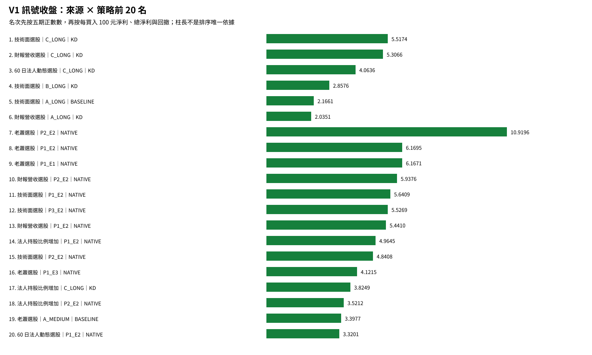

# V1 來源策略績效報告

本報告只看 **V1｜訊號收盤成交**。7 個選股來源 × 14 個策略，共 **98 組**；每組交易去除重複後只保留一套最終數字。chip_4 因缺少可比較資料，另列 HOLD，不計入 98 組分母。

每筆買進總成本上限 TWD 10,000、最多 999 股，買賣各計 20 bps。這裡不是 50 萬元帳戶回測。

排名先比較五期正數數，再比較每買入 100 元淨利、總淨利、回撤與交易數。2026 是截至 9/30 的 YTD。

年度欄是各年度選股名單分別回測，可能包含相同交易，因此不可相加；總計與風險欄已避免重複計算同一筆交易。

**最大回撤**是把完成交易依出場日排序後，計算『累計已實現交易損益曲線』從高點到後續低點的最大跌幅；它不是 50 萬元帳戶淨值回撤。

## 14 策略白話對照

|策略代碼|進場條件|出場條件|
|---|---|---|
|A_MEDIUM|基本進場條件|5/21 中期均線結構出場|
|A_LONG|基本進場條件|21/144 長期均線結構出場|
|B_MEDIUM|進場時距近期低點不超過 7%|5/21 中期均線結構出場|
|B_LONG|進場時距近期低點不超過 7%|21/144 長期均線結構出場|
|C_LONG|收盤高於 21 日均線至少 5%|21/144 長期均線結構出場|
|P1_E1|MA21 結構突破|固定結構防守；MACD 轉弱備援|
|P1_E2|MA21 結構突破|固定結構防守；費後達 2R 後 KD 死叉|
|P1_E3|MA21 結構突破|只升不降的道氏防線；MACD 轉弱備援|
|P2_E1|MACD(21,55,55) 綠翻紅|固定結構防守；MACD 轉弱備援|
|P2_E2|MACD(21,55,55) 綠翻紅|固定結構防守；費後達 2R 後 KD 死叉|
|P2_E3|MACD(21,55,55) 綠翻紅|只升不降的道氏防線；MACD 轉弱備援|
|P3_E1|KD(9,9,55) 二次回檔後突破 MA21|固定結構防守；MACD 轉弱備援|
|P3_E2|KD(9,9,55) 二次回檔後突破 MA21|固定結構防守；費後達 2R 後 KD 死叉|
|P3_E3|KD(9,9,55) 二次回檔後突破 MA21|只升不降的道氏防線；MACD 轉弱備援|

## 快速結論

- 綜合排名第一：`技術面選股｜C_LONG`；依五期正數數、每買入 100 元淨利、總淨利、回撤、交易數依序比較。
- 總淨利最高：`技術面選股｜A_LONG`，總淨利 819,378.93，每買入 100 元淨利 2.17。
- 總淨利最低：`投信認養股｜B_MEDIUM`，總淨利 -15,216.29，每買入 100 元淨利 -3.00。
- 五期全正：6 組。
- 觀察到的回撤最小且總淨利為正：`投信認養股｜C_LONG`，回撤 3,157.86，完成交易 21 筆，總淨利 12,168.91。

## 各來源最佳策略

|來源|最佳策略|總排名|五期正數|每買入100元淨利|總淨利|最大回撤|
|---|---|---:|---:|---:|---:|---:|
|財報營收選股|C_LONG|2|5|5.31|258,099.69|37,873.41|
|60 日法人動態選股|C_LONG|3|5|4.06|198,740.48|37,793.61|
|投信認養股|C_LONG|70|2|5.91|12,168.91|3,157.86|
|法人持股比例增加|P1_E2|14|4|4.96|152,812.50|68,793.81|
|技術面選股|C_LONG|1|5|5.52|314,196.23|32,085.86|
|老蕭選股|P2_E2|7|4|10.92|201,913.56|52,440.17|
|精選股票|A_LONG|31|4|2.07|238,635.63|66,437.03|

## 五期全正組

|排名|來源|策略|每買入100元淨利|總淨利|最大回撤|
|---:|---|---|---:|---:|---:|
|1|技術面選股|C_LONG|5.52|314,196.23|32,085.86|
|2|財報營收選股|C_LONG|5.31|258,099.69|37,873.41|
|3|60 日法人動態選股|C_LONG|4.06|198,740.48|37,793.61|
|4|技術面選股|B_LONG|2.86|514,599.16|83,703.17|
|5|技術面選股|A_LONG|2.17|819,378.93|157,992.04|
|6|財報營收選股|A_LONG|2.04|697,027.29|176,341.09|

## 98 組完整排行榜

|排名|來源|策略|方法|狀態|2022淨利|2023淨利|2024淨利|2025淨利|2026 YTD淨利|五期正數|完成交易|勝率|每買入100元淨利|總淨利|最大單筆獲利|最大單筆虧損|最大連輸|交易損益曲線最大回撤|Profit factor|平均獲利|平均虧損|
|---:|---|---|---|---|---:|---:|---:|---:|---:|---:|---:|---:|---:|---:|---:|---:|---:|---:|---:|---:|---:|
|1|技術面選股|C_LONG|KD|PASS|26,070.19|53,177.21|34,152.83|96,553.49|150,661.67|5|580|40.52%|5.52|314,196.23|32,428.96|-2,497.18|17|32,085.86|1.93|2,776.17|-980.30|
|2|財報營收選股|C_LONG|KD|PASS|20,686.86|32,789.32|34,130.40|128,040.44|116,079.68|5|497|40.44%|5.31|258,099.69|32,428.96|-2,552.22|23|37,873.41|1.85|2,786.95|-1,020.53|
|3|60 日法人動態選股|C_LONG|KD|PASS|41,046.11|28,888.86|32,404.95|109,949.56|2,641.53|5|499|41.68%|4.06|198,740.48|21,164.43|-2,552.22|10|37,793.61|1.69|2,341.89|-990.97|
|4|技術面選股|B_LONG|KD|PASS|18,009.52|117,015.45|49,141.68|195,118.08|203,519.44|5|1827|35.30%|2.86|514,599.16|32,428.96|-2,497.18|44|83,703.17|1.50|2,379.07|-862.86|
|5|技術面選股|A_LONG|BASELINE|PASS|16,541.45|475,819.71|114,841.21|194,327.72|141,495.27|5|3815|32.69%|2.17|819,378.93|41,407.22|-2,497.18|38|157,992.04|1.49|1,995.77|-650.06|
|6|財報營收選股|A_LONG|KD|PASS|7,832.80|323,844.77|6,616.42|249,222.97|294,236.18|5|3462|34.69%|2.04|697,027.29|32,428.96|-2,552.22|40|176,341.09|1.44|1,912.45|-707.58|
|7|老蕭選股|P2_E2|NATIVE|PASS|85,190.82|47,390.58|-14,281.01|87,751.85|7,286.71|4|206|49.03%|10.92|201,913.56|12,625.71|-2,597.13|19|52,440.17|2.07|3,874.72|-1,804.12|
|8|老蕭選股|P1_E2|NATIVE|PASS|38,162.97|31,500.96|-17,133.83|83,664.98|38,067.95|4|239|45.19%|6.17|144,433.91|9,921.62|-2,552.22|13|31,185.63|1.73|3,164.56|-1,506.40|
|9|老蕭選股|P1_E1|NATIVE|PASS|27,893.70|32,396.63|-13,011.88|106,962.36|35,007.56|4|257|39.69%|6.17|154,909.30|18,387.15|-2,246.03|12|27,214.53|1.97|3,082.15|-1,028.84|
|10|財報營收選股|P2_E2|NATIVE|PASS|87,090.46|147,233.61|-221,912.83|523,369.92|183,860.31|4|999|38.04%|5.94|544,807.37|102,526.09|-2,635.46|60|346,123.25|1.48|4,410.54|-1,827.46|
|11|技術面選股|P1_E2|NATIVE|PASS|80,486.45|72,691.17|-71,557.98|368,445.66|97,559.95|4|826|38.01%|5.64|460,966.81|46,592.76|-2,497.18|27|135,236.62|1.66|3,675.70|-1,353.91|
|12|技術面選股|P3_E2|NATIVE|PASS|17.56|34,104.76|-7,951.12|72,059.09|34,827.83|4|202|45.05%|5.53|110,812.01|11,842.52|-2,278.62|12|27,734.71|1.74|2,860.51|-1,346.79|
|13|財報營收選股|P1_E2|NATIVE|PASS|57,585.58|860.63|-83,176.17|393,260.38|82,548.28|4|705|37.87%|5.44|378,573.51|46,592.76|-2,587.11|22|128,000.33|1.63|3,678.09|-1,377.80|
|14|法人持股比例增加|P1_E2|NATIVE|PASS|29,664.60|32,388.09|-48,030.86|153,709.84|36,013.44|4|312|39.10%|4.96|152,812.50|32,668.30|-2,552.22|18|68,793.81|1.58|3,407.71|-1,383.83|
|15|技術面選股|P2_E2|NATIVE|PASS|132,109.54|321,767.65|-274,769.76|420,783.93|209,624.48|4|1282|38.30%|4.84|575,928.63|27,761.31|-2,679.70|55|451,836.06|1.40|4,076.99|-1,802.62|
|16|老蕭選股|P1_E3|NATIVE|PASS|27,491.23|28,305.41|-15,024.66|66,930.26|35,340.46|4|281|41.99%|4.12|113,155.38|18,387.15|-2,246.03|15|26,017.69|1.72|2,288.23|-962.31|
|17|法人持股比例增加|C_LONG|KD|PASS|26,142.80|10,074.11|9,476.68|52,926.93|-7,829.73|4|240|43.75%|3.82|90,323.49|21,164.43|-2,552.22|6|21,076.97|1.67|2,144.31|-998.74|
|18|法人持股比例增加|P2_E2|NATIVE|PASS|34,616.95|78,286.41|-123,531.78|163,606.32|67,257.61|4|487|37.17%|3.52|158,140.50|27,007.87|-2,679.70|64|197,786.17|1.28|3,951.21|-1,820.35|
|19|老蕭選股|A_MEDIUM|BASELINE|PASS|-5,013.09|85,837.08|18,329.70|1,879.39|116,437.32|4|648|32.87%|3.40|216,575.81|90,626.09|-2,195.57|17|52,420.05|1.68|2,509.21|-730.77|
|20|60 日法人動態選股|P1_E2|NATIVE|PASS|33,765.45|39,719.83|-77,440.77|269,988.91|49,182.32|4|748|35.96%|3.32|245,036.96|32,668.30|-2,552.22|27|142,164.70|1.37|3,345.17|-1,367.05|
|21|60 日法人動態選股|P2_E2|NATIVE|PASS|60,183.63|234,093.78|-251,444.25|322,630.82|92,234.67|4|1079|36.79%|3.09|311,075.92|27,007.87|-2,679.70|117|404,897.75|1.25|3,861.57|-1,791.74|
|22|老蕭選股|P3_E2|NATIVE|PASS|11,375.30|716.15|-9,115.43|13,364.62|7,269.11|4|55|38.18%|3.02|16,117.11|8,892.94|-2,278.62|6|12,476.93|1.33|3,079.32|-1,427.90|
|23|財報營收選股|B_LONG|KD|PASS|-4,660.02|102,195.83|16,678.34|259,812.89|266,088.33|4|1700|35.06%|2.99|499,427.63|32,428.96|-2,552.22|51|94,938.42|1.50|2,501.95|-898.31|
|24|老蕭選股|P3_E3|NATIVE|PASS|17,262.08|766.24|-12,350.27|11,421.17|6,184.29|4|62|30.65%|2.81|16,857.36|12,143.27|-2,230.10|7|16,181.88|1.46|2,798.20|-844.38|
|25|老蕭選股|P2_E1|NATIVE|PASS|18,290.64|18,796.37|-7,150.56|83,566.19|3,516.36|4|469|30.06%|2.50|104,098.33|18,021.86|-1,842.06|16|34,010.22|1.45|2,379.28|-705.43|
|26|技術面選股|P3_E1|NATIVE|PASS|-20,178.59|4,855.26|12,835.36|47,230.27|26,503.08|4|213|36.62%|2.31|48,799.63|20,900.50|-2,145.30|13|30,078.86|1.38|2,253.08|-940.30|
|27|老蕭選股|A_LONG|BASELINE|PASS|16,153.47|143,823.99|-37,486.50|104,300.17|16,094.27|4|1089|30.76%|2.23|236,734.56|34,301.13|-2,552.22|25|85,500.14|1.38|2,581.78|-833.10|
|28|法人持股比例增加|B_LONG|KD|PASS|15,929.29|59,946.03|29,924.99|127,331.38|-39,078.16|4|869|36.82%|2.21|189,887.92|23,348.02|-2,552.22|18|54,059.19|1.41|2,034.06|-839.73|
|29|60 日法人動態選股|B_LONG|KD|PASS|27,290.59|109,999.91|26,655.63|274,616.41|-30,045.28|4|1759|36.33%|2.15|372,529.34|23,348.02|-2,552.22|35|101,583.51|1.39|2,077.35|-852.59|
|30|技術面選股|B_MEDIUM|KD|PASS|-16,098.38|12,285.17|11,329.07|102,263.52|236,128.16|4|1711|33.96%|2.08|353,972.85|24,986.84|-2,174.66|30|51,198.07|1.40|2,131.09|-782.47|
|31|精選股票|A_LONG|BASELINE|PASS|43,170.65|188,872.12|23,381.86|32,514.75|-46,040.74|4|1159|33.30%|2.07|238,635.63|30,999.18|-2,294.73|41|66,437.03|1.48|1,901.30|-640.71|
|32|精選股票|B_LONG|KD|PASS|39,158.30|46,339.36|15,607.92|17,329.92|-13,182.59|4|544|35.29%|1.99|107,010.19|19,923.82|-2,046.82|21|37,607.29|1.36|2,108.28|-845.97|
|33|老蕭選股|B_MEDIUM|KD|PASS|-10,078.64|28,281.42|31,836.19|19,257.80|11,094.71|4|404|36.88%|1.91|76,119.77|15,882.02|-2,195.57|15|21,097.88|1.34|2,034.74|-890.42|
|34|法人持股比例增加|A_LONG|BASELINE|PASS|11,441.43|231,206.88|53,974.02|114,203.49|-69,649.38|4|1778|33.24%|1.89|332,775.35|30,999.18|-2,552.22|29|111,923.09|1.43|1,865.14|-648.29|
|35|60 日法人動態選股|A_LONG|BASELINE|PASS|42,686.50|429,905.14|28,313.91|230,410.99|-88,739.63|4|3751|32.36%|1.63|605,546.02|39,386.79|-2,552.22|50|236,592.70|1.37|1,849.96|-646.56|
|36|精選股票|A_MEDIUM|BASELINE|PASS|-36,203.56|123,775.88|6,839.72|82,498.12|13,136.71|4|2146|28.33%|0.88|187,672.35|44,891.30|-2,022.23|37|77,725.83|1.24|1,592.92|-507.69|
|37|法人持股比例增加|P3_E1|NATIVE|PASS|5,464.33|8,969.72|2,242.81|4,240.09|-1,834.17|4|80|36.25%|0.63|5,007.25|7,808.12|-2,036.96|10|16,654.37|1.12|1,670.13|-851.50|
|38|財報營收選股|P3_E2|NATIVE|PASS|15,802.93|-2,077.90|-25,721.72|80,811.89|22,640.07|3|180|40.00%|4.55|80,783.95|34,179.29|-2,587.11|19|52,136.27|1.53|3,238.23|-1,410.82|
|39|精選股票|C_LONG|KD|PASS|32,755.49|25,984.59|-6,739.44|-1,788.01|6,474.67|3|164|40.24%|3.62|58,501.78|19,923.82|-2,004.58|7|25,848.28|1.61|2,338.40|-977.88|
|40|精選股票|B_MEDIUM|BASELINE|PASS|-5,650.93|47,893.99|-3,684.97|70,056.05|57,984.60|3|530|35.47%|3.20|168,552.73|44,891.30|-2,174.66|21|35,382.34|1.61|2,355.76|-802.13|
|41|60 日法人動態選股|P3_E2|NATIVE|PASS|18,256.31|31,137.48|-12,272.43|36,702.67|-2,733.78|3|176|39.20%|3.13|54,624.47|11,842.52|-2,278.62|12|38,821.84|1.38|2,888.75|-1,352.33|
|42|財報營收選股|B_MEDIUM|BASELINE|PASS|-10,137.56|54,077.84|-17,374.73|104,744.64|237,285.77|3|1360|33.75%|2.51|339,803.83|44,891.30|-1,942.73|24|66,631.74|1.48|2,294.61|-791.81|
|43|技術面選股|P1_E1|NATIVE|PASS|30,511.92|-3,545.43|-32,793.19|222,854.41|94,919.52|3|902|32.71%|2.40|213,868.52|27,177.52|-2,442.17|20|72,310.23|1.37|2,670.32|-945.43|
|44|老蕭選股|P3_E1|NATIVE|PASS|12,050.71|-4,505.80|-13,218.72|16,823.50|6,184.29|3|61|26.23%|2.37|13,969.49|12,657.84|-2,230.10|8|18,297.26|1.36|3,297.56|-862.03|
|45|財報營收選股|P1_E1|NATIVE|PASS|21,525.53|-22,566.62|-68,999.74|229,954.12|68,490.19|3|764|32.46%|2.12|159,943.86|27,177.52|-2,587.11|19|124,977.99|1.32|2,638.97|-958.37|
|46|技術面選股|P1_E3|NATIVE|PASS|38,264.99|-5,229.30|-44,259.66|176,025.25|131,055.30|3|980|35.41%|2.09|202,651.06|27,177.52|-2,442.17|28|83,374.15|1.37|2,169.85|-869.33|
|47|財報營收選股|P1_E3|NATIVE|PASS|39,416.09|-15,881.53|-66,408.56|166,838.18|94,874.76|3|838|36.28%|1.88|154,929.52|27,177.52|-2,442.17|12|103,868.92|1.33|2,067.73|-887.00|
|48|法人持股比例增加|P3_E2|NATIVE|PASS|10,984.85|19,725.83|-3,208.25|380.68|-2,973.84|3|71|36.62%|1.77|12,461.56|11,842.52|-2,249.06|11|29,109.22|1.20|2,891.05|-1,393.46|
|49|老蕭選股|C_LONG|KD|PASS|-8,719.21|17,111.75|-18,539.15|31,907.58|32,645.16|3|280|37.14%|1.69|45,890.75|8,350.61|-2,552.22|16|39,470.71|1.25|2,226.49|-1,054.91|
|50|老蕭選股|B_LONG|BASELINE|PASS|-3,302.69|45,596.26|-20,855.47|83,308.39|8,320.40|3|784|30.36%|1.51|114,583.76|34,301.13|-2,552.22|25|62,124.23|1.22|2,638.68|-940.33|
|51|法人持股比例增加|P1_E3|NATIVE|PASS|30,837.00|-5,898.50|-28,325.11|48,782.02|41,326.83|3|394|35.53%|1.45|56,508.09|21,164.43|-2,442.17|13|48,212.81|1.27|1,897.19|-823.22|
|52|技術面選股|P3_E3|NATIVE|PASS|-15,834.69|4,489.62|-13,107.28|42,708.33|31,208.39|3|221|35.29%|1.44|31,528.90|11,360.47|-2,145.30|15|31,340.37|1.25|2,017.15|-879.78|
|53|60 日法人動態選股|B_MEDIUM|BASELINE|PASS|-13,705.67|30,156.34|-31,853.82|142,870.40|27,702.70|3|1136|31.25%|1.35|153,141.04|44,891.30|-2,174.66|19|82,777.07|1.25|2,164.78|-787.91|
|54|老蕭選股|P2_E3|NATIVE|PASS|14,252.68|13,923.36|-14,921.05|42,886.99|-7,866.68|3|483|30.02%|1.18|50,744.23|18,021.86|-1,724.96|17|32,038.69|1.23|1,869.15|-651.72|
|55|法人持股比例增加|P1_E1|NATIVE|PASS|29,842.76|-3,530.65|-30,951.79|55,646.58|24,100.98|3|359|33.15%|1.05|37,359.73|21,057.65|-2,442.17|13|49,829.23|1.17|2,115.41|-893.22|
|56|財報營收選股|P2_E1|NATIVE|PASS|-67,383.77|67,313.74|-129,230.96|311,763.21|163,719.72|3|2363|27.42%|0.76|165,780.83|53,464.20|-2,436.54|51|295,562.04|1.12|2,377.27|-801.57|
|57|財報營收選股|A_MEDIUM|BASELINE|PASS|-56,263.77|193,552.51|-100,160.41|27,137.97|317,071.16|3|4938|27.20%|0.74|362,650.34|90,626.09|-1,942.73|63|313,980.39|1.19|1,687.48|-529.52|
|58|技術面選股|P2_E1|NATIVE|PASS|-54,766.64|126,378.91|-102,490.27|340,590.28|129,504.65|3|2913|26.91%|0.71|192,738.81|53,464.20|-2,436.54|47|302,037.78|1.11|2,426.63|-803.07|
|59|財報營收選股|P2_E3|NATIVE|PASS|-50,761.54|61,122.59|-69,801.84|234,393.22|153,044.47|3|2530|30.00%|0.70|162,512.89|25,505.85|-2,436.54|35|190,711.46|1.13|1,841.81|-697.59|
|60|法人持股比例增加|B_MEDIUM|KD|PASS|-8,638.41|7,743.31|-3,795.14|11,657.11|32,260.93|3|545|32.66%|0.69|37,624.43|21,660.60|-2,174.66|19|53,110.10|1.13|1,830.50|-785.30|
|61|60 日法人動態選股|P3_E3|NATIVE|PASS|1,989.75|12,406.37|-11,092.27|24,066.35|-1,760.14|3|195|35.90%|0.65|12,588.08|7,808.12|-2,145.30|10|24,261.12|1.11|1,804.33|-909.72|
|62|60 日法人動態選股|P1_E3|NATIVE|PASS|17,708.94|-38,563.46|-28,975.36|109,095.70|47,416.01|3|909|33.66%|0.65|58,226.13|21,164.43|-2,442.17|14|82,740.79|1.11|1,874.60|-854.73|
|63|60 日法人動態選股|P1_E1|NATIVE|PASS|14,646.34|-33,895.30|-41,692.36|135,624.16|34,169.53|3|833|32.29%|0.60|49,459.30|21,057.65|-2,442.17|13|94,525.34|1.09|2,155.48|-940.36|
|64|技術面選股|A_MEDIUM|KD|PASS|-75,390.84|157,606.78|-21,653.53|37,398.22|305,957.74|3|7139|28.73%|0.57|406,103.93|90,626.09|-2,068.53|63|310,600.24|1.16|1,461.97|-509.51|
|65|技術面選股|P2_E3|NATIVE|PASS|-49,206.89|95,987.80|-46,836.72|203,772.89|128,337.69|3|3103|29.55%|0.43|122,157.80|25,505.85|-2,436.54|42|204,594.05|1.08|1,792.17|-695.91|
|66|法人持股比例增加|P3_E3|NATIVE|PASS|4,968.88|4,090.85|-3,040.77|5,446.81|-796.21|3|83|37.35%|0.27|2,260.28|7,808.12|-2,036.96|8|19,514.84|1.05|1,492.51|-846.30|
|67|60 日法人動態選股|P2_E3|NATIVE|PASS|-31,660.49|68,356.22|-43,807.35|144,224.84|28,631.59|3|2673|29.44%|0.11|26,221.91|24,775.40|-2,436.54|47|210,670.28|1.02|1,686.64|-689.91|
|68|法人持股比例增加|P2_E1|NATIVE|PASS|14,461.01|7,583.87|-44,844.57|50,344.93|-36,504.04|3|1164|26.63%|-0.11|-12,389.88|25,416.54|-2,339.07|49|114,057.14|0.98|2,069.19|-765.62|
|69|法人持股比例增加|P2_E3|NATIVE|PASS|-11,077.96|5,225.34|-33,985.29|47,564.22|974.45|3|1234|28.61%|-0.12|-13,643.40|19,033.33|-2,339.07|27|106,511.19|0.98|1,665.40|-682.78|
|70|投信認養股|C_LONG|KD|PASS|-1,570.23|14,229.58|-2,172.12|1,681.68|0.00|2|21|57.14%|5.91|12,168.91|6,508.94|-2,374.37|4|3,157.86|2.32|1,781.09|-1,022.69|
|71|投信認養股|P1_E2|NATIVE|PASS|8,978.34|831.00|-9,584.22|-463.85|-1,630.35|2|45|33.33%|1.56|6,966.91|9,545.05|-2,319.63|13|16,007.68|1.18|2,981.69|-1,258.62|
|72|投信認養股|A_LONG|BASELINE|PASS|-680.35|47,691.17|-3,441.14|-11,043.33|195.41|2|271|35.06%|1.18|31,645.58|11,166.49|-1,570.23|19|28,470.95|1.33|1,335.57|-541.10|
|73|財報營收選股|P3_E3|NATIVE|PASS|-4,894.89|-3,432.94|-22,939.82|30,969.86|22,124.67|2|192|35.94%|0.71|13,392.66|11,360.47|-2,230.10|13|40,528.36|1.12|1,816.10|-909.90|
|74|60 日法人動態選股|P3_E1|NATIVE|PASS|-176.43|10,839.75|-11,113.93|28,597.29|-1,933.63|2|189|37.57%|0.62|11,673.97|9,046.91|-2,145.30|9|18,162.87|1.10|1,755.34|-957.25|
|75|法人持股比例增加|A_MEDIUM|BASELINE|PASS|-25,162.24|131,626.35|-19,732.33|4,564.54|-9,636.47|2|2100|27.00%|0.33|69,594.02|29,402.27|-2,022.23|57|135,387.65|1.09|1,531.03|-520.87|
|76|60 日法人動態選股|A_MEDIUM|BASELINE|PASS|-63,994.61|176,984.88|-34,275.51|65,902.43|-61,338.51|2|5332|26.80%|0.14|74,279.87|44,891.30|-2,068.53|93|313,495.21|1.04|1,414.36|-498.81|
|77|60 日法人動態選股|P2_E1|NATIVE|PASS|-41,578.70|69,027.61|-86,658.81|218,159.27|-6,490.14|2|2510|27.01%|0.09|20,653.88|40,377.63|-2,436.54|60|282,293.39|1.01|2,165.25|-790.06|
|78|投信認養股|P2_E3|NATIVE|PASS|21,655.08|1,891.68|-11,772.79|-13,274.54|-5,860.93|2|196|29.59%|-0.35|-6,489.88|10,593.02|-2,215.80|17|25,598.47|0.93|1,465.60|-663.01|
|79|財報營收選股|P3_E1|NATIVE|PASS|-8,456.92|-2,527.17|-23,084.49|28,897.86|11,301.86|2|187|33.69%|-0.36|-6,696.14|11,360.47|-2,587.11|13|45,764.11|0.95|1,857.64|-997.80|
|80|投信認養股|A_MEDIUM|KD|PASS|3,784.57|11,746.97|-8,746.09|-13,149.74|-7,448.84|2|313|28.12%|-0.44|-13,813.12|11,254.10|-1,556.13|12|39,129.18|0.87|1,072.71|-480.94|
|81|投信認養股|P2_E2|NATIVE|PASS|15,901.35|7,540.67|-22,430.54|-12,641.23|-4,482.86|2|65|32.31%|-1.82|-11,023.87|6,770.65|-2,632.97|17|40,248.51|0.86|3,123.68|-1,741.39|
|82|投信認養股|B_LONG|BASELINE|PASS|-1,353.38|22,122.89|-2,295.46|-7,349.20|-1,379.41|1|87|31.03%|1.14|9,781.86|11,166.49|-1,570.23|10|13,728.32|1.23|1,920.89|-701.37|
|83|投信認養股|P1_E3|NATIVE|PASS|11,348.50|-4,605.29|-9,173.05|-4,869.73|0.00|1|56|32.14%|-0.25|-1,398.42|11,746.12|-1,953.06|17|15,559.27|0.95|1,539.14|-765.87|
|84|投信認養股|P2_E1|NATIVE|PASS|28,291.89|-1,292.73|-17,275.66|-20,969.53|-7,246.85|1|188|28.72%|-0.65|-11,496.54|10,593.02|-2,215.80|18|34,572.70|0.89|1,658.70|-754.23|
|85|投信認養股|P1_E1|NATIVE|PASS|11,861.07|-6,185.55|-10,194.82|-6,436.08|0.00|1|53|28.30%|-0.73|-3,815.19|13,126.85|-1,953.06|16|17,692.89|0.88|1,840.80|-827.03|
|86|投信認養股|P3_E3|NATIVE|PASS|-745.83|1,586.86|-2,097.84|-1,291.47|0.00|1|10|40.00%|-2.42|-2,406.19|1,195.60|-1,221.65|4|3,247.22|0.54|699.63|-867.45|
|87|投信認養股|B_MEDIUM|KD|PASS|2,041.54|-4,842.47|-6,208.69|-3,378.29|-2,828.38|1|51|21.57%|-3.00|-15,216.29|2,265.69|-1,556.13|9|20,881.04|0.49|1,322.60|-744.12|
|88|投信認養股|P3_E1|NATIVE|PASS|-745.83|538.85|-2,311.61|-1,505.24|0.00|1|9|33.33%|-4.09|-3,667.97|1,195.60|-1,221.65|4|4,117.74|0.32|583.50|-903.08|
|89|投信認養股|P3_E2|NATIVE|PASS|-2,114.58|-1,213.01|-4,045.99|-2,335.97|0.00|0|8|12.50%|-8.90|-7,087.85|1,149.31|-1,424.29|4|7,087.85|0.14|1,149.31|-1,176.74|
|HOLD|精選股票|P3_E2|NATIVE|HOLD_SOURCE_YEAR_COVERAGE|N/A|N/A|N/A|N/A|N/A|N/A|N/A|N/A|N/A|N/A|N/A|N/A|N/A|N/A|N/A|N/A|N/A|
|HOLD|精選股票|P1_E2|NATIVE|HOLD_SOURCE_YEAR_COVERAGE|N/A|N/A|N/A|N/A|N/A|N/A|N/A|N/A|N/A|N/A|N/A|N/A|N/A|N/A|N/A|N/A|N/A|
|HOLD|精選股票|P2_E2|NATIVE|HOLD_SOURCE_YEAR_COVERAGE|N/A|N/A|N/A|N/A|N/A|N/A|N/A|N/A|N/A|N/A|N/A|N/A|N/A|N/A|N/A|N/A|N/A|
|HOLD|精選股票|P2_E3|NATIVE|HOLD_SOURCE_YEAR_COVERAGE|N/A|N/A|N/A|N/A|N/A|N/A|N/A|N/A|N/A|N/A|N/A|N/A|N/A|N/A|N/A|N/A|N/A|
|HOLD|精選股票|P1_E3|NATIVE|HOLD_SOURCE_YEAR_COVERAGE|N/A|N/A|N/A|N/A|N/A|N/A|N/A|N/A|N/A|N/A|N/A|N/A|N/A|N/A|N/A|N/A|N/A|
|HOLD|精選股票|P3_E3|NATIVE|HOLD_SOURCE_YEAR_COVERAGE|N/A|N/A|N/A|N/A|N/A|N/A|N/A|N/A|N/A|N/A|N/A|N/A|N/A|N/A|N/A|N/A|N/A|
|HOLD|精選股票|P2_E1|NATIVE|HOLD_SOURCE_YEAR_COVERAGE|N/A|N/A|N/A|N/A|N/A|N/A|N/A|N/A|N/A|N/A|N/A|N/A|N/A|N/A|N/A|N/A|N/A|
|HOLD|精選股票|P1_E1|NATIVE|HOLD_SOURCE_YEAR_COVERAGE|N/A|N/A|N/A|N/A|N/A|N/A|N/A|N/A|N/A|N/A|N/A|N/A|N/A|N/A|N/A|N/A|N/A|
|HOLD|精選股票|P3_E1|NATIVE|HOLD_SOURCE_YEAR_COVERAGE|N/A|N/A|N/A|N/A|N/A|N/A|N/A|N/A|N/A|N/A|N/A|N/A|N/A|N/A|N/A|N/A|N/A|

## chip_4 HOLD

chip_4 沒有可比較資料，因此下列 14 個策略全部標示 HOLD，不補零，也不放進 98 組排名分母。

|來源|策略|狀態|
|---|---|---|
|第八來源 chip_4|A_MEDIUM|NO_COMPARABLE_DATA/HOLD|
|第八來源 chip_4|A_LONG|NO_COMPARABLE_DATA/HOLD|
|第八來源 chip_4|B_MEDIUM|NO_COMPARABLE_DATA/HOLD|
|第八來源 chip_4|B_LONG|NO_COMPARABLE_DATA/HOLD|
|第八來源 chip_4|C_LONG|NO_COMPARABLE_DATA/HOLD|
|第八來源 chip_4|P1_E1|NO_COMPARABLE_DATA/HOLD|
|第八來源 chip_4|P1_E2|NO_COMPARABLE_DATA/HOLD|
|第八來源 chip_4|P1_E3|NO_COMPARABLE_DATA/HOLD|
|第八來源 chip_4|P2_E1|NO_COMPARABLE_DATA/HOLD|
|第八來源 chip_4|P2_E2|NO_COMPARABLE_DATA/HOLD|
|第八來源 chip_4|P2_E3|NO_COMPARABLE_DATA/HOLD|
|第八來源 chip_4|P3_E1|NO_COMPARABLE_DATA/HOLD|
|第八來源 chip_4|P3_E2|NO_COMPARABLE_DATA/HOLD|
|第八來源 chip_4|P3_E3|NO_COMPARABLE_DATA/HOLD|

## 指標定義

- 最大單筆獲利／虧損：完成交易扣成本後淨利的最大值／最小值。
- 最大連輸：完成交易依出場日排序，連續淨利小於 0 的最長筆數。
- 勝率：淨利大於 0 的完成交易數 ÷ 完成交易總數。
- Profit factor：總獲利 ÷ 總虧損絕對值。沒有虧損時顯示 ∞。
- 平均獲利／平均虧損：獲利交易與虧損交易各自的平均扣成本後淨利。
- 五期全正：2022、2023、2024、2025、2026/09 YTD 每期已實現淨利都大於 0。
