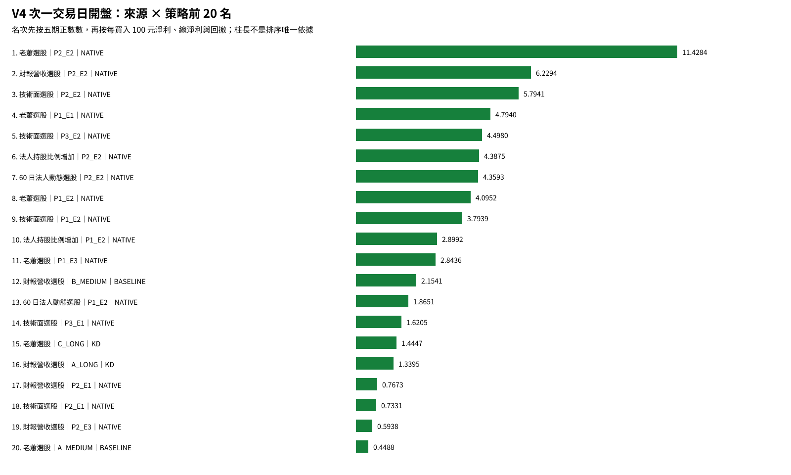

# V4 來源策略績效報告

本報告只看 **V4｜次一交易日開盤成交**。7 個選股來源 × 14 個策略，共 **98 組**；每組交易去除重複後只保留一套最終數字。chip_4 因缺少可比較資料，另列 HOLD，不計入 98 組分母。

每筆買進總成本上限 TWD 10,000、最多 999 股，買賣各計 20 bps。這裡不是 50 萬元帳戶回測。

排名先比較五期正數數，再比較每買入 100 元淨利、總淨利、回撤與交易數。2026 是截至 9/30 的 YTD。

年度欄是各年度選股名單分別回測，可能包含相同交易，因此不可相加；總計與風險欄已避免重複計算同一筆交易。

**最大回撤**是把完成交易依出場日排序後，計算『累計已實現交易損益曲線』從高點到後續低點的最大跌幅；它不是 50 萬元帳戶淨值回撤。

## 14 策略白話對照

|策略代碼|進場條件|出場條件|
|---|---|---|
|A_MEDIUM|基本進場條件|5/21 中期均線結構出場|
|A_LONG|基本進場條件|21/144 長期均線結構出場|
|B_MEDIUM|進場時距近期低點不超過 7%|5/21 中期均線結構出場|
|B_LONG|進場時距近期低點不超過 7%|21/144 長期均線結構出場|
|C_LONG|收盤高於 21 日均線至少 5%|21/144 長期均線結構出場|
|P1_E1|MA21 結構突破|固定結構防守；MACD 轉弱備援|
|P1_E2|MA21 結構突破|固定結構防守；費後達 2R 後 KD 死叉|
|P1_E3|MA21 結構突破|只升不降的道氏防線；MACD 轉弱備援|
|P2_E1|MACD(21,55,55) 綠翻紅|固定結構防守；MACD 轉弱備援|
|P2_E2|MACD(21,55,55) 綠翻紅|固定結構防守；費後達 2R 後 KD 死叉|
|P2_E3|MACD(21,55,55) 綠翻紅|只升不降的道氏防線；MACD 轉弱備援|
|P3_E1|KD(9,9,55) 二次回檔後突破 MA21|固定結構防守；MACD 轉弱備援|
|P3_E2|KD(9,9,55) 二次回檔後突破 MA21|固定結構防守；費後達 2R 後 KD 死叉|
|P3_E3|KD(9,9,55) 二次回檔後突破 MA21|只升不降的道氏防線；MACD 轉弱備援|

## 快速結論

- 綜合排名第一：`老蕭選股｜P2_E2`；依五期正數數、每買入 100 元淨利、總淨利、回撤、交易數依序比較。
- 總淨利最高：`技術面選股｜P2_E2`，總淨利 596,012.04，每買入 100 元淨利 5.79。
- 總淨利最低：`60 日法人動態選股｜A_MEDIUM`，總淨利 -388,029.50，每買入 100 元淨利 -0.74。
- 五期全正：0 組。
- 觀察到的回撤最小且總淨利為正：`投信認養股｜C_LONG`，回撤 2,328.33，完成交易 20 筆，總淨利 17,649.37。

## 各來源最佳策略

|來源|最佳策略|總排名|五期正數|每買入100元淨利|總淨利|最大回撤|
|---|---|---:|---:|---:|---:|---:|
|財報營收選股|P2_E2|2|4|6.23|479,696.41|352,429.08|
|60 日法人動態選股|P2_E2|7|4|4.36|377,891.08|405,553.58|
|投信認養股|C_LONG|24|3|9.13|17,649.37|2,328.33|
|法人持股比例增加|P2_E2|6|4|4.39|170,656.13|199,507.27|
|技術面選股|P2_E2|3|4|5.79|596,012.04|455,272.67|
|老蕭選股|P2_E2|1|4|11.43|194,555.35|60,095.11|
|精選股票|B_MEDIUM|57|2|5.92|103,577.69|31,404.99|

## 五期全正組

|排名|來源|策略|每買入100元淨利|總淨利|最大回撤|
|---:|---|---|---:|---:|---:|
|—|目前沒有|任何組合五期全正|—|—|—|

## 98 組完整排行榜

|排名|來源|策略|方法|狀態|2022淨利|2023淨利|2024淨利|2025淨利|2026 YTD淨利|五期正數|完成交易|勝率|每買入100元淨利|總淨利|最大單筆獲利|最大單筆虧損|最大連輸|交易損益曲線最大回撤|Profit factor|平均獲利|平均虧損|
|---:|---|---|---|---|---:|---:|---:|---:|---:|---:|---:|---:|---:|---:|---:|---:|---:|---:|---:|---:|---:|
|1|老蕭選股|P2_E2|NATIVE|PASS|93,919.98|49,719.48|-26,803.29|86,291.68|2,699.47|4|191|48.69%|11.43|194,555.35|13,011.44|-2,970.46|20|60,095.11|2.09|4,018.83|-1,828.53|
|2|財報營收選股|P2_E2|NATIVE|PASS|191,875.95|137,815.30|-229,223.93|374,736.48|149,706.87|4|848|40.09%|6.23|479,696.41|27,150.83|-3,300.16|91|352,429.08|1.51|4,203.87|-1,869.33|
|3|技術面選股|P2_E2|NATIVE|PASS|229,472.57|297,025.07|-279,606.17|376,917.95|161,510.55|4|1119|39.32%|5.79|596,012.04|27,150.83|-3,362.53|58|455,272.67|1.48|4,191.20|-1,838.17|
|4|老蕭選股|P1_E1|NATIVE|PASS|12,336.27|22,332.86|-15,194.70|95,688.85|28,829.90|4|238|39.50%|4.79|110,630.06|19,358.20|-3,142.93|12|28,494.18|1.69|2,875.29|-1,108.66|
|5|技術面選股|P3_E2|NATIVE|PASS|3,095.37|27,231.57|-9,448.80|45,742.97|30,654.47|4|185|41.62%|4.50|81,926.72|11,688.46|-2,599.42|10|27,952.03|1.55|2,986.95|-1,371.00|
|6|法人持股比例增加|P2_E2|NATIVE|PASS|76,998.68|83,648.24|-123,730.94|132,930.13|51,904.07|4|427|38.17%|4.39|170,656.13|27,150.83|-3,362.53|64|199,507.27|1.35|4,069.81|-1,866.37|
|7|60 日法人動態選股|P2_E2|NATIVE|PASS|162,500.54|241,459.47|-249,188.21|276,611.46|75,690.45|4|940|38.40%|4.36|377,891.08|27,150.83|-3,362.53|120|405,553.58|1.36|3,966.77|-1,820.58|
|8|老蕭選股|P1_E2|NATIVE|PASS|16,497.49|21,381.71|-20,327.52|67,824.99|27,164.67|4|212|42.92%|4.10|84,132.81|9,778.07|-3,142.93|14|38,896.26|1.43|3,068.83|-1,612.65|
|9|技術面選股|P1_E2|NATIVE|PASS|63,283.53|71,285.20|-104,907.56|243,158.01|44,512.28|4|739|35.59%|3.79|275,705.21|43,930.55|-3,415.52|32|157,501.50|1.41|3,625.57|-1,423.99|
|10|法人持股比例增加|P1_E2|NATIVE|PASS|33,063.23|17,904.89|-63,228.15|102,509.51|6,645.66|4|286|35.66%|2.90|81,448.99|29,674.71|-2,846.10|25|90,309.46|1.30|3,422.29|-1,454.48|
|11|老蕭選股|P1_E3|NATIVE|PASS|15,046.10|15,762.87|-15,941.39|60,663.61|25,194.47|4|264|40.53%|2.84|72,585.80|19,358.20|-3,142.93|15|27,326.83|1.45|2,171.23|-1,017.42|
|12|財報營收選股|B_MEDIUM|BASELINE|PASS|3,275.40|7,289.41|-25,036.52|103,519.95|159,080.74|4|1161|33.76%|2.15|248,128.98|48,737.00|-2,381.02|14|69,425.56|1.41|2,161.00|-778.91|
|13|60 日法人動態選股|P1_E2|NATIVE|PASS|35,145.79|23,810.49|-104,108.58|183,443.17|18,240.69|4|682|33.43%|1.87|124,616.28|29,674.71|-2,903.43|29|171,729.40|1.19|3,434.14|-1,450.15|
|14|技術面選股|P3_E1|NATIVE|PASS|-16,292.62|1,682.32|7,944.73|35,048.42|17,766.41|4|202|34.16%|1.62|32,200.45|20,083.78|-2,599.42|16|27,891.41|1.25|2,315.00|-958.91|
|15|老蕭選股|C_LONG|KD|PASS|2,820.16|5,538.09|-12,851.59|20,753.54|2,049.67|4|132|40.15%|1.44|18,309.87|6,566.91|-2,777.58|7|21,301.91|1.20|2,067.27|-1,155.13|
|16|財報營收選股|A_LONG|KD|PASS|102,492.80|43,104.69|-81,227.68|288,464.57|4,345.03|4|2696|33.94%|1.34|357,179.42|32,991.70|-2,777.58|38|139,611.80|1.29|1,749.20|-698.11|
|17|財報營收選股|P2_E1|NATIVE|PASS|15,705.73|44,075.78|-156,769.29|239,024.57|141,589.82|4|2119|27.84%|0.77|147,686.36|53,354.93|-2,858.75|74|304,228.19|1.12|2,349.09|-809.86|
|18|技術面選股|P2_E1|NATIVE|PASS|33,423.04|73,184.41|-128,945.80|284,557.61|109,064.62|4|2682|27.03%|0.73|180,393.24|53,354.93|-2,858.75|73|329,456.87|1.11|2,416.69|-803.12|
|19|財報營收選股|P2_E3|NATIVE|PASS|18,392.12|21,897.35|-89,303.95|168,033.24|121,352.94|4|2281|29.86%|0.59|122,500.18|25,531.53|-2,632.17|35|196,427.81|1.11|1,814.05|-695.54|
|20|老蕭選股|A_MEDIUM|BASELINE|PASS|-33,567.86|21,927.53|19,196.20|5,584.01|7,147.32|4|462|32.25%|0.45|20,287.20|12,526.10|-2,679.69|31|43,896.36|1.09|1,734.47|-760.86|
|21|技術面選股|P2_E3|NATIVE|PASS|22,628.44|27,120.69|-63,025.14|158,916.22|98,678.73|4|2871|29.36%|0.31|82,359.63|25,531.53|-2,632.17|30|222,578.14|1.06|1,766.05|-693.50|
|22|60 日法人動態選股|P2_E3|NATIVE|PASS|23,709.97|30,644.14|-66,337.41|96,381.31|1,987.98|4|2461|29.09%|-0.04|-8,579.00|24,750.11|-2,631.75|35|227,215.80|0.99|1,676.38|-692.76|
|23|法人持股比例增加|P3_E1|NATIVE|PASS|3,793.82|7,119.51|101.99|1,981.71|-3,425.62|4|76|31.58%|-0.16|-1,225.79|7,924.36|-1,872.51|9|17,947.63|0.97|1,870.95|-887.09|
|24|投信認養股|C_LONG|KD|PASS|12,845.43|5,404.00|-1,724.02|1,123.96|0.00|3|20|50.00%|9.13|17,649.37|8,998.18|-2,287.97|4|2,328.33|3.43|2,491.86|-726.92|
|25|財報營收選股|P1_E2|NATIVE|PASS|45,638.48|-12,270.38|-95,933.30|304,321.06|38,725.17|3|616|36.36%|4.20|253,406.06|43,930.55|-3,005.49|35|142,988.66|1.45|3,657.79|-1,443.72|
|26|財報營收選股|P3_E2|NATIVE|PASS|13,982.47|-5,667.17|-28,213.34|65,580.46|20,676.07|3|163|39.26%|3.89|62,029.58|28,684.22|-2,777.58|17|52,138.07|1.42|3,250.24|-1,474.61|
|27|法人持股比例增加|C_LONG|KD|PASS|28,219.90|1,350.09|-13,668.87|40,596.25|-10,208.86|3|166|39.76%|2.85|46,288.51|17,621.91|-2,569.78|11|26,336.93|1.47|2,191.67|-983.62|
|28|財報營收選股|B_LONG|KD|PASS|44,747.64|11,355.45|-41,847.60|276,534.40|-2,902.10|3|1050|36.38%|2.79|287,887.79|32,991.70|-2,777.58|23|65,225.65|1.48|2,329.97|-901.44|
|29|60 日法人動態選股|P3_E2|NATIVE|PASS|14,703.75|25,792.23|-18,985.68|32,593.03|-3,195.33|3|165|36.97%|2.33|37,772.22|11,688.46|-2,777.58|12|40,240.01|1.26|2,960.28|-1,373.13|
|30|技術面選股|B_LONG|KD|PASS|44,755.72|35,923.01|-11,217.96|178,597.26|-22,441.38|3|1063|35.09%|2.16|225,616.63|32,991.70|-2,845.21|27|74,047.21|1.38|2,210.87|-868.17|
|31|技術面選股|C_LONG|KD|PASS|8,863.70|12,882.12|-15,578.33|72,618.65|-18,894.88|3|310|35.81%|1.97|59,891.25|15,429.44|-2,630.64|18|28,473.52|1.30|2,335.65|-1,001.84|
|32|法人持股比例增加|P3_E2|NATIVE|PASS|12,021.06|17,729.38|-6,019.88|1,282.60|-2,466.94|3|66|34.85%|1.94|12,620.22|11,688.46|-2,110.50|11|28,493.96|1.21|3,133.04|-1,382.32|
|33|老蕭選股|P2_E1|NATIVE|PASS|9,491.21|10,289.20|-17,694.68|74,047.72|-157.63|3|443|28.89%|1.85|72,195.64|17,867.17|-2,325.95|28|38,280.27|1.32|2,306.62|-708.10|
|34|法人持股比例增加|B_LONG|KD|PASS|19,804.49|3,246.32|-23,367.79|121,605.20|-23,218.08|3|595|37.65%|1.67|98,070.14|25,144.47|-2,569.78|19|47,142.49|1.31|1,848.83|-851.94|
|35|60 日法人動態選股|B_LONG|KD|PASS|60,662.78|18,481.50|-67,445.93|228,606.49|-48,243.35|3|1278|35.13%|1.53|192,061.48|25,144.47|-2,777.58|28|114,192.05|1.27|2,021.05|-862.95|
|36|老蕭選股|P3_E3|NATIVE|PASS|15,708.85|-1,146.18|-13,080.09|5,967.27|5,306.39|3|60|30.00%|1.49|8,600.05|12,659.90|-2,142.02|8|19,517.79|1.22|2,666.18|-937.89|
|37|老蕭選股|B_LONG|BASELINE|PASS|17,392.40|-925.97|-23,493.41|53,674.25|40.18|3|347|31.70%|1.39|46,687.45|23,324.96|-2,977.54|14|54,265.37|1.20|2,551.09|-987.05|
|38|技術面選股|P1_E1|NATIVE|PASS|20,474.00|-17,892.03|-65,266.92|185,662.00|67,784.16|3|844|30.69%|1.35|112,344.04|27,287.30|-2,897.11|19|96,521.94|1.20|2,629.05|-971.93|
|39|技術面選股|B_MEDIUM|KD|PASS|7,026.05|-50,836.10|-21,799.59|94,024.66|166,779.91|3|1458|31.89%|1.35|195,194.93|26,051.70|-2,698.75|17|99,024.18|1.25|2,112.20|-792.53|
|40|財報營收選股|P1_E1|NATIVE|PASS|3,927.41|-31,090.31|-74,825.49|185,713.00|54,330.23|3|698|31.95%|1.15|78,466.74|28,851.29|-2,897.11|19|139,822.81|1.16|2,489.11|-1,003.38|
|41|技術面選股|P1_E3|NATIVE|PASS|23,736.96|-24,942.11|-63,584.42|129,122.78|90,768.31|3|921|32.57%|1.00|90,111.05|27,287.30|-2,897.11|23|97,085.72|1.16|2,161.55|-899.12|
|42|老蕭選股|P3_E1|NATIVE|PASS|11,229.45|-5,228.56|-13,945.30|10,154.15|5,306.39|3|59|28.81%|0.98|5,538.65|12,586.44|-2,344.64|12|21,553.24|1.13|2,810.57|-1,005.74|
|43|老蕭選股|P2_E3|NATIVE|PASS|7,306.89|5,605.80|-16,198.52|42,328.90|-9,873.73|3|459|27.67%|0.91|36,890.15|17,867.17|-2,325.95|15|32,966.80|1.17|1,980.66|-646.55|
|44|老蕭選股|A_LONG|BASELINE|PASS|28,800.64|16,309.42|-37,356.96|53,043.21|-5,314.88|3|656|30.79%|0.87|55,481.43|23,324.96|-2,977.54|16|74,537.90|1.15|2,129.03|-825.07|
|45|財報營收選股|P1_E3|NATIVE|PASS|20,709.86|-30,375.47|-76,110.94|115,228.04|71,245.81|3|773|33.64%|0.74|55,659.70|27,287.30|-2,897.11|16|128,829.17|1.12|2,032.50|-921.62|
|46|技術面選股|A_LONG|BASELINE|PASS|42,079.48|49,725.67|-79,948.21|192,410.98|-21,436.78|3|2731|29.37%|0.68|182,831.14|40,517.39|-2,845.21|30|183,244.04|1.15|1,763.67|-638.48|
|47|法人持股比例增加|P1_E3|NATIVE|PASS|30,259.65|-13,600.16|-28,452.36|29,502.57|19,677.82|3|376|32.98%|0.65|23,762.22|17,621.91|-2,378.07|12|48,638.98|1.11|1,927.30|-854.06|
|48|技術面選股|P3_E3|NATIVE|PASS|-13,444.69|2,159.57|-14,399.66|28,479.61|18,888.64|3|211|32.70%|0.51|10,592.41|11,050.05|-2,599.42|10|35,198.55|1.08|2,018.75|-906.35|
|49|法人持股比例增加|A_LONG|BASELINE|PASS|29,501.11|25,923.65|-59,824.76|106,368.37|-43,551.39|3|1334|31.11%|0.44|58,416.98|25,144.47|-2,569.78|21|120,772.66|1.10|1,619.05|-667.56|
|50|60 日法人動態選股|P2_E1|NATIVE|PASS|29,770.39|43,109.18|-115,956.18|163,596.93|-19,693.68|3|2302|26.76%|0.02|4,899.75|37,123.95|-2,858.75|67|310,732.23|1.00|2,170.31|-790.04|
|51|法人持股比例增加|P1_E1|NATIVE|PASS|27,638.19|-10,323.81|-34,084.90|28,221.46|10,030.47|3|342|30.41%|-0.09|-3,103.76|20,743.43|-2,846.10|13|53,560.63|0.99|2,076.54|-920.44|
|52|老蕭選股|P3_E2|NATIVE|PASS|9,250.15|-914.70|-11,996.91|2,102.99|5,703.60|3|50|34.00%|-0.13|-606.95|8,321.56|-2,777.58|6|18,410.01|0.99|2,990.59|-1,559.00|
|53|財報營收選股|A_MEDIUM|BASELINE|PASS|-135,404.05|26,281.03|-123,814.75|118.37|152,210.97|3|4908|27.04%|-0.17|-80,608.43|48,737.00|-2,230.93|63|406,189.68|0.96|1,363.93|-527.94|
|54|60 日法人動態選股|P1_E3|NATIVE|PASS|17,049.28|-60,696.77|-41,039.12|61,156.92|21,098.02|3|864|30.56%|-0.31|-26,366.20|17,621.91|-2,897.11|18|121,968.56|0.95|1,930.35|-893.30|
|55|法人持股比例增加|P3_E3|NATIVE|PASS|3,232.40|3,901.58|-3,009.77|3,034.00|-3,063.05|3|80|35.00%|-0.36|-2,865.35|7,924.36|-2,060.35|9|20,238.04|0.94|1,566.77|-898.75|
|56|60 日法人動態選股|P1_E1|NATIVE|PASS|19,660.67|-51,024.02|-58,370.71|83,710.91|17,042.95|3|790|29.75%|-0.39|-29,988.02|20,743.43|-2,897.11|19|131,042.51|0.94|2,175.95|-975.38|
|57|精選股票|B_MEDIUM|BASELINE|PASS|0.00|0.00|0.00|73,528.91|30,048.78|2|176|33.52%|5.92|103,577.69|48,737.00|-2,572.82|16|31,404.99|2.05|3,428.79|-843.77|
|58|財報營收選股|C_LONG|KD|PASS|42,429.62|-4,623.24|-29,005.25|126,328.56|-21,184.53|2|310|37.42%|3.78|113,945.17|31,772.28|-2,777.58|17|38,053.67|1.58|2,686.48|-1,019.00|
|59|老蕭選股|B_MEDIUM|KD|PASS|-5,219.75|-653.82|52,883.17|20,910.69|-3,716.75|2|242|39.26%|2.72|64,203.54|15,288.83|-2,679.69|9|15,595.15|1.49|2,066.71|-898.87|
|60|投信認養股|B_LONG|BASELINE|PASS|5,685.98|18,714.57|-936.90|-6,351.09|0.00|2|66|28.79%|2.64|17,112.56|11,213.23|-1,540.07|11|11,738.54|1.55|2,551.29|-667.28|
|61|投信認養股|P2_E2|NATIVE|PASS|34,600.78|16,547.21|-19,161.88|-13,226.09|-4,010.89|2|59|40.68%|2.08|11,351.76|6,885.46|-3,050.20|15|36,166.16|1.18|3,092.02|-1,795.91|
|62|60 日法人動態選股|C_LONG|KD|PASS|44,838.09|-2,133.26|-32,467.02|63,216.59|-12,137.71|2|364|36.81%|1.73|61,316.68|17,621.91|-2,777.58|18|52,418.36|1.26|2,199.02|-1,014.57|
|63|投信認養股|A_LONG|BASELINE|PASS|18,060.46|18,020.47|-9,412.21|-8,519.58|-1,219.52|2|216|31.02%|0.79|16,929.62|11,213.23|-2,112.72|21|25,569.74|1.20|1,538.85|-578.34|
|64|60 日法人動態選股|A_LONG|BASELINE|PASS|111,275.37|-14,435.67|-143,584.21|177,512.54|-67,747.31|2|3089|29.10%|0.21|63,020.72|37,186.29|-2,655.26|37|272,467.37|1.04|1,638.89|-643.99|
|65|60 日法人動態選股|B_MEDIUM|BASELINE|PASS|-13,116.60|-49,322.03|-63,654.94|135,097.79|9,598.74|2|992|29.23%|0.19|18,602.97|48,737.00|-2,698.75|26|160,228.86|1.03|2,054.87|-822.38|
|66|60 日法人動態選股|P3_E3|NATIVE|PASS|-829.20|9,088.93|-14,768.25|19,152.71|-5,111.79|2|189|32.80%|-0.15|-2,852.97|7,924.36|-2,599.42|12|26,692.02|0.98|1,880.75|-940.63|
|67|60 日法人動態選股|P3_E1|NATIVE|PASS|-1,831.44|7,154.20|-15,066.24|21,209.25|-5,013.94|2|183|34.43%|-0.20|-3,638.70|8,620.70|-2,599.42|8|19,670.42|0.97|1,802.47|-976.62|
|68|法人持股比例增加|P2_E3|NATIVE|PASS|16,791.37|-5,507.34|-45,614.45|21,999.84|-7,849.86|2|1146|28.45%|-0.26|-26,726.51|18,225.82|-2,631.75|27|112,106.90|0.95|1,636.77|-683.31|
|69|法人持股比例增加|P2_E1|NATIVE|PASS|41,724.70|-2,175.45|-61,037.35|20,660.34|-43,611.61|2|1074|26.91%|-0.34|-32,947.45|25,630.22|-2,631.75|36|131,891.96|0.95|1,978.77|-770.46|
|70|財報營收選股|P3_E3|NATIVE|PASS|-4,048.40|-7,780.68|-26,019.61|18,284.90|13,024.20|2|181|34.25%|-0.39|-6,934.17|11,050.05|-2,322.15|16|48,497.14|0.94|1,751.67|-970.91|
|71|法人持股比例增加|B_MEDIUM|KD|PASS|-7,347.00|-10,795.65|-24,544.34|4,837.57|8,631.61|2|479|30.90%|-0.62|-29,217.80|22,139.61|-2,698.75|16|65,536.45|0.90|1,684.72|-841.56|
|72|財報營收選股|P3_E1|NATIVE|PASS|-6,476.97|-6,547.33|-24,932.06|19,899.35|5,136.98|2|176|34.09%|-1.13|-19,459.94|11,050.05|-2,390.89|11|49,284.24|0.84|1,744.02|-1,069.84|
|73|精選股票|A_MEDIUM|BASELINE|PASS|0.00|0.00|0.00|69,738.98|-17,026.94|1|495|26.46%|1.07|52,712.04|48,737.00|-2,572.82|22|52,899.90|1.25|2,037.27|-588.38|
|74|精選股票|A_LONG|BASELINE|PASS|0.00|0.00|0.00|18,866.81|-16,428.98|1|125|27.20%|0.20|2,437.83|14,793.22|-2,630.64|12|20,872.35|1.04|1,876.95|-674.49|
|75|技術面選股|A_MEDIUM|KD|PASS|-130,155.87|-44,895.07|-96,433.72|-428.60|150,936.89|1|7014|27.67%|-0.17|-120,976.36|31,606.95|-2,698.75|57|448,646.41|0.95|1,268.04|-509.02|
|76|投信認養股|P2_E3|NATIVE|PASS|27,003.43|-157.62|-16,245.16|-12,950.24|-6,294.11|1|175|29.71%|-0.27|-4,410.29|10,462.19|-2,152.14|12|30,574.44|0.94|1,439.32|-644.35|
|77|投信認養股|P2_E1|NATIVE|PASS|35,074.88|-2,390.76|-21,484.14|-19,349.96|-7,985.51|1|168|29.76%|-0.42|-6,541.61|10,462.19|-2,152.14|9|38,577.99|0.93|1,636.64|-748.93|
|78|精選股票|B_LONG|KD|PASS|0.00|0.00|0.00|14,327.00|-18,265.77|1|69|31.88%|-0.58|-3,938.77|9,303.68|-2,630.64|7|21,804.64|0.92|1,945.36|-994.40|
|79|投信認養股|P1_E2|NATIVE|PASS|12,469.35|-3,038.66|-12,635.28|-10,286.28|-2,496.02|1|42|28.57%|-0.61|-2,528.45|8,998.18|-2,897.11|10|24,222.62|0.94|3,371.07|-1,432.71|
|80|60 日法人動態選股|A_MEDIUM|BASELINE|PASS|-150,886.07|-28,432.03|-142,259.37|10,814.44|-77,266.47|1|5295|25.34%|-0.74|-388,029.50|48,737.00|-2,698.75|123|501,400.60|0.81|1,202.92|-506.54|
|81|投信認養股|B_MEDIUM|KD|PASS|8,415.32|-2,225.53|-2,802.48|-3,715.24|-2,712.68|1|40|27.50%|-0.77|-3,040.61|7,148.65|-1,447.03|8|14,238.25|0.86|1,698.30|-749.03|
|82|投信認養股|P1_E3|NATIVE|PASS|10,809.60|-6,428.61|-10,851.13|-7,010.62|0.00|1|52|32.69%|-0.88|-4,537.23|11,213.23|-2,897.11|16|18,013.04|0.85|1,477.02|-847.04|
|83|投信認養股|P1_E1|NATIVE|PASS|13,531.74|-6,299.21|-11,750.91|-8,740.34|0.00|1|48|29.17%|-0.89|-4,229.92|12,882.87|-2,897.11|15|19,553.92|0.86|1,894.24|-904.39|
|84|法人持股比例增加|A_MEDIUM|BASELINE|PASS|-58,853.28|24,178.30|-82,390.52|-45,285.42|-37,289.41|1|1997|25.69%|-1.00|-199,640.32|22,139.61|-2,698.75|59|203,181.92|0.75|1,185.76|-544.43|
|85|投信認養股|A_MEDIUM|KD|PASS|-811.70|997.18|-15,667.83|-13,602.02|-7,545.75|1|342|24.56%|-1.08|-36,630.12|8,935.50|-1,758.50|14|47,030.84|0.69|993.40|-465.41|
|86|精選股票|C_LONG|KD|PASS|0.00|0.00|0.00|-3,382.16|110.31|1|19|36.84%|-1.75|-3,271.85|4,538.09|-2,630.64|7|6,095.02|0.76|1,493.52|-1,143.87|
|87|投信認養股|P3_E3|NATIVE|PASS|0.00|792.41|-1,906.46|-1,397.22|0.00|1|7|28.57%|-2.70|-1,874.51|1,126.58|-1,269.70|4|3,001.09|0.50|950.26|-755.01|
|88|投信認養股|P3_E1|NATIVE|PASS|0.00|18.47|-2,167.53|-1,658.29|0.00|1|6|16.67%|-4.89|-2,909.53|1,126.58|-1,269.70|5|4,036.11|0.28|1,126.58|-807.22|
|89|投信認養股|P3_E2|NATIVE|PASS|0.00|-1,142.55|-4,306.48|-2,381.04|0.00|0|6|16.67%|-8.30|-4,959.00|1,349.78|-1,548.41|4|5,364.87|0.21|1,349.78|-1,261.76|
|HOLD|精選股票|P3_E2|NATIVE|HOLD_SOURCE_YEAR_COVERAGE|N/A|N/A|N/A|N/A|N/A|N/A|N/A|N/A|N/A|N/A|N/A|N/A|N/A|N/A|N/A|N/A|N/A|
|HOLD|精選股票|P1_E2|NATIVE|HOLD_SOURCE_YEAR_COVERAGE|N/A|N/A|N/A|N/A|N/A|N/A|N/A|N/A|N/A|N/A|N/A|N/A|N/A|N/A|N/A|N/A|N/A|
|HOLD|精選股票|P2_E2|NATIVE|HOLD_SOURCE_YEAR_COVERAGE|N/A|N/A|N/A|N/A|N/A|N/A|N/A|N/A|N/A|N/A|N/A|N/A|N/A|N/A|N/A|N/A|N/A|
|HOLD|精選股票|P3_E3|NATIVE|HOLD_SOURCE_YEAR_COVERAGE|N/A|N/A|N/A|N/A|N/A|N/A|N/A|N/A|N/A|N/A|N/A|N/A|N/A|N/A|N/A|N/A|N/A|
|HOLD|精選股票|P1_E3|NATIVE|HOLD_SOURCE_YEAR_COVERAGE|N/A|N/A|N/A|N/A|N/A|N/A|N/A|N/A|N/A|N/A|N/A|N/A|N/A|N/A|N/A|N/A|N/A|
|HOLD|精選股票|P1_E1|NATIVE|HOLD_SOURCE_YEAR_COVERAGE|N/A|N/A|N/A|N/A|N/A|N/A|N/A|N/A|N/A|N/A|N/A|N/A|N/A|N/A|N/A|N/A|N/A|
|HOLD|精選股票|P3_E1|NATIVE|HOLD_SOURCE_YEAR_COVERAGE|N/A|N/A|N/A|N/A|N/A|N/A|N/A|N/A|N/A|N/A|N/A|N/A|N/A|N/A|N/A|N/A|N/A|
|HOLD|精選股票|P2_E3|NATIVE|HOLD_SOURCE_YEAR_COVERAGE|N/A|N/A|N/A|N/A|N/A|N/A|N/A|N/A|N/A|N/A|N/A|N/A|N/A|N/A|N/A|N/A|N/A|
|HOLD|精選股票|P2_E1|NATIVE|HOLD_SOURCE_YEAR_COVERAGE|N/A|N/A|N/A|N/A|N/A|N/A|N/A|N/A|N/A|N/A|N/A|N/A|N/A|N/A|N/A|N/A|N/A|

## chip_4 HOLD

chip_4 沒有可比較資料，因此下列 14 個策略全部標示 HOLD，不補零，也不放進 98 組排名分母。

|來源|策略|狀態|
|---|---|---|
|第八來源 chip_4|A_MEDIUM|NO_COMPARABLE_DATA/HOLD|
|第八來源 chip_4|A_LONG|NO_COMPARABLE_DATA/HOLD|
|第八來源 chip_4|B_MEDIUM|NO_COMPARABLE_DATA/HOLD|
|第八來源 chip_4|B_LONG|NO_COMPARABLE_DATA/HOLD|
|第八來源 chip_4|C_LONG|NO_COMPARABLE_DATA/HOLD|
|第八來源 chip_4|P1_E1|NO_COMPARABLE_DATA/HOLD|
|第八來源 chip_4|P1_E2|NO_COMPARABLE_DATA/HOLD|
|第八來源 chip_4|P1_E3|NO_COMPARABLE_DATA/HOLD|
|第八來源 chip_4|P2_E1|NO_COMPARABLE_DATA/HOLD|
|第八來源 chip_4|P2_E2|NO_COMPARABLE_DATA/HOLD|
|第八來源 chip_4|P2_E3|NO_COMPARABLE_DATA/HOLD|
|第八來源 chip_4|P3_E1|NO_COMPARABLE_DATA/HOLD|
|第八來源 chip_4|P3_E2|NO_COMPARABLE_DATA/HOLD|
|第八來源 chip_4|P3_E3|NO_COMPARABLE_DATA/HOLD|

## 指標定義

- 最大單筆獲利／虧損：完成交易扣成本後淨利的最大值／最小值。
- 最大連輸：完成交易依出場日排序，連續淨利小於 0 的最長筆數。
- 勝率：淨利大於 0 的完成交易數 ÷ 完成交易總數。
- Profit factor：總獲利 ÷ 總虧損絕對值。沒有虧損時顯示 ∞。
- 平均獲利／平均虧損：獲利交易與虧損交易各自的平均扣成本後淨利。
- 五期全正：2022、2023、2024、2025、2026/09 YTD 每期已實現淨利都大於 0。
